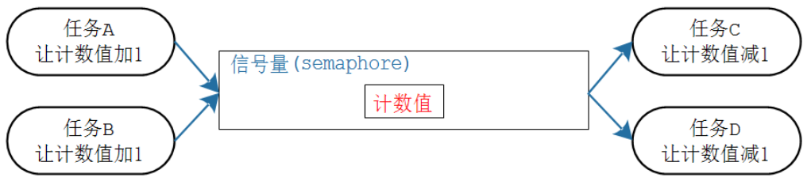

# 第12章 信号量(semaphore)

前面介绍的队列(queue)可以用于传输数据：在任务之间、任务和中断之间。

消息队列用于传输多个数据，但是有时候我们只需要传递状态，这个状态值需要用一个数值表示，比如：

- 卖家：做好了1个包子！做好了2个包子！做好了3个包子！
- 买家：买了1个包子，包子数量减1
- 这个停车位我占了，停车位减1
- 我开车走了，停车位加1

在这种情况下我们只需要维护一个数值，使用信号量效率更高、更节省内存

本章涉及如下内容：

- 怎么创建、删除信号量
- 怎么发送、获得信号量
- 什么是计数型信号量？什么是二进制信号量？

## 12.1 信号量的特性

### 12.1.1 信号量的常规操作

信号量这个名字很恰当：

- 信号：起通知作用
- 量：还可以用来表示资源的数量
  - 当"量"没有限制时，它就是"计数型信号量"(Counting Semaphores)
  - 当"量"只有0、1两个取值时，它就是"二进制信号量"(Binary Semaphores)
- 支持的动作："give"给出资源，计数值加1；"take"获得资源，计数值减1

计数型信号量的典型场景是：

- 计数：事件产生时"give"信号量，让计数值加1；处理事件时要先"take"信号量，就是获得信号量，让计数值减1。
- 资源管理：要想访问资源需要先"take"信号量，让计数值减1；用完资源后"give"信号量，让计数值加1。

信号量的"give"、"take"双方并不需要相同，可以用于生产者-消费者场合：

- 生产者为任务A、B，消费者为任务C、D
- 一开始信号量的计数值为0，如果任务C、D想获得信号量，会有两种结果：
  - 阻塞：买不到东西咱就等等吧，可以定个闹钟(超时时间)
  - 即刻返回失败：不等
- 任务A、B可以生产资源，就是让信号量的计数值增加1，并且把等待这个资源的顾客唤醒
- 唤醒谁？谁优先级高就唤醒谁，如果大家优先级一样就唤醒等待时间最长的人

二进制信号量跟计数型的唯一差别，就是计数值的最大值被限定为1。



### 12.1.2 信号量跟队列的对比

差异列表如下：

| **队列** | **信号量** |
| --- | --- |
| 可以容纳多个数据，<br/>创建队列时有2部分内存: 队列结构体、存储数据的空间 | 只有计数值，无法容纳其他数据。<br/>创建信号量时，只需要分配信号量结构体 |
| 生产者：没有空间存入数据时可以阻塞 | 生产者：用于不阻塞，计数值已经达到最大时返回失败 |
| 消费者：没有数据时可以阻塞 | 消费者：没有资源时可以阻塞 |

### 12.1.3 两种信号量的对比

信号量的计数值都有限制：限定了最大值。如果最大值被限定为1，那么它就是二进制信号量；如果最大值不是1，它就是计数型信号量。

差别列表如下：

| **二进制信号量** | **技术型信号量** |
| --- | --- |
| 被创建时初始值为0 | 被创建时初始值可以设定 |
| 其他操作是一样的 | 其他操作是一样的 |

## 12.2 信号量函数

使用信号量时，先创建、然后去添加资源、获得资源。使用句柄来表示一个信号量。

### 12.2.1 创建

使用信号量之前，要先创建，得到一个句柄；使用信号量时，要使用句柄来表明使用哪个信号量。

对于二进制信号量、计数型信号量，它们的创建函数不一样：

|  | **二进制信号量** | **计数型信号量** |
| --- | --- | --- |
| 动态创建 | xSemaphoreCreateBinary<br/>计数值初始值为0 | xSemaphoreCreateCounting |
|  | vSemaphoreCreateBinary(过时了)<br/>计数值初始值为1 |  |
| 静态创建 | xSemaphoreCreateBinaryStatic | xSemaphoreCreateCountingStatic |

创建二进制信号量的函数原型如下：

```c
/* 创建一个二进制信号量，返回它的句柄。
 * 此函数内部会分配信号量结构体
 * 返回值: 返回句柄，非NULL表示成功
 */
SemaphoreHandle_t xSemaphoreCreateBinary( void );

/* 创建一个二进制信号量，返回它的句柄。
 * 此函数无需动态分配内存，所以需要先有一个StaticSemaphore_t结构体，并传入它的指针
 * 返回值: 返回句柄，非NULL表示成功
 */
SemaphoreHandle_t xSemaphoreCreateBinaryStatic( StaticSemaphore_t *pxSemaphoreBuffer );
```

创建计数型信号量的函数原型如下：

```c
/* 创建一个计数型信号量，返回它的句柄。
 * 此函数内部会分配信号量结构体
 * uxMaxCount: 最大计数值
 * uxInitialCount: 初始计数值
 * 返回值: 返回句柄，非NULL表示成功
 */
SemaphoreHandle_t xSemaphoreCreateCounting(UBaseType_t uxMaxCount, UBaseType_t uxInitialCount);

/* 创建一个计数型信号量，返回它的句柄。
 * 此函数无需动态分配内存，所以需要先有一个StaticSemaphore_t结构体，并传入它的指针
 * uxMaxCount: 最大计数值
 * uxInitialCount: 初始计数值
 * pxSemaphoreBuffer: StaticSemaphore_t结构体指针
 * 返回值: 返回句柄，非NULL表示成功
 */
SemaphoreHandle_t xSemaphoreCreateCountingStatic( UBaseType_t uxMaxCount,
                                                 UBaseType_t uxInitialCount,
                                                 StaticSemaphore_t *pxSemaphoreBuffer );
```

### 12.2.2 删除

对于动态创建的信号量，不再需要它们时，可以删除它们以回收内存。

vSemaphoreDelete可以用来删除二进制信号量、计数型信号量，函数原型如下：

```c
/*
 * xSemaphore: 信号量句柄，你要删除哪个信号量
 */
void vSemaphoreDelete( SemaphoreHandle_t xSemaphore );
```

### 12.2.3 give/take

二进制信号量、计数型信号量的give、take操作函数是一样的。这些函数也分为2个版本：给任务使用，给ISR使用。列表如下：

|  | **在任务中使用** | **在ISR中使用** |
| --- | --- | --- |
| give | xSemaphoreGive | xSemaphoreGiveFromISR |
| take | xSemaphoreTake | xSemaphoreTakeFromISR |

xSemaphoreGive的函数原型如下：

```c
BaseType_t xSemaphoreGive( SemaphoreHandle_t xSemaphore );
```

xSemaphoreGive函数的参数与返回值列表如下：

| **参数** | **说明** |
| --- | --- |
| xSemaphore | 信号量句柄，释放哪个信号量 |
| 返回值 | pdTRUE表示成功,<br/>如果二进制信号量的计数值已经是1，再次调用此函数则返回失败；<br/>如果计数型信号量的计数值已经是最大值，再次调用此函数则返回失败 |

pxHigherPriorityTaskWoken的函数原型如下：

```c
BaseType_t xSemaphoreGiveFromISR(
                        SemaphoreHandle_t xSemaphore,
                        BaseType_t *pxHigherPriorityTaskWoken
                    );
```

xSemaphoreGiveFromISR函数的参数与返回值列表如下：

| **参数** | **说明** |
| --- | --- |
| xSemaphore | 信号量句柄，释放哪个信号量 |
| pxHigherPriorityTaskWoken | 如果释放信号量导致更高优先级的任务变为了就绪态，<br/>则*pxHigherPriorityTaskWoken = pdTRUE |
| 返回值 | pdTRUE表示成功,<br/>如果二进制信号量的计数值已经是1，再次调用此函数则返回失败；<br/>如果计数型信号量的计数值已经是最大值，再次调用此函数则返回失败 |

xSemaphoreTake的函数原型如下：

```c
BaseType_t xSemaphoreTake(
                   SemaphoreHandle_t xSemaphore,
                   TickType_t xTicksToWait
               );
```

xSemaphoreTake函数的参数与返回值列表如下：

| **参数** | **说明** |
| --- | --- |
| xSemaphore | 信号量句柄，获取哪个信号量 |
| xTicksToWait | 如果无法马上获得信号量，阻塞一会：<br/>0：不阻塞，马上返回<br/>portMAX_DELAY: 一直阻塞直到成功<br/>其他值: 阻塞的Tick个数，可以使用pdMS_TO_TICKS()来指定阻塞时间为若干ms |
| 返回值 | pdTRUE表示成功 |

xSemaphoreTakeFromISR的函数原型如下：

```c
BaseType_t xSemaphoreTakeFromISR(
                        SemaphoreHandle_t xSemaphore,
                        BaseType_t *pxHigherPriorityTaskWoken
                    );
```

xSemaphoreTakeFromISR函数的参数与返回值列表如下：

| 参数 | 说明 |
| --- | --- |
| xSemaphore | 信号量句柄，获取哪个信号量 |
| pxHigherPriorityTaskWoken | 如果获取信号量导致更高优先级的任务变为了就绪态，<br/>则*pxHigherPriorityTaskWoken = pdTRUE |
| 返回值 | pdTRUE表示成功 |

## 12.3 示例: 使用计数型信号量

本节代码为：19_semaphore_count，主看nwatch\game2.c。

3俩小车要进城，但是通行证只有2张，进城后就可以交还同行证，其他车辆就可以得到通行证。这个场景使用计数型信号量。

一开始，创建了一个信号量，它的最大值为3，初始值为2，代码如下（第151行）：

```c
void car_game(void)
{
    int x;
    int i, j;
    g_framebuffer = LCD_GetFrameBuffer(&g_xres, &g_yres, &g_bpp);
    draw_init();
    draw_end();

    g_xSemTicks = xSemaphoreCreateCounting(3, 2);
```

汽车任务代码如下：

```c
91 static void CarTask(void *params)
92 {
93    struct car *pcar = params;
94    struct ir_data idata;
95
96    /* 创建自己的队列 */
97    QueueHandle_t xQueueIR = xQueueCreate(10, sizeof(struct ir_data));
98
99    /* 注册队列 */
100    RegisterQueueHandle(xQueueIR);
101
102    /* 显示汽车 */
407    ShowCar(pcar);
104
105    /* 获得信号量 */
106    xSemaphoreTake(g_xSemTicks, portMAX_DELAY);
107
108    while (1)
109    {
110        /* 读取按键值:读队列 */
111        //xQueueReceive(xQueueIR, &idata, portMAX_DELAY);
112
113        /* 控制汽车往右移动 */
114        //if (idata.val == pcar->control_key)
115        {
116            if (pcar->x < g_xres - CAR_LENGTH)
117            {
118                /* 隐藏汽车 */
119                HideCar(pcar);
120
121                /* 调整位置 */
122                pcar->x += 1;
123                if (pcar->x > g_xres - CAR_LENGTH)
124                {
125                    pcar->x = g_xres - CAR_LENGTH;
126                }
127
128                /* 重新显示汽车 */
129                ShowCar(pcar);
130
131                vTaskDelay(50);
132
133                if (pcar->x == g_xres - CAR_LENGTH)
134                {
135                    /* 释放信号量 */
136                    xSemaphoreGive(g_xSemTicks);
137                    vTaskDelete(NULL);
138                }
139                }
140           }
141      }
142  }
```

第105行：获得信号量，如果不成功则阻塞。

第110~135行：汽车行驶到最右边后，释放信号量。如果有其他汽车任务在等待这个信号量，它就会被唤醒。

烧录、运行程序后，现象为：car1、car2一起往右行驶，任何一辆到达右边后car3才开始往右行驶。

## 12.4 示例: 二进制信号量

本节代码为：20_semaphore_binary，主要看nwatch\game2.c。

3俩小车要进城，但是通行证只有1张，进城后就可以交还同行证，其他车辆就可以得到通行证。这个场景使用二进制信号量。

跟19_semaphore_count相比，只是在创建信号量时的代码不一样，如下：

```c
144 void car_game(void)
145 {
146     int x;
147    int i, j;
148    g_framebuffer = LCD_GetFrameBuffer(&g_xres, &g_yres, &g_bpp);
149    draw_init();
150    draw_end();
151
152    //g_xSemTicks = xSemaphoreCreateCounting(1, 1);
153    g_xSemTicks = xSemaphoreCreateBinary();
154    xSemaphoreGive(g_xSemTicks);  /* 对于二进制信号量,它的最大值是1,后面两次give无效 */
155    xSemaphoreGive(g_xSemTicks);
156    xSemaphoreGive(g_xSemTicks);
```

第153行：创建二进制信号量，它的初始值是1。需要使用第154行，设置它的值为1。二进制信号量的值最大就是1，所以第155、156行无效果。

实现现象：car1、car2、car3依次运行，前面的车行驶到最右边时，下一辆车才开始运行。

## 12.5 示例: 优先级反转

本节代码为：21_semaphore_priority_inversion，主要看nwatch\game2.c。

使用信号量时，会出现优先级反转的现象，比如：

① car1_task优先级最低，car2_task优先级为中，car3_task优先级最高

② car1_task先运行，获得的信号量，它可以运行：car1往右行驶

③ car2_task接着运行，它不需要获得信号量，它的优先级高于car1_task，所以它可以往右行驶

④ car3_task最后运行，它也需要获得信号量：但是car1_task占用了信号量，car3_task阻塞。

在上述场景中，car2_task的优先级高于car1_task，car2_task没放弃运行的话，car1_task无法运行。car1_task无法运行，就无法释放信号量。最终：优先级最高的car3_task反而无法运行。这就是优先级反转：小职员（car1_task）手上拿着钥匙，中层领导（car2_task）毫不相让，使得小职员的工作迟迟无法完成无法交还钥匙，使得大老板（car3_task）很无语：我需要钥匙才能工作，但是你们太不懂事了。

本程序使用不同的函数创建任务，这3个任务的优先级不同，代码如下：

```c
xTaskCreate(Car1Task, "car1", 128, &g_cars[0], osPriorityNormal, NULL);
    xTaskCreate(Car2Task, "car2", 128, &g_cars[1], osPriorityNormal+2, NULL);
    xTaskCreate(Car3Task, "car3", 128, &g_cars[2], osPriorityNormal+3, NULL);
```

car1_task的代码如下：

```c
91 static void Car1Task(void *params)
92 {
93    struct car *pcar = params;
94    struct ir_data idata;
95
96    /* 创建自己的队列 */
97    QueueHandle_t xQueueIR = xQueueCreate(10, sizeof(struct ir_data));
98
99    /* 注册队列 */
100    RegisterQueueHandle(xQueueIR);
101
102    /* 显示汽车 */
407    ShowCar(pcar);
104
105    /* 获得信号量 */
106    xSemaphoreTake(g_xSemTicks, portMAX_DELAY);
```

第105行获取信号量，成功后就继续执行后续代码往右行驶。

car1_task的优先级最低，为何是它获得信号量？因为：car2_task、car3_task都故意阻塞了一阵子，让car1_task新运行。

car2_task代码如下：

```c
144 static void Car2Task(void *params)
145 {
146    struct car *pcar = params;
147    struct ir_data idata;
148
149    vTaskDelay(1000);
150
151    /* 创建自己的队列 */
152    QueueHandle_t xQueueIR = xQueueCreate(10, sizeof(struct ir_data));
153
154    /* 注册队列 */
155    RegisterQueueHandle(xQueueIR);
156
157    /* 显示汽车 */
158    ShowCar(pcar);
159
160    /* 获得信号量 */
161    //xSemaphoreTake(g_xSemTicks, portMAX_DELAY);
162
163    while (1)
164    {
165        /* 读取按键值:读队列 */
166        //xQueueReceive(xQueueIR, &idata, portMAX_DELAY);
167
168        /* 控制汽车往右移动 */
169        //if (idata.val == pcar->control_key)
170        {
171            if (pcar->x < g_xres - CAR_LENGTH)
172            {
173                /* 隐藏汽车 */
174                HideCar(pcar);
175
176                /* 调整位置 */
177                pcar->x += 1;
178                if (pcar->x > g_xres - CAR_LENGTH)
179                {
180                    pcar->x = g_xres - CAR_LENGTH;
181                }
182
183                /* 重新显示汽车 */
184                ShowCar(pcar);
185
186                //vTaskDelay(50);
187                mdelay(50);
188
189                if (pcar->x == g_xres - CAR_LENGTH)
190                {
191                    /* 释放信号量 */
192                    //xSemaphoreGive(g_xSemTicks);
193                    //vTaskDelete(NULL);
194                }
```

第161行被注释掉了，它无需获得信号量，就可以让car2往右行驶。在车子运行过程中，我们R_BSP_SoftwareDelay来延时，而不使用vTaskDelay，就是让car2_task不阻塞，是的car1_task无法运行。car2行驶到最后边后，任务自杀，car1_task才能再次运行。

car3_task代码如下：

```c
201 static void Car3Task(void *params)
202 {
203    struct car *pcar = params;
204    struct ir_data idata;
205
206
207    /* 创建自己的队列 */
208    QueueHandle_t xQueueIR = xQueueCreate(10, sizeof(struct ir_data));
209
210    /* 注册队列 */
211    RegisterQueueHandle(xQueueIR);
212
213    /* 显示汽车 */
214    ShowCar(pcar);
215
216    vTaskDelay(2000);
217
218    /* 获得信号量 */
219    xSemaphoreTake(g_xSemTicks, portMAX_DELAY);
```

跟Car1Task函数相比，就是多了第216行：它在开头故意阻塞一阵子，一遍car1_task能先获得信号量。

第218行：获得信号量，不成功，进入阻塞状态。

实验现象：car1新运行一阵子，car2接着运行，car2运行到终点后car1继续运行，car1运行到终点后car3才开始运行。

如果修改car2_task的代码，把第193行的“vTaskDelete(NULL);”去掉，那么即使car2运行到了终点，car1和car3也不能运行。
