# 第4章 开发板使用

## 4.1 硬件连接

### 4.1.1 连接ST-Link

本课程使用ST-Link给开发板供电、烧录、调试。

DshanMCU-F407上有1个4pin的插针座子，它们分别是GND、SWCLK、SWDIO、3.3V。

ST-Link上有10个插针，它们的功能在外壳上有标注。接线方法如下图所示：

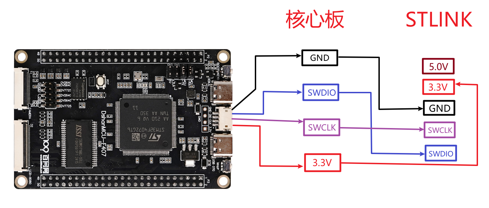

连接好的实物图像如下（ST-Link的USB口要插到电脑上）：

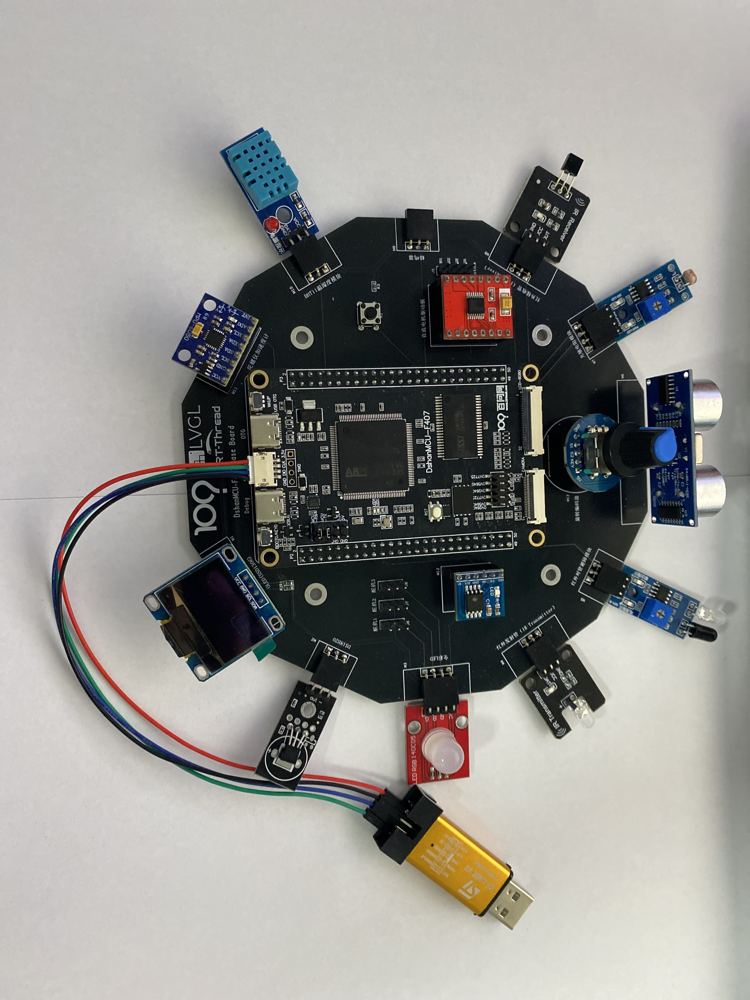

### 4.1.2 连接USB串口

本核心板自带USB串口，所以不需要额外接串口模块，直接与Debug口连接就可以使用串口；

本课程后面部分会使用串口来打印信息，请按照下图连线：

注意：ST-Link也要保持连接，我们使用ST-Link进行供电、烧录、调试。

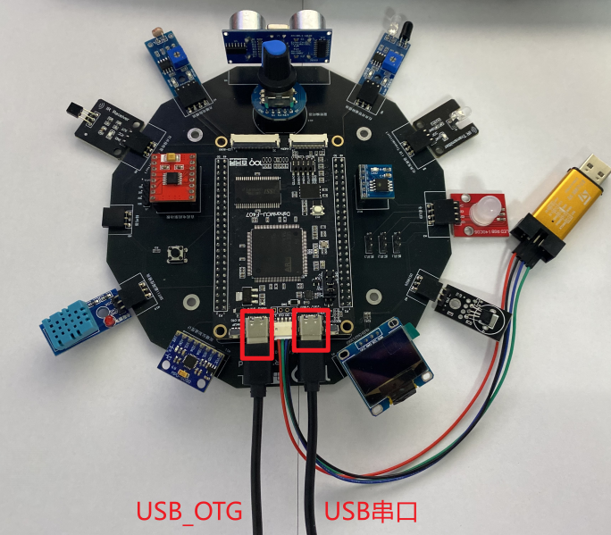

同时我们的USB串口也支持ISP烧录，可以不通过STLink烧录，打开资料包，打开ISP烧录工具：

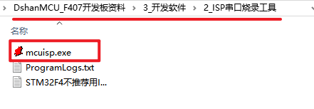

打烧录工具后，搜索串口，设置波特率，选择我们要烧录的hex文件，选择DTR低电平进入复位，高电平进入BootLoader,按下板载Boot0按键，烧录即可；

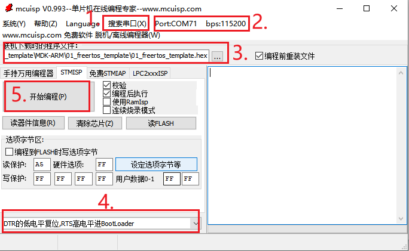

烧录成功如下图所示：

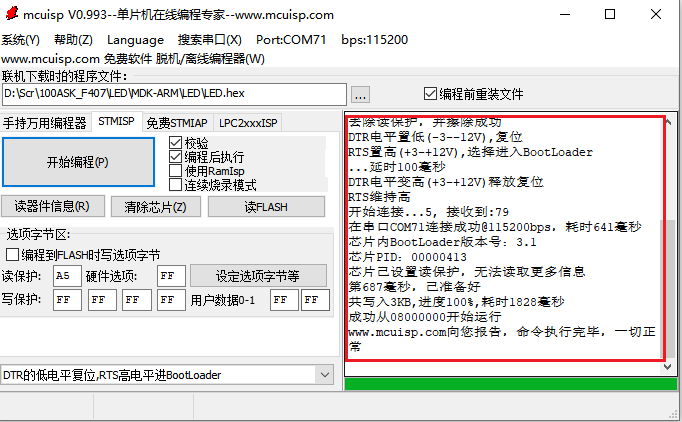

烧录完成，程序成功运行，如果你烧录的也是LED程序，此时可以看见开发板LED1、LED2交替闪烁。

## 4.2 编译、下载、运行

### 4.2.1 编译工程

把开发板配套资料中如下程序复制到“目录名里没有空格、没有中文字符”的目录下并解压开：

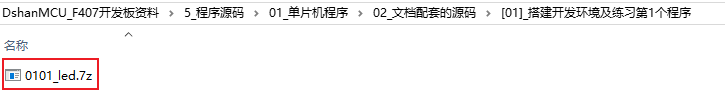

在工程的“MDK-ARM”目录下，双击如下文件，就会使用Keil打开工程：

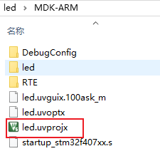

在Keil界面，点击一下红框中任意一个按钮即可编译程序：

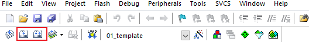

左边的按钮名为“Build”，点击这个按钮后，这些文件将会被编译：

- 所有没有被编译过的C文件
- 所被修改了但是尚未再次编译的C文件

如果你曾经编译过工程，但是只是修改了某些文件，使用“Buld”按钮时，只会编译这些被修改的文件，这会加快编译速度。

右边的按钮名为“Rebuild”，点击这个按钮后，所有的文件都会被再次编译。

### 4.2.2 配置调试器

先点击如下图所示按钮：

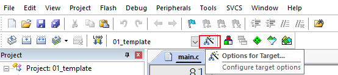

然后如下图依次点击“Debug”，选择“ST-Link Debugger”，点击“Setting”（可能会一是升级固件，见本节后面部分）：

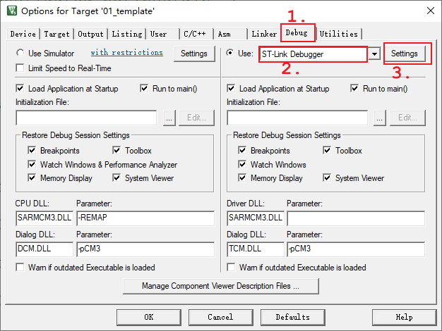

如一切正常，ST-Link会自动识别出芯片，如下图所示：

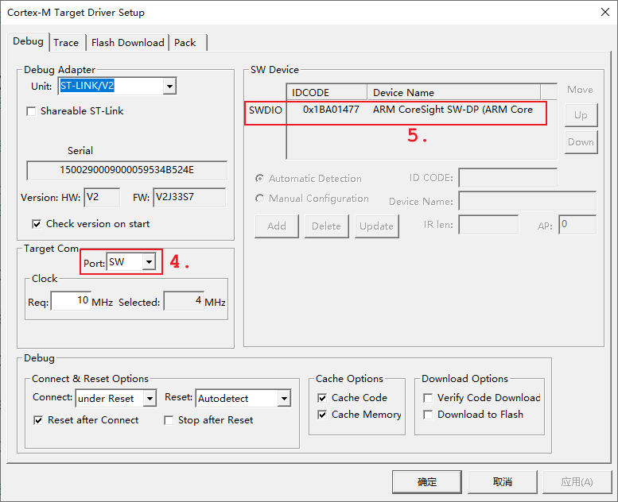

然后入下图选择：

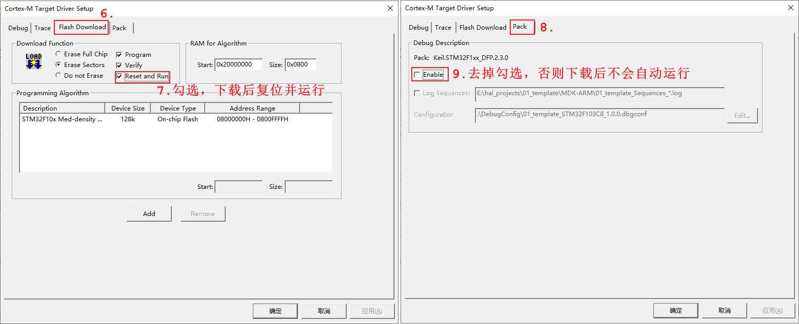

注意：如果你的ST-Link是第1次使用，它的固件可能已经很老了。设置调试器时可能会提示升级固件。如下图所示：点击“Yes”表示升级：

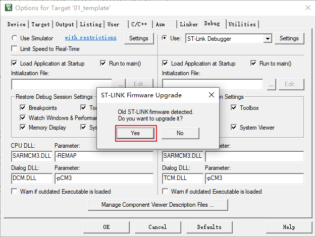

然后会弹出升级界面，点击“Device Connect”，表示连接设备；再点击“Yes”开始升级。如下图所示：

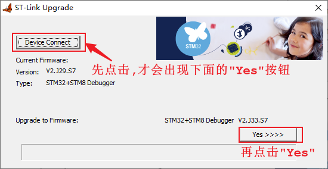

### 4.2.3 烧录运行

点击如下按钮，即可烧写、运行程序：

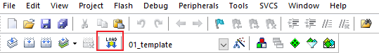

如果一切正常，可以看到DshanMCU-407上的LED闪烁。

## 4.3 修改代码

“01_freertos_template”里已经支持了所有的模块，这些模块不能同时测试。要测试哪个模块，需要如下图修改代码：

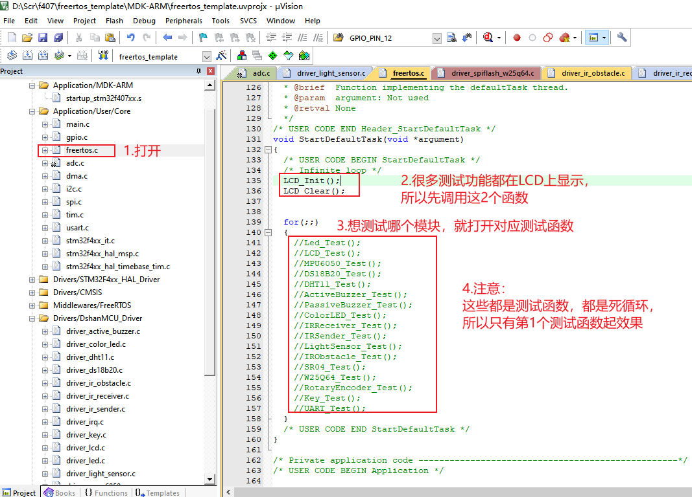
