# 第5章 模块使用说明与STM32CubeMX配置

## 5.1 硬件模块和驱动对应关系

配套源码为：

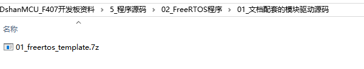

对于每一个模块，我们都编写了驱动程序。这些驱动程序依赖于STM32CubeMX提供的初始化代码。比如driver_oled.c里面要使用I2C1通道，I2C1的初始化代码是STM32CubeMX生成的：MX_I2C1_Init被用来初始I2C1本身，HAL_I2C_MspInit被用来初始化I2C引脚。driver_oled.c只使用I2C1的函数收发数据，它不涉及I2C1的初始化。换句话说，你要在自己的工程里使用driver_oled.c，还需要初始化相应的I2C通道、引脚。

观看模块的头文件就可以知道接口函数的用法，每个驱动文件里都有一个测试函数，参考测试函数也可以知道怎么使用这个驱动。硬件模块和驱动文件对应关系如下表所示：

| 模块 | 驱动 |
| --- | --- |
| 板载单色LED1<br/>板载单色LED2 | driver_led.c<br/>driver_led.h |
| 按键(Boot0) | driver_key.c<br/>driver_key.h |
| 蜂鸣器模块（有源） | driver_active_buzzer.c<br/>driver_active_buzzer.h |
| 蜂鸣器模块（无源） | driver_passive_buzzer.c<br/>driver_passive_buzzer.h |
| 温湿度模块（DHT11） | driver_dht11.c<br/>driver_dht11.h |
| 温度模块（DS18B20） | driver_ds18b20.c<br/>driver_ds18b20.h |
| 红外避障模块（LM393） | driver_ir_obstacle.c<br/>driver_ir_obstacle.h |
| 超声波测距模块（HC-SR04） | driver_ultrasonic_sr04.c<br/>driver_ultrasonic_sr04.h |
| 旋转编码器模块（EC11） | driver_rotary_encoder.c<br/>driver_rotary_encoder.h |
| 红外接收模块（1838） | driver_ir_receiver.c<br/>driver_ir_receiver.h |
| 红外发射模块（38KHz） | driver_ir_sender.c<br/>driver_ir_sender.h |
| RGB全彩LED模块 | driver_color_led.c<br/>driver_color_led.h |
| 光敏电阻模块 | driver_light_sensor.c<br/>driver_light_sensor.h |
| IIC OLED屏幕（SSD1306） | driver_oled.c<br/>driver_oled.h |
| IIC 陀螺仪加速度计模块（MPU6050） | driver_mpu6050.c<br/>driver_mpu6050.h |
| SPI FLASH模块（W25Q64） | driver_spiflash_w25q64.c<br/>driver_spiflash_w25q64.h |
| 直流电机（DRV8833） | driver_motor.c<br/>driver_motor.h |

## 5.2 调试引脚与定时器

DshanMCU-F407使用SWD调试接口，可以节省出TDI（PA15）、TDO（PB3）、TRST（PB4）三个引脚。所以需要在STM32CubeMX里配置调试接口为SWD，否则使用对应引脚模块无法使用。

DshanMCU-F407中使用PA7来控制红外发射模块、无源蜂鸣器，PA7作为TIM3_CH1时用到TIMER3；全彩LED使用PA5、PA1、PA2作为绿色（G）、蓝色（B）、红色（R）的驱动线，这3个引脚被分别配置为TIM2_CHN1、TIM2_CHN2、TIM2_CHN3，用到TIMER2；直流电机的通道B使用PE3作为PWM引脚（TIM9_CHN1），用到TIMER9。另外，我们还使用TIMER4作为HAL时钟。所以TIMER1、2、3、4、9都被使用了。

如下配置：

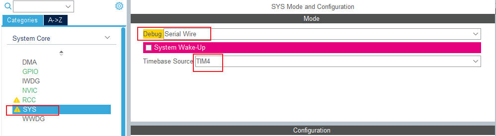

## 5.3 LED驱动使用方法

本节介绍板载LED灯驱动的使用方法，最终实现控制LED灯的亮灭。

### 5.3.1 硬件接线

这里我们不需要进行额外接模块的操作，因为DShanMCU-F407板载了两颗LED灯，其位于正面，丝印名称是PF9、PF10，如下图所示：

### 5.3.2 118STM32CubeMX配置

LED1使用PF9引脚，LED2使用PF10引脚，配置如下：

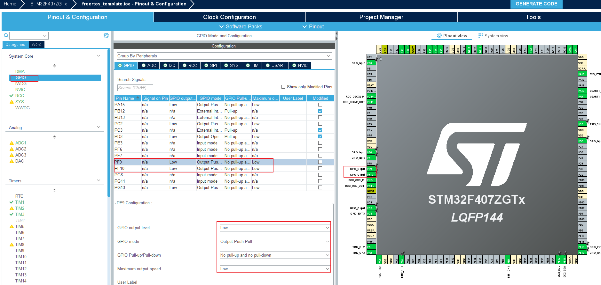

### 5.3.3 代码调用

这里使用到的驱动以及测试代码位于 “Drivers/DShanMCU_Driver/driver_led.c” 和 “Drivers/DShanMCU_Driver/driver_led.h” 中。其中，**Led_Test** 函数完成了 led 灯的初始化与测试工作。

**Led_Test** 函数在 “Core/Src/freertos.c” 文件中被**StartDefaultTask **函数调用。

打开 “Core/Src/freertos.c” 文件，将**StartDefaultTask **函数中的 **Led_Test **前面的注释去掉，并检查是否有其他函数未被注释(因为每个测试函数中都使用到死循环，所以每次只能运行位于最前面的测试项)，如下所示：

```c
void StartDefaultTask(void *argument)
{
  /* USER CODE BEGIN StartDefaultTask */
  /* Infinite loop */
  LCD_Init();
  LCD_Clear();

  for(;;)
  {
    Led_Test();
    //LCD_Test();
    //MPU6050_Test();
    //DS18B20_Test();
    //DHT11_Test();
    //ActiveBuzzer_Test();
    //PassiveBuzzer_Test();
    //ColorLED_Test();
    //IRReceiver_Test();
    //IRSender_Test();
    //LightSensor_Test();
    //Obstacle_Test();
    //SR04_Test();
    //W25Q64_Test();
    //RotaryEncoder_Test();
    //Key_Test();
//UART_Test();
//Motor_Test();
  }
  /* USER CODE END StartDefaultTask */
}
```

### 5.3.4 上机实验

会看到板载的LED灯亮500毫秒之后灭500毫秒，不停的重复这个过程。

## 5.4 IIC OLED屏驱动使用方法

本节介绍OLED屏幕驱动的使用方法，最终实现通过OLED屏幕显示字符或字符串。

### 5.4.1 硬件接线

将OLED屏幕接到配套的DShanMCU-F407开发板上即可，具体位置是印有 “OLED(SSD4076)”丝印的排母接口，如下图所示：

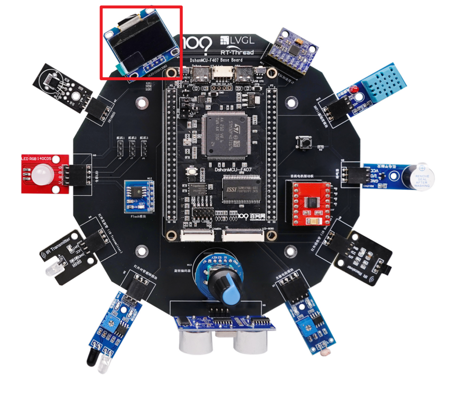

### 5.4.2 STM32CubeMX配置

OLED屏幕使用I2C1通道，I2C1使用PB8、PB9作为SCL、SDA引脚，配置如下：

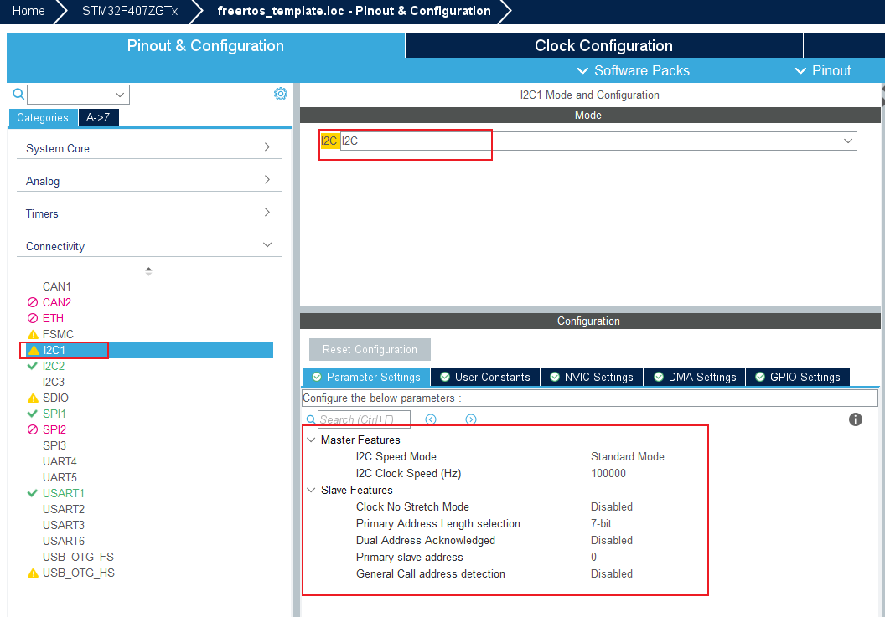

### 5.4.3 代码调用

这里使用到的驱动以及测试代码位于 “Drivers/DShanMCU_Driver/driver_oled.c” 和 “Drivers/DShanMCU_Driver/driver_oled.h” 中。其中，**OLED_Test** 函数完成了 OLED 屏幕的初始化与测试工作。

**OLED****_Test** 函数在 “Core/Src/freertos.c” 文件中被**StartDefaultTask **函数调用。

打开 “Core/Src/freertos.c” 文件，将**StartDefaultTask **函数中的 **OLED****_Test **前面的注释去掉，并检查是否有其他函数未被注释(因为每个测试函数中都使用到死循环，所以每次只能运行位于最前面的测试项)，如下所示：

```c
void StartDefaultTask(void *argument)
{
  /* USER CODE BEGIN StartDefaultTask */
  /* Infinite loop */
  LCD_Init();
  LCD_Clear();

  for(;;)
  {
    //Led_Test();
    LCD_Test();
    //MPU6050_Test();
    //DS18B20_Test();
    //DHT11_Test();
    //ActiveBuzzer_Test();
    //PassiveBuzzer_Test();
    //ColorLED_Test();
    //IRReceiver_Test();
    //IRSender_Test();
    //LightSensor_Test();
    //Obstacle_Test();
    //SR04_Test();
    //W25Q64_Test();
    //RotaryEncoder_Test();
    //Motor_Test();
    //Key_Test();
//UART_Test();
//Motor_Test();
  }
  /* USER CODE END StartDefaultTask */
}
```

### 5.4.4 上机实验

会看到OLED屏幕上显示**OLED****_Test **函数中指定的字符或字符串。

## 5.5 按键驱动使用方法

本节介绍按键驱动的使用方法，最终实现通过按键控制LED灯。

### 5.5.1 硬件接线

这里我们不需要进行额外接模块的操作，因为DShanMCU-F407开发板板载了一个按键，如下图所示：

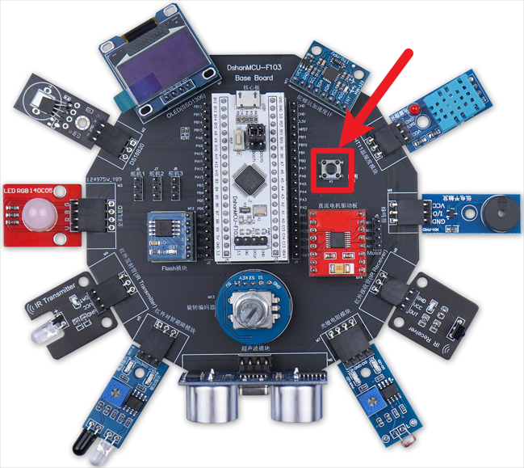

### 5.5.2 STM32CubeMX配置

按键Key使用PE3引脚，配置如下：

**注意：**此按键与BOOT0共用PE3,BOOT0上电后不影响PE3按键的正常使用。

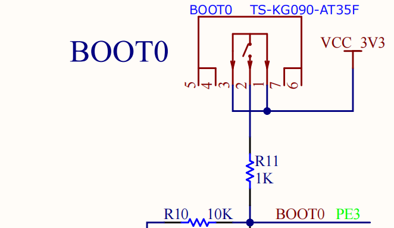

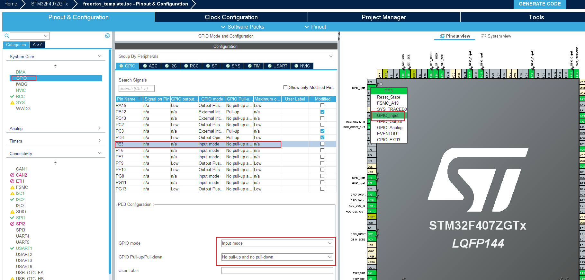

### 5.5.3 代码调用

这里使用到的驱动以及测试代码位于 “Drivers/DShanMCU_Driver/driver_key.c” 和 “Drivers/DShanMCU_Driver/driver_key.h” 中。其中，**Key_Test** 函数完成了按键和 LED灯的初始化与测试工作。

**Key****_Test** 函数在 “Core/Src/freertos.c” 文件中被**StartDefaultTask **函数调用。

打开 “Core/Src/freertos.c” 文件，将**StartDefaultTask **函数中的 **Key_Test **前面的注释去掉，并检查是否有其他函数未被注释(因为每个测试函数中都使用到死循环，所以每次只能运行位于最前面的测试项)，如下所示：

```c
void StartDefaultTask(void *argument)
{
  /* USER CODE BEGIN StartDefaultTask */
  /* Infinite loop */
  LCD_Init();
  LCD_Clear();

  for(;;)
  {
    //Led_Test();
    //LCD_Test();
    //MPU6050_Test();
    //DS18B20_Test();
    //DHT11_Test();
    //ActiveBuzzer_Test();
    //PassiveBuzzer_Test();
    //ColorLED_Test();
    //IRReceiver_Test();
    //IRSender_Test();
    //LightSensor_Test();
    //Obstacle_Test();
    //SR04_Test();
    //W25Q64_Test();
    //RotaryEncoder_Test();
    Key_Test();
//UART_Test();
//Motor_Test();
  }
  /* USER CODE END StartDefaultTask */
}
```

### 5.5.4 上机实验

按下或者松开按键，会看到OLED屏幕上按键的当前状态（按下或松开）；同时，可以通过按键控制LED灯的亮灭，按下按键LED灯亮起，松开按键LED灯熄灭。。

## 5.6 有源蜂鸣器模块驱动使用方法

本节介绍有源蜂鸣器模块驱动的使用方法，最终实现让有源蜂鸣器发出声音。

### 5.6.1 硬件接线

将有源蜂鸣器模块接到配套的DShanMCU-F407开发板上即可，具体位置是印有“蜂鸣器”丝印的排母接口，如下图所示：

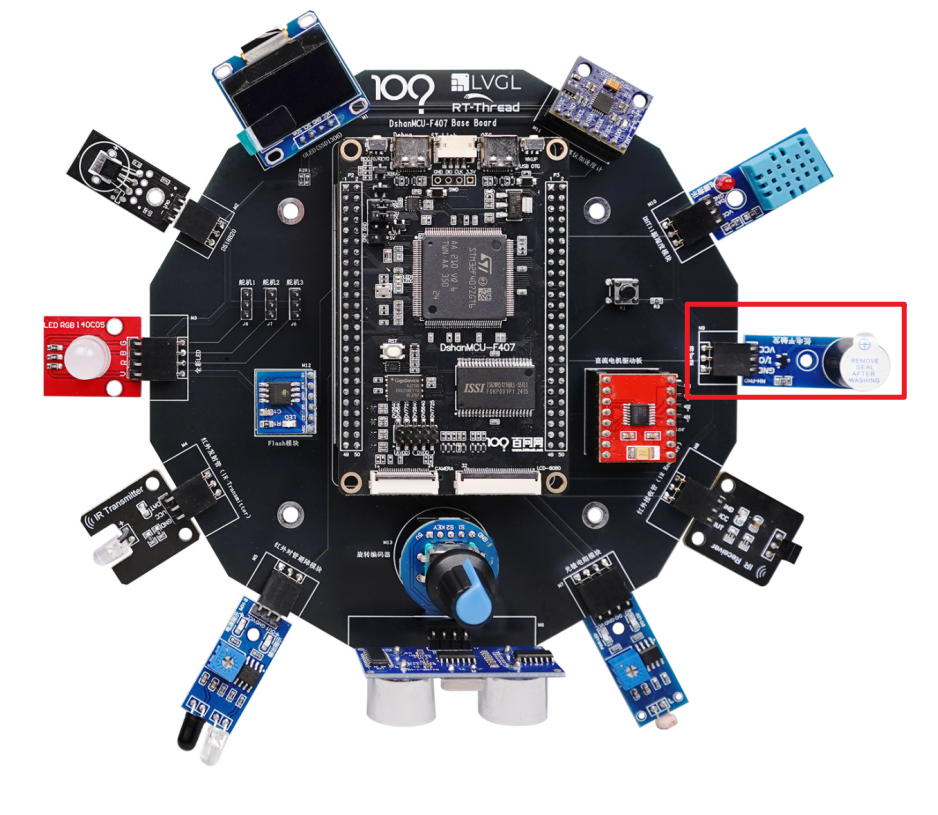

接线图如下：

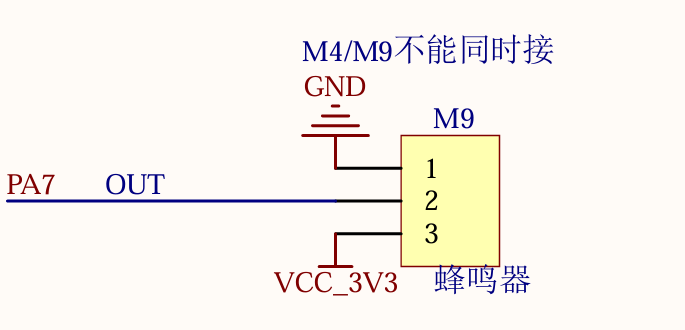

只要让PA7输出低电平即可让它发出声音。

### 5.6.2 STM32CubeMX配置

有源蜂鸣器使用PA7，把它配置为推挽输出引脚即可。但是源蜂鸣器也使用PA7，需要把它配置为TIM3_CH2引脚。我们的程序可以既使用有源蜂鸣器，也使用无源蜂鸣器。所以需要使用代码来配置PA7。

在driver_active_buzzer.c文件的ActiveBuzzer_Init函数里，已经把PA7配置为推挽输出。

在driver_passive_buzzer.c文件的PassiveBuzzer_Init函数里，已经把PA7配置为TIM3_CH1。

无需在STM32CubeMX里配置PA7。

### 5.6.3 代码调用

这里使用到的驱动以及测试代码位“Drivers/DShanMCU_Driver/driver_active_buzzer”和“Drivers/DShanMCU_Driver/driver_active_buzzer.h”中。其中，**ActiveBuzzer_Test** 函数完成了有源蜂鸣器模块的初始化与测试工作。

**ActiveBuzzer****_Test** 函数在 “Core/Src/freertos.c” 文件中被**StartDefaultTask **函数调用。

打开 “Core/Src/freertos.c” 文件，将**StartDefaultTask **函数中的 **ActiveBuzzer****_Test **前面的注释去掉，并检查是否有其他函数未被注释(因为每个测试函数中都使用到死循环，所以每次只能运行位于最前面的测试项)，如下所示：

```c
void StartDefaultTask(void *argument)
{
  /* USER CODE BEGIN StartDefaultTask */
  /* Infinite loop */
  LCD_Init();
  LCD_Clear();

  for(;;)
  {
    //Led_Test();
    //LCD_Test();
    //MPU6050_Test();
    //DS18B20_Test();
    //DHT11_Test();
    ActiveBuzzer_Test();
    //PassiveBuzzer_Test();
    //ColorLED_Test();
    //IRReceiver_Test();
    //IRSender_Test();
    //LightSensor_Test();
    //Obstacle_Test();
    //SR04_Test();
    //W25Q64_Test();
    //RotaryEncoder_Test();
    //Key_Test();
//UART_Test();
//Motor_Test();
  }
  /* USER CODE END StartDefaultTask */
}
```

### 5.6.4 上机实验

有源蜂鸣器保持响1秒之后保持不响1秒，不停的重复这个过程；同时会看到OLED屏幕上显示有源蜂鸣器的状态(ON/OFF)。

## 5.7 无源蜂鸣器模块驱动使用方法

本节介绍无源蜂鸣器模块驱动的使用方法，最终实现让无源蜂鸣器发出声音。

### 5.7.1 硬件接线

将无源蜂鸣器模块接到配套的DShanMCU-F407开发板上即可，具体位置是印有“蜂鸣器”丝印的排母接口，如下图所示：

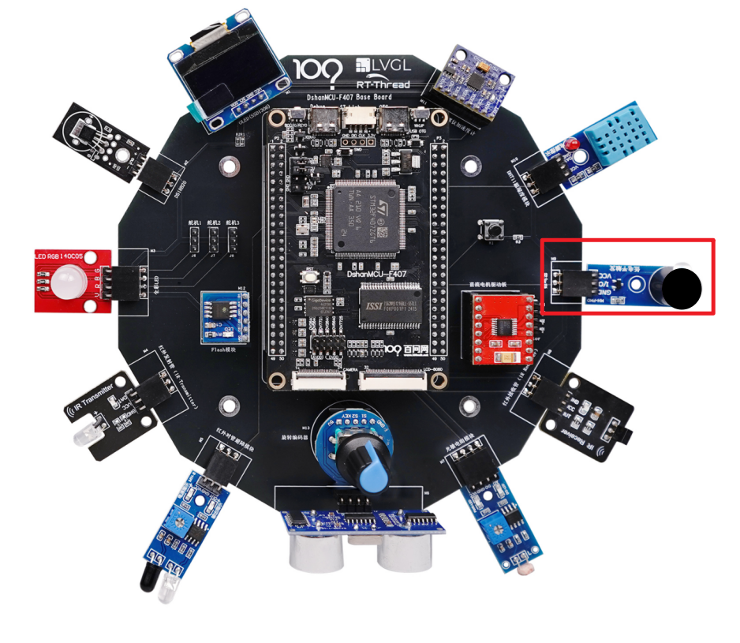

接线图如下：


只要让PA7输出PWM波形即可让它发出声音。

### 5.7.2 STM32CubeMX配置

有源蜂鸣器使用PA7，把它配置为推挽输出引脚即可。但是无源蜂鸣器也使用PA7，需要把它配置为TIM3_CH2引脚。我们的程序可以既使用有源蜂鸣器，也使用无源蜂鸣器。所以需要使用代码来配置PA7。

在driver_active_buzzer.c文件的ActiveBuzzer_Init函数里，已经把PA7配置为推挽输出。

在driver_passive_buzzer.c文件的PassiveBuzzer_Init函数里，已经把PA7配置为TIM1_CH1。

无需在STM32CubeMX里配置PA7。

下图仅仅是一个示例，演示如何配置TIMER3、如何把PA7配置为TIM3_CH2：

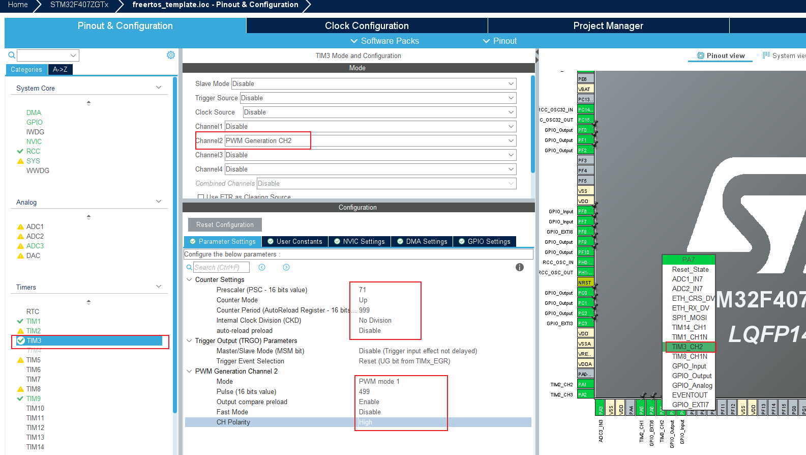

### 5.7.3 核心代码

核心代码为：

① 通过“HAL_TIM_Base_Init”函数设置周期

```c
g_HPWM_PassiveBuzzer->Init.Period = 1000000 / freq – 1;
```

② 通过“HAL_TIM_PWM_ConfigChannel”函数设置占空比：

```c
sConfig.Pulse      = (1000000 / freq - 1) * duty / 100;
```

完整函数如下：

```c
/**********************************************************************
 * 函数名称： PassiveBuzzer_Set_Freq_Duty
 * 功能描述： 无源蜂鸣器控制函数: 设置频率和占空比
 * 输入参数： freq - 频率, duty - 占空比
 * 输出参数： 无
 * 返 回 值： 无
 * 修改日期：      版本号     修改人          修改内容
 * -----------------------------------------------
 * 2024/07/18         V1.1      韦东山          创建
 ***********************************************************************/
void PassiveBuzzer_Set_Freq_Duty(int freq, int duty)
{
    TIM_OC_InitTypeDef sConfig = { 0 };

    HAL_TIM_PWM_Stop(g_HPWM_PassiveBuzzer, TIM_CHANNEL_2);

    HAL_TIM_Base_DeInit(g_HPWM_PassiveBuzzer);
    g_HPWM_PassiveBuzzer->Instance = TIM3;
    g_HPWM_PassiveBuzzer->Init.Prescaler = 71;
    g_HPWM_PassiveBuzzer->Init.CounterMode = TIM_COUNTERMODE_UP;
    g_HPWM_PassiveBuzzer->Init.Period = 1000000 / freq - 1;
    g_HPWM_PassiveBuzzer->Init.ClockDivision = TIM_CLOCKDIVISION_DIV1;
    g_HPWM_PassiveBuzzer->Init.RepetitionCounter = 0;
    g_HPWM_PassiveBuzzer->Init.AutoReloadPreload = TIM_AUTORELOAD_PRELOAD_ENABLE;
    HAL_TIM_Base_Init(g_HPWM_PassiveBuzzer);

    sConfig.OCMode = TIM_OCMODE_PWM1;        // PWM 输出的两种模式:PWM1 当极性为低,CCR<CNT,输出低电平,反之高电平
    sConfig.OCPolarity = TIM_OCPOLARITY_LOW; // 设置极性为低(硬件上低电平亮灯)
    sConfig.OCFastMode = TIM_OCFAST_DISABLE; // 输出比较快速使能禁止(仅在 PWM1 和 PWM2 可设置)
    sConfig.Pulse      = (1000000 / freq - 1) * duty / 100;                // 在 PWM1 模式占空比

    HAL_TIM_PWM_ConfigChannel(g_HPWM_PassiveBuzzer, &sConfig, TIM_CHANNEL_2);

    HAL_TIM_PWM_Start(g_HPWM_PassiveBuzzer, TIM_CHANNEL_2);
}
```

### 5.7.4 代码调用

这里使用到的驱动以及测试代码位于 Drivers/DShanMCU_Driver/driver_passive_buzzer.c和 Drivers/DShanMCU_Driver/driver_passive_buzzer.h中。其中，**PassiveBuzzer_Test** 函数完成了无源蜂鸣器模块的初始化与测试工作。

**PassiveBuzzer_Test** 函数在 “Core/Src/freertos.c” 文件中被**StartDefaultTask **函数调用。

打开 “Core/Src/freertos.c” 文件，将**StartDefaultTask **函数中的 **P****assiveBuzzer_Test **前面的注释去掉，并检查是否有其他函数未被注释(因为每个测试函数中都使用到死循环，所以每次只能运行位于最前面的测试项)，如下所示：

```c
void StartDefaultTask(void *argument)
{
  /* USER CODE BEGIN StartDefaultTask */
  /* Infinite loop */
  LCD_Init();
  LCD_Clear();

  for(;;)
  {
    //Led_Test();
    //LCD_Test();
    //MPU6050_Test();
    //DS18B20_Test();
    //DHT11_Test();
    //ActiveBuzzer_Test();
    PassiveBuzzer_Test();
    //ColorLED_Test();
    //IRReceiver_Test();
    //IRSender_Test();
    //LightSensor_Test();
    //Obstacle_Test();
    //SR04_Test();
    //W25Q64_Test();
    //RotaryEncoder_Test();
    //Key_Test();
//UART_Test();
//Motor_Test();
  }
  /* USER CODE END StartDefaultTask */
}
```

### 5.7.5 上机实验

有源蜂鸣器保持响1秒之后保持不响1秒，不停的重复这个过程；同时会看到OLED屏幕上显示有源蜂鸣器的状态(ON/OFF)。

## 5.8 DHT11温湿度模块驱动使用方法

本节介绍DHT11温湿度模块驱动的使用方法，最终实现通过DHT11温湿度模块采集温湿度信息。

### 5.8.1 硬件接线

将DHT11温湿度模块接到配套的DShanMCU-F407开发板上即可，具体位置是印有“DHT11温湿度模块” 丝印的排母接口，如下图所示：

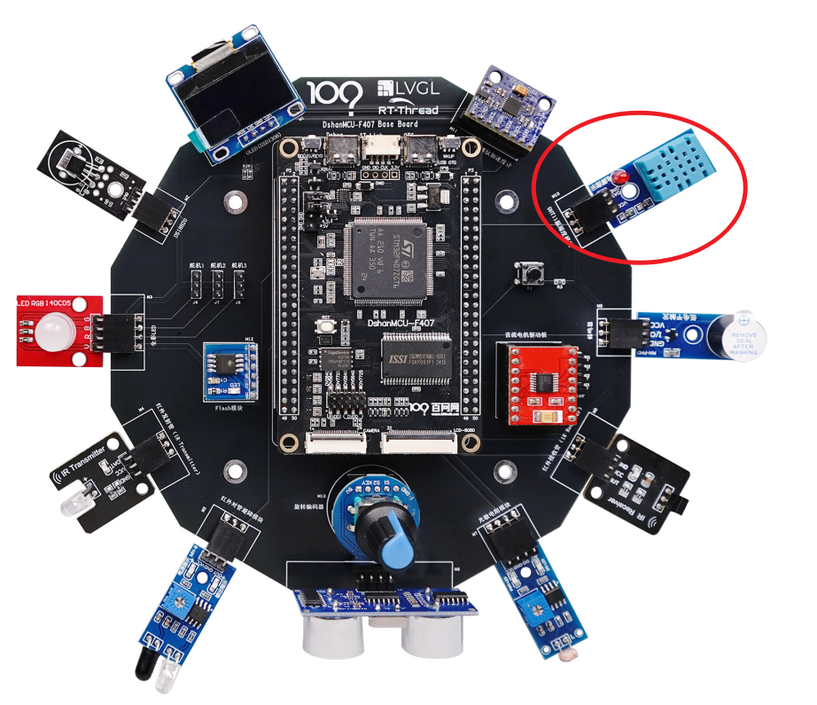

接线图如下：

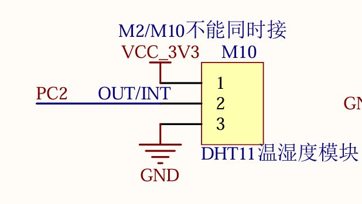

### 5.8.2 DHT11操作方法

DHT11是一款可测量温度和湿度的传感器。比如市面上一些空气加湿器，会测量空气中湿度，再根据测量结果决定是否继续加湿。

DHT11数字温湿度传感器是一款含有已校准数字信号输出的温湿度复合传感器，具有超小体积、极低功耗的特点，使用单根总线与主机进行双向的串行数据传输。DHT11测量温度的精度为±2℃，检测范围为-20℃-60℃。湿度的精度为±5%RH，检测范围为5%RH-95%RH，常用于对精度和实时性要求不高的温湿度测量场合。

**1****. ****硬件连接**

主机通过一条数据线与DH11连接，主机通过这条线发命令给DHT11，DHT11再通过这条线把数据发送给主机。

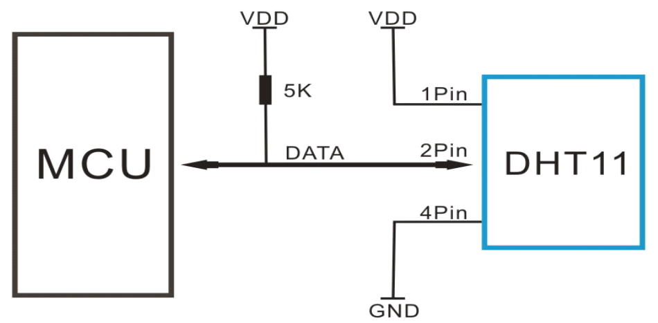

**2****. ****通信时序**

主控发出开始信号后,DHT11从低功耗模式转换到高速模式,等待主机开始信号结束后,DHT11发送响应信号,并送出40bit的数据,完成一次信号采集。DHT11接收到开始信号后触发一次温湿度采集,如果没有开始信号,DHT11不会主动进行温湿度采集。采集数据后转换到低速模式。

通讯过程如图所示：


1) 总线空闲状态为高电平；
2) 主机把总线拉低等待DHT11响应,主机把总线拉低必须大于18毫秒,保证DHT11能检测到起始信号；
3) DHT11接收到主机的开始信号后,等待主机开始信号结束,然后发送80us低电平响应信号；
4) 主机发送开始信号结束后,延时等待20-40us后,读取DHT11的响应信号；

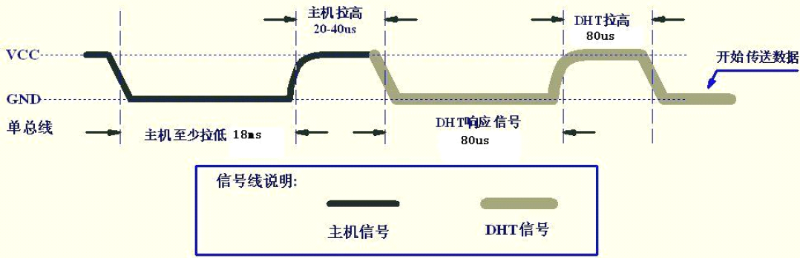

主机发送开始信号后,可以切换到输入模式,或者输出高电平均可,总线由上拉电阻拉高。

- 总线为低电平,说明DHT11发送响应信号；
- DHT11发送响应信号后,再把总线拉高80us,准备发送数据；
- 每一bit数据都以50us低电平时隙开始,高电平的长短定了数据位是0还是1；如果读取响应信号为高电平,则DHT11没有响应,请检查线路是否连接正常；
- 当最后一bit数据传送完毕后，DHT11拉低总线50us,随后总线由上拉电阻拉高进入空闲状态；

**3****. ****数据位格式**

1. 数据‘0’

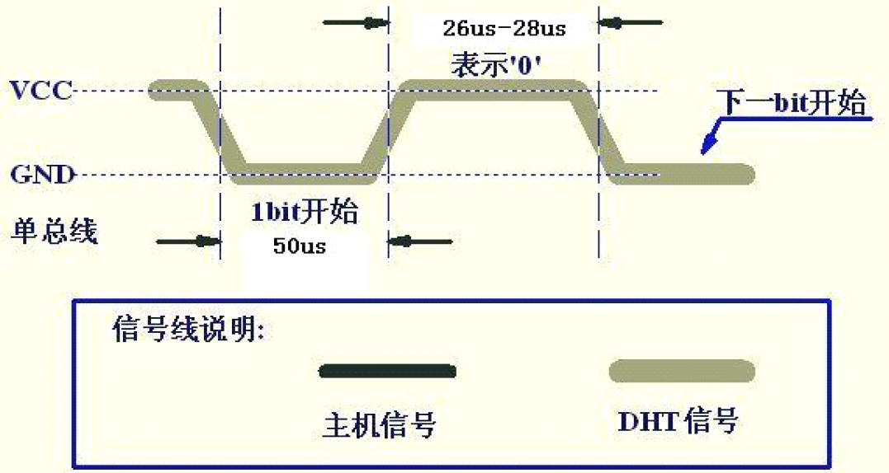

1. 数据‘1’

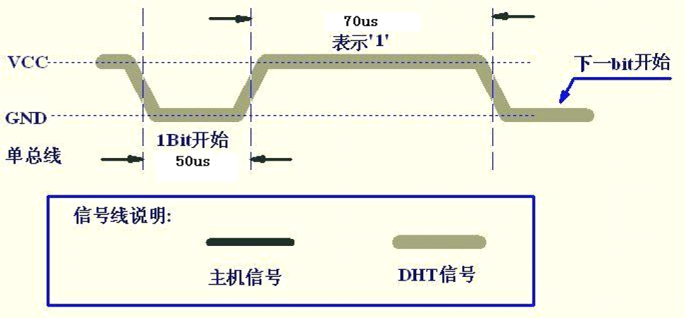

### 5.8.3 编程思路

根据DHT11的时序图，发出起始信号并得到回应后，去连续读取5个字节的数据。核心函数如下：

```c
/**********************************************************************
 * 函数名称： DHT11_ReadByte
 * 功能描述： 读取DH11 1byte数据
 * 输入参数： 无
 * 输出参数： 无
 * 返 回 值： 数据
 * 修改日期：      版本号     修改人         修改内容
 * -----------------------------------------------
 * 2024/07/18        V1.1     韦东山         创建
 ***********************************************************************/
static int DHT11_ReadByte(void)
{
    int i;
    int data = 0;

    for (i = 0; i < 8; i++)
    {
        if (DHT11_WaitFor_Val(1, 1000))  // 等待数据线为高电平
        {
            //printf("dht11 wait for high data err!\n\r");
            return -1;
        }
        udelay(40);  // 延时40us后再读取引脚电平，确定当前数值
        data <<= 1;
        if (DHT11_PinRead() == 1)
            data |= 1;

        if (DHT11_WaitFor_Val(0, 1000))
        {
            //printf("dht11 wait for low data err!\n\r");
            return -1;
        }
    }

    return data;
}
```

### 5.8.4 STM32CubeMX配置

DHT11使用PC2，初始状态为“open drain，pull-up”，如下图：

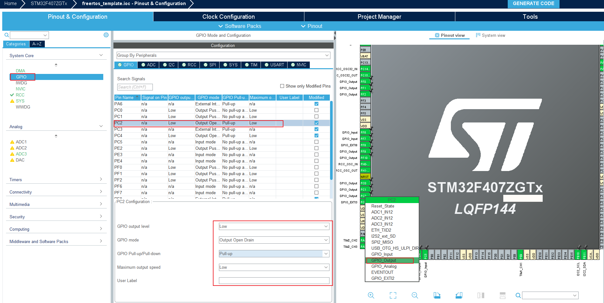

### 5.8.5 代码调用

这里使用到的驱动以及测试代码位于 “Drivers/DShanMCU_Driver/driver_dht11.c” 和 “Drivers/DShanMCU_Driver/driver_dht11.h” 中。其中，**DHT11_Test** 函数完成了DHT11温湿度模块的初始化与测试工作。

**DHT11_Test** 函数在 “Core/Src/freertos.c” 文件中被**StartDefaultTask **函数调用。

打开 “Core/Src/freertos.c” 文件，将**StartDefaultTask **函数中的 **DHT11_Test **前面的注释去掉，并检查是否有其他函数未被注释(因为每个测试函数中都使用到死循环，所以每次只能运行位于最前面的测试项)，如下所示：

```c
void StartDefaultTask(void *argument)
{
  /* USER CODE BEGIN StartDefaultTask */
  /* Infinite loop */
  LCD_Init();
  LCD_Clear();

  for(;;)
  {
    //Led_Test();
    //LCD_Test();
    //MPU6050_Test();
    //DS18B20_Test();
    DHT11_Test();
    //ActiveBuzzer_Test();
    //PassiveBuzzer_Test();
    //ColorLED_Test();
    //IRReceiver_Test();
    //IRSender_Test();
    //LightSensor_Test();
    //Obstacle_Test();
    //SR04_Test();
    //W25Q64_Test();
    //RotaryEncoder_Test();
    //Key_Test();
//UART_Test();
//Motor_Test();
  }
  /* USER CODE END StartDefaultTask */
}
```

### 5.8.6 上机实验

会看到OLED屏幕上显示DHT11温湿度模块实时采集的温度与湿度信息。

## 5.9 DS18B20温度模块驱动使用方法

本节介绍DS18B20温度模块驱动的使用方法，最终实现通过DS18B20温度模块采集温度信息。

### 5.9.1 硬件接线

将有DS18B20温度模块接到配套的DShanMCU-F407开发板上即可，具体位置是印有“DS18B20” 丝印的排母接口，如下图所示：

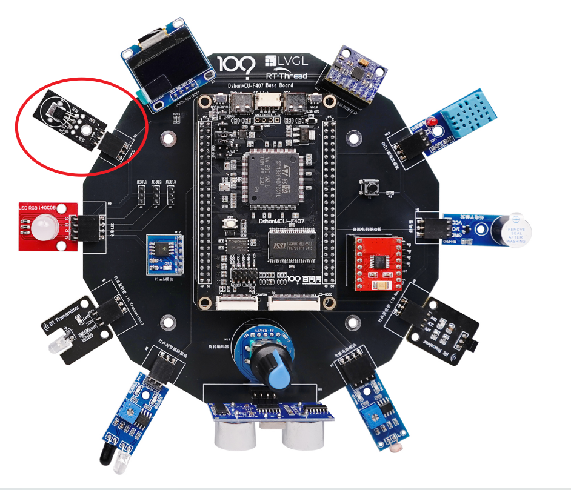

接线图如下：

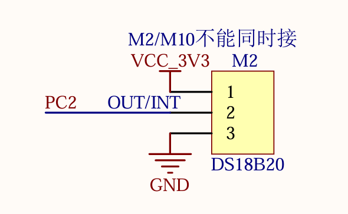

### 5.9.2 DS18B20操作方法

DS18B20温度传感器具有线路简单、体积小的特点，用来测量温度非常简单，在一根通信线上可以挂载多个DS18B20温度传感器。用户可以通过编程实现9~12位的温度读数，每个DS18B20有唯一的64位序列号，保存在rom中，因此一条总线上可以挂载多个DS18B20。

温度寄存器格式如下表所示：

|  | Bit 7 | Bit 6 | Bit 5 | Bit 4 | Bit 3 | Bit 2 | Bit 1 | Bit 0 |
| --- | --- | --- | --- | --- | --- | --- | --- | --- |
| LS Byte |  |  |  |  |  |  |  |  |
| MS Byte | S | S | S | S | S |  |  |  |

**1****. ****单总线连接**

主控芯片和DS18B20之间，只需要连接两条线：数据线、GND。除去GND，只有一条数据线，这就是单总线。

要使用一条数据线传输双向的数据，要考虑最坏的情况：如果双方同时驱动这个数据线时，一个输出高电平，一个输出低电平，会不会烧坏？所以，一般来说，单总线的驱动电路都是漏极开路，并且使用上拉电阻。如下图所示：

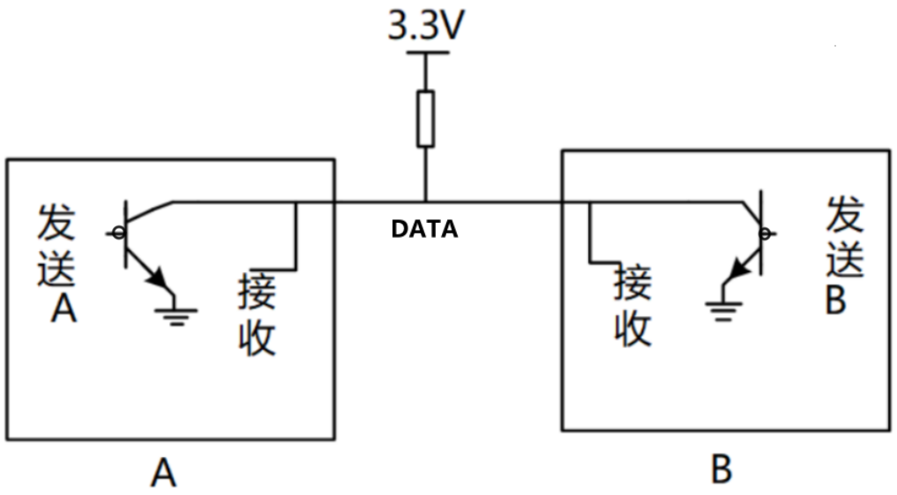

1、 B的输出值与DATA信号的关系，如下表所示：
| A | B | DATA |
| --- | --- | --- |
| 0 | 0 | 0 |
| 0 | 1 | 0 |
| 1 | 0 | 0 |
| 1 | 1 | 1 |

即：DATA = A & B，只要一方输出0，DATA就是0。

使用单总线可以连接很多DS18B20，它们平时处于高阻态（内部输出1，反相后无法驱动三极管），不影响其他设备。参与通信的DS18B20，想输出0时并不会损坏其他设备。

DS18B20接口如下：

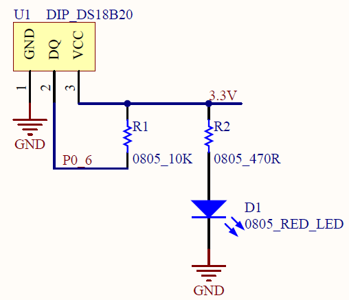

**2****. ****内部存储器**

DS18B20内部有个64位只读存储器（ROM）和64位配置存储器（SCRATCHP）。

64位只读存储器（ROM）包含序列号等，具体格式如下图：

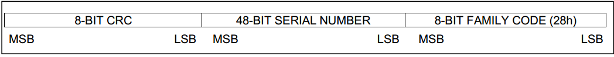

低八位用于CRC校验，中间48位是DS18B20唯一序列号，高八位是该系列产品系列号(固定为28h)。因此，根据每个DS18B20唯一的序列号，可以实现一条总线上可以挂载多个DS18B20时，获取指定DS18B20的温度信息。

64位配置存储器（SCRATCHP）由9个Byte组成，包含温度数据、配置信息等，具体格式如下图：

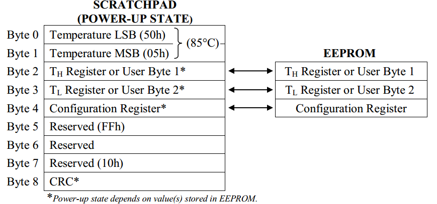

- Byte[0:1]：温度值。也就是当我们发出一个测量温度的命令之后，还需要发送一个读内存的命令才能把温度值读取出来。
- Byte[2:3]：TL是低温阈值设置，TH是高温阈值设置。当温度低于/超过阈值，就会报警。 TL、TH存储在EEPROM中，数据在掉电时不会丢失；
- Byte4：配置寄存器。用于配置温度精度为9、10、11或12位。配置寄存器也存储在EEPROM中，数据在掉电时不会丢失；
- Byte[5:7]：厂商预留；
- Byte[8]：CRC校验码。

**3****. ****通信时序**

① 初始化时序

主机要跟DS18B20通信，首先需要发出一个开始信号。下图中，深黑色线表示由主机驱动信号，浅灰色线表示由DS18B20驱动信号。最开始时引脚是高电平，想要开始传输信号，步骤如下：

a. 主机必须要拉低至少480us，这是复位信号；

b. 然后主机释放总线，等待15~60us之后，

c. 如果GPIO上连有DS18B20芯片，它会拉低60~240us。

如果主机在最后检查到60～240us的低脉冲，则表示DS18B20初始化成功。

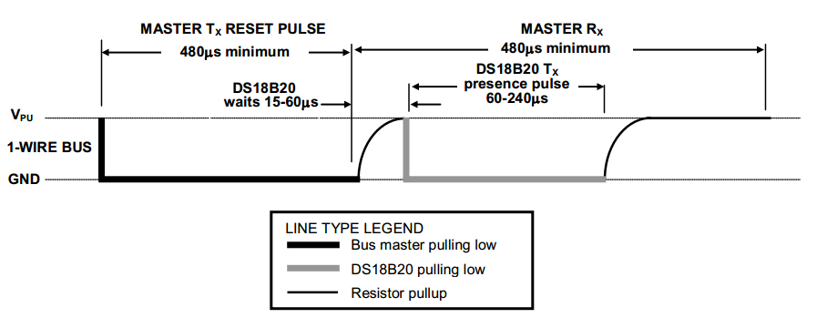

② 写时序

如果写0，拉低至少60us(写周期为60-120us)即可；

如果写1，先拉低至少1us，然后拉高，整个写周期至少为60us即可。

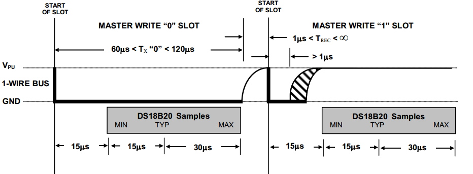

③ 读时序

主机先拉低至少1us，随后读取电平，如果为0，即读到的数据是0，如果为1，即可读到的数据是1。

整个过程必须在15us内完成，15us后引脚都会被拉高。

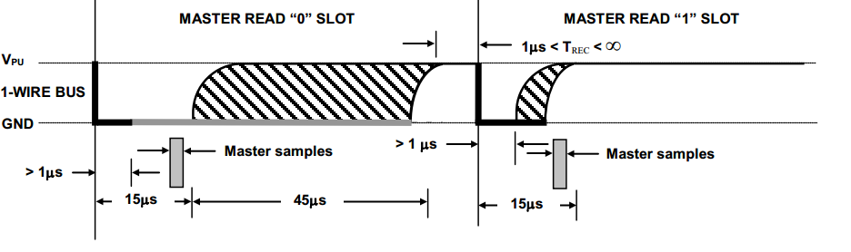

**4****. ****常用命令**

现在我们知道怎么发1位数据，收1位数据。发什么数据才能得到温度值，这需要用到“命令”。

DS18B20中有两类命令：ROM命令、功能命令，列表如下：

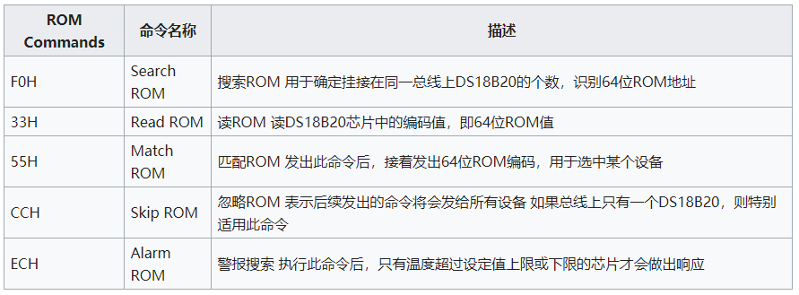

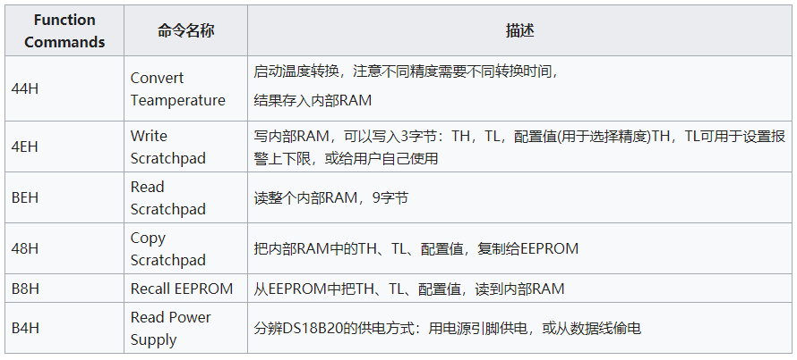

**5****. ****流程图**

DS18B20芯片手册中有ROM命令、功能命令的流程图，先贴出来，下一小节再举例。

2. ROM命令流程图如下：

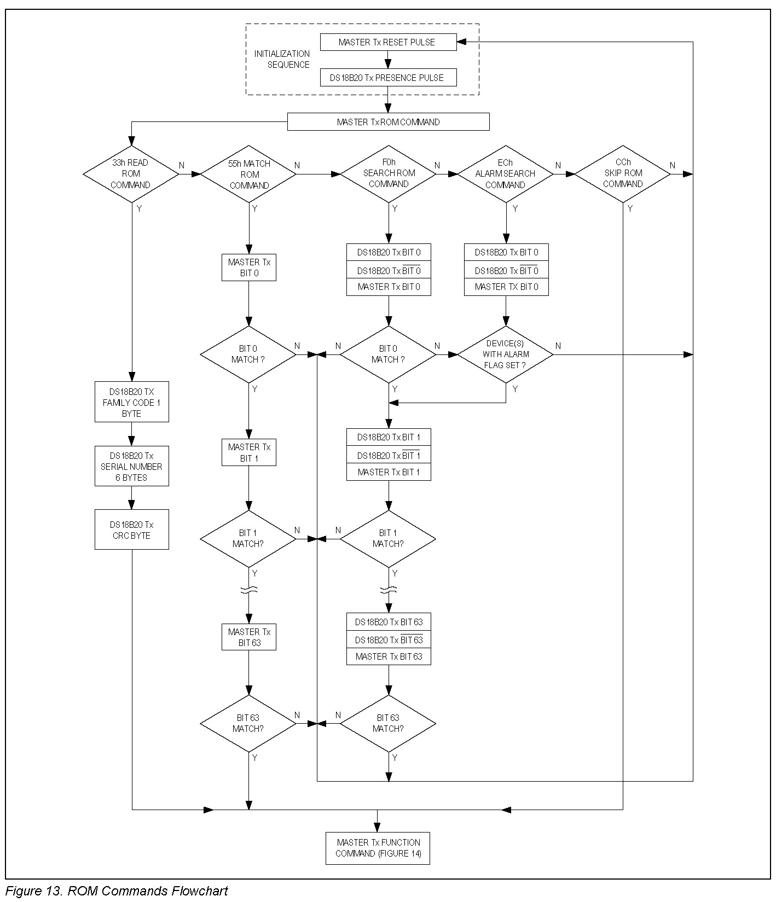

2. 功能命令流程图如下：

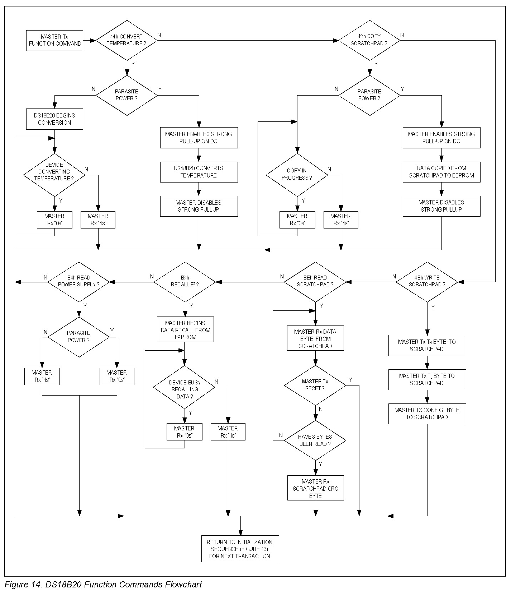

**6****. ****操作示例：单个D****S18B20****温度转换**

总线上只一个DS18B20设备时，根据下表发送命令、读取数据。因为只有一个DS18B20，所以不需要选择设备，发出“Skip ROM”命令。然后发户“Convert T”命令启动温度转换；等待温度转换成功后再读数据。读数据前，也要发出“Skip ROM”命令。

下表列得很清楚：

| 主机模式 | 数据 | 描述 |
| --- | --- | --- |
| 发送 | 复位 | 主机发出复位脉冲 |
| 接收 | 回应 | 总线上可能有多个DS18B20，它们都可以拉低信号，回应 |
| 发送 | CCh | 主机发出“Skip ROM”命令(忽略ROM) |
| 发送 | 44h | 主机发出“Convert T”命令(启动温度转换) |
| 发送 | 保持高电平 | 主机使用强上拉保存数据线为高电平，至少tCONV() |
| 发送 | 复位 | 主机发出复位脉冲 |
| 接收 | 回应 | 总线上可能有多个DS18B20，它们都可以拉低信号，回应 |
| 发送 | CCh | 主机发出“Skip ROM”命令(忽略ROM) |
| 发送 | BEh | 主机发出“Read Scratchpad”命令(读内存) |
| 接收 | 9字节数据 | 主机读9字节数据 |

### 5.9.3 编程思路

根据流程图发出命令、读取数据。

怎么发出一个字节的数据？代码如下：

```c
/**********************************************************************
 * 函数名称： DS18B20_WriteBit
 * 功能描述： 给DS18B20发送1bit数据
 * 输入参数： val - 数据
 * 输出参数： 无
 * 返 回 值： 无
 * 修改日期：      版本号     修改人         修改内容
 * -----------------------------------------------
 * 2024/07/18       V1.1     韦东山         创建
 ***********************************************************************/
static void DS18B20_WriteBit(int val)
{
    if (0 == val)
    {
        DS18B20_PinSetForTime(0, 60);
        DS18B20_PinRelease();
        udelay(2);
    }
    else
    {
        DS18B20_PinSetForTime(0, 2);
        DS18B20_PinRelease();
        udelay(60);
    }
}

/**********************************************************************
 * 函数名称： DS18B20_WriteByte
 * 功能描述： 给DS18B20发送1 byte数据
 * 输入参数： data - 数据
 * 输出参数： 无
 * 返 回 值： 无
 * 修改日期：      版本号     修改人         修改内容
 * -----------------------------------------------
 * 2024/07/18        V1.1    韦东山         创建
 ***********************************************************************/
static void DS18B20_WriteByte(unsigned char data)
{
    int i;
    for (i = 0; i < 8; i++)
    {

        DS18B20_WriteBit(data & (1<<i));
    }
}
```

怎么读取一个字节的数据？代码如下：

```c
/**********************************************************************
 * 函数名称： DS18B20_ReadBit
 * 功能描述： 读取DS18B20 1bit数据
 * 输入参数： 无
 * 输出参数： 无
 * 返 回 值： 1/0 - 数据
 * 修改日期：      版本号     修改人         修改内容
 * -----------------------------------------------
 * 2024/07/18        V1.1     韦东山         创建
 ***********************************************************************/
static int DS18B20_ReadBit(void)
{
    int val;

    DS18B20_PinSetForTime(0, 2);
    DS18B20_PinRelease();
    udelay(10);
    val = DS18B20_PinRead();
    udelay(50);
    return val;
}

/**********************************************************************
 * 函数名称： DS18B20_ReadByte
 * 功能描述： 读取DS18B20 1 byte数据
 * 输入参数： 无
 * 输出参数： 无
 * 返 回 值： 数据
 * 修改日期：      版本号     修改人         修改内容
 * -----------------------------------------------
 * 2024/07/18        V1.1     韦东山         创建
 ***********************************************************************/
static unsigned char DS18B20_ReadByte(void)
{
    int i;
    unsigned char data = 0;

    for (i = 0; i < 8; i++)
    {
        if (DS18B20_ReadBit() == 1)
            data |= (1<<i);
    }

    return data;
}
```

### 5.9.4 STM32CubeMX配置

DS18B20使用PC2，初始状态为“open drain，pull-up”，如下图：


### 5.9.5 代码调用

这里使用到的驱动以及测试代码位于 “Drivers/DShanMCU_Driver/driver_ds18b20.c” 和 “Drivers/DShanMCU_Driver/driver_ds18b20.h” 中。其中，**DS18B20****_Test** 函数完成了DS18B20温度模块的初始化与测试工作。

**DS18B20_Test** 函数在 “Core/Src/freertos.c” 文件中被**StartDefaultTask **函数调用。

打开 “Core/Src/freertos.c” 文件，将**StartDefaultTask **函数中的 **DS18B20_Test **前面的注释去掉，并检查是否有其他函数未被注释(因为每个测试函数中都使用到死循环，所以每次只能运行位于最前面的测试项)，如下所示：

```c
void StartDefaultTask(void *argument)
{
  /* USER CODE BEGIN StartDefaultTask */
  /* Infinite loop */
  LCD_Init();
  LCD_Clear();

  for(;;)
  {
    //Led_Test();
    //LCD_Test();
    //MPU6050_Test();
    DS18B20_Test();
    //DHT11_Test();
    //ActiveBuzzer_Test();
    //PassiveBuzzer_Test();
    //ColorLED_Test();
    //IRReceiver_Test();
    //IRSender_Test();
    //LightSensor_Test();
    //Obstacle_Test();
    //SR04_Test();
    //W25Q64_Test();
    //RotaryEncoder_Test();
    //Key_Test();
//UART_Test();
//Motor_Test();
  }
  /* USER CODE END StartDefaultTask */
}
```

### 5.9.6 上机实验

会看到OLED屏幕上显示DS18B20温度模块实时采集的温度信息。

## 5.10 红外避障模块驱动使用方法

本节介绍红外避障模块驱动的使用方法，最终实现碰撞检测功能。

### 5.10.1 硬件接线

将红外避障模块接到配套的DShanMCU-F407开发板上即可，具体位置是印有“红外对管避障模块” 丝印的排母接口，如下图所示：

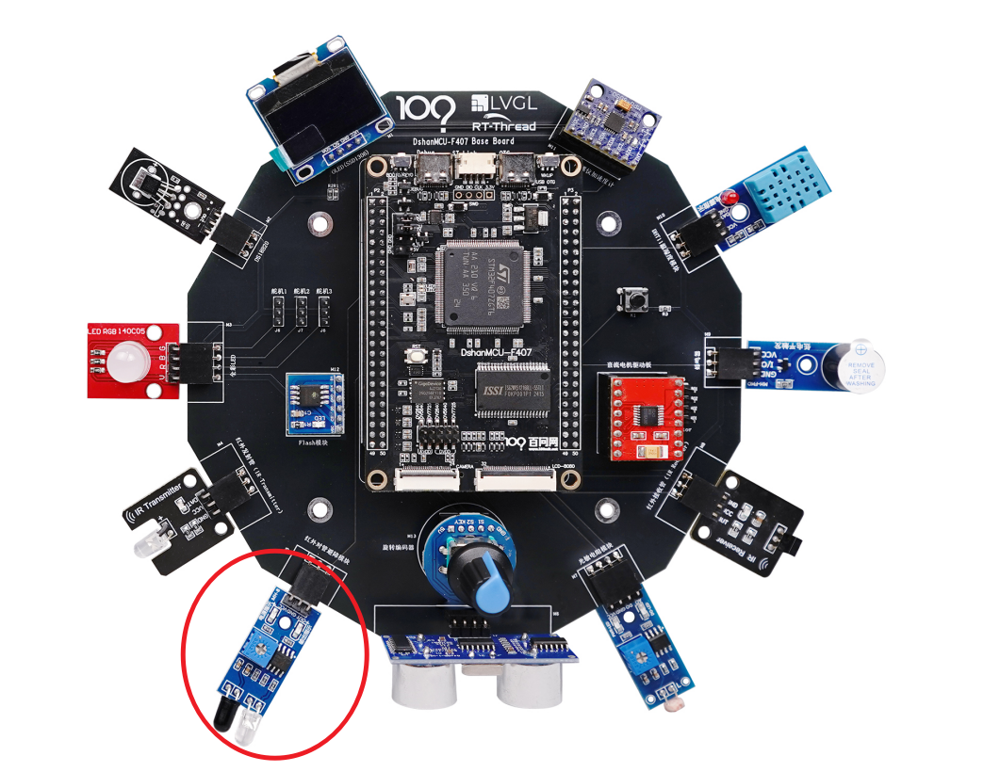

接线图如下：

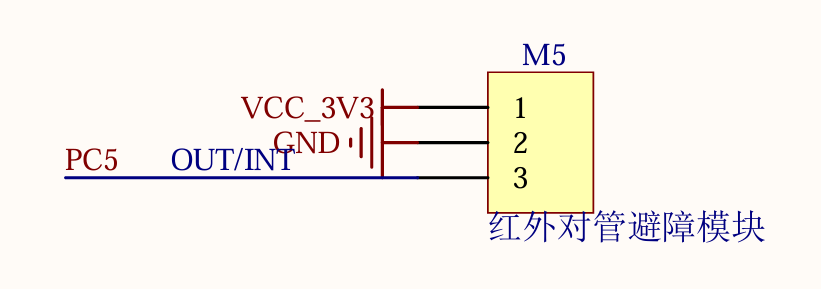

读取PC5引脚，如果是低电平，则表示即将碰到障碍物。

### 5.10.2 STM32CubeMX配置

红外避障模块使用PC5，把它配置为输入引脚即可，如下图：

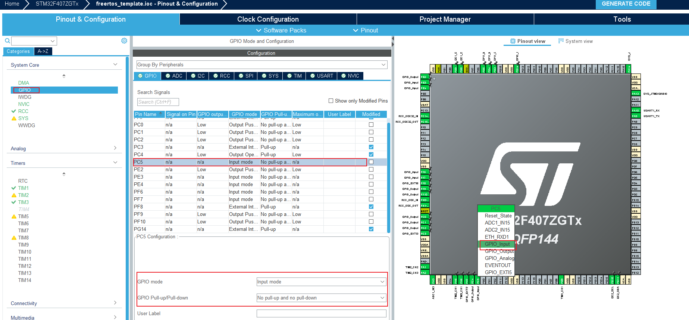

### 5.10.3 代码调用

这里使用到的驱动以及测试代码位于 “Drivers/DShanMCU_Driver/driver_ir_obstacle.c” 和 “Drivers/DShanMCU_Driver/driver_ir_obstacle.h” 中。其中，**IRObstacle_Test** 函数完成了红外避障模块的初始化与测试工作。

**IRObstacle****_Test** 函数在 “Core/Src/freertos.c” 文件中被**StartDefaultTask **函数调用。

打开 “Core/Src/freertos.c” 文件，将**StartDefaultTask **函数中的 **IRObstacle****_Test **前面的注释去掉，并检查是否有其他函数未被注释(因为每个测试函数中都使用到死循环，所以每次只能运行位于最前面的测试项)，如下所示：

```c
void StartDefaultTask(void *argument)
{
  /* USER CODE BEGIN StartDefaultTask */
  /* Infinite loop */
  LCD_Init();
  LCD_Clear();

  for(;;)
  {
    //Led_Test();
    //LCD_Test();
    //MPU6050_Test();
    //DS18B20_Test();
    //DHT11_Test();
    //ActiveBuzzer_Test();
    //PassiveBuzzer_Test();
    //ColorLED_Test();
    //IRReceiver_Test();
    //IRSender_Test();
    //LightSensor_Test();
    Obstacle_Test();
    //SR04_Test();
    //W25Q64_Test();
    //RotaryEncoder_Test();
    //Key_Test();
//UART_Test();
//Motor_Test();
  }
  /* USER CODE END StartDefaultTask */
}
```

### 5.10.4 上机实验

会看到OLED屏幕上显示红外避障模块实时检测的状态信息(是否碰撞到障碍物)。

## 5.11 超声波测距模块驱动使用方法

本节介绍超声波测距模块驱动的使用方法，最终实现测距功能。

### 5.11.1 硬件接线

将超声波测距模块接到配套的DShanMCU-F407开发板上即可，具体位置是印有“超声波模块” 丝印的排母接口，如下图所示：

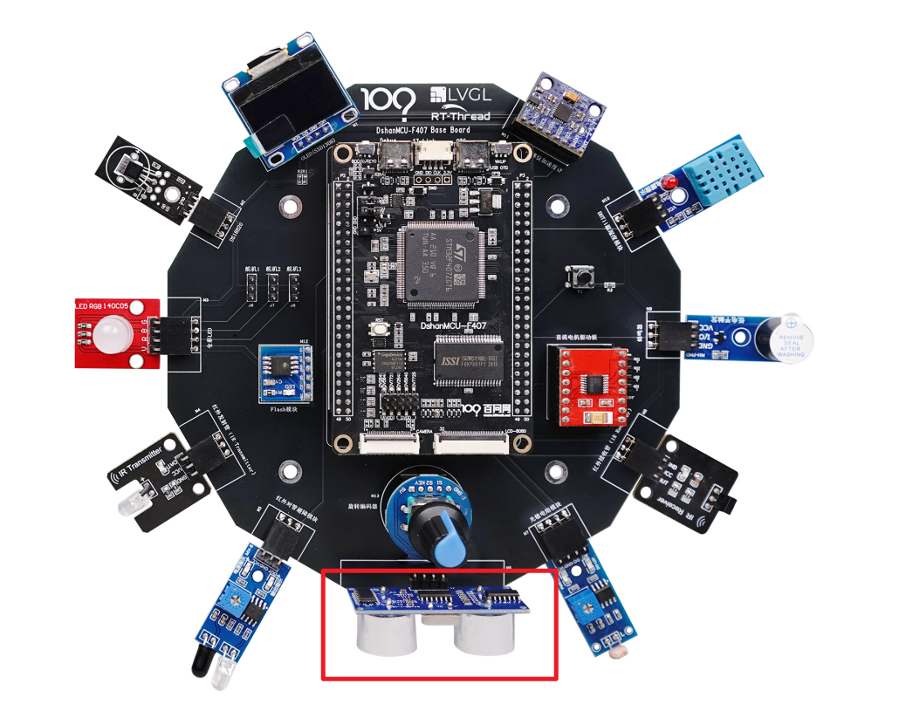

接线图如下：

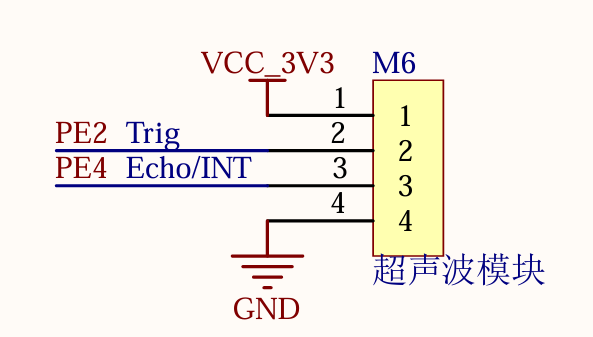

### 5.11.2 操作方法

超声波测距模块是利用超声波来测距。模块先发送超声波，然后接收反射回来的超声波，由反射经历的时间和声音的传播速度340m/s，计算得出距离。

SR04是一款常见的超声波传感器，模块自动发送8个40KHz的方波，自动检测是否有信号返回，用户只需提供一个触发信号，随后检测回响信号的时间长短即可。

SR04采用5V电压，静态电流小于2mA，感应角度最大约15度，探测距离约2cm-450cm。

SR04模块上面有四个引脚，分别为：VCC、Trig、Echo、GND。

Trig是脉冲触发引脚，即控制该脚让SR04模块开始发送超声波。

Echo是回响接收引脚，即SR04模块一旦接收到超声波的返回信号则输出回响信号，回响信号的脉冲宽度与所测距离成正比。

SR04超声波测距模块时序图所下图所示：

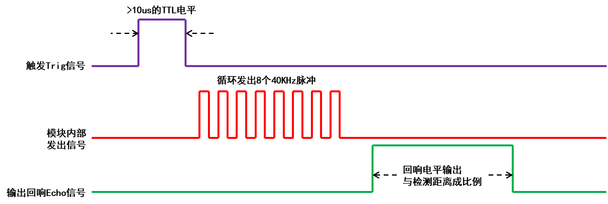

要测距，需如下操作：

① 触发：

向Trig（脉冲触发引脚）发出一个大约10us的高电平。

② 发出超声波，接收反射信号：

模块就自动发出8个40Khz的超声波，超声波遇到障碍物后反射回来，模块接收返回来的超声波。

③ 回响：

模块接收到反射回来的超声波后，Echo引脚输出一个与检测距离成比例的高电平。

我们只要在该引脚为高时，开启定时器计数，在该引脚变为低时，结束定时器计数。根据定时器的计数和定时器频率就可以算出经历时间，根据时间即可推导出距离。

计算公式为：测试距离=(高电平时间*声速(340M/S))/2;

### 5.11.3 编程思路

发出触发信号后，使用高精度计时器计算回响电平的高电平时间，从而计算距离。核心代码如下：

```c

/**********************************************************************
 * 函数名称： SR04_Read
 * 功能描述： 超声测距模块读取距离函数
 * 输入参数： 无
 * 输出参数： pData - 用来保存距离(单位cm)
 * 返 回 值： 0 - 成功, (-1) - 失败
 * 修改日期：      版本号     修改人         修改内容
 * -----------------------------------------------
 * 2024/07/18        V1.1     韦东山         创建
 ***********************************************************************/
int SR04_Read(uint32_t *pData)
{
    uint32_t timeout = SR04_TIMEOUT;
    uint64_t time;

    /* 发送Trig信号 */
    HAL_GPIO_WritePin(SR04_TRIG_GPIO_GROUP, SR04_TRIG_GPIO_PIN, GPIO_PIN_SET);
    udelay(20);
    HAL_GPIO_WritePin(SR04_TRIG_GPIO_GROUP, SR04_TRIG_GPIO_PIN, GPIO_PIN_RESET);

    /* 上升沿记录起始时间 */
    while (timeout-- && (HAL_GPIO_ReadPin(SR04_ECHO_GPIO_GROUP, SR04_ECHO_GPIO_PIN) == GPIO_PIN_RESET))
    {
        udelay(1);
    }
    if (!timeout)
    {
        return -1;
    }
    time = system_get_ns();

    /* 下降沿记录结束时间, 并计算时间差, 计算距离 */
    timeout = SR04_TIMEOUT;
    while (timeout-- && (HAL_GPIO_ReadPin(SR04_ECHO_GPIO_GROUP, SR04_ECHO_GPIO_PIN) == GPIO_PIN_SET))
    {
        udelay(1);
    }
    if (!timeout)
    {
        return -1;
    }

    time  = system_get_ns() - time;

    *pData =  time * 17 / 1000000; // time /1000000000 * 340 * 100 / 2
    return 0;
}
```

### 5.11.4 STM32CubeMX配置

超声测距模块SR04使用PE2最为Trig引脚，使用PE4作为Echo引脚。把PE2设置为输出、把PE4设置为输入即可。如下图所示：

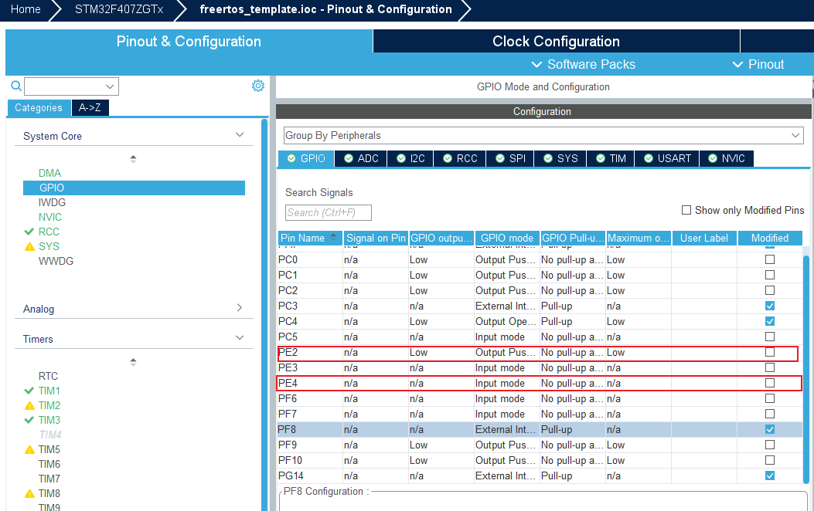

### 5.11.5 代码调用

这里使用到的驱动以及测试代码位于 “Drivers/DShanMCU_Driver/driver_ultrasonic_sr04.c” 和 “Drivers/DShanMCU_Driver/driver_ultrasonic_sr04.h” 中。其中，**SR****04_Test** 函数完成了超声波测距模块的初始化与测试工作。

**SR****04****_Test** 函数在 “Core/Src/freertos.c” 文件中被**StartDefaultTask **函数调用。

打开 “Core/Src/freertos.c” 文件，将**StartDefaultTask **函数中的 **SR****04****_Test **前面的注释去掉，并检查是否有其他函数未被注释(因为每个测试函数中都使用到死循环，所以每次只能运行位于最前面的测试项)，如下所示：

```c
void StartDefaultTask(void *argument)
{
  /* USER CODE BEGIN StartDefaultTask */
  /* Infinite loop */
  LCD_Init();
  LCD_Clear();

  for(;;)
  {
    //Led_Test();
    //LCD_Test();
    //MPU6050_Test();
    //DS18B20_Test();
    //DHT11_Test();
    //ActiveBuzzer_Test();
    //PassiveBuzzer_Test();
    //ColorLED_Test();
    //IRReceiver_Test();
    //IRSender_Test();
    //LightSensor_Test();
    //Obstacle_Test();
    SR04_Test();
    //W25Q64_Test();
    //RotaryEncoder_Test();
    //Key_Test();
//UART_Test();
//Motor_Test();
  }
  /* USER CODE END StartDefaultTask */
}
```

### 5.11.6 上机实验

会看到OLED屏幕上显示超声波测距模块实时检测的距离信息(单位cm)。

## 5.12 旋转编码器模块驱动使用方法

本节介绍旋转编码器模块驱动的使用方法，最终实现旋转编码器的操作功能(正反转、按下)。

### 5.12.1 硬件接线

将旋转编码器模块接到配套的DShanMCU-F407开发板上即可，具体位置是印有“旋转编码器” 丝印的排母接口，如下图所示：

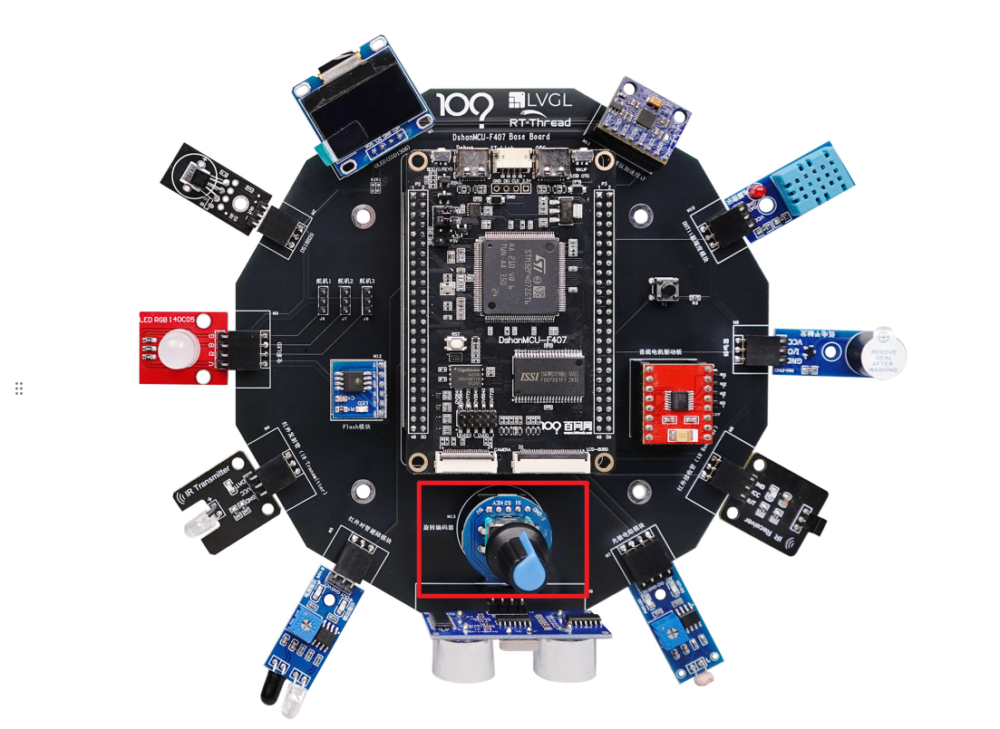

接线图如下：

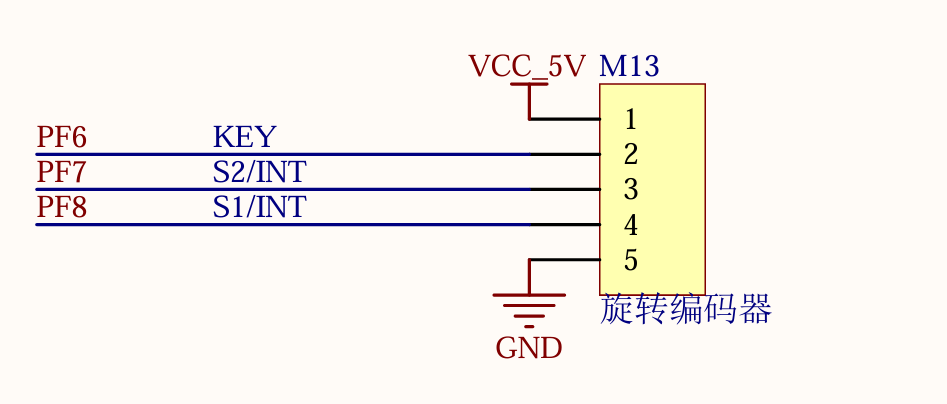

### 5.12.2 操作方法

旋转编码器的S1、S2输出信号如下：

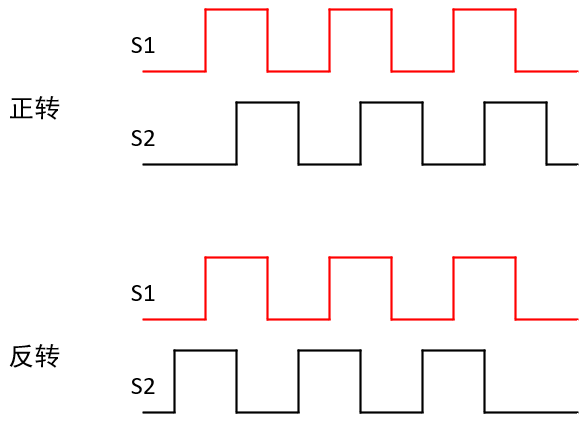

可以设置S1位上升沿触发中断，在中断函数里读取S2的电平：S2为低电平则表示正转，否则表示反转。根据2次中断发生的间隔，就可以算出旋转速度。

### 5.12.3 核心函数

核心函数为中断回调函数，代码如下：

```c
/**********************************************************************
 * 函数名称： RotaryEncoder_IRQ_Callback
 * 功能描述： 旋转编码器的中断回调函数
 * 输入参数： 无
 * 输出参数： 无
 * 返 回 值： 无
 * 修改日期：      版本号     修改人         修改内容
 * -----------------------------------------------
 * 2024/07/18        V1.1     韦东山         创建
 ***********************************************************************/
void RotaryEncoder_IRQ_Callback(void)
{
    uint64_t time;
    static uint64_t pre_time = 0;
    struct rotary_data rdata;

    BaseType_t xHigherPriorityTaskWoken = pdFALSE;

    /* 1. 记录中断发生的时刻 */
    time = system_get_ns();

    /* 上升沿触发: 必定是高电平
     * 防抖
     */
    mdelay(2);
    if (!RotaryEncoder_Get_S1())
        return;

    /* S1上升沿触发中断
     * S2为0表示逆时针转, 为1表示顺时针转
     */
    g_speed = (uint64_t)1000000000/(time - pre_time);
    if (RotaryEncoder_Get_S2())
    {
        g_count++;
    }
    else
    {
        g_count--;
        g_speed = 0 - g_speed;
    }
    pre_time = time;

    /* 写队列 */
    rdata.cnt   = g_count;
    rdata.speed = g_speed;
    xQueueSendFromISR(g_xQueueRotary, &rdata, &xHigherPriorityTaskWoken);
    portYIELD_FROM_ISR(xHigherPriorityTaskWoken);
}
```

### 5.12.4 STM32CubeMX配置

旋转编码器使用PF8作为S1引脚（作为中断引脚，上升沿触发），使用PF7作为S2引脚（作为输入引脚），使用PF6作为Key引脚（作为输入引脚）。配置如下：

PF6、PF7：

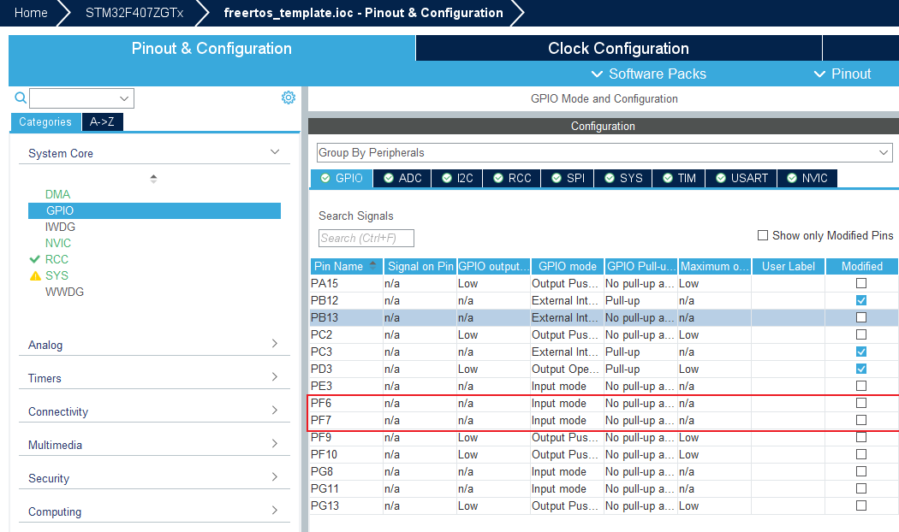

PB13:

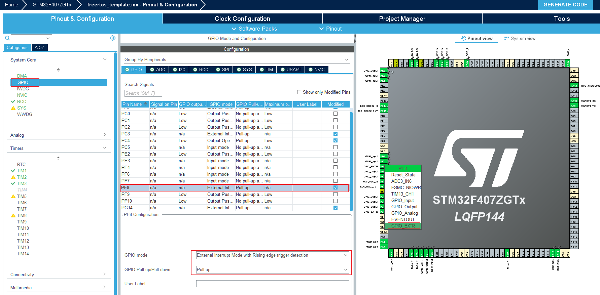

### 5.12.5 代码调用

这里使用到的驱动以及测试代码位于 “Drivers/DShanMCU_Driver/driver_rotary_encoder.c” 和 “Drivers/DShanMCU_Driver/driver_rotary_encoder.h” 中。其中，**RotaryEncoder_Test** 函数完成了旋转编码器模块的初始化与测试工作。

**RotaryEncoder****_Test** 函数在 “Core/Src/freertos.c” 文件中被**StartDefaultTask **函数调用。

打开 “Core/Src/freertos.c” 文件，将**StartDefaultTask **函数中的 **RotaryEncoder****_Test **前面的注释去掉，并检查是否有其他函数未被注释(因为每个测试函数中都使用到死循环，所以每次只能运行位于最前面的测试项)，如下所示：

```c
void StartDefaultTask(void *argument)
{
  /* USER CODE BEGIN StartDefaultTask */
  /* Infinite loop */
  LCD_Init();
  LCD_Clear();

  for(;;)
  {
    //Led_Test();
    //LCD_Test();
    //MPU6050_Test();
    //DS18B20_Test();
    //DHT11_Test();
    //ActiveBuzzer_Test();
    //PassiveBuzzer_Test();
    //ColorLED_Test();
    //IRReceiver_Test();
    //IRSender_Test();
    //LightSensor_Test();
    //Obstacle_Test();
    //SR04_Test();
    //W25Q64_Test();
    RotaryEncoder_Test();
    //Key_Test();
//UART_Test();
//Motor_Test();
  }
  /* USER CODE END StartDefaultTask */
}
```

### 5.12.6 上机实验

会看到OLED屏幕上显示旋转编码器模块的状态信息(正反转及计数、按下)。

## 5.13 红外接收模块驱动使用方法

本节介绍红外接收模块驱动的使用方法，最终实现红外接收模块的接收功能。

### 5.13.1 硬件接线

将红外接收模块接到配套的DShanMCU-F407开发板上即可，具体位置是印有“红外接收管(IR Receiver)” 丝印的排母接口，如下图所示：

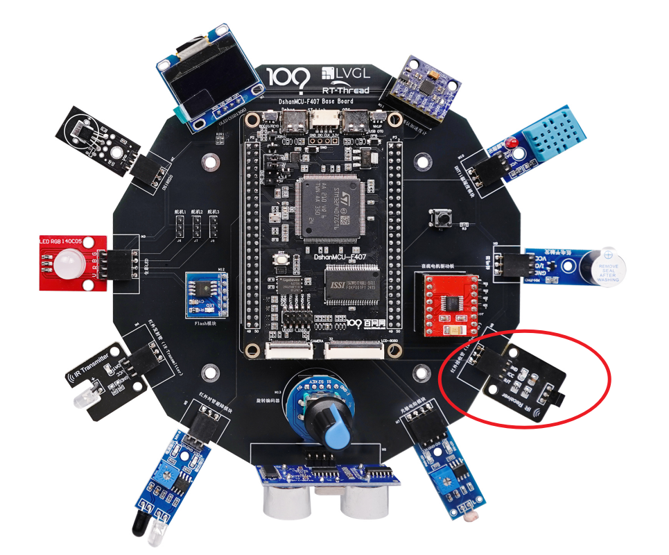

接线图如下：

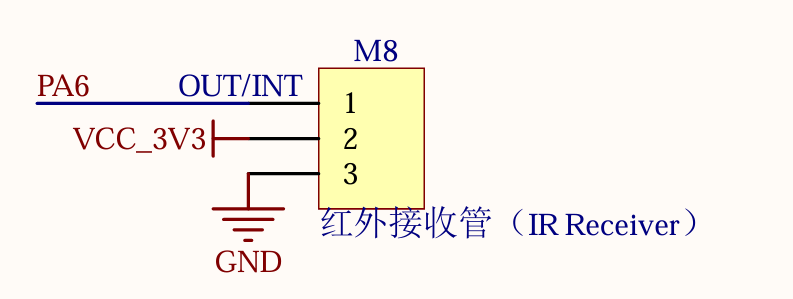

### 5.13.2 操作方法

NEC协议是众多红外遥控协议的其中一种,除NEC外,还有RC5、RC6等协议。市面上买到的非学习型万能电视遥控器大多集成一种或多种编码，一般都支持NEC协议。

NEC编码的一帧（通常按一下遥控器按钮所发送的数据）由引导码、地址码及数据码组成，如下图所示，把地址码及数据码取反的作用是验证数据的正确性。

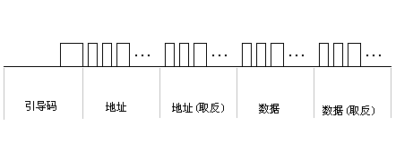

当一直按住一个按钮的时候，会隔110ms左右发一次连续码，连续码后面不带任何数据。NEC协议的信号定义如下图所示：

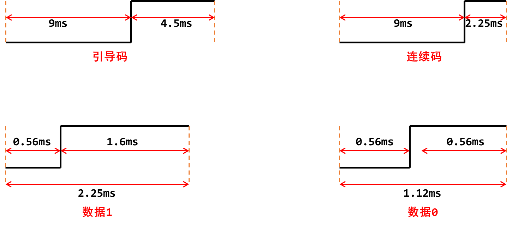

引导码由一个9ms的低脉冲加上一个4.5ms的高脉冲组成，它用来通知接收方“我要开始传输数据了”。

数据1和0，开始都是0.56ms的低脉冲，对于数据1，后面的高脉冲比较长；对于数据0，后面的高脉冲比较短。

NEC协议里有很多时间，这些时间有一个有趣的现象，把所有时间里面最小的0.56ms看作基本脉冲宽度，假设用t表示，那么其它时长都是t的倍数。

NEC协议中，信号的最小时间单位是0.56ms，这个时间对人来说是很短的，但对于嵌入式系统它是很长的，足够做很多事情了。我们并不知道用户什么时候按下遥控器，使用轮询的方式特别耗资源，因此使用中断来处理。

### 5.13.3 编程思路

在中断函数里记录上升沿、下降沿的发生时刻，当收到足够的数据后，就分析这些时刻，解析出数据。

中断函数代码如下：

```c
/**********************************************************************
 * 函数名称： IRReceiver_IRQ_Callback
 * 功能描述： 红外接收器的中断回调函数,记录中断时刻
 * 输入参数： 无
 * 输出参数： 无
 * 返 回 值： 无
 * 修改日期：      版本号     修改人         修改内容
 * -----------------------------------------------
 * 2024/07/18        V1.1     韦东山         创建
 ***********************************************************************/
void IRReceiver_IRQ_Callback(void)
{
    uint64_t time;
    static uint64_t pre_time = 0;

    struct ir_data data;

    /* 1. 记录中断发生的时刻 */
    time = system_get_ns();

    /* 一次按键的最长数据 = 引导码 + 32个数据"1" = 9+4.5+2.25*32 = 85.5ms
     * 如果当前中断的时刻, 举例上次中断的时刻超过这个时间, 以前的数据就抛弃
     */
    if (time - pre_time > 100000000)
    {
        g_IRReceiverIRQ_Cnt = 0;
    }
    pre_time = time;

    g_IRReceiverIRQ_Timers[g_IRReceiverIRQ_Cnt] = time;

    /* 2. 累计中断次数 */
    g_IRReceiverIRQ_Cnt++;

    /* 3. 次数达标后, 解析数据, 放入buffer */
    if (g_IRReceiverIRQ_Cnt == 4)
    {
        /* 是否重复码 */
        if (isRepeatedKey())
        {
            /* device: 0, val: 0, 表示重复码 */
            //PutKeyToBuf(0);
            //PutKeyToBuf(0);
            /* 写队列 */
            data.dev = 0;
            data.val = 0;
            DispatchKey(&data);
            g_IRReceiverIRQ_Cnt = 0;
        }
    }
    if (g_IRReceiverIRQ_Cnt == 68)
    {
        IRReceiver_IRQTimes_Parse();
        g_IRReceiverIRQ_Cnt = 0;
    }
}
```

解析“重复码”的代码如下：

```c

/**********************************************************************
 * 函数名称： isRepeatedKey
 * 功能描述： 解析中断回调函数里记录的时间序列,判断是否重复码
 * 输入参数： 无
 * 输出参数： 无
 * 返 回 值： 1 - 是, (0) - 不是
 * 修改日期：      版本号     修改人         修改内容
 * -----------------------------------------------
 * 2024/07/18        V1.1     韦东山         创建
 ***********************************************************************/
static int isRepeatedKey(void)
{
    uint64_t time;

    /* 1. 判断重复码 : 9ms的低脉冲, 2.25ms高脉冲  */
    time = g_IRReceiverIRQ_Timers[1] - g_IRReceiverIRQ_Timers[0];
    if (time < 8000000 || time > 10000000)
    {
        return 0;
    }

    time = g_IRReceiverIRQ_Timers[2] - g_IRReceiverIRQ_Timers[1];
    if (time < 2000000 || time > 2500000)
    {
        return 0;
    }

    return 1;
}
```

解析普通键值的代码如下：

```c

/**********************************************************************
 * 函数名称： IRReceiver_IRQTimes_Parse
 * 功能描述： 解析中断回调函数里记录的时间序列,得到的device和key放入环形缓冲区
 * 输入参数： 无
 * 输出参数： 无
 * 返 回 值： 0 - 成功, (-1) - 失败
 * 修改日期：      版本号     修改人         修改内容
 * -----------------------------------------------
 * 2024/07/18        V1.1     韦东山         创建
 ***********************************************************************/
static int IRReceiver_IRQTimes_Parse(void)
{
    uint64_t time;
    int i;
    int m, n;
    unsigned char datas[4];
    unsigned char data = 0;
    int bits = 0;
    int byte = 0;
    struct ir_data idata;

    /* 1. 判断前导码 : 9ms的低脉冲, 4.5ms高脉冲  */
    time = g_IRReceiverIRQ_Timers[1] - g_IRReceiverIRQ_Timers[0];
    if (time < 8000000 || time > 10000000)
    {
        return -1;
    }

    time = g_IRReceiverIRQ_Timers[2] - g_IRReceiverIRQ_Timers[1];
    if (time < 3500000 || time > 55000000)
    {
        return -1;
    }

    /* 2. 解析数据 */
    for (i = 0; i < 32; i++)
    {
        m = 3 + i*2;
        n = m+1;
        time = g_IRReceiverIRQ_Timers[n] - g_IRReceiverIRQ_Timers[m];
        data <<= 1;
        bits++;
        if (time > 1000000)
        {
            /* 得到了数据1 */
            data |= 1;
        }

        if (bits == 8)
        {
            datas[byte] = data;
            byte++;
            data = 0;
            bits = 0;
        }
    }

    /* 判断数据正误 */
    datas[1] = ~datas[1];
    datas[3] = ~datas[3];

    if ((datas[0] != datas[1]) || (datas[2] != datas[3]))
    {
        g_IRReceiverIRQ_Cnt = 0;
        return -1;
    }

    //PutKeyToBuf(datas[0]);
    //PutKeyToBuf(datas[2]);
    /* 写队列 */
    idata.dev = datas[0];
    idata.val = datas[2];

    DispatchKey(&idata);

    return 0;
}
```

### 5.13.4 STM32CubeMX配置

红外接收模块使用PA6作为中断引脚，双边沿触发。要使能内部上拉，因为没有外部上拉电阻。配置如下：

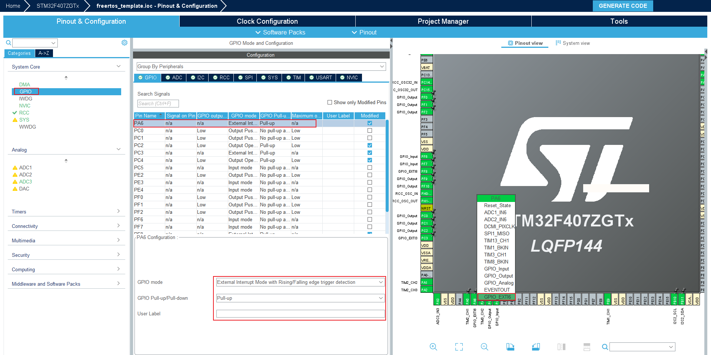

### 5.13.5 代码调用

这里使用到的驱动以及测试代码位于 “Drivers/DShanMCU_Driver/driver_ir_receiver.c” 和 “Drivers/DShanMCU_Driver/driver_ir_receiver.h” 中。其中，**IRReceiver_Test** 函数完成了红外接收模块的初始化与测试工作。

**IRReceiver_Test** 函数在 “Core/Src/freertos.c” 文件中被**StartDefaultTask **函数调用。

打开 “Core/Src/freertos.c” 文件，将**StartDefaultTask **函数中的 **IRReceiver****_Test **前面的注释去掉，并检查是否有其他函数未被注释(因为每个测试函数中都使用到死循环，所以每次只能运行位于最前面的测试项)，如下所示：

```c
void StartDefaultTask(void *argument)
{
  /* USER CODE BEGIN StartDefaultTask */
  /* Infinite loop */
  LCD_Init();
  LCD_Clear();

  for(;;)
  {
    //Led_Test();
    //LCD_Test();
    //MPU6050_Test();
    //DS18B20_Test();
    //DHT11_Test();
    //ActiveBuzzer_Test();
    //PassiveBuzzer_Test();
    //ColorLED_Test();
    IRReceiver_Test();
    //IRSender_Test();
    //LightSensor_Test();
    //Obstacle_Test();
    //SR04_Test();
    //W25Q64_Test();
    //RotaryEncoder_Test();
    //Key_Test();
//UART_Test();
//Motor_Test();
  }
  /* USER CODE END StartDefaultTask */
}
```

## 5.14 红外发射模块驱动使用方法

本节介绍红外发射模块驱动的使用方法，最终实现红外发射模块的发射功能。

### 5.14.1 硬件接线

将红外发射模块接到配套的DShanMCU-F407开发板上即可，具体位置是印有“红外发射管(IR Transmitter)” 丝印的排母接口，如下图所示：


接线图如下：


### 5.14.2 操作方法

给红外发射管输入38KHz的PWM波，它就会对外发射信号；停止输入PWM波，它也就不再对外发射信号。

它跟红外接收管遵循相同的协议，比如要发出如下引导码，需要给红外发射管提供9ms的PWM波，然后停止4.5ms：


### 5.14.3 编程思路

先初始PWM信号，代码如下：

```c

/**********************************************************************
 * 函数名称： IRSender_Init
 * 功能描述： 红外发送器的初始化函数
 * 输入参数： 无
 * 输出参数： 无
 * 返 回 值： 无
 * 修改日期：      版本号     修改人         修改内容
 * -----------------------------------------------
 * 2024/07/18        V1.1     韦东山         创建
 ***********************************************************************/
void IRSender_Init(void)
{
    TIM_OC_InitTypeDef sConfig;

    HAL_TIM_Base_DeInit(g_HPWM_IRSender);
    g_HPWM_IRSender->Instance = TIM3;
    g_HPWM_IRSender->Init.Prescaler = 0;
    g_HPWM_IRSender->Init.CounterMode = TIM_COUNTERMODE_UP;
    g_HPWM_IRSender->Init.Period = 1894;  /* 38KHz */
    g_HPWM_IRSender->Init.ClockDivision = TIM_CLOCKDIVISION_DIV1;
    g_HPWM_IRSender->Init.RepetitionCounter = 0;
    g_HPWM_IRSender->Init.AutoReloadPreload = TIM_AUTORELOAD_PRELOAD_ENABLE;
    HAL_TIM_Base_Init(g_HPWM_IRSender);

    sConfig.OCMode = TIM_OCMODE_PWM1;        // PWM 输出的两种模式:PWM1 当极性为低,CCR<CNT,输出低电平,反之高电平
    sConfig.OCPolarity = TIM_OCPOLARITY_LOW; // 设置极性为低(硬件上低电平亮灯)
    sConfig.OCFastMode = TIM_OCFAST_DISABLE; // 输出比较快速使能禁止(仅在 PWM1 和 PWM2 可设置)
    sConfig.Pulse      = 473;                // 在 PWM1 模式下,75%占空比

    HAL_TIM_PWM_ConfigChannel(g_HPWM_IRSender, &sConfig, IR_SENDER_CHANNEL);
}
```

然后控制PWM波的时间，从而发送信号。核心函数代码如下：

```c
/**********************************************************************
 * 函数名称： IRSender_Write
 * 功能描述： 红外发送器的发送函数
 * 输入参数： device - 设备ID
 *            data   - 按键码
 * 输出参数： 无
 * 返 回 值： 无
 * 修改日期：      版本号     修改人         修改内容
 * -----------------------------------------------
 * 2024/07/18        V1.1     韦东山         创建
 ***********************************************************************/
void IRSender_Write(uint8_t device, uint8_t data)
{
    uint8_t datas[4];
    int i, j;

    datas[0] = device;
    datas[1] = ~device;
    datas[2] = data;
    datas[3] = ~data;

    /* 发送引导码: 9ms低脉冲,4.5ms高脉冲 */
    HAL_TIM_PWM_Start(g_HPWM_IRSender, IR_SENDER_CHANNEL);
    udelay(9000);
    HAL_TIM_PWM_Stop(g_HPWM_IRSender, IR_SENDER_CHANNEL);
    udelay(4500);

    /* 发送32位数据: 先发送MSB */
    for (i = 0; i < 4; i++)
    {
        /* 发送数据位:
         * 1 : 0.56ms低脉冲, 1.6ms高脉冲
         * 0 : 0.56ms低脉冲, 0.56ms高脉冲
         */
        for (j = 7; j >= 0; j--)
        {
            HAL_TIM_PWM_Start(g_HPWM_IRSender, IR_SENDER_CHANNEL);
            udelay(560);
            HAL_TIM_PWM_Stop(g_HPWM_IRSender, IR_SENDER_CHANNEL);
            if (datas[i] & (1<<j))
            {
                udelay(1600);
            }
            else
            {
                udelay(560);
            }
        }
    }

    /* 0.56ms的低脉冲表示数据传输结束 */
    HAL_TIM_PWM_Start(g_HPWM_IRSender, IR_SENDER_CHANNEL);
    udelay(560);
    HAL_TIM_PWM_Stop(g_HPWM_IRSender, IR_SENDER_CHANNEL);
}
```

### 5.14.4 STM32CubeMX配置

红外发射模使用PA7。

红外发射模块驱动driver_ir_sender.c文件的IRSender_Init函数里，已经把PA7配置为TIM3_CH2。

无需使用STM32CubeMX来配置PA7。

### 5.14.5 代码调用

这里使用到的驱动以及测试代码位于 “Drivers/DShanMCU_Driver/driver_ir_sender.c” 和 “Drivers/DShanMCU_Driver/driver_ir_sender.h” 中。其中，**IR****Send****er_Test** 函数完成了红外发射模块的初始化与测试工作。

**IR****Send****er_Test** 函数在 “Core/Src/freertos.c” 文件中被**StartDefaultTask **函数调用。

打开 “Core/Src/freertos.c” 文件，将**StartDefaultTask **函数中的 **IR****Send****er****_Test **前面的注释去掉，并检查是否有其他函数未被注释(因为每个测试函数中都使用到死循环，所以每次只能运行位于最前面的测试项)，如下所示：

```c
void StartDefaultTask(void *argument)
{
  /* USER CODE BEGIN StartDefaultTask */
  /* Infinite loop */
  LCD_Init();
  LCD_Clear();

  for(;;)
  {
    //Led_Test();
    //LCD_Test();
    //MPU6050_Test();
    //DS18B20_Test();
    //DHT11_Test();
    //ActiveBuzzer_Test();
    //PassiveBuzzer_Test();
    //ColorLED_Test();
    //IRReceiver_Test();
    IRSender_Test();
    //LightSensor_Test();
    //Obstacle_Test();
    //SR04_Test();
    //W25Q64_Test();
    //RotaryEncoder_Test();
    //Motor_Test();
    //Key_Test();
//UART_Test();
//Motor_Test();
  }
  /* USER CODE END StartDefaultTask */
}
```

### 5.14.6 上机实验

会看到OLED屏幕上显示红外发射模块发送的信息(哪个按键信息被发射出去)。

## 5.15 RGB全彩LED模块驱动使用方法

本节介绍RGB全彩LED模块驱动的使用方法，最终实现让RGB全彩LED模块显示不同的颜色。

### 5.15.1 硬件接线

将RGB全彩LED模块接到配套的DShanMCU-F407开发板上即可，具体位置是印有“全彩LED”丝印的排母接口，如下图所示：


接线图如下：


### 5.15.2 STM32CubeMX配置

全彩LED使用PA5、PA1、PA2作为绿色（G）、蓝色（B）、红色（R）的驱动线，这3个引脚被分别配置为TIM2_CHN1、TIM2_CHN2、TIM2_CHN3。TIMER2的配置如下图所示：


### 5.15.3 代码调用

这里使用到的驱动以及测试代码位于 “Drivers/DShanMCU_Driver/driver_color_led.c” 和 “Drivers/DShanMCU_Driver/driver_color_led.h” 中。其中，**ColorLED_Test** 函数完成了RGB全彩LED模块的初始化与测试工作。

**ColorLED_Test** 函数在 “Core/Src/freertos.c” 文件中被**StartDefaultTask **函数调用。

打开 “Core/Src/freertos.c” 文件，将**StartDefaultTask **函数中的 **ColorLED_Test **前面的注释去掉，并检查是否有其他函数未被注释(因为每个测试函数中都使用到死循环，所以每次只能运行位于最前面的测试项)，如下所示：

```c
void StartDefaultTask(void *argument)
{
  /* USER CODE BEGIN StartDefaultTask */
  /* Infinite loop */
  LCD_Init();
  LCD_Clear();

  for(;;)
  {
    //Led_Test();
    //LCD_Test();
    //MPU6050_Test();
    //DS18B20_Test();
    //DHT11_Test();
    //ActiveBuzzer_Test();
    //PassiveBuzzer_Test();
    ColorLED_Test();
    //IRReceiver_Test();
    //IRSender_Test();
    //LightSensor_Test();
    //Obstacle_Test();
    //SR04_Test();
    //W25Q64_Test();
    //RotaryEncoder_Test();
    //Key_Test();
//UART_Test();
//Motor_Test();
  }
  /* USER CODE END StartDefaultTask */
}
```

### 5.15.4 上机实验

会看到RGB全彩LED模块每隔1秒切换为不同的颜色；同时会看到OLED屏幕上显示当前颜色的hex值。

## 5.16 光敏电阻模块驱动使用方法

本节介绍光敏电阻模块驱动的使用方法，最终实现通过光敏电阻模块采集亮度信息。

### 5.16.1 硬件接线

将有光敏电阻模块接到配套的DShanMCU-F407开发板上即可，具体位置是印有“光敏电阻模块” 丝印的排母接口，如下图所示：


接线图如下：


### 5.16.2 操作方法

光敏电阻会因为光照强度的变化而改变阻值，使用一个分压电路来测量电压后，就可以反应出光照的强度。

### 5.16.3 编程思路

配置ADC_IN3，读取模拟值。核心代码如下：

```c
#define LIGHT_SENSOR_ADC_TIMEOUT 500

extern ADC_HandleTypeDef hadc1;
static ADC_HandleTypeDef *g_HADC_LightSensor = &hadc1;

/**********************************************************************
 * 函数名称： LightSensor_Init
 * 功能描述： 光敏电阻的初始化函数
 * 输入参数： 无
 * 输出参数： 无
 * 返 回 值： 无
 * 修改日期：      版本号     修改人         修改内容
 * -----------------------------------------------
 * 2024/07/18        V1.1     韦东山         创建
 ***********************************************************************/
void LightSensor_Init(void)
{
    /* PA3用作ADC(ADC1_IN3) */
    HAL_ADCEx_Calibration_Start(g_HADC_LightSensor);

}
```

### 5.16.4 STM32CubeMX配置

光敏电阻模块使用PA3作为ADC引脚，配置如下：


### 5.16.5 代码调用

这里使用到的驱动以及测试代码位于 “Drivers/DShanMCU_Driver/driver_light_sensor.c” 和 “Drivers/DShanMCU_Driver/driver_light_sensor.h” 中。其中，**LightSensor****_Test** 函数完成了光敏电阻模块的初始化与测试工作。

**LightSensor****_Test** 函数在 “Core/Src/freertos.c” 文件中被**StartDefaultTask **函数调用。

打开 “Core/Src/freertos.c” 文件，将**StartDefaultTask **函数中的 **LightSensor****_Test **前面的注释去掉，并检查是否有其他函数未被注释(因为每个测试函数中都使用到死循环，所以每次只能运行位于最前面的测试项)，如下所示：

```c
void StartDefaultTask(void *argument)
{
  /* USER CODE BEGIN StartDefaultTask */
  /* Infinite loop */
  LCD_Init();
  LCD_Clear();

  for(;;)
  {
    //Led_Test();
    //LCD_Test();
    //MPU6050_Test();
    //DS18B20_Test();
    //DHT11_Test();
    //ActiveBuzzer_Test();
    //PassiveBuzzer_Test();
    //ColorLED_Test();
    //IRReceiver_Test();
    //IRSender_Test();
    LightSensor_Test();
    //Obstacle_Test();
    //SR04_Test();
    //W25Q64_Test();
    //RotaryEncoder_Test();
    //Key_Test();
//UART_Test();
//Motor_Test();
  }
  /* USER CODE END StartDefaultTask */
}
```

### 5.16.6 上机实验

会看到OLED屏幕上显示光敏电阻模块实时采集的亮度信息。

## 5.17 IIC 陀螺仪加速度计模块驱动使用方法

本节介绍IIC 陀螺仪加速度计模块驱动的使用方法，最终实现通过IIC 陀螺仪加速度计模块采集X/Y/Z轴的加速度与角速度信息。

### 5.17.1 硬件接线

将有IIC 陀螺仪加速度计模块接到配套的DShanMCU-F407开发板上即可，具体位置是印有“陀螺仪加速度计” 丝印的排母接口，如下图所示：


接线图如下：


### 5.17.2 操作方法

参考文章：

① STM32 实现 MPU6050 数据读取与倾角检测，[https://zhuanlan.zhihu.com/p/30621372](https://zhuanlan.zhihu.com/p/30621372)

② MPU6050的运动中断应用，[https://blog.csdn.net/sjf8888/article/details/97912391](https://blog.csdn.net/sjf8888/article/details/97912391)

### 5.17.3 STM32CubeMX配置

陀螺仪使用I2C1通道，I2C1使用PB8、PB9作为SCL、SDA引脚，配置如下：


### 5.17.4 代码调用

这里使用到的驱动以及测试代码位于 “Drivers/DShanMCU_Driver/driver_mpu6050.c” 和 “Drivers/DShanMCU_Driver/driver_mpu6050.h” 中。其中，**MPU6050****_Test** 函数完成了IIC 陀螺仪加速度计模块的初始化与测试工作。

**MPU6050****_Test** 函数在 “Core/Src/freertos.c” 文件中被**StartDefaultTask **函数调用。

打开 “Core/Src/freertos.c” 文件，将**StartDefaultTask **函数中的 **MPU6050****_Test **前面的注释去掉，并检查是否有其他函数未被注释(因为每个测试函数中都使用到死循环，所以每次只能运行位于最前面的测试项)，如下所示：

```c
void StartDefaultTask(void *argument)
{
  /* USER CODE BEGIN StartDefaultTask */
  /* Infinite loop */
  LCD_Init();
  LCD_Clear();

  for(;;)
  {
    //Led_Test();
    //LCD_Test();
    MPU6050_Test();
    //DS18B20_Test();
    //DHT11_Test();
    //ActiveBuzzer_Test();
    //PassiveBuzzer_Test();
    //ColorLED_Test();
    //IRReceiver_Test();
    //IRSender_Test();
    //LightSensor_Test();
    //Obstacle_Test();
    //SR04_Test();
    //W25Q64_Test();
    //RotaryEncoder_Test();
    //Key_Test();
//UART_Test();
//Motor_Test();
  }
  /* USER CODE END StartDefaultTask */
}
```

### 5.17.5 上机实验

会看到OLED屏幕上显示IIC 陀螺仪加速度计模块实时采集的X/Y/Z轴的加速度与角速度信息。

## 5.18 SPI FLASH模块驱动使用方法

本节介绍SPI FLASH模块驱动的使用方法，最终实现通过SPI FLASH模块采集亮度信息。

### 5.18.1 硬件接线

将有SPI FLASH模块接到配套的DShanMCU-F407开发板上即可，具体位置是印有“FLASH模块” 丝印的排母接口，如下图所示：


接线图如下：


### 5.18.2 STM32CubeMX配置

SPI Flash模块使用SPI1通道，PB4作为SPI1_MOSI、PB3作为SPI1_SCK、PB5作为SPI1_MISO。另外使用PC1作为片选引脚。

SPI1配置如下图所示：


PC1是片选信号，把它配置为输出引脚，配置如下图所示：


### 5.18.3 代码调用

这里使用到的驱动以及测试代码位于 “Drivers/DShanMCU_Driver/driver_spiflash_w25q64.c” 和 “Drivers/DShanMCU_Driver/driver_spiflash_w25q64.h” 中。其中，**W25Q64****_Test** 函数完成了SPI FLASH模块的初始化与测试工作。

**W25Q64****_Test** 函数在 “Core/Src/freertos.c” 文件中被**StartDefaultTask **函数调用。

打开 “Core/Src/freertos.c” 文件，将**StartDefaultTask **函数中的 **W25Q64****_Test **前面的注释去掉，并检查是否有其他函数未被注释(因为每个测试函数中都使用到死循环，所以每次只能运行位于最前面的测试项)，如下所示：

```c
void StartDefaultTask(void *argument)
{
  /* USER CODE BEGIN StartDefaultTask */
  /* Infinite loop */
  LCD_Init();
  LCD_Clear();

  for(;;)
  {
    //Led_Test();
    //LCD_Test();
    //MPU6050_Test();
    //DS18B20_Test();
    //DHT11_Test();
    //ActiveBuzzer_Test();
    //PassiveBuzzer_Test();
    //ColorLED_Test();
    //IRReceiver_Test();
    //IRSender_Test();
    //LightSensor_Test();
    //Obstacle_Test();
    //SR04_Test();
    W25Q64_Test();
    //RotaryEncoder_Test();
    //Key_Test();
//UART_Test();
//Motor_Test();
  }
  /* USER CODE END StartDefaultTask */
}
```

### 5.18.4 上机实验

会看到OLED屏幕上显示SPI FLASH模块的工作状态信息。

## 5.19 直流电机驱动使用方法

本节介绍直流电机驱动的使用方法，最终实现通过直流电机驱动模块驱动直流电机。

### 5.19.1 硬件接线

将有直流电机驱动模块接到配套的DShanMCU-F407 Base Board学习底板上即可，具体位置是印有“直流电机驱动模块板” 丝印的排母接口，如下图所示：


接线图如下：


### 5.19.2 操作方法

本模块使用的电机驱动芯片为DRV8833，它的真值表如下：

| xIN1 | xIN2 | xO1 | xO2 | 功能 |
| --- | --- | --- | --- | --- |
| 0 | 0 | Z | Z | 惯性运行/快速衰减 |
| 0 | 1 | L | H | 反转 |
| 1 | 0 | H | L | 正转 |
| 1 | 1 | L | L | 制动/慢速衰减 |

### 5.19.3 编程思路

直流电机驱动模块的通道A使用PF0、PF1来控制，这2个引脚没有PWM功能，所以只需要配置为输出即可。只可以控制3个功能：停止、正转、反转。

通道B使用PE5、PF2来控制，PE5可以配置为PWM引脚（TIM9_CHN1），PF2仍然配置为输出引脚。通过PF2可以控制旋转方向，通过设置PE5的PWM占空比，可以调节速度。

核心代码如下：

```c
/**********************************************************************
 * 函数名：Motor_SetPpeed
 * 功能描述：设置马达速度
 * 输入参数：channel - MOTOR_A 或 MOTOR_B
 *           speed - 取值(-100~100),
 *                   0表示停止,
 *                   正数表示顺时针旋转速度,
 *                   负数表示逆时钟旋转速度
 * 输出参数：无
 * 返回值：无
 * 修改日期        版本号     修改人        修改内容
 * -----------------------------------------------
 * 2023/08/05        V1.0     韦东山       创建
 ***********************************************************************/
void Motor_SetSpeed(int32_t channel, int32_t speed)
{
    if (speed > 99)
        speed = 99;
    else if (speed < -99)
        speed = -99;

    if (MOTOR_A == channel)
    {
        if (0 == speed)
        {
            HAL_GPIO_WritePin(MOTOR_A_IN1_GPIO_GROUP, MOTOR_A_IN1_GPIO_PIN, GPIO_PIN_SET);
            HAL_GPIO_WritePin(MOTOR_A_IN2_GPIO_GROUP, MOTOR_A_IN2_GPIO_PIN, GPIO_PIN_SET);
        }
        else if (0 < speed)
        {
            HAL_GPIO_WritePin(MOTOR_A_IN1_GPIO_GROUP, MOTOR_A_IN1_GPIO_PIN, GPIO_PIN_SET);
            HAL_GPIO_WritePin(MOTOR_A_IN2_GPIO_GROUP, MOTOR_A_IN2_GPIO_PIN, GPIO_PIN_RESET);
        }
        else
        {
            HAL_GPIO_WritePin(MOTOR_A_IN1_GPIO_GROUP, MOTOR_A_IN1_GPIO_PIN, GPIO_PIN_RESET);
            HAL_GPIO_WritePin(MOTOR_A_IN2_GPIO_GROUP, MOTOR_A_IN2_GPIO_PIN, GPIO_PIN_SET);
        }
    }

    if (MOTOR_B == channel)
    {
        Motor_PWM_SetSpeed(speed);
    }
}
```

另一核心函数是“Motor_PWM_SetSpeed”，代码如下：

```c

//extern TIM_HandleTypeDef htim9;
//static TIM_HandleTypeDef *g_HPWM_BIN2 = &htim9;

/**********************************************************************
 * 函数名：Motor_PWM_SetDuty
 * 功能描述：初始化Motor
 * 输入参数：channel - MOTOR_A 或 MOTOR_B
 * 输出参数：无
 * 返回值：无
 * 修改日期        版本号     修改人        修改内容
 * -----------------------------------------------
 * 2023/08/05        V1.0     韦东山       创建
 ***********************************************************************/
static void Motor_PWM_SetSpeed(int32_t speed)
{
    GPIO_InitTypeDef GPIO_InitStruct = {0};
    TIM_OC_InitTypeDef sConfig = {0};

    if (speed == 0)
    {
        /*Configure GPIO pin Output Level */
        HAL_GPIO_WritePin(MOTOR_B_IN1_GPIO_GROUP, MOTOR_B_IN1_GPIO_PIN, GPIO_PIN_SET);
        HAL_GPIO_WritePin(MOTOR_B_IN2_GPIO_GROUP, MOTOR_B_IN2_GPIO_PIN, GPIO_PIN_SET);

        /*Configure GPIO pins*/
        GPIO_InitStruct.Pin = MOTOR_B_IN1_GPIO_PIN;
        GPIO_InitStruct.Mode = GPIO_MODE_OUTPUT_PP;
        GPIO_InitStruct.Pull = GPIO_NOPULL;
        GPIO_InitStruct.Speed = GPIO_SPEED_FREQ_LOW;
        HAL_GPIO_Init(MOTOR_B_IN1_GPIO_GROUP, &GPIO_InitStruct);

        GPIO_InitStruct.Pin = MOTOR_B_IN2_GPIO_PIN;
        GPIO_InitStruct.Mode = GPIO_MODE_OUTPUT_PP;
        GPIO_InitStruct.Pull = GPIO_NOPULL;
        GPIO_InitStruct.Speed = GPIO_SPEED_FREQ_LOW;
        HAL_GPIO_Init(MOTOR_B_IN2_GPIO_GROUP, &GPIO_InitStruct);
    }
    else if (speed > 0)
    {
        /* B_IN1 设置为PWM,  B_IN2设置为输出并且输出0 */
        /* B_IN1 */

        /* 配置B_IN1为 PWM引脚 */
        GPIO_InitStruct.Pin = MOTOR_B_IN1_GPIO_PIN;
        GPIO_InitStruct.Mode = GPIO_MODE_AF_PP;
        GPIO_InitStruct.Speed = GPIO_SPEED_FREQ_LOW;
        HAL_GPIO_Init(MOTOR_B_IN1_GPIO_GROUP, &GPIO_InitStruct);

        /* 配置B_IN1的PWM占空比 */

        sConfig.OCMode = TIM_OCMODE_PWM1;         // PWM 输出的两种模式:PWM1 当极性为低,CCR<CNT,输出低电平,反之高电平
        sConfig.OCPolarity = TIM_OCPOLARITY_HIGH; // 设置极性为高(硬件上BIN1为高,BIN2为低电平让motor正转)
        sConfig.OCFastMode = TIM_OCFAST_DISABLE;  // 输出比较快速使能禁止(仅在 PWM1 和 PWM2 可设置)
        sConfig.Pulse = speed*10;                 // 周期是1000, speed取值0~99

        HAL_TIM_PWM_Stop(g_HPWM_BIN1, MOTOR_B_IN1_CHANNEL);
        HAL_TIM_PWM_ConfigChannel(g_HPWM_BIN1, &sConfig, MOTOR_B_IN1_CHANNEL);
        HAL_TIM_PWM_Start(g_HPWM_BIN1, MOTOR_B_IN1_CHANNEL);

        /* B_IN2 */
        HAL_GPIO_WritePin(MOTOR_B_IN2_GPIO_GROUP, MOTOR_B_IN2_GPIO_PIN, GPIO_PIN_RESET);
        GPIO_InitStruct.Pin = MOTOR_B_IN2_GPIO_PIN;
        GPIO_InitStruct.Mode = GPIO_MODE_OUTPUT_PP;
        GPIO_InitStruct.Pull = GPIO_NOPULL;
        GPIO_InitStruct.Speed = GPIO_SPEED_FREQ_LOW;
        HAL_GPIO_Init(MOTOR_B_IN2_GPIO_GROUP, &GPIO_InitStruct);
    }
    else
    {
        speed = 0 - speed;
        /* B_IN1 设置为PWM,  B_IN2设置为输出并且输出1 */
        /* B_IN1 */

        /* 配置B_IN1为 PWM引脚 */
        GPIO_InitStruct.Pin = MOTOR_B_IN1_GPIO_PIN;
        GPIO_InitStruct.Mode = GPIO_MODE_AF_PP;
        GPIO_InitStruct.Speed = GPIO_SPEED_FREQ_LOW;
        HAL_GPIO_Init(MOTOR_B_IN1_GPIO_GROUP, &GPIO_InitStruct);

        /* 配置B_IN1的PWM占空比 */

        sConfig.OCMode = TIM_OCMODE_PWM1;         // PWM 输出的两种模式:PWM1 当极性为低,CCR<CNT,输出低电平,反之高电平
        sConfig.OCPolarity = TIM_OCPOLARITY_HIGH; // 设置极性为高(硬件上BIN2为高,BIN1为低电平让motor反转)
        sConfig.OCFastMode = TIM_OCFAST_DISABLE;  // 输出比较快速使能禁止(仅在 PWM1 和 PWM2 可设置)
        sConfig.Pulse = (99 - speed)*10;          // 周期是1000, speed取值0~99

        HAL_TIM_PWM_Stop(g_HPWM_BIN1, MOTOR_B_IN1_CHANNEL);
        HAL_TIM_PWM_ConfigChannel(g_HPWM_BIN1, &sConfig, MOTOR_B_IN1_CHANNEL);
        HAL_TIM_PWM_Start(g_HPWM_BIN1, MOTOR_B_IN1_CHANNEL);

        /* B_IN2 */
        HAL_GPIO_WritePin(MOTOR_B_IN2_GPIO_GROUP, MOTOR_B_IN2_GPIO_PIN, GPIO_PIN_SET);
        GPIO_InitStruct.Pin = MOTOR_B_IN2_GPIO_PIN;
        GPIO_InitStruct.Mode = GPIO_MODE_OUTPUT_PP;
        GPIO_InitStruct.Pull = GPIO_NOPULL;
        GPIO_InitStruct.Speed = GPIO_SPEED_FREQ_LOW;
        HAL_GPIO_Init(MOTOR_B_IN2_GPIO_GROUP, &GPIO_InitStruct);
    }
}
```

### 5.19.4 STM32CubeMX配置

直流电机驱动模块的通道A使用PF0、PF1来控制，这2个引脚没有PWM功能，所以只需要配置为输出即可。

通道B使用PE5、PF2来控制，PE5可以配置为PWM引脚（TM3_CHN1），PF2仍然配置为输出引脚。

这3个输出引脚配置如下：


PE5配置为PWM引脚（TM9_CHN1），如下图所示：


### 5.19.5 代码调用

这里使用到的驱动以及测试代码位于 “Drivers/DShanMCU_Driver/driver_motor.c” 和 “Drivers/DShanMCU_Driver/driver_motor.h” 中。其中，**Motor****_Test** 函数完成了直流电机驱动模块的初始化与测试工作。

**Motor****_Test** 函数在 “Core/Src/freertos.c” 文件中被**StartDefaultTask **函数调用。

打开 “Core/Src/freertos.c” 文件，将**StartDefaultTask **函数中的 **Motor****_Test **前面的注释去掉，并检查是否有其他函数未被注释(因为每个测试函数中都使用到死循环，所以每次只能运行位于最前面的测试项)，如下所示：

```c
void StartDefaultTask(void *argument)
{
  /* USER CODE BEGIN StartDefaultTask */
  /* Infinite loop */
  LCD_Init();
  LCD_Clear();

  for(;;)
  {
    //Led_Test();
    //LCD_Test();
    //MPU6050_Test();
    //DS18B20_Test();
    //DHT11_Test();
    //ActiveBuzzer_Test();
    //PassiveBuzzer_Test();
    //ColorLED_Test();
    //IRReceiver_Test();
    //IRSender_Test();
    //LightSensor_Test();
    //Obstacle_Test();
    //SR04_Test();
    //W25Q64_Test();
    //RotaryEncoder_Test();
    //Key_Test();
//UART_Test();
Motor_Test();
  }
  /* USER CODE END StartDefaultTask */
}
```

### 5.19.6 上机实验

会看到OLED屏幕上显示直流电机的工作状态信息。
