# 第6章 创建FreeRTOS工程

## 6.1 创建STM32CubeMX工程

双击运行STM32CubeMX，在首页面选择“Access to MCU Selector”，如下图所示：

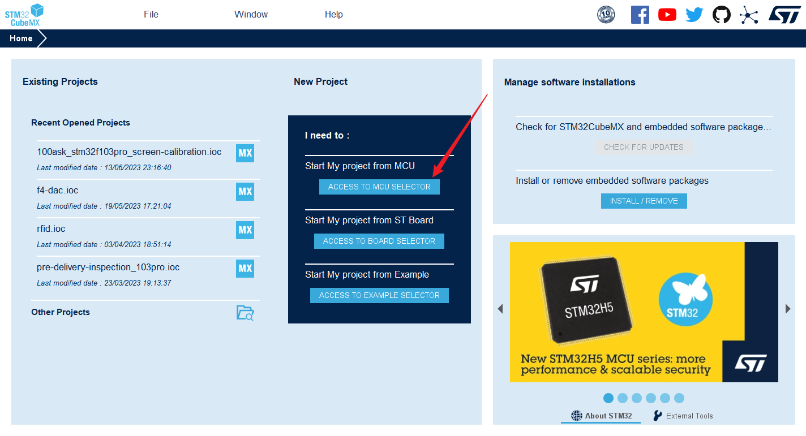

然后来到MCU选型界面，在序列号那里输入想要开发的芯片，例如STM32F407ZGT6：

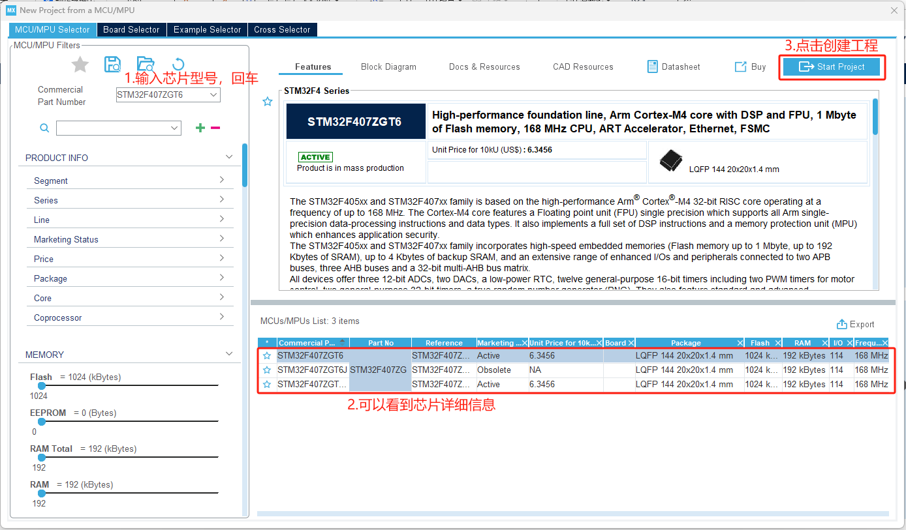

## 6.2 配置时钟

先配置处理器的时钟，在“System Core”的“RCC”处选择外部高速时钟源和低速时钟源。DshanMCU-F407使用了外部高速时钟源，如下图所示：

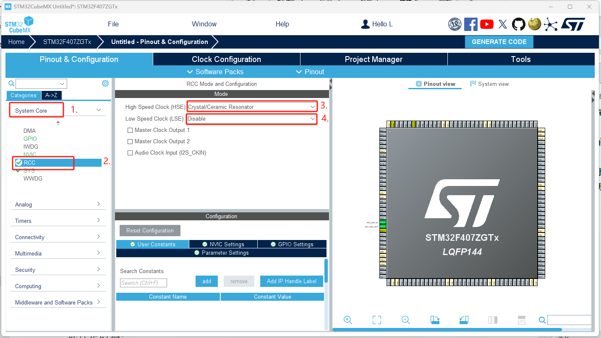

另外，本实验使用了FreeRTOS，FreeRTOS的时基使用的是Systick，而STM32CubeMX中默认的HAL库时基也是Systick，为了避免可能的冲突，最好将HAL库的时基换做其它的硬件定时器：

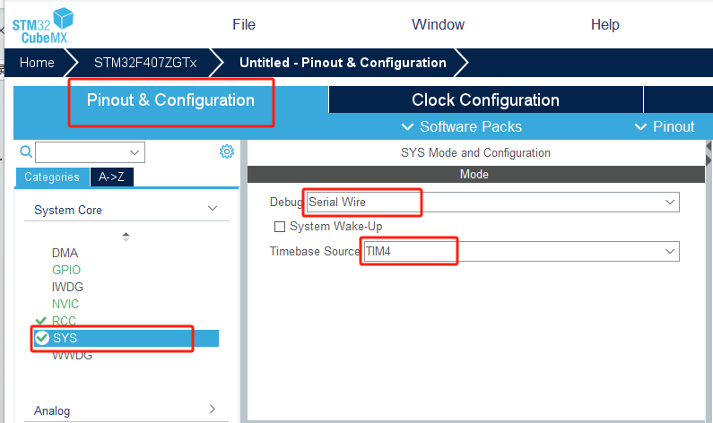

最后去时钟配置界面配置系统时钟频率。直接在HCLK时钟那里输入MCU允许的最高时钟频率。F407的最高频率是168Mhz，所以直接在那里输入168然后按回车：

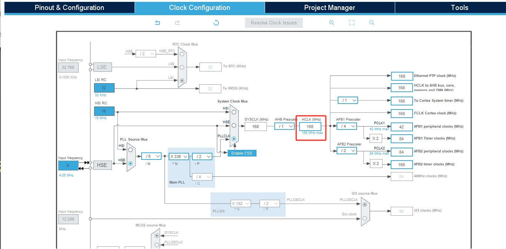

回车后，STM32CubeMX会自动计算得到各个分频系数和倍频系数：

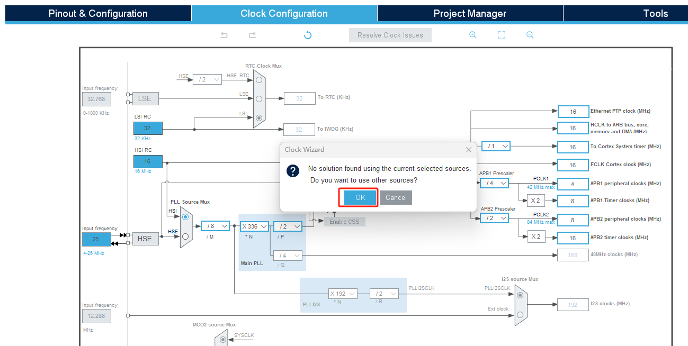

在上图中点击“OK”，就开始自动配置时钟，配置成功后，结果如下图所示：

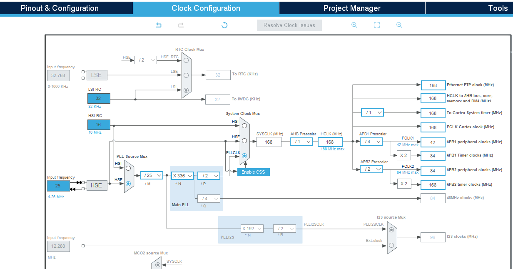

## 6.3 配置GPIO

板载LED的使用的GPIO是PF9、PF10，如下图所示：

所以在STM32CubeMX的引脚配置界面，找到PF9、PF10：

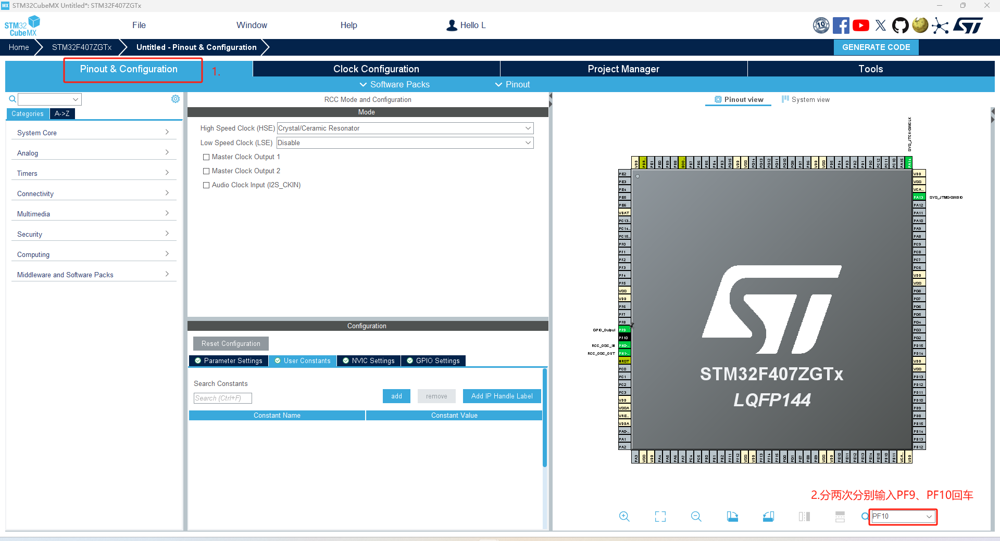

在芯片图中，使用鼠标左键点击PF9、PF10，会弹出此IO支持的模式：

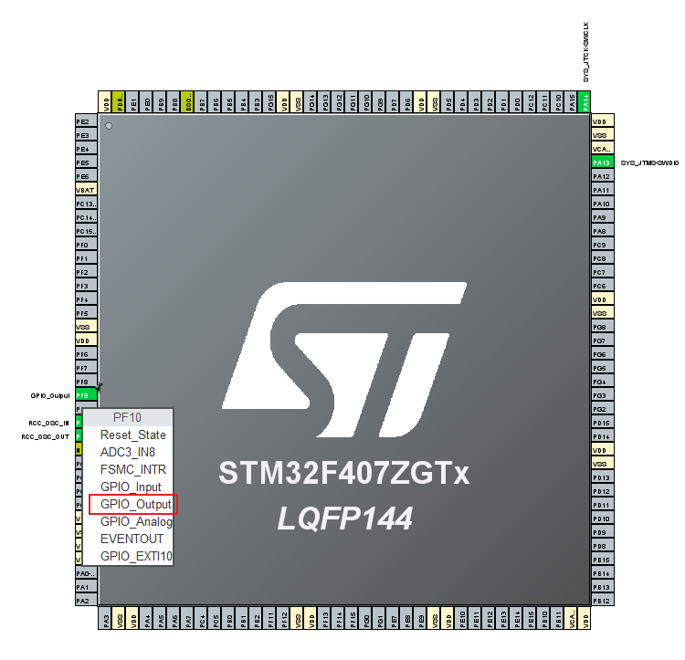

这里选择GPIO Output，让PF9、PF10配置为通用输出IO，以便用来驱动LED的亮灭。

## 6.4 配置FreeRTOS

STM32CubeMX已经将FreeRTOS集成到工具中，并且将RTOS的接口进行了封装CMSIS-RTOS V1/V2，相较之于V1版本的CMSIS-RTOS API，V2版本的API的兼容性更高，为了将来的开发和移植，建议开发者使用V2版本的API：

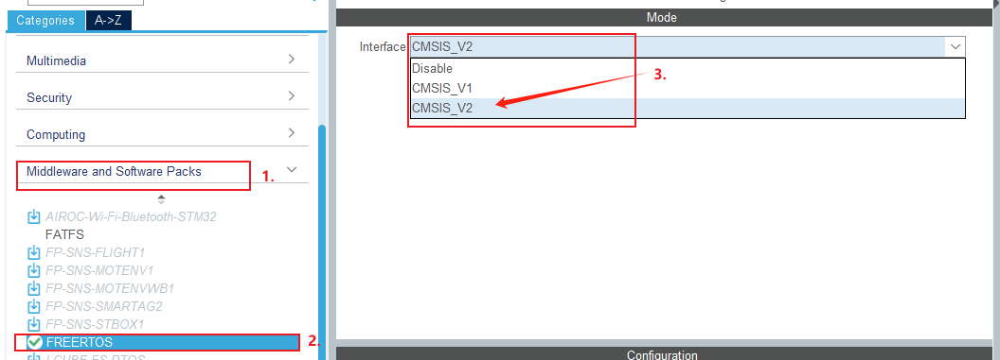

选择CMSIS V2接口后，还要进一步配置FreeRTOS的参数和功能。

### 6.4.1 配置参数

FreeRTOS的参数包括时基频率、任务堆栈大小、是否使能互斥锁等等，需要开发者根据自己对FreeRTOS的了解以及项目开发的需求，来定制参数。

先如下图进行配置：

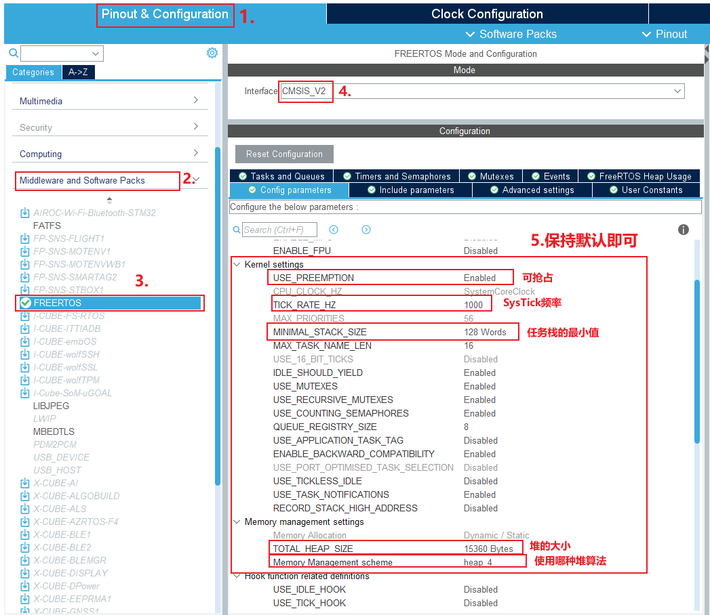

### 6.4.2 添加任务

使用STM32CubeMX，可以手工添加任务、队列、信号量、互斥锁、定时器等等。但是本课程不想严重依赖STM32CubeMX，所以不会使用STM32CubeMX来添加这些对象，而是手写代码来使用这些对象。

使用STM32CubeMX时，有一个默认任务，此任务无法删除，只能修改其名称和函数类型，如下图所示：

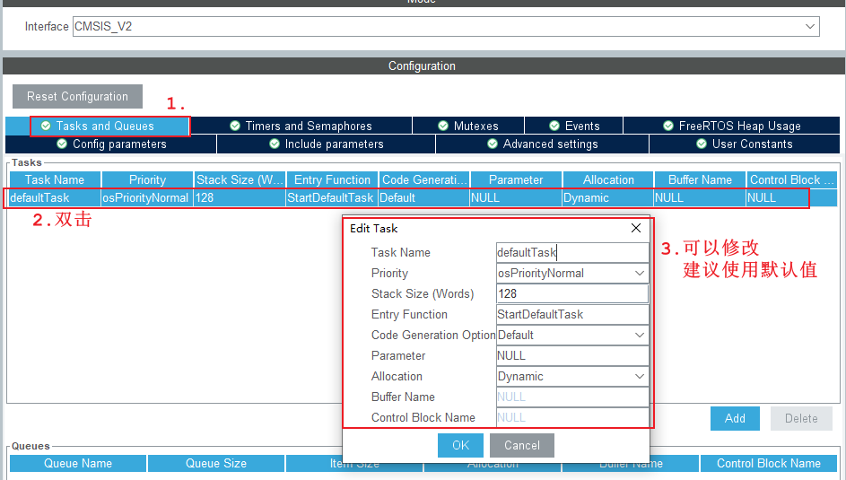

## 6.5 生成Keil MDK的工程

当对外设配置完成后，就去“Project Manager”中设置工程的名称、存储路径和开发IDE：

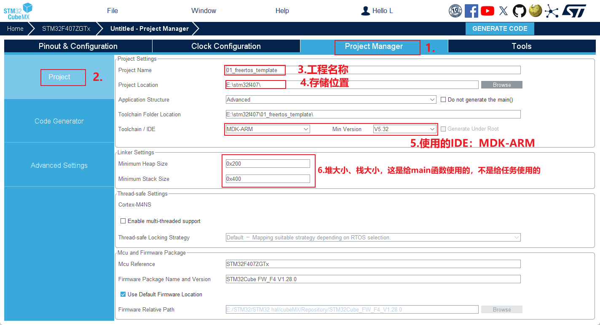

随后去同界面的“Code Generator”设置、生成工程：

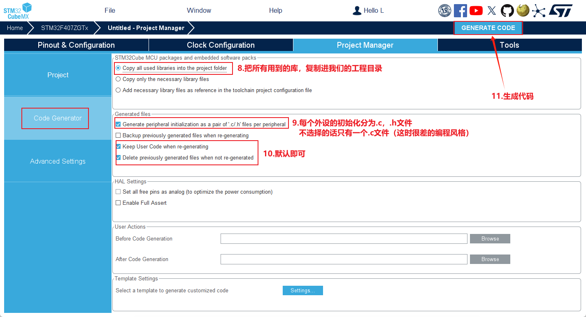

可能会有如下提示，选择“Yes”下载所依赖的文件即可：

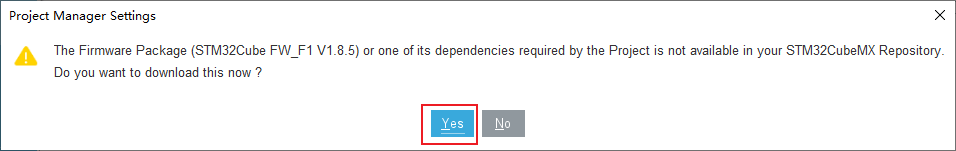

一切正常的话，可以看到如下提示：

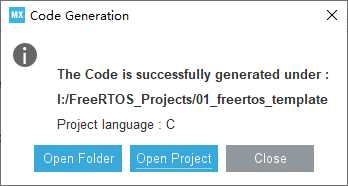

点击“Open Folder”可以打开工程目录，看到如下文件：

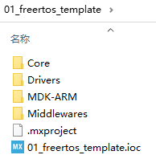

## 6.6 添加用户代码

STM32CubeMX只是帮我们初始化了所配置的硬件模块，你要实现什么功能，需要自己添加代码。

### 6.6.1 打开工程

在工程的“MDK-ARM”目录下，双击如下文件，就会使用Keil打开工程：

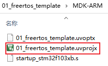

### 6.6.2 修改文件

双击打开freertos.c文件，找到StartDefaultTask函数里的循环。我们编写的代码，需要位于“USER CODE BEGIN xxx”和“USER CODE END xxx”之间，否则以后再次使用STM32CubeMX配置工程时，不在这些位置的用户代码会被删除。

如下图加入代码：

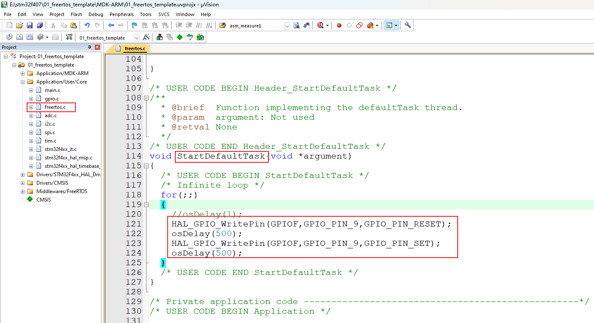

然后就可以参考《第4章 开发板使用》编译、烧写、运行了。
