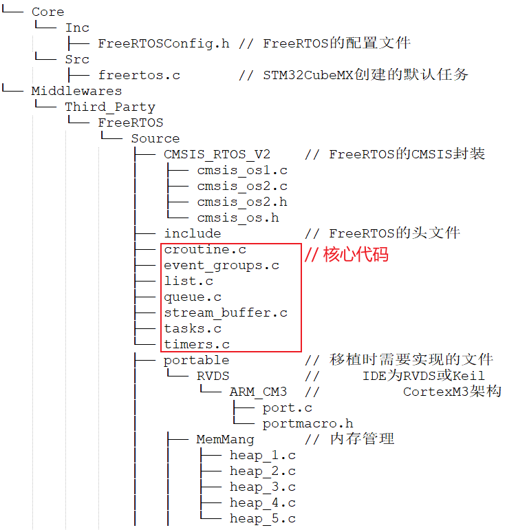

# 第7章 FreeRTOS源码概述

## 7.1 FreeRTOS目录结构

使用STM32CubeMX创建的FreeRTOS工程中，FreeRTOS相关的源码如下:



主要涉及2个目录：

- Core
  - Inc目录下的FreeRTOSConfig.h是配置文件
  - Src目录下的freertos.c是STM32CubeMX创建的默认任务
- Middlewares\Third_Party\FreeRTOS\Source
  - 根目录下是核心文件，这些文件是通用的
  - portable目录下是移植时需要实现的文件
    - 目录名为：[compiler]/[architecture]
    - 比如：RVDS/ARM_CM4，这表示cortexM4架构在RVDS工具上的移植文件

## 7.2 核心文件

FreeRTOS的最核心文件只有2个：

- FreeRTOS/Source/tasks.c
- FreeRTOS/Source/list.c

其他文件的作用也一起列表如下：

| **FreeRTOS/Source/下的文件** | **作用** |
| --- | --- |
| tasks.c | 必需，任务操作 |
| list.c | 必须，列表 |
| queue.c | 基本必需，提供队列操作、信号量(semaphore)操作 |
| timer.c | 可选，software timer |
| event_groups.c | 可选，提供event group功能 |
| croutine.c | 可选，过时了 |

## 7.3 移植时涉及的文件

移植FreeRTOS时涉及的文件放在

FreeRTOS/Source/portable/[compiler]/[architecture]目录下，

比如：RVDS/ARM_CM3，这表示cortexM3架构在RVDS或Keil工具上的移植文件。

里面有2个文件：

- port.c
- portmacro.h

## 7.4 头文件相关

### 7.4.1 头文件目录

FreeRTOS需要3个头文件目录：

- FreeRTOS本身的头文件：

Middlewares\Third_Party\FreeRTOS\Source\include

- 移植时用到的头文件：

Middlewares\Third_Party\FreeRTOS\Source\portable\[compiler]\[architecture]

- 含有配置文件FreeRTOSConfig.h的目录：Core\Inc

### 7.4.2 头文件

列表如下：

| **头文件** | **作用** |
| --- | --- |
| FreeRTOSConfig.h | FreeRTOS的配置文件，比如选择调度算法：configUSE_PREEMPTION<br/>每个demo都必定含有FreeRTOSConfig.h<br/>建议去修改demo中的FreeRTOSConfig.h，而不是从头写一个 |
| FreeRTOS.h | 使用FreeRTOS API函数时，必须包含此文件。<br/>在FreeRTOS.h之后，再去包含其他头文件，比如：<br/>task.h、queue.h、semphr.h、event_group.h |

## 7.5 内存管理

文件在Middlewares\Third_Party\FreeRTOS\Source\portable\MemMang下，它也是放在“portable”目录下，表示你可以提供自己的函数。

源码中默认提供了5个文件，对应内存管理的5种方法。

后续章节会详细讲解。

| **文件** | **优点** | **缺点** |
| --- | --- | --- |
| heap_1.c | 分配简单，时间确定 | 只分配、不回收 |
| heap_2.c | 动态分配、最佳匹配 | 碎片、时间不定 |
| heap_3.c | 调用标准库函数 | 速度慢、时间不定 |
| heap_4.c | 相邻空闲内存可合并 | 可解决碎片问题、时间不定 |
| heap_5.c | 在heap_4基础上支持分隔的内存块 | 可解决碎片问题、时间不定 |

## 7.6 入口函数

在Core\Src\main.c的main函数里，初始化了FreeRTOS环境、创建了任务，然后启动调度器。源码如下：

```c
  /* Init scheduler */
  osKernelInitialize();  /* 初始化FreeRTOS运行环境 */
  MX_FREERTOS_Init();    /* 创建任务 */

  /* Start scheduler */
  osKernelStart();       /* 启动调度器 */
```

## 7.7 数据类型和编程规范

### 7.7.1 数据类型

每个移植的版本都含有自己的portmacro.h头文件，里面定义了2个数据类型：

- TickType_t：
  - FreeRTOS配置了一个周期性的时钟中断：Tick Interrupt
  - 每发生一次中断，中断次数累加，这被称为tick count
  - tick count这个变量的类型就是TickType_t
  - TickType_t可以是16位的，也可以是32位的
  - FreeRTOSConfig.h中定义configUSE_16_BIT_TICKS时，TickType_t就是uint16_t
  - 否则TickType_t就是uint32_t
  - 对于32位架构，建议把TickType_t配置为uint32_t
- BaseType_t：
  - 这是该架构最高效的数据类型
  - 32位架构中，它就是uint32_t
  - 16位架构中，它就是uint16_t
  - 8位架构中，它就是uint8_t
  - BaseType_t通常用作简单的返回值的类型，还有逻辑值，比如pdTRUE/pdFALSE

### 7.7.2 变量名

变量名有前缀：

| **变量名前缀** | **含义** |
| --- | --- |
| c | char |
| s | int16_t，short |
| l | int32_t，long |
| x | BaseType_t，<br/>其他非标准的类型：结构体、task handle、queue handle等 |
| u | unsigned |
| p | 指针 |
| uc | uint8_t，unsigned char |
| pc | char指针 |

### 7.7.3 函数名

函数名的前缀有2部分：返回值类型、在哪个文件定义。

| **函数名前缀** | **含义** |
| --- | --- |
| vTaskPrioritySet | 返回值类型：void<br/>在task.c中定义 |
| xQueueReceive | 返回值类型：BaseType_t<br/>在queue.c中定义 |
| pvTimerGetTimerID | 返回值类型：pointer to void<br/>在tmer.c中定义 |

### 7.7.4 宏的名

宏的名字是大小，可以添加小写的前缀。前缀是用来表示：宏在哪个文件中定义。

| **宏的前缀** | **含义：在哪个文件里定义** |
| --- | --- |
| port (比如portMAX_DELAY) | portable.h或portmacro.h |
| task (比如taskENTER_CRITICAL()) | task.h |
| pd (比如pdTRUE) | projdefs.h |
| config (比如configUSE_PREEMPTION) | FreeRTOSConfig.h |
| err (比如errQUEUE_FULL) | projdefs.h |

通用的宏定义如下：

| **宏** | **值** |
| --- | --- |
| pdTRUE | 1 |
| pdFALSE | 0 |
| pdPASS | 1 |
| pdFAIL | 0 |
