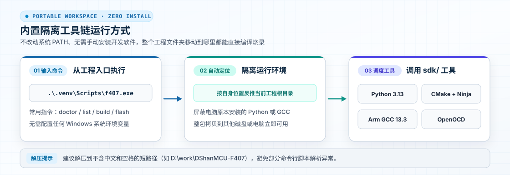

# 准备开发环境

DShanMCU-F407 的 CMake 开发环境将 Python、CMake、Ninja、Arm GCC 编译器与 OpenOCD 下载工具全部打包在工程的 `sdk/` 目录中，不需要单独安装软件，也不需要配置 Windows 系统环境变量。解压后即可直接在命令行或 VS Code 中编译与烧录程序。

:::info[本节完成标准]
1. 工程包解压在纯英文短路径下；
2. 运行 `.\.venv\Scripts\f407.exe doctor` 提示工具链检查通过；
3. 接好 SWD 调试器与供电串口线。
:::

## 获取工程包

1. 从 [DShanMCU-F407 资料下载目录](https://dl.100ask.net/Hardware/MCU/DShanMCU-F407/) 或配套网盘下载 CMake 原生 FreeRTOS 工程压缩包；
2. 将压缩包解压到**不包含中文和空格的短路径**，例如 `D:\work\DShanMCU-F407`。

:::tip[只体验硬件模块功能？]
如果只想先烧录现成固件体验实验套件上的 14 个模块，不需要解压本工程，请直接查看 [认识实验套件与固件汇总](../../quickstart/p1-00-认识实验套件/README.md)。
:::

## 目录概览

打开解压后的根目录，可以看到以下文件夹：

```text
DShanMCU-F407/
├── .venv/          工程命令行入口（包含 python.exe 与 f407.exe）
├── .vscode/        VS Code 配置文件（一键构建、烧录与调试）
├── applications/   18 个 FreeRTOS 示例应用源码
├── cmake/          编译器选择与公共构建规则
├── drivers/        STM32F4 官方 HAL / LL 芯片驱动源码
├── middlewares/    FreeRTOS V11.3.3 内核源码
├── openocd/        USBToolBox、ST-Link 与 CMSIS-DAP 烧录配置
├── platform/       启动参数、板级硬件驱动与外设模块驱动
├── scripts/        工程命令脚本与新建应用脚本
└── sdk/            内置的 Python、CMake、Ninja、GCC 与 OpenOCD 工具
```

工程主要内置工具与源码版本如下：

| 组件 | 工程位置 | 版本 |
| --- | --- | --- |
| Python | `sdk/python/` | 3.13.16 |
| CMake / Ninja | `sdk/cmake/`、`sdk/ninja/` | CMake 4.4.3 / Ninja 1.13.2 |
| Arm GNU 工具链 | `sdk/arm-gnu-toolchain/` | Arm GCC 13.3.1 / GDB 14.2.90 |
| OpenOCD | `sdk/openocd/` | 0.12.0+dev |
| STM32F4 HAL/LL 驱动 | `drivers/STM32F4xx_HAL_Driver/` | v1.8.6（CMSIS Device F4 v2.6.9） |
| FreeRTOS 内核 | `middlewares/FreeRTOS-Kernel/` | V11.3.3 |

`.venv/Scripts/f407.exe` 会根据自身所在位置自动定位工程根目录，并在执行编译、烧录命令时只使用 `sdk/` 中的内置工具，不依赖电脑上原本是否安装过其他 Python 或编译器。即使把整个工程文件夹拷贝到其他磁盘或电脑，也可以直接运行。



## 检测工具链

在 `DShanMCU-F407` 工程根目录下打开 PowerShell 终端，依次运行自检命令和示例列表命令：

```powershell
.\.venv\Scripts\f407.exe doctor
.\.venv\Scripts\f407.exe list
```

执行 `f407 doctor` 后，终端会逐项输出所有内置工具路径和版本号；看到最后一行提示即表示编译环境就绪：

```text
Workspace Root : D:\work\DShanMCU-F407
...
[OK] cmake.exe              -> D:\work\DShanMCU-F407\sdk\cmake\bin\cmake.exe
     cmake version 4.4.3
[OK] ninja.exe              -> D:\work\DShanMCU-F407\sdk\ninja\ninja.exe
     1.13.2
[OK] arm-none-eabi-gcc.exe  -> D:\work\DShanMCU-F407\sdk\arm-gnu-toolchain\bin\arm-none-eabi-gcc.exe
     arm-none-eabi-gcc.exe (Arm GNU Toolchain 13.3.Rel1 (Build arm-13.24)) 13.3.1 20240614
[OK] arm-none-eabi-gdb.exe  -> D:\work\DShanMCU-F407\sdk\arm-gnu-toolchain\bin\arm-none-eabi-gdb.exe
[OK] openocd.exe            -> D:\work\DShanMCU-F407\sdk\openocd\bin\openocd.exe
[OK] python packages       -> pyserial, intelhex, pyelftools

All tools isolated inside sdk/. Zero system dependencies required.
```

执行 `f407 list` 会列出 `applications/` 目录下的全部 18 个示例名称及当前编译状态（已编译显示 `[BUILT]`，未编译显示 `[     ]`）。

## 安装调试器驱动

开始编译烧录前，先按照 [SWD 调试烧录硬件连接](../../quickstart/p1-00-SWD调试烧录硬件连接/README.md) 接好核心板白色 4-Pin SWD 座子的三根信号线（`CLK`、`DIO`、`GND`），并通过核心板 DEBUG Type-C 接口连接电脑供电和串口（使用 Type-C 供电时 SWD 的 3.3V 引脚留空）。

如果在新电脑上首次使用 DshanPI USBToolBox，且尚未通过上位机安装过驱动，可以以管理员身份运行工程自带的离线驱动安装脚本：

```powershell
sdk\driver\Install-DshanPI-USBToolBox.cmd
```

## 常见问题

| 现象 | 常见原因 | 处理方法 |
| --- | --- | --- |
| 编译或脚本报错编码异常 | 工程路径包含中文字符或空格 | 将工程移动到短纯英文目录，例如 `D:\work\DShanMCU-F407` |
| 终端提示找不到 `f407` 模块 | 使用了系统全局 `python` 而不是工程入口 | 改用 `.\.venv\Scripts\f407.exe` 或 `.\.venv\Scripts\python.exe` |
| 自检提示找不到 `sdk` 目录下的工具 | `.venv/` 与 `sdk/` 目录相对位置被破坏 | 保留完整解压目录结构，不要单独复制 `.venv/` |
| OpenOCD 连接调试器失败 | 未装 USBToolBox 驱动或上位机正占用 SWD | 运行驱动安装脚本，并在命令行烧录前关闭 USBToolBox 上位机 |

---

[课程首页](../../README.md) · [下一篇：编译、烧录与调试](../c02-build-flash-debug/README.md)
