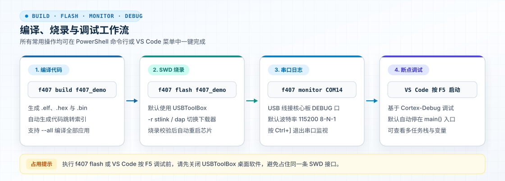

# 编译、烧录与调试

环境就绪后，可以通过工程命令行工具 `f407` 或 VS Code 完成代码编译、程序烧录、串口查看与单步调试。下面以默认的核心板自检示例 `f407_demo` 为例介绍完整操作流程。



## 编译程序

在工程根目录下打开 PowerShell 终端，输入以下常用编译指令：

```powershell
# 编译单个应用（默认输出到 build/f407_demo）
.\.venv\Scripts\f407.exe build f407_demo

# 指定输出目录或应用路径
.\.venv\Scripts\f407.exe build applications\blinky -d build\blinky

# 清理后重新配置并编译（修改 CMakeLists.txt 后可使用）
.\.venv\Scripts\f407.exe build f407_demo -c

# 以 Release (-O2) 模式编译
.\.venv\Scripts\f407.exe build f407_demo --release

# 一次编译全部 18 个示例
.\.venv\Scripts\f407.exe build --all
```

需要删除临时编译产物时，可执行清理命令：

```powershell
.\.venv\Scripts\f407.exe clean f407_demo   # 清理单个应用构建目录
.\.venv\Scripts\f407.exe clean --all       # 清理全部 build/ 目录
```

编译成功后，`build/<应用名>/` 目录下会生成以下文件：

| 文件 | 用途 |
| --- | --- |
| `<应用名>.elf` | 包含调试信息的可执行文件，VS Code 断点调试时使用 |
| `<应用名>.hex` | 带烧录地址的固件文件，用于 OpenOCD 与 USBToolBox 烧录 |
| `<应用名>.bin` | 纯二进制镜像文件 |
| `<应用名>.map` | 内存占用明细文件，可用于查看代码与变量大小 |
| `build/compile_commands.json` | 根目录编译索引文件，供 VS Code 识别头文件和跳转定义 |

## 烧录到开发板

`f407 flash` 会自动检查代码改动并执行增量编译，随后调用 OpenOCD 把 `.hex` 写入芯片并自动重启运行：

```powershell
# 默认使用 DshanPI USBToolBox（配置文件：openocd/usbtoolbox_swd.cfg）
.\.venv\Scripts\f407.exe flash f407_demo

# 使用 ST-Link（配置文件：openocd/stlink_swd.cfg）
.\.venv\Scripts\f407.exe flash f407_demo -r stlink

# 使用 CMSIS-DAP（配置文件：openocd/cmsis_dap_swd.cfg）
.\.venv\Scripts\f407.exe flash f407_demo -r dap
```

| `-r` 参数 | 对应调试器 | 配置文件 | SWD 通信速率 |
| --- | --- | --- | --- |
| `usbtoolbox`（默认） | DshanPI USBToolBox | `openocd/usbtoolbox_swd.cfg` | 1000 kHz |
| `stlink` | ST-Link V2 | `openocd/stlink_swd.cfg` | 4000 kHz |
| `dap` | CMSIS-DAP | `openocd/cmsis_dap_swd.cfg` | 4000 kHz |

:::note[烧录后自动复位说明]
核心板白色 4-Pin SWD 座子仅引出 `3.3V`、`CLK`、`DIO`、`GND`，不包含硬件复位脚，因此 OpenOCD 配置采用 `reset_config none`，在烧录校验完成后通过内核软复位命令重启芯片运行新程序。硬件接法见 [SWD 调试烧录硬件连接](../../quickstart/p1-00-SWD调试烧录硬件连接/README.md)。
:::

:::warning[烧录前先关闭 USBToolBox 桌面软件]
DshanPI USBToolBox 的 SWD 通道同一时间只能被一个程序使用。执行 `f407 flash` 或 VS Code 调试前，如果已经打开 USBToolBox 桌面端并占用连接，请先退出该桌面端。
:::

## 查看串口日志

核心板的 DEBUG Type-C 接口在连接电脑后，会枚举出一个 USB 转串口。可先列出电脑上的串口号，再打开内置串口终端（默认波特率 115200）：

```powershell
# 查看当前连接的串口列表（找核心板对应的 COM 号）
.\.venv\Scripts\python.exe -m serial.tools.list_ports -v

# 打开串口终端（将 COM14 替换为本机实际端口号，按 Ctrl+] 退出）
.\.venv\Scripts\f407.exe monitor COM14
```

烧录 `f407_demo` 后按一下核心板 `RST` 复位键，串口终端会打印启动信息与每秒心跳日志（如果底板插着 M1 OLED 屏幕，屏幕也会同步显示运行时间与按键次数）：

```text
==============================================
 DshanMCU-F407 Native FreeRTOS Bringup
 SYSCLK=168 MHz | SRAM=1MiB OK | FreeRTOS=V11.3.3
==============================================
[HEARTBEAT] up=0s sysclk=168MHz sram=OK heap_free=45848B
```

## 使用 VS Code 开发

工程根目录下的 `.vscode/` 已预先写好编辑器配置，直接用 VS Code 打开 `DShanMCU-F407` 文件夹即可。集成终端会自动加载 `sdk/` 内的工具路径，并关闭了 CMake 插件打开时的自动弹窗配置，避免干扰 `f407` 构建命令。

### 安装推荐插件

首次打开工程时，VS Code 右下角会提示安装 `.vscode/extensions.json` 中的推荐插件：

- `C/C++`（`ms-vscode.cpptools`）：代码提示、宏识别与函数跳转；
- `Cortex-Debug`（`marus25.cortex-debug`）：单步断点调试、变量监视与 FreeRTOS 任务栈查看；
- `Serial Monitor`（`ms-vscode.vscode-serial-monitor`）：在 VS Code 底部面板直接查看串口打印。

:::tip[让代码跳转生效]
代码跳转依赖 `build/compile_commands.json`。打开工程后如果发现头文件波浪线提示，先任意编译一次应用（如 `.\.venv\Scripts\f407.exe build f407_demo`）即可恢复正常。
:::

### 一键编译与烧录

按下快捷键 `Ctrl+Shift+B` 可直接编译全部 18 个示例；或者按下 `Ctrl+Shift+P` 输入 `Tasks: Run Task`，在列表中选择目标任务并在弹出的下拉框里挑选应用：

- `Build All Apps`：编译全部 18 个应用；
- `Build Selected App`：编译选中的单个应用；
- `Flash Selected App (USBToolBox)`：使用 USBToolBox 烧录选中的应用；
- `Flash Selected App (ST-Link)`：使用 ST-Link 烧录选中的应用；
- `Clean All Builds`：清空 `build/` 目录。

### 单步断点调试

在 VS Code 左侧点击「运行和调试」图标，在顶部下拉栏选择调试方案后按 `F5` 启动调试（配置位于 `.vscode/launch.json`）：

- `Debug Selected App (USBToolBox SWD)`
- `Debug Selected App (ST-Link SWD)`

调试启动后会自动下载当前应用并在 `main()` 入口处暂停。由于配置中开启了 `"rtos": "FreeRTOS"`，暂停程序时可以直接在左侧「调用堆栈」栏看到每个 FreeRTOS 任务的运行状态与调用路径，方便排查卡死或任务切换问题。

## 常见问题

| 现象 | 常见原因 | 处理方法 |
| --- | --- | --- |
| `f407 flash` 或 `F5` 连接不上调试器 | USBToolBox 上位机仍在运行占用设备，或接线松动 | 关闭 USBToolBox 上位机，对照核心板丝印检查 `CLK`、`DIO`、`GND` |
| 按 `F5` 提示找不到 `.elf` 文件 | 所选应用尚未在 Debug 模式下编译 | 先运行一次 `Build Selected App` 或 `f407 build <应用名>` |
| 串口终端没有输出 | 选错了串口号，或 `MCU-RX / MCU-TX` 跳线帽脱落 | 确认插在核心板 DEBUG 口且跳线帽短接，再用 `list_ports` 核对端口 |
| VS Code 中代码报找不到头文件 | 还未生成过 `build/compile_commands.json` | 命令行或任务中编译任意一个应用后再观察 |

---

[上一篇：准备开发环境](../c01-workspace-setup/README.md) · [下一篇：创建第一个工程](../c03-first-app/README.md) · [课程首页](../../README.md)
