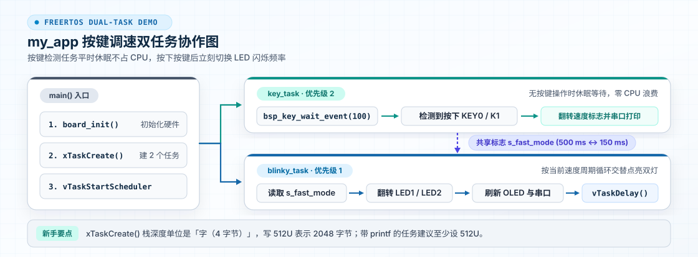

# 创建第一个工程

熟悉编译和烧录流程后，下面动手新建一个自己的应用 `my_app`，从修改代码到烧录运行走通完整的开发流程。

## 从模板新建应用

工程中的 `scripts/ide/create_app.py` 脚本可以从现有示例复制生成新工程，不需要手动建立文件夹和配置文件。在根目录打开 PowerShell 执行：

```powershell
# 列出当前所有可作为模板的应用
.\.venv\Scripts\python.exe scripts\ide\create_app.py --list

# 以最精简的 blinky 为模板创建 my_app（不指定 --template 时默认使用 f407_demo）
.\.venv\Scripts\python.exe scripts\ide\create_app.py --name my_app --template blinky
```

:::note[应用命名限制]
`--name` 只能包含英文字母、数字和下划线，且以字母或数字开头（不超过 64 个字符）。脚本会自动改写新工程 `CMakeLists.txt` 里的工程名。
:::

## 认识 CMakeLists.txt

打开新建的 `applications/my_app/CMakeLists.txt`，全文只有 9 行：

```cmake
cmake_minimum_required(VERSION 3.22)
include(${CMAKE_CURRENT_LIST_DIR}/../../cmake/arm-none-eabi-gcc.cmake)

project(my_app LANGUAGES C ASM)

include(${F407_ROOT}/cmake/f407_app.cmake)
target_sources(app PRIVATE
    src/main.c
)
```

每部分作用如下：

- `include(.../arm-none-eabi-gcc.cmake)`：指定交叉编译器与构建器路径，需写在 `project()` 之前；
- `project(my_app LANGUAGES C ASM)`：设置工程名称，编译产物会命名为 `my_app.elf` 与 `my_app.hex`；
- `include(${F407_ROOT}/cmake/f407_app.cmake)`：引入 STM32F4 HAL 库、FreeRTOS 内核以及核心板和底板模块驱动；
- `target_sources(app PRIVATE ...)`：列出当前应用自己的源码文件。如果后续新建了 `src/app_led.c` 等源文件，继续加在这里即可。

## 认识 main.c

打开 `applications/my_app/src/main.c`（来自 `blinky` 模板），代码结构非常清晰：

```c
#include "board.h"
#include "FreeRTOS.h"
#include "task.h"
#include <stdio.h>

static void blinky_task(void *arg)
{
    (void)arg;
    bool state = false;
    uint32_t tick = 0U;

    (void)oled_ui_init();
    printf("\r\nblinky demo: PF9(LED1) / PF10(LED2) @ 500 ms\r\n");

    for (;;) {
        state = !state;
        bsp_led_set(BSP_LED1, state);
        bsp_led_set(BSP_LED2, !state);

        if (oled_ui_is_ready()) {
            oled_ui_clear();
            oled_ui_header("LED", "BLINKY", tick);
            oled_ui_card(0, 17, 128, 47);
            oled_ui_big_text_center(22, state ? "LED1 ON" : "LED2 ON");
            oled_ui_text_center(46, "PF9 <-> PF10  500ms", false);
            (void)oled_ui_present();
        }

        if ((tick % 4U) == 0U) {
            printf("[BLINKY] cycle=%lu LED1=%s LED2=%s\r\n",
                   (unsigned long)tick,
                   state ? "ON" : "OFF",
                   !state ? "ON" : "OFF");
        }

        ++tick;
        vTaskDelay(pdMS_TO_TICKS(500));
    }
}

int main(void)
{
    board_init();
    configASSERT(xTaskCreate(blinky_task, "blinky", 512U, NULL, tskIDLE_PRIORITY + 1U, NULL) == pdPASS);
    vTaskStartScheduler();
    for (;;) {
    }
}
```

写应用代码时注意以下 4 点：

1. `main()` 函数只负责调用 `board_init()` 初始化硬件底座、创建起始任务并调用 `vTaskStartScheduler()` 启动调度器，业务逻辑全部写在任务函数里；
2. `oled_ui_init()` 放在任务启动后再调用，未接 M1 屏幕时 `oled_ui_is_ready()` 会返回 `false`，程序仍能正常通过 LED 和串口运行；
3. `xTaskCreate()` 的第 3 个参数是任务栈大小，单位是 **4 字节字**，因此写 `512U` 对应 2048 字节栈空间（使用 `printf` 的任务建议不少于 `512U`）；
4. 工程编译选项将所有编译警告视为错误，未使用的形参需要加上 `(void)arg;` 消除告警。

## 修改代码：按键调速

下面修改 `applications/my_app/src/main.c`，增加一个检测按键的任务，实现按下核心板 `KEY0` 或底板 `K1` 后切换双 LED 的闪烁速度（`500 ms` ↔ `150 ms`），并在串口与 OLED 上同步显示当前状态：



```c
#include "board.h"
#include "FreeRTOS.h"
#include "task.h"
#include <stdio.h>

static volatile bool s_fast_mode = false;

static void key_task(void *arg)
{
    (void)arg;
    for (;;) {
        /* 阻塞等待按键事件（超时 100 ms），没有按键时不会占用 CPU */
        (void)bsp_key_wait_event(100U);
        uint32_t hits = bsp_key_take_presses(BSP_KEY0) + bsp_key_take_presses(BSP_KEY_K1);
        if ((hits & 1U) != 0U) {
            s_fast_mode = !s_fast_mode;
            printf("[KEY] speed switched -> %s\r\n",
                   s_fast_mode ? "FAST (150ms)" : "NORMAL (500ms)");
        }
    }
}

static void blinky_task(void *arg)
{
    (void)arg;
    bool state = false;
    uint32_t tick = 0U;

    (void)oled_ui_init();
    printf("\r\nmy_app started: press KEY0 or K1 to toggle speed\r\n");

    for (;;) {
        bool fast = s_fast_mode;
        uint32_t delay_ms = fast ? 150U : 500U;

        state = !state;
        bsp_led_set(BSP_LED1, state);
        bsp_led_set(BSP_LED2, !state);

        if (oled_ui_is_ready()) {
            oled_ui_clear();
            oled_ui_header("APP", fast ? "MY_APP [FAST]" : "MY_APP", tick);
            oled_ui_card(0, 17, 128, 47);
            oled_ui_big_text_center(22, state ? "LED1 ON" : "LED2 ON");
            oled_ui_text_center(46, fast ? "Period: 150 ms" : "Period: 500 ms", false);
            (void)oled_ui_present();
        }

        if ((tick % 5U) == 0U) {
            printf("[MY_APP] tick=%lu mode=%s\r\n",
                   (unsigned long)tick, fast ? "FAST" : "NORMAL");
        }

        ++tick;
        vTaskDelay(pdMS_TO_TICKS(delay_ms));
    }
}

int main(void)
{
    board_init();
    configASSERT(xTaskCreate(blinky_task, "blinky", 512U, NULL, tskIDLE_PRIORITY + 1U, NULL) == pdPASS);
    configASSERT(xTaskCreate(key_task, "key", 384U, NULL, tskIDLE_PRIORITY + 2U, NULL) == pdPASS);
    vTaskStartScheduler();
    for (;;) {
    }
}
```

## 编译与验证

保存代码后，在工程根目录执行烧录并打开串口监视器（将 `COM14` 替换为本机实际端口）：

```powershell
.\.venv\Scripts\f407.exe flash my_app
.\.venv\Scripts\f407.exe monitor COM14
```

烧录完成后，核心板 `LED1 (PF9)` 与 `LED2 (PF10)` 默认每 500 ms 交替闪烁一次；按下核心板 `KEY0` 或底板 `K1`，串口会立即输出 `[KEY] speed switched -> FAST (150ms)`，同时双灯闪烁频率变为 150 ms。

如果需要在 VS Code 的任务菜单与 `F5` 调试列表里直接选择 `my_app`，把 `"my_app"` 加入 `.vscode/tasks.json` 与 `.vscode/launch.json` 的 `options` 数组即可。

---

[上一篇：编译、烧录与调试](../c02-build-flash-debug/README.md) · [下一篇：工程目录与 CMake](../c04-workspace-cmake/README.md) · [课程首页](../../README.md)
