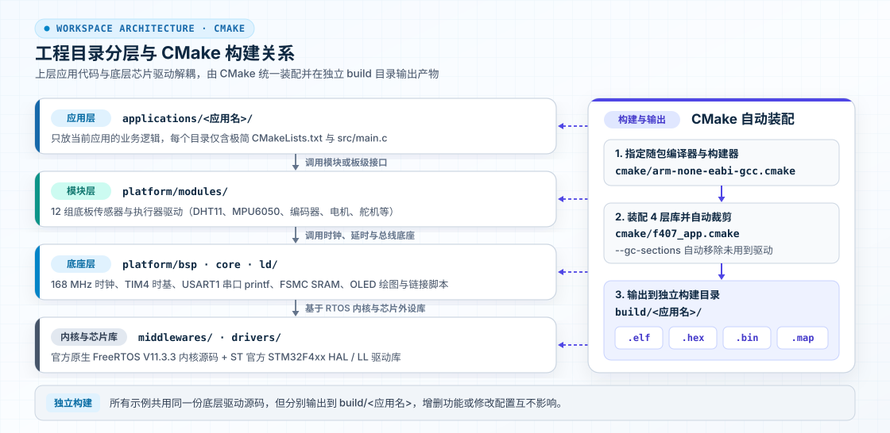

# 工程目录与 CMake

本工程没有使用 STM32CubeMX 生成代码，而是采用分层的目录结构加公共 CMake 规则。应用源码、模块驱动、板级硬件初始化与 FreeRTOS 内核相互分离，修改一个应用的业务代码不会影响其他工程。

## 目录分层

各个核心目录的分工如下表所示：

| 目录 | 职责说明 |
| --- | --- |
| `applications/` | 存放各个独立应用（每个应用包含自己的 `CMakeLists.txt` 与 `src/main.c`） |
| `platform/modules/` | 存放底板外设模块驱动（如温湿度、超声波、红外、编码器、电机等 `mod_*.c/.h`） |
| `platform/bsp/` | 存放核心板常用驱动（时钟、LED、按键、串口、I2C、SPI、外部 SRAM、OLED 绘图） |
| `platform/core/` | 存放 FreeRTOS 配置文件、HAL 启用配置、中断入口和 `printf` 重定向接口 |
| `platform/ld/` | 存放芯片链接脚本 `STM32F407ZGTx_FLASH.ld`，决定程序在 Flash 与 RAM 中的地址分布 |
| `middlewares/` | 存放官方原生 FreeRTOS V11.3.3 内核源码与 `heap_4` 内存分配实现 |
| `drivers/` | 存放 ST 官方 CMSIS 与 STM32F4xx HAL / LL 库源码 |
| `cmake/` | 存放交叉编译器设置与共用的 CMake 构建规则 |
| `openocd/` | 存放 USBToolBox、ST-Link、CMSIS-DAP 三种调试器的烧录配置 |
| `scripts/` 与 `sdk/` | 存放 `f407` 命令行脚本以及隔离的工具链二进制程序 |

## 编译流程

工程把复杂的编译规则集中在 `cmake/arm-none-eabi-gcc.cmake` 和 `cmake/f407_app.cmake` 两份文件中，因此每个应用自己只需保留几行 `CMakeLists.txt`：

1. `cmake/arm-none-eabi-gcc.cmake` 在工程配置最开始执行，用来指定目标平台为 ARM Cortex-M4 裸机环境，并将编译器、链接器与 `ninja` 全部绑定到 `sdk/` 目录；
2. `cmake/f407_app.cmake` 自动把底层源码拆分为 4 个基础目标和 1 个最终可执行程序目标 `app`：

| 构建目标 | 源码范围 | 作用 |
| --- | --- | --- |
| `stm32f4_hal` | `drivers/STM32F4xx_HAL_Driver/Src/*.c` 与 `system_stm32f4xx.c` | 编译 STM32F4 标准外设驱动库（自动排除模板文件） |
| `freertos_kernel` | `middlewares/FreeRTOS-Kernel/` 核心文件、`port.c` 与 `heap_4.c` | 编译 FreeRTOS V11.3.3 内核 |
| `f407_platform` | 启动汇编 `startup_stm32f407xx.s`、`platform/core/*.c` 与 `platform/bsp/*.c` | 以直接参与链接的对象文件编译，保证中断向量、时基与 `printf` 覆盖函数稳定生效 |
| `f407_modules` | `platform/modules/*.c` | 自动收集并编译全部底板模块驱动，新增 `.c` 文件时会自动识别 |
| `app` | 链接以上全部目标 + 应用自身 `src/*.c` | 生成 `.elf`、`.hex` 与 `.bin`，并统计 Flash 与 RAM 占用 |

## 常用编译选项

在 `cmake/f407_app.cmake` 中，以下编译和链接选项直接决定了生成程序的硬件行为与体积控制：

| 选项 | 作用 |
| --- | --- |
| `-mcpu=cortex-m4 -mthumb -mfpu=fpv4-sp-d16 -mfloat-abi=hard` | 开启 Cortex-M4 硬件单精度浮点运算加速 |
| `STM32F407xx`、`USE_HAL_DRIVER`、`USE_FULL_LL_DRIVER` | 启用 F407 型号定义以及 HAL 和 LL 双套驱动接口 |
| `HSE_VALUE=24000000U`、`BOARD_HSE_MHZ=24` | 匹配核心板上实际使用的 24 MHz 外部晶振 |
| `-ffunction-sections -fdata-sections` 配合 `-Wl,--gc-sections` | 按函数和变量拆段，链接时自动剔除未调用到的驱动和模块代码，避免固件体积膨胀 |
| `--specs=nano.specs` | 使用轻量级 C 标准库（Newlib-Nano）减小 `printf` 等库函数占用 |
| `-Wl,--print-memory-usage` | 编译结束后在终端直接输出 Flash 与 RAM 使用占比 |

## 独立构建目录

所有示例共用同一套 `drivers/`、`middlewares/` 和 `platform/` 源码，但编译时会分别输出到各自的 `build/<应用名>` 目录中，这样做有三个实际好处：

- 不同示例可以根据硬件需要决定初始化哪些外设（例如直流电机示例不启用外部 SRAM），彼此不冲突；
- 平时只改自己应用的 `src/main.c` 时，增量编译通常只需 1～2 秒即可生成新的 `.hex`；
- 在公共目录修改或新增驱动后，一次运行 `f407 build --all` 就能让全部应用同步更新。

---

[上一篇：创建第一个工程](../c03-first-app/README.md) · [下一篇：启动与时钟配置](../c05-startup-clock-bsp/README.md) · [课程首页](../../README.md)
