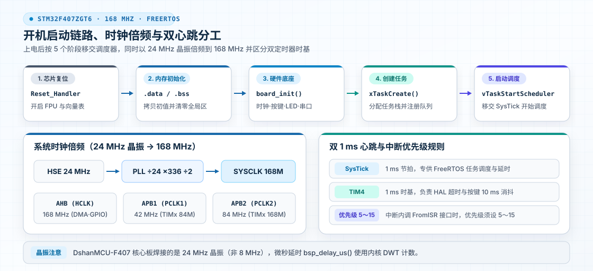

# 启动与时钟配置

在脱离 STM32CubeMX 自己编写工程代码时，芯片上电启动、系统时钟初始化、定时器中断分工和串口打印都由 `platform/` 目录下的基础文件共同完成。理解这几个核心环节后，排查启动异常或修改硬件参数会非常清晰。

## 开机启动流程

芯片复位或上电后，程序按照下面的顺序从汇编启动入口一步步交接给 FreeRTOS 任务调度器，并完成系统时钟倍频与定时器分工：

1. **芯片复位**：执行 `startup_stm32f407xx.s` 中的 `Reset_Handler`，调用 `SystemInit()` 打开硬件浮点单元 FPU 并配置中断向量表基址；
2. **内存初始化**：启动代码把已初始化全局变量的初值从 Flash 复制到 RAM（`.data` 段），把未初始化变量清零（`.bss` 段）；
3. **`board_init()` 硬件初始化**：依次配置中断优先级分组、168 MHz 主频、LED、按键与 115200 调试串口；
4. **创建 FreeRTOS 任务**：在 `main()` 中通过 `xTaskCreate()` 建立一个或多个应用任务；
5. **启动任务调度**：调用 `vTaskStartScheduler()`，由 FreeRTOS 接管 `SysTick`、`PendSV` 与 `SVC` 中断，开始多任务调度。

## 内存空间划分

链接脚本决定编译器把代码和变量放在芯片哪块地址里，工程使用的脚本位于 `platform/ld/STM32F407ZGTx_FLASH.ld`，主要区域划分如下：

| 内存区域 | 起始地址 | 大小 | 用途 |
| --- | --- | --- | --- |
| `FLASH` | `0x08000000` | 1024 KB | 存放程序代码（`.text`）、只读常量（`.rodata`）与中断向量表 |
| `RAM` | `0x20000000` | 128 KB | 芯片主内存，存放全局变量、主中断栈和 FreeRTOS 48 KB 动态内存池 |
| `CCMRAM` | `0x10000000` | 64 KB | CPU 专用高速内存，可放高频访问变量，但 DMA 控制器无法访问此区域 |
| 外部 SRAM | `0x68000000` | 1024 KB | 核心板自带 `IS62WV51216BLL` 芯片，调用 `bsp_sram_init()` 后即可直接读写 |

## 系统时钟与延时

许多 STM32F407 开发板采用 8 MHz 晶振，但 **DshanMCU-F407 核心板焊接的是 24 MHz 外部晶振**。时钟配置位于 `platform/bsp/bsp_clock.c`，默认在 `board_init()` 中完成初始化：

- 通过 PLL 倍频将主频提升到 168 MHz（`24 MHz / 24 * 336 / 2 = 168 MHz`），USB 时钟同步分频为 48 MHz；
- 开启高性能稳压模式并设置 Flash 5 个等待周期（`FLASH_LATENCY_5`），确保高频读取稳定。

初始化完成后，各总线时钟频率如下：

| 时钟 / 总线 | 频率 | 主要对应外设 |
| --- | --- | --- |
| `SYSCLK` / `HCLK` | 168 MHz | CPU 内核、DMA、FSMC、GPIO |
| `PCLK1` (APB1) | 42 MHz | `I2C1`、`USART2/3`（挂在上面的定时器倍频为 84 MHz） |
| `PCLK2` (APB2) | 84 MHz | `USART1`、`SPI1`、`ADC1`（挂在上面的定时器倍频为 168 MHz） |

为了在不占用硬件定时器的情况下提供微秒级延时，`bsp_clock.c` 启用了 Cortex-M4 内核自带的周期计数器 DWT（`bsp_delay_us()`），在 DHT11、DS18B20 与超声波模块中都会直接使用。

## 定时器与中断分工

运行 FreeRTOS 时需要区分两套 1 ms 定时心跳：

1. **FreeRTOS 系统时钟（`SysTick`）**：每秒触发 1000 次，专门负责任务调度时间片切换和 `vTaskDelay()` 延时计数；
2. **HAL 库时钟（`TIM4`）**：HAL 外设库内部等待超时需要独立的 1 ms 计数，工程在 `platform/bsp/bsp_hal_timebase_tim4.c` 中使用 `TIM4` 作为 HAL 时基，同时顺便驱动按键每 1 ms 采样消抖（`bsp_key_tick_1ms()`）。

在中断管理方面，还需要注意以下 3 条基础规则：

- **统一优先级分组**：`board.c` 固定设置为 `NVIC_PRIORITYGROUP_4`（只保留 0～15 共 16 级抢占优先级，不设子优先级）；
- **调用 FreeRTOS 接口的中断优先级门槛**：在 `platform/core/FreeRTOSConfig.h` 中，可安全调用 `FromISR` 接口的最高中断优先级设在 5。因此需要唤醒任务的中断（如外部中断和 `TIM4`）优先级必须设在 **5 到 15 之间**（工程中通常设为 6 或 15）；
- **外部中断统一分发**：当多个传感器模块都用到 GPIO 外部中断时，容易出现同名的 `EXTI9_5_IRQHandler()` 函数冲突。工程在 `platform/core/stm32f4xx_it.c` 提供了 `bsp_exti_set_callback()`，驱动只需按引脚序号登记自己的回调函数即可。

:::tip[内存与栈错误定位]
`stm32f4xx_it.c` 中还默认带了两个故障回调函数：`vApplicationMallocFailedHook`（动态内存不足）和 `vApplicationStackOverflowHook`（任务栈溢出）。触发异常时串口会打印错误信息并停在原地，方便接调试器定位。
:::

## 串口打印配置

工程默认把标准 C 库的 `printf()` 重定向到了核心板 `USART1 (PA9/PA10)`，波特率为 115200 8-N-1，通过跳线帽连接到 DEBUG Type-C 接口：

- 在 `board_init()` 里通过 `setvbuf(stdout, NULL, _IONBF, 0)` 关闭输出缓冲，调用 `printf` 时哪怕结尾不加 `\n` 也会立刻输出；
- 在 `platform/core/syscalls.c` 中，`_write()` 会把所有输出字节转交给 `bsp_uart_write()` 发送，并自动把单独的 `\n` 补齐为 `\r\n`，保证 Windows 串口工具里换行显示整齐。

---

[上一篇：工程目录与 CMake](../c04-workspace-cmake/README.md) · [下一篇：FreeRTOS 常用接口](../c06-freertos-v11-migration/README.md) · [课程首页](../../README.md)
