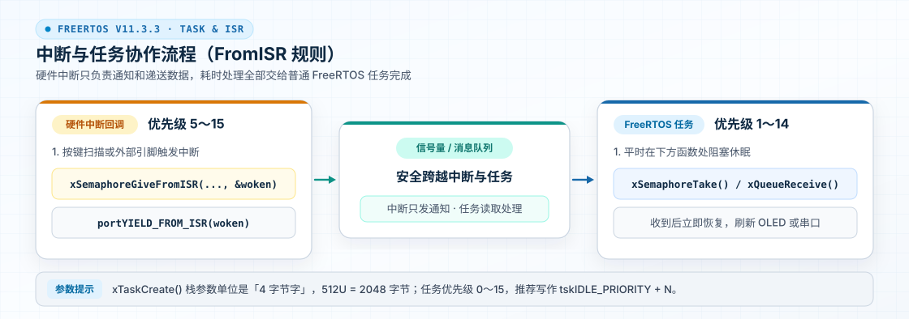

# FreeRTOS 常用接口

本站后面「FreeRTOS 教程（CubeMX）」章节主要基于 CubeMX 封装的 CMSIS-RTOS V2 函数来写代码；而在本套 CMake 工程中，直接调用 **官方原生 FreeRTOS V11.3.3** 的 C 语言接口，减少一层封装的同时也能直接查阅官方手册。

本篇整理了开发中最常用到的原生函数，并标注了与 CubeMX 写法的对应关系，方便两边切换学习。

## 常用函数速查

| 功能 | 原生 FreeRTOS 接口 | CubeMX 常见写法 | 头文件 |
| --- | --- | --- | --- |
| 启动调度 | `vTaskStartScheduler()` | `osKernelStart()` | `task.h` |
| 创建任务 | `xTaskCreate(...)` | `osThreadNew(...)` | `task.h` |
| 删除任务 | `vTaskDelete(...)` | `osThreadTerminate()` | `task.h` |
| 相对延时 | `vTaskDelay(pdMS_TO_TICKS())` | `osDelay(ms)` | `task.h` |
| 周期延时 | `xTaskDelayUntil(...)` | `osDelayUntil(ticks)` | `task.h` |
| 消息队列 | `xQueueCreate / Send / Recv` | `osMessageQueueNew / Put` | `queue.h` |
| 二值信号量 | `xSemaphoreCreateBinary / Take` | `osSemaphoreNew / Acquire` | `semphr.h` |
| 互斥量 | `xSemaphoreCreateMutex / Take` | `osMutexNew / Acquire` | `semphr.h` |
| 事件标志组 | `xEventGroupCreate / WaitBits` | `osEventFlagsNew / Wait` | `event_groups.h` |
| 任务通知 | `xTaskNotifyGive / Take` | `osThreadFlagsSet / Wait` | `task.h` |
| 软件定时器 | `xTimerCreate / Start` | `osTimerNew / Start` | `timers.h` |
| 剩余堆内存 | `xPortGetFreeHeapSize()` | 无 | `portable.h` |

## 新手常见注意点

### 任务栈大小单位

调用 `xTaskCreate()` 创建任务时，第 3 个参数是**任务栈深度**（记录能存放多少个 `StackType_t` 数据），在 STM32F407 上 1 个单位等于 **4 个字节**，而 CubeMX 里的 `stack_size` 单位是 **字节**。

- 需要 2048 字节任务栈时，在原生接口里应当传 `512U`（`512 × 4 = 2048` 字节）；
- 只控制 LED 闪烁的简单任务可用 `256U`（1024 字节），包含 `printf` 格式化打印的任务建议分配 `512U` 或更多。

### 任务优先级范围

本工程在 `platform/core/FreeRTOSConfig.h` 中将可用优先级数量 `configMAX_PRIORITIES` 设为 16（范围 `0～15`，数字越大优先级越高，软件定时器服务任务占最高级 15）。

写代码时不要填入 CubeMX 的 `osPriorityNormal`（它的宏数值是 24，会超出范围），建议写成相对空闲任务优先级的格式：

```c
/* 普通后台任务 */
xTaskCreate(led_task, "led", 256U, NULL, tskIDLE_PRIORITY + 1U, NULL);

/* 优先级更高的响应任务 */
xTaskCreate(key_task, "key", 512U, NULL, tskIDLE_PRIORITY + 2U, NULL);
```

### 中断里调用接口

在原生 FreeRTOS 中，普通任务和硬件中断必须分开使用两套函数：



- 普通任务里调用不带后缀的函数（例如 `xSemaphoreGive()`、`xQueueSend()`）；
- 中断回调函数里**必须**调用带 `FromISR` 后缀的接口（例如 `xSemaphoreGiveFromISR()`、`xQueueSendFromISR()`、`xTaskGetTickCountFromISR()`），并在函数末尾加上 `portYIELD_FROM_ISR(woken)`，让被唤醒的高优先级任务可以立刻得到调度。

同时要保证这个中断的抢占优先级设置大于等于 5（例如工程中的外部中断均设为 6）。以按键中断唤醒任务为例，标准写法如下：

```c
    if (any_edge && sched_running && s_key_sem != NULL) {
        BaseType_t woken = pdFALSE;
        (void)xSemaphoreGiveFromISR(s_key_sem, &woken);
        portYIELD_FROM_ISR(woken);
    }
```

## 关键系统配置

`platform/core/FreeRTOSConfig.h` 默认打开了开发和调试常用选项：

| 配置项 | 当前设定 | 说明 |
| --- | --- | --- |
| `configTICK_RATE_HZ` | 1000 | 每秒 1000 次系统节拍，1 Tick 恰好等于 1 ms |
| `configTOTAL_HEAP_SIZE` | `48 * 1024` | 分配给任务、队列、信号量使用的总堆内存为 48 KB |
| `configKERNEL_PROVIDED_STATIC_MEMORY` | 1 | FreeRTOS V11 特性：启用静态内存支持时无需手动编写空闲任务内存回调 |
| `configCHECK_HANDLER_INSTALLATION` | 1 | 启动调度前自动核对核心中断向量是否配置正确 |
| `configCHECK_FOR_STACK_OVERFLOW` | 2 | 任务切换时检查任务栈底部标记，防止栈越界 |
| `configHEAP_CLEAR_MEMORY_ON_FREE` | 1 | 释放堆内存后自动清零 |
| `configUSE_TRACE_FACILITY` | 1 | 让 VS Code 在断点调试时显示完整的 FreeRTOS 任务状态列表 |

## 深入学习入口

关于任务状态机、消息队列、信号量和内存管理的完整原理，可以直接配合本站的理论教程一起学习：

| 学习主题 | 理论章节 | 对应参考示例 |
| --- | --- | --- |
| 内存管理方案 | [第 8 章 内存管理](../../chapter8.md) | `platform/core/FreeRTOSConfig.h` |
| 任务管理与阻塞延时 | [第 9 章 任务管理](../../chapter9.md) | `applications/f407_demo/src/main.c` |
| 消息队列传参 | [第 11 章 队列(queue)](../../chapter11.md) | `platform/modules/mod_ir.c` |
| 二值信号量同步 | [第 12 章 信号量(semaphore)](../../chapter12.md) | `platform/bsp/bsp_key.c` |
| 互斥量保护共享总线 | [第 13 章 互斥量(mutex)](../../chapter13.md) | `platform/bsp/bsp_i2c.c` |
| 事件组与任务通知 | [第 14 章 事件组](../../chapter14.md)、[第 15 章 任务通知](../../chapter15.md) | `platform/core/FreeRTOSConfig.h` |

---

[上一篇：启动与时钟配置](../c05-startup-clock-bsp/README.md) · [下一篇：外部 SRAM 与 OLED](../c07-sram-and-oled-ui/README.md) · [课程首页](../../README.md)
