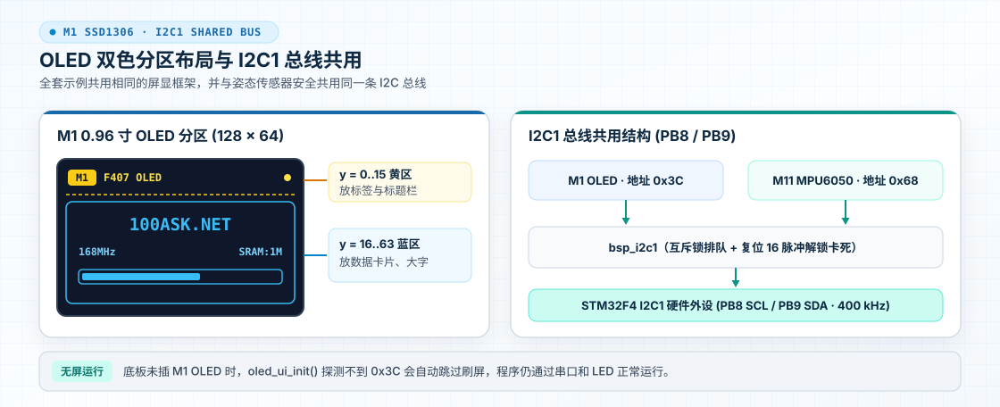

# 外部 SRAM 与 OLED

除基础 GPIO 与串口之外，核心板驱动目录下（`platform/bsp/`）还封装了 1 MB 外部 SRAM 驱动与 0.96 寸 OLED 绘图界面接口。全套 18 个示例都共用这套界面接口来展示实时数据。

## 使用 1 MB 外部 SRAM

### 硬件与地址范围

DshanMCU-F407 核心板正面主控右侧带有一颗 `IS62WV51216BLL` 异步静态内存芯片（容量 1 MB），连接在 STM32F4 的 FSMC Bank 3 接口（片选引脚 `PG10`）上，初始化后直接映射到芯片内存地址 `0x68000000`～`0x680FFFFF`。

FSMC 时序已按照 168 MHz 主频配置完毕，使用前无需再计算建立与保持时间参数。

### 常用接口与示例

| 函数 | 作用 |
| --- | --- |
| `bsp_sram_init()` | 初始化 FSMC 接口及 `PD/PE/PF/PG` 相关复用引脚，返回是否成功 |
| `bsp_sram_quick_check()` | 写入并回读 3 个位置的特征数，用于上电快速自检 |
| `bsp_sram_march_test(...)` | 按步长遍历全部 1 MB 地址空间并校验，测试示例见 `applications/sram_test` |

初始化通过后，可以像访问普通数组指针一样直接读写这片空间：

```c
if (bsp_sram_init() && bsp_sram_quick_check()) {
    volatile uint32_t *ext_buf = (volatile uint32_t *)BSP_SRAM_BASE_ADDR;
    ext_buf[0] = 0x12345678UL;
}
```

:::warning[与 M14 直流电机的引脚冲突]
底板上的 `M14` 直流电机模块使用 `PF0`、`PF1`、`PF2` 三个引脚，而这三个引脚同时是 FSMC 外部 SRAM 的地址线 `A0~A2`。因此工程没有把 `bsp_sram_init()` 放进开机默认的 `board_init()` 里；编写电机控制工程时不要初始化外部 SRAM，需要使用外部 SRAM 时不要同时驱动 `M14` 电机。
:::

## 使用 M1 OLED 屏幕

### 屏幕分区与自动检测

底板 `M1` 插座接的是 0.96 寸 128×64 黄蓝双色 SSD1306 屏幕（I2C 地址 `0x3C`，接在 `PB8 / PB9` 上）：

- **双色分区**：屏幕最上方 16 行（`y = 0..15`）固定显示为黄色，适合放模块编号标签、标题和心跳动画；下方 48 行（`y = 16..63`）固定为蓝色，用于显示卡片框、主数值和进度条；
- **无屏自动运行**：任务中调用 `oled_ui_init()` 会尝试探测屏幕 3 次。如果底板上没有插屏幕，串口会提示 `oled: M1 (ssd1306@3c) not detected, UART log only`，之后所有绘图与刷新函数自动跳过实际发送，保证 LED 与串口日志照常运行。

### 常用绘图接口

绘图操作会先写入内存里的 `1024` 字节显存，最后调用一次 `oled_ui_present()` 统一发送到屏幕刷新：

| 接口 | 用途 |
| --- | --- |
| `oled_ui_init()` / `oled_ui_is_ready()` | 初始化 I2C1 并探测屏幕；查询屏幕是否在线 |
| `oled_ui_clear()` | 清空显存画面 |
| `oled_ui_header(tag, title, tick)` | 绘制顶部黄区：反白标签 + 标题 + 右上角旋转动态指示 + 分隔虚线 |
| `oled_ui_card(x, y, w, h)` | 绘制带圆角效果的边框 |
| `oled_ui_text()` / `text_center()` / `text_right()` | 显示标准 5×7 ASCII 字符（支持左对齐、居中、右对齐和反白） |
| `oled_ui_big_text()` / `big_text_center()` | 显示 2 倍放大的醒目文字（适合展示数值或状态） |
| `oled_ui_bar(x, y, w, h, permille)` | 绘制 0～1000 千分比进度条 |
| `oled_ui_center_bar(x, y, w, h, signed_permille)` | 绘制以中心为 0 点的 `-1000～+1000` 双向进度条（适合电机正反转速度） |
| `oled_ui_present()` | 将显存一次性刷到 OLED 屏幕上 |

## I2C1 总线共用说明

底板上的 `M1` OLED（地址 `0x3C`）和 `M11` MPU6050 姿态传感器（地址 `0x68`）都挂在 `I2C1 (PB8/PB9)` 总线上。为了让多设备与多任务共用稳定，底层 `platform/bsp/bsp_i2c.c` 与屏显框架协作如下：



1. **复位后总线恢复**：每次初始化 `I2C1` 时，若发现上一次异常复位导致从机拉低 SDA 数据线死锁，驱动会自动通过 `SCL` 输出最多 16 个时钟脉冲把总线释放出来，并执行一次软件复位，避免一开机通信就卡死；
2. **互斥锁访问**：`bsp_i2c1` 每次读写都会自动获取 FreeRTOS 互斥信号量，防止多个任务同时抢占总线导致数据混乱。

## 其他板载接口

| 驱动文件 | 对应硬件与常用函数 |
| --- | --- |
| `bsp_led.h/.c` | 核心板 `LED1 (PF9)`、`LED2 (PF10)`：`bsp_led_set()`、`bsp_led_toggle()` |
| `bsp_key.h/.c` | 核心板 `KEY0 (PE3)`、`WKUP (PA0)` 与底板 `K1 (PB1)`：`bsp_key_is_pressed()`、`bsp_key_take_presses()`、`bsp_key_wait_event()` |
| `bsp_uart.h/.c` | `USART1 (PA9/PA10)` 调试串口：`bsp_uart_write()`、`bsp_uart_read_byte()` |
| `bsp_spi.h/.c` | `SPI1 (PB3/PB4/PB5)`：`bsp_spi1_init()`、`bsp_spi_core_flash_cs()`（`PB14` 核心板 Flash）、`bsp_spi_ext_flash_cs()`（`PC1` 底板 Flash） |

---

[上一篇：FreeRTOS 常用接口](../c06-freertos-v11-migration/README.md) · [下一篇：添加外设驱动](../c08-custom-module-driver/README.md) · [课程首页](../../README.md)
