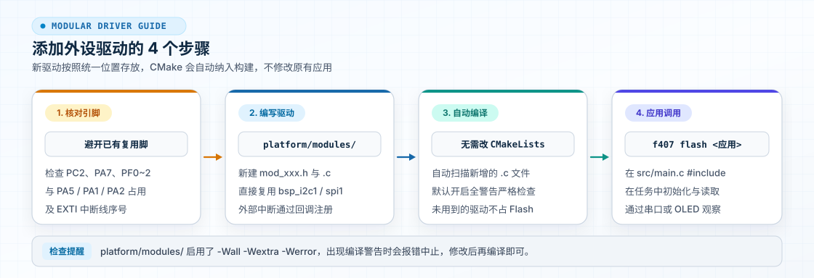

# 添加外设驱动

当需要扩展实验套件之外的新传感器或执行器时，可以把它的初始化和读取函数放进 `platform/modules/` 目录下的独立文件中。CMake 会自动识别新文件，不需要把大段寄存器操作写进 `main.c`。



## 驱动存放位置

打开工作区的 `platform/modules/` 目录，可以看到 12 组现有模块驱动文件（如 `mod_dht11.c`、`mod_mpu6050.c`、`mod_obstacle.c`），新增驱动建议保持一致的写法：

- **文件命名**：头文件命名为 `mod_<模块名>.h`，源文件命名为 `mod_<模块名>.c`；
- **内部变量隐藏**：外设句柄（如 `TIM_HandleTypeDef`）和 FreeRTOS 信号量在 `.c` 文件里加 `static` 声明，头文件只放结构体和供外部调用的函数声明；
- **复用板级总线**：新模块如果是 I2C、SPI 或需要微秒延时，直接调用 `bsp_i2c1_*`、`bsp_spi1_*` 与 `bsp_delay_us()`，不要再去重配 `I2C1` 时钟或占用 `TIM4`。

## 核对可用引脚

动手写代码前，先确认新模块选择的引脚、外部中断线和定时器没有和底板现有插槽冲突：

| 引脚 / 外设 | 所属模块 | 选脚建议 |
| --- | --- | --- |
| PB8 / PB9 (I2C1) | M1 OLED (0x3C) / M11 MPU6050 (0x68) | 只要新器件 I2C 地址不重复，可直接并联共用 |
| PB3 / PB4 / PB5 (SPI1) | 板载 GD25Q256 / M12 W25Q64 | 共用总线时需另选空闲 GPIO 作新模块片选，并保持原有片选拉高 |
| PC2 | M2 DS18B20 / M10 DHT11 | 二者复用同一单总线引脚 |
| PA7 (TIM3_CH2) | M4 红外发射 / M9 蜂鸣器 | 严禁同插，新模块建议避开 |
| PA5 / PA1 / PA2 (TIM2) | M3 RGB LED / J6～J8 舵机 | 使用 PWM 时注意不要和这两个模块同时运行 |
| PF0 / PF1 / PF2 | 外部 SRAM (A0~A2) / M14 直流电机 | 打开外部 SRAM 时不可再把这 3 个引脚用作普通 IO |
| EXTI 线 0 / 5 / 6 / 7 / 8 | PC0 (M7)、PC5 (M5)、PA6 (M8)、PF6~8 (M13) | 同一序号的中断线全芯片共用，新模块可选 PA4 或 PC4 (EXTI4) 等空闲线号 |

## 编写驱动代码

### I2C 外设示例

下面以挂在 `I2C1` 上的数字光照传感器 BH1750 为例，展示完整的模块写法。

1. 新建 `platform/modules/mod_bh1750.h`：

```c
#ifndef MOD_BH1750_H
#define MOD_BH1750_H

#include <stdbool.h>
#include <stdint.h>

#ifdef __cplusplus
extern "C" {
#endif

/**
 * @brief 初始化 I2C1 并启动 BH1750 连续采集模式
 * @return true 探测并配置成功，false 未找到设备
 */
bool mod_bh1750_init(void);

/**
 * @brief 读取当前照度值（单位：lux）
 */
bool mod_bh1750_read_lux(uint32_t *out_lux);

#ifdef __cplusplus
}
#endif

#endif /* MOD_BH1750_H */
```

2. 新建 `platform/modules/mod_bh1750.c`：

```c
#include "mod_bh1750.h"
#include "bsp_i2c.h"

/* ADDR 接地时 7 位地址为 0x23，HAL 库需要左移 1 位的 8 位地址 0x46 */
#define BH1750_I2C_ADDR     (0x23U << 1)
#define BH1750_CMD_POWER_ON 0x01U
#define BH1750_CMD_CONT_H   0x10U

bool mod_bh1750_init(void)
{
    bsp_i2c1_init(400000U);

    if (!bsp_i2c1_probe(BH1750_I2C_ADDR)) {
        return false;
    }

    uint8_t cmd = BH1750_CMD_POWER_ON;
    if (!bsp_i2c1_transmit(BH1750_I2C_ADDR, &cmd, 1U, 20U)) {
        return false;
    }

    cmd = BH1750_CMD_CONT_H;
    return bsp_i2c1_transmit(BH1750_I2C_ADDR, &cmd, 1U, 20U);
}

bool mod_bh1750_read_lux(uint32_t *out_lux)
{
    uint8_t buf[2] = {0};

    if (out_lux == NULL) {
        return false;
    }

    bsp_i2c1_lock();
    HAL_StatusTypeDef st = HAL_I2C_Master_Receive(&hi2c1, BH1750_I2C_ADDR, buf, sizeof(buf), 30U);
    bsp_i2c1_unlock();

    if (st != HAL_OK) {
        return false;
    }

    uint32_t raw = ((uint32_t)buf[0] << 8) | buf[1];
    *out_lux = (raw * 10U) / 12U;
    return true;
}
```

### 外部中断示例

如果新外设需要通过外部中断即时唤醒 FreeRTOS 任务，可以先调用 `bsp_exti_set_callback()` 登记中断处理函数，再通过二值信号量通知任务（中断优先级设在 5～15 之间）：

```c
static SemaphoreHandle_t s_evt_sem = NULL;

static void my_exti_cb(void)
{
    if (s_evt_sem != NULL && xTaskGetSchedulerState() == taskSCHEDULER_RUNNING) {
        BaseType_t woken = pdFALSE;
        (void)xSemaphoreGiveFromISR(s_evt_sem, &woken);
        portYIELD_FROM_ISR(woken);
    }
}

void mod_my_sensor_init(void)
{
    if (s_evt_sem == NULL) {
        s_evt_sem = xSemaphoreCreateBinary();
    }
    bsp_exti_set_callback(4U, my_exti_cb); /* 以 PC4 (EXTI4) 为例 */
    /* 配置 GPIO 为中断模式后，设置优先级 6 并使能中断 */
    HAL_NVIC_SetPriority(EXTI4_IRQn, 6U, 0U);
    HAL_NVIC_EnableIRQ(EXTI4_IRQn);
}
```

## 自动加入编译

打开 `cmake/f407_app.cmake` 可以看到：

```cmake
file(GLOB PLATFORM_MODULE_SOURCES CONFIGURE_DEPENDS
    "${F407_ROOT}/platform/modules/*.c"
)
add_library(f407_modules STATIC ${PLATFORM_MODULE_SOURCES})
```

因此新增 `.c` 文件放进 `platform/modules/` 后，**不需要改动任何 `CMakeLists.txt`**，下次执行编译时 CMake 会自动发现并加入编译。同时因为链接器启用了自动裁剪未用代码段（`--gc-sections`），其他没有用到这个驱动的应用在烧录固件里不会增加多余空间。

:::note[编译警告检查]
工作区对 `platform/modules/*.c` 默认启用 `-Wall -Wextra -Werror`，任何未使用的参数或类型转换警告都会导致编译失败，保存后先编译一次确保零警告通过。
:::

## 在应用中调用

参考「创建第一个工程」新建一个测试应用后，完成以下 3 步即可看到实际效果：

1. 在 `src/main.c` 顶部加上 `#include "mod_bh1750.h"`；
2. 在任务启动后调用 `mod_bh1750_init()`，随后在循环里定时调用 `mod_bh1750_read_lux(&lux)` 并用 `printf` 或 `oled_ui` 输出结果；
3. 运行 `.\.venv\Scripts\f407.exe flash <应用名>` 编译烧录，打开串口终端确认数据正常刷新。

---

[上一篇：外部 SRAM 与 OLED](../c07-sram-and-oled-ui/README.md) · [下一篇：内置示例汇总](../c09-apps-index-and-pitfalls/README.md) · [课程首页](../../README.md)
