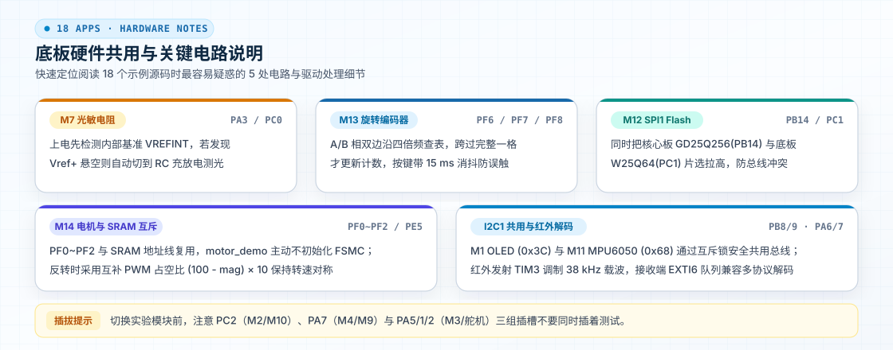

# 内置示例汇总

工作区 `applications/` 目录中共包含 18 个可独立编译的示例工程：前 4 个面向核心板自身外设与外部 SRAM，后 14 个对应实验套件底板上的各类传感器和执行器模块，并且全部支持在插上 M1 OLED 时同步显示实时界面、未插屏幕时正常输出串口日志。点击下方任一示例名称即可进入对应的源码逐行解析页面。

在工程根目录执行以下命令即可一键编译并烧录下面任意示例：

```powershell
.\.venv\Scripts\f407.exe flash <应用名>
```

## 核心板示例

以下 4 个示例只需连接核心板即可运行（源码均位于 `applications/<应用名>/src/main.c`）：

| 应用名 | 功能说明 | 主要硬件 | 关键驱动源码 |
| --- | --- | --- | --- |
| [`f407_demo`](../demos/d04-f407-demo/README.md) | 综合自检 | 1 MB SRAM、LED1/2、按键、串口、M1 OLED | `bsp_sram.c`、`oled_ui.c` |
| [`blinky`](../demos/d01-blinky/README.md) | 双灯闪烁 | LED1 (PF9)、LED2 (PF10) | `bsp_led.c` |
| [`sram_test`](../demos/d03-sram-test/README.md) | SRAM 校验 | IS62WV51216BLL (0x68000000) | `bsp_sram.c` |
| [`key_led_demo`](../demos/d02-key-led/README.md) | 按键与 LED | KEY0 (PE3)、WKUP (PA0)、K1 (PB1) | `bsp_key.c`、`bsp_led.c` |

## 底板模块示例

各应用入口位于 `applications/<应用名>/src/main.c`，模块驱动位于 `platform/modules/`（OLED 驱动位于 `platform/bsp/`），点击示例名可看源码解析，点击右侧链接可查看对应模块的接线与现象说明：

| 应用名 | 底板插座与模块 | 驱动文件 | 快速体验 |
| --- | --- | --- | --- |
| [`oled_demo`](../demos/d05-oled-demo/README.md) | M1 · 0.96 寸 OLED (PB8/PB9) | `oled_ui.c` | [第 1 课：OLED 双色屏](../../quickstart/p1-01-OLED双色屏显示/README.md) |
| [`rgb_led_demo`](../demos/d06-rgb-led/README.md) | M3 · RGB 全彩 LED (PA5/PA1/PA2) | `mod_rgb_led.c` | [第 2 课：RGB 全彩 LED](../../quickstart/p1-02-RGB全彩LED调色/README.md) |
| [`buzzer_demo`](../demos/d07-buzzer/README.md) | M9 · 有源/无源蜂鸣器 (PA7) | `mod_buzzer.c` | [第 3 课：有源/无源蜂鸣器](../../quickstart/p1-03-有源无源蜂鸣器/README.md) |
| [`dht11_demo`](../demos/d08-dht11/README.md) | M10 · DHT11 温湿度 (PC2) | `mod_dht11.c` | [第 4 课：DHT11 温湿度](../../quickstart/p1-04-DHT11温湿度采集/README.md) |
| [`ds18b20_demo`](../demos/d09-ds18b20/README.md) | M2 · DS18B20 测温 (PC2) | `mod_ds18b20.c` | [第 5 课：DS18B20 测温](../../quickstart/p1-05-DS18B20单总线测温/README.md) |
| [`hc_sr04_demo`](../demos/d10-hc-sr04/README.md) | M6 · 超声波测距 (PE2/PE4) | `mod_hcsr04.c` | [第 6 课：HC-SR04 超声波](../../quickstart/p1-06-HC-SR04超声波测距/README.md) |
| [`mpu6050_demo`](../demos/d11-mpu6050/README.md) | M11 · MPU6050 六轴 (PB8/PB9) | `mod_mpu6050.c` | [第 7 课：MPU6050 姿态](../../quickstart/p1-07-MPU6050六轴姿态采集/README.md) |
| [`light_sensor_demo`](../demos/d12-light-sensor/README.md) | M7 · 光敏电阻模块 (PA3/PC0) | `mod_light.c` | [第 8 课：光敏电阻亮度](../../quickstart/p1-08-光敏电阻亮度采集/README.md) |
| [`rotary_encoder_demo`](../demos/d13-rotary-encoder/README.md) | M13 · EC11 编码器 (PF6/PF7/PF8) | `mod_encoder.c` | [第 9 课：旋转编码器](../../quickstart/p1-09-旋转编码器与按键/README.md) |
| [`ir_obstacle_demo`](../demos/d14-ir-obstacle/README.md) | M5 · 红外对管避障 (PC5) | `mod_obstacle.c` | [第 10 课：红外对管避障](../../quickstart/p1-10-红外对管避障检测/README.md) |
| [`ir_tx_rx_demo`](../demos/d15-ir-tx-rx/README.md) | M4 + M8 · 红外收发 (PA7/PA6) | `mod_ir.c` | [第 11 课：红外发射与接收](../../quickstart/p1-11-红外发射与接收通信/README.md) |
| [`w25q64_demo`](../demos/d16-w25q64/README.md) | M12 · W25Q64 Flash (SPI1/PC1) | `mod_w25q64.c` | [第 12 课：W25Q64 Flash](../../quickstart/p1-12-W25Q64外部Flash读写/README.md) |
| [`motor_demo`](../demos/d17-motor/README.md) | M14 + J5 · 直流电机 (PF0~2/PE5) | `mod_motor.c` | [第 13 课：DRV8833 电机](../../quickstart/p1-13-DRV8833直流电机驱动/README.md) |
| [`servo_demo`](../demos/d18-servo/README.md) | J6～J8 · SG90 舵机 (PA5/PA1/PA2) | `mod_servo.c` | [第 14 课：SG90 舵机控制](../../quickstart/p1-14-SG90舵机角度控制/README.md) |

## 使用注意事项

阅读上述模块驱动源码时，以下 5 处针对开发板电路特性的实现值得注意：



### 光敏模块读取说明

在部分批次的核心板上，STM32F407ZGT6 的 `Vref+` 模拟参考脚处于悬空状态，直接读 `ADC1_IN3 (PA3)` 会一直接近满量程 `4095`。

为此 `platform/modules/mod_light.c` 会在上电时先读取内部参考电压通道 `ADC_CHANNEL_VREFINT`：若 `Vref+` 正常供电，直接使用常规 ADC 电压换算；若检测到 `Vref+` 悬空，则自动切换为基于 `PA3` 引脚与模块滤波电容的 RC 充放电计时测算方式（`rc_measure_pa3_mv()`），确保两种硬件批次上都能连续读出亮度值。

### 旋转编码器防抖

`platform/modules/mod_encoder.c` 对 `S1 (PF8)` 和 `S2 (PF7)` 同时开启双边沿中断，并通过四倍频状态查表（`s_qdec_table[16]`）判断旋转方向：只有当编码器完整跨过一个定位格回到空闲高电平时才对位置计数加减 1，同时对按压键 `KEY (PF6)` 做 15 ms 消抖，避免快速拧动或触点抖动导致跳数。

### SPI1 双 Flash 片选

核心板背面带有一颗 `GD25Q256` Flash（片选 `PB14`），底板 `M12` 插座上的 `W25Q64` Flash（片选 `PC1`）与它共用 `SPI1 (PB3/PB4/PB5)`。

`platform/bsp/bsp_spi.c` 在初始化 `SPI1` 引脚前就预先把 `PB14` 和 `PC1` 同时拉高置为非选中状态，防止读写 `M12` 模块时核心板 `GD25Q256` 同时响应造成数据错乱。

### 直流电机与 SRAM 互斥

由于 `M14` 电机占用的 `PF0~PF2` 与核心板外部 SRAM 地址线复用，`applications/motor_demo/src/main.c` 中没有调用 `bsp_sram_init()`。另外 `platform/modules/mod_motor.c` 使用 `TIM9_CH1 (PE5)` 输出 1 kHz PWM，在反转状态下自动将占空比调整为互补值 `(100 - mag) * 10`，保证正反两向相同百分比对应的转速一致。

### I2C1 共用与红外解码

- `M1 OLED`（`0x3C`）与 `M11 MPU6050`（`0x68`）可同时插在底板上，通过 `bsp_i2c1` 互斥锁轮流访问 `PB8/PB9` 实现 2D 水平仪同屏刷新；
- `platform/modules/mod_ir.c` 中，发射端使用 `TIM3_CH2 (PA7)` 调制约 38 kHz 红外载波，接收端通过 `PA6 (EXTI6)` 记录边沿时长，同时兼容标准 NEC 协议与百问网 16-bit 红外编码，解码后通过队列 `s_ir_rx_queue` 传递给任务处理。

---

[上一篇：添加外设驱动](../c08-custom-module-driver/README.md) · [开始阅读示例解析：双灯闪烁](../demos/d01-blinky/README.md) · [FreeRTOS 教程（CubeMX）](../../chapter1.md) · [课程首页](../../README.md)
