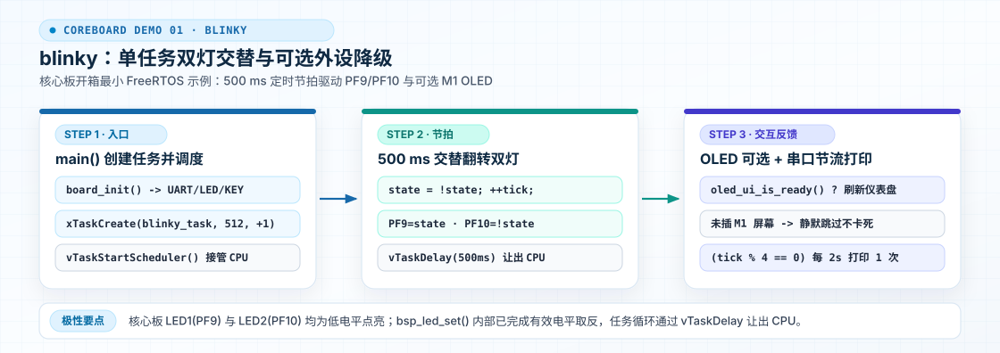

# 双灯闪烁（blinky）

`blinky` 是整套工程最精简的 FreeRTOS 入门模板：只需一根 Type-C 线连接核心板 `DEBUG` 口（可选外接 M1 OLED），就能看到核心板 `LED1 (PF9)` 与 `LED2 (PF10)` 每 500 ms 交替闪烁，并在串口同步输出运行节拍。代码虽短，却完整跑通了裸机启动到多任务调度的全部核心链路。

通过本篇源码解析，你将掌握：
- **构建与启动链**：理解 7 行 `CMakeLists.txt` 如何把 HAL、FreeRTOS、板级驱动打包成固件，以及 `board_init()` 在进入任务前做了什么。
- **FreeRTOS 任务核心**：掌握 `xTaskCreate()` 六个参数的真实含义（尤其是字对齐栈单位）、`vTaskStartScheduler()` 启动机制以及 `vTaskDelay()` 为何能主动让出 CPU。
- **GPIO 与可选外设**：理解核心板低电平有效（灌电流）LED 电路、防上电误闪技巧，以及 `128×64` 黄蓝双色 OLED 的降级兼容写法。

## 工程结构与烧录

在工程根目录执行以下命令即可完成增量编译并烧录到核心板：

```powershell
.\.venv\Scripts\f407.exe flash blinky
```

打开 `applications/blinky/CMakeLists.txt`，会发现全篇只有 7 行：

```cmake
cmake_minimum_required(VERSION 3.22)
include(${CMAKE_CURRENT_LIST_DIR}/../../cmake/arm-none-eabi-gcc.cmake)

project(blinky LANGUAGES C ASM)

include(${F407_ROOT}/cmake/f407_app.cmake)
target_sources(app PRIVATE
    src/main.c
)
```

引入公共规则 `cmake/f407_app.cmake` 后，CMake 会自动将 ST 官方 HAL/LL 库（`stm32f4_hal`）、原生 FreeRTOS V11.3.3 内核（`freertos_kernel`，含 `ARM_CM4F` 移植层与 `heap_4`）、启动文件与板级支持包（`f407_platform`）以及底板外设库（`f407_modules`）链接进可执行目标，开启 `-Wall -Wextra -Werror` 严格编译并在构建后生成 `.elf`、`.hex` 与 `.bin`。

| 项目 | 说明 |
| --- | --- |
| 应用入口 | `applications/blinky/src/main.c`（52 行） |
| 构建脚本 | `applications/blinky/CMakeLists.txt`、`cmake/f407_app.cmake` |
| 核心驱动 | `platform/bsp/board.c`、`platform/bsp/bsp_led.c`、`platform/bsp/oled_ui.c` |
| 硬件引脚与外设 | `LED1 (PF9)`、`LED2 (PF10)`、`USART1 (PA9/PA10, 115200)`、可选 `M1 OLED (PB8/PB9)` |
| FreeRTOS 机制 | 单任务 `blinky_task`（栈 `512` 字 / `2048 B`，优先级 `+1`）+ `vTaskDelay()` |

## 运行原理与流程



从芯片上电复位到两颗 LED 开始交替闪烁，完整的软件执行链共分 5 步：

1. **汇编启动**：`startup_stm32f407xx.s` 初始化栈顶与 `.data` / `.bss` 内存段，调用 `SystemInit()` 后跳转至应用 `main()`。
2. **板级初始化（`board_init()`）**：配置 4 位抢占优先级分组 `NVIC_PRIORITYGROUP_4`、启动 `TIM4` 作为 HAL 1 ms 时基，启用 24 MHz HSE 倍频至 168 MHz 主频，初始化 LED、按键与 115200 波特率 `USART1`。
3. **创建任务**：`xTaskCreate()` 从 `configTOTAL_HEAP_SIZE`（48 KB）动态堆中分配任务控制块（TCB）和 `2048 B` 任务栈，把 `"blinky"` 任务加入优先级 `1` 的就绪列表。
4. **启动调度器**：`vTaskStartScheduler()` 创建空闲任务（Idle Task）并开启 `SysTick`（1000 Hz）和 `PendSV`/`SVC` 异常，切入最高优先级就绪任务 `blinky_task`。
5. **500 ms 节拍循环**：任务首次运行调用 `oled_ui_init()` 探测屏幕；随后在 `for (;;)` 中翻转双灯、按需刷屏与每 4 拍打印日志，最后调用 `vTaskDelay()` 释放 CPU 等待下一个 500 ms 到来。

## 源码逐段精讲（main.c）

### 1. 板级初始化、任务创建与调度启动

```c
int main(void)
{
    board_init();
    configASSERT(xTaskCreate(blinky_task, "blinky", 512U, NULL, tskIDLE_PRIORITY + 1U, NULL) == pdPASS);
    vTaskStartScheduler();
    for (;;) {
    }
}
```

先看 `board_init()`（位于 `platform/bsp/board.c`）在调度之前做好了哪些底层铺垫：

- `HAL_Init()`：按照 `platform/bsp/bsp_hal_timebase_tim4.c` 的重定义，配置通用定时器 `TIM4` 为 **1 kHz（1 ms）中断** 作为 HAL 库时基（刻意把 `SysTick` 完整让给 FreeRTOS 内核使用）。
- `HAL_NVIC_SetPriorityGrouping(NVIC_PRIORITYGROUP_4)`：FreeRTOS 在 Cortex-M4 上强依赖 **4 位全抢占优先级、0 位子优先级**，使 `0~15` 级中断优先级完全线性可比，不会出现子优先级混淆问题。
- `bsp_clock_init()`：配置 24 MHz 外部无源晶振 `HSE`，经 PLL（`PLLM=24`、`PLLN=336`、`PLLP=2`）生成 **168 MHz 系统主频**（`APB1 = 42 MHz`、`APB2 = 84 MHz`），同时开启内核 `DWT->CYCCNT` 周期计数器供微秒级延时使用。
- `bsp_uart_init(115200U)` + `setvbuf(stdout, NULL, _IONBF, 0)`：打通 `USART1 (PA9/PA10)` 并在 `platform/core/syscalls.c` 的 `_write()` 里自动给 `\n` 补上 `\r`，同时关闭标准输出行缓冲——这样哪怕打印字符串末尾不带 `\n`，串口也会立刻吐出字符。

再逐一拆解 `xTaskCreate(...)` 的 6 个参数：

| 参数 | 传入实参 | 含义与工程考量 |
| --- | --- | --- |
| `1` · 入口 | `blinky_task` | 任务函数指针，函数体内必须有死循环，不可直接 `return` |
| `2` · 名称 | `"blinky"` | 调试器查看任务列表时显示名称（上限 `16` 字符） |
| `3` · 栈深 | `512U` | 单位为 **字（4 B）**，即 `512 × 4 = 2048` 字节，满足 `printf` 开销 |
| `4` · 传参 | `NULL` | 传递给 `blinky_task(void *arg)` 的自定义指针，此处无需传参 |
| `5` · 优先级 | `tskIDLE_PRIORITY + 1U` | 比优先级 `0` 的空闲任务高 1 级（上限为 `15`） |
| `6` · 句柄 | `NULL` | 若后续不需要从外部挂起、删除或发通知，可传 `NULL` |

:::tip[为什么 `configASSERT(...)` 和末尾 `for (;;) {}` 要这样写？]
如果把任务栈写太大导致 48 KB 堆溢出，或 `heap_4` 无空闲空间，`xTaskCreate()` 会返回 `errCOULD_NOT_ALLOCATE_REQUIRED_MEMORY`。在调试阶段用 `configASSERT` 包住，一旦创建失败就会在原地关中断停住，连上仿真器就能一秒定位哪一行出错。正常情况下 `vTaskStartScheduler()` 永远不会返回，末尾空循环只是为了防止编译器提示无返回或误入未知 Flash 地址。
:::

### 2. 主循环调度与可选 OLED 降级策略

```c
static void blinky_task(void *arg)
{
    (void)arg;
    bool state = false;
    uint32_t tick = 0U;

    (void)oled_ui_init();
    printf("\r\nblinky demo: PF9(LED1) / PF10(LED2) @ 500 ms\r\n");

    for (;;) {
        state = !state;
        bsp_led_set(BSP_LED1, state);
        bsp_led_set(BSP_LED2, !state);

        if (oled_ui_is_ready()) {
            oled_ui_clear();
            oled_ui_header("LED", "BLINKY", tick);
            oled_ui_card(0, 17, 128, 47);
            oled_ui_big_text_center(22, state ? "LED1 ON" : "LED2 ON");
            oled_ui_text_center(46, "PF9 <-> PF10  500ms", false);
            (void)oled_ui_present();
        }

        if ((tick % 4U) == 0U) {
            printf("[BLINKY] cycle=%lu LED1=%s LED2=%s\r\n",
                   (unsigned long)tick,
                   state ? "ON" : "OFF",
                   !state ? "ON" : "OFF");
        }

        ++tick;
        vTaskDelay(pdMS_TO_TICKS(500));
    }
}
```

逐行分析新手最常疑惑的几个细节：

- **`(void)arg;` 与 `(void)oled_ui_init();` 的显式强转**：工程 CMake 默认开启 `-Wall -Wextra -Werror -Wno-unused-parameter`（把警告当成编译错误）。显式强转明确告诉编译器“我知道这个返回值/形参刻意不用”。
- **裸硬件也能降级跑通**：`oled_ui_init()` 探测 `I2C1` 地址 `0x3C`。若底板没插屏幕或只拿单独核心板做实验，`oled_ui_is_ready()` 直接返回 `false`，整个 `if` 块跳过，不会像阻塞式 I2C 死等那样把任务卡死。
- **`128×64` 双色屏像素坐标分配**：M1 OLED 物理上 `y = 0..15` 为黄色灯珠，`y = 16..63` 为蓝色灯珠。`oled_ui_header("LED", "BLINKY", tick)` 刚好画在 `y = 0..14` 黄区内，圆角卡片 `oled_ui_card(0, 17, 128, 47)` 紧贴交界线下方铺满蓝区（`17 + 47 = 64`）。
- **串口 2 秒节流打印**：`(tick % 4U) == 0U` 让日志每 4 拍（`4 × 500 ms = 2 秒`）输出一行，`printf` 中强转 `(unsigned long)tick` 是为了严格匹配 `%lu` 格式化符（Arm GCC 下 `uint32_t` 在某些选项中会被定义为 `unsigned int` 或 `long`）。
- **`vTaskDelay` 引发的任务状态切换**：不同于会原地死占 CPU 的 `HAL_Delay()`，调用 `vTaskDelay(pdMS_TO_TICKS(500))` 会立刻把 `blinky_task` 从 `Running` 态移入 `Blocked`（阻塞）态；随后 500 ms 内 FreeRTOS 切换运行空闲任务（此时自动触发配置好的硬件省电或栈溢出检查），直到第 500 次 `SysTick` 中断到来才唤醒任务回到 `Ready` 态。

:::caution[在任务里调用 `HAL_Delay()` 的隐患]
如果误把 `vTaskDelay(500)` 换成 `HAL_Delay(500)`，`HAL_Delay()` 会死盯着 `uwTick` 忙等半秒不撒手，不仅所有同优先级或更低优先级的任务全部饥饿卡死，高优先级任务频繁抢占还会拉长它的实际延时时长。因此在启动调度器后的任务代码里，**延时永远使用 `vTaskDelay` 或 `vTaskDelayUntil`**。
:::

## 底层驱动与硬件解析

`platform/bsp/bsp_led.c` 代码仅 36 行，但每一行都遵循规范的嵌入式硬件设计习惯：

```c
void bsp_led_init(void)
{
    GPIO_InitTypeDef gpio = {0};

    __HAL_RCC_GPIOF_CLK_ENABLE();

    /* Coreboard LED1 = PF9, LED2 = PF10 (active-low: RESET=ON, SET=OFF) */
    HAL_GPIO_WritePin(GPIOF, GPIO_PIN_9 | GPIO_PIN_10, GPIO_PIN_SET);

    gpio.Pin = GPIO_PIN_9 | GPIO_PIN_10;
    gpio.Mode = GPIO_MODE_OUTPUT_PP;
    gpio.Pull = GPIO_NOPULL;
    gpio.Speed = GPIO_SPEED_FREQ_LOW;
    HAL_GPIO_Init(GPIOF, &gpio);
}

void bsp_led_set(bsp_led_id_t id, bool on)
{
    uint16_t pin = (id == BSP_LED1) ? GPIO_PIN_9 : GPIO_PIN_10;
    if (id >= BSP_LED_COUNT) {
        return;
    }
    HAL_GPIO_WritePin(GPIOF, pin, on ? GPIO_PIN_RESET : GPIO_PIN_SET);
}
```

- **灌电流低电平点亮电路**：核心板两颗 LED 的阳极通过限流电阻接 `3.3 V`，阴极分别连向芯片 `PF9` 和 `PF10`。只有单片机引脚输出低电平（`GPIO_PIN_RESET`），电流才从 3.3 V 流经 LED 灌入芯片引脚使其点亮；输出高电平（`GPIO_PIN_SET`）时两端无压差即熄灭。
- **为什么先写 `ODR`（`WritePin`）再调 `HAL_GPIO_Init()`**：STM32 复位后 GPIO 输出数据寄存器 `ODR` 默认全为 `0`。如果先配成推挽输出再拉高，就会在几微秒窗口期内把默认的 `0` 推出去导致 LED 上电“闪”一下；先拉高 `SET` 再切输出就能保证上电严丝合缝保持熄灭。
- **压摆率选择 `GPIO_SPEED_FREQ_LOW`**：点灯频率以百毫秒计，设为低速（约 2 MHz 压摆率）比超高速更加安静，能降低 PCB 高频振铃噪声。

### 公开驱动 API 速查（`bsp_led.h`）

| 函数原型 | 参数说明 | 作用与返回值 |
| --- | --- | --- |
| `void bsp_led_init(void)` | 无参数 | 使能 `GPIOF` 时钟并配置 `PF9/PF10` 为初始熄灭的推挽输出 |
| `void bsp_led_set(id, on)` | `id`: `BSP_LED1`/`BSP_LED2`，`on`: `bool` | 按逻辑开关控制亮灭，屏蔽低电平有效极性 |
| `void bsp_led_toggle(id)` | `id`: `BSP_LED1`/`BSP_LED2` | 直接翻转对应 LED 当前输出电平 |

## 运行现象与常见问题

连接核心板 `DEBUG` 口并打开串口终端（波特率 `115200 8-N-1`），可见核心板 `LED1` 与 `LED2` 每 `500 ms` 严格交替亮灭；串口每 2 秒打印一行状态日志：

```text
blinky demo: PF9(LED1) / PF10(LED2) @ 500 ms
[BLINKY] cycle=0 LED1=ON LED2=OFF
[BLINKY] cycle=4 LED1=ON LED2=OFF
[BLINKY] cycle=8 LED1=ON LED2=OFF
```

*(若插上 M1 OLED，黄区显示 `LED` 徽章与 `BLINKY` 旋转指示器，蓝区居中大字交替切换 `LED1 ON` / `LED2 ON`。)*

| 现象 | 可能原因 | 排查方法 |
| --- | --- | --- |
| 串口只有乱码或无输出 | 波特率不是 115200 或未连到 `DEBUG` 口 | 核对 USB 线已插在核心板标注 `DEBUG` 的 Type-C 口，且核查 `J1` 串口跳线帽已短接 |
| 烧录成功但灯不闪、日志只出前两行 | 进入了 `configASSERT()` 或栈溢出钩子 | 检查是否把栈改得过小触发 `vApplicationStackOverflowHook`，或在 `xTaskCreate` 加了过大的栈 |
| `cycle` 在日志里跳着打印（0, 4, 8） | 这正是正常现象 | 因为代码中写了 `(tick % 4U) == 0U` 节流打印，LED 本身仍是每 1 tick（500 ms）翻转一次 |

## 进阶改造练习

### 练习 1：把单任务拆成两个独立频率闪烁的任务

目前 `LED1` 和 `LED2` 绑在同一个 `500 ms` 节拍下同步反向。试着将 `applications/blinky/src/main.c` 改为创建两个各自拥有独立周期的任务（`LED1` 每 300 ms、`LED2` 每 700 ms），体会 FreeRTOS 调度器如何同时维护多个独立时间轴：

```c
static void led1_task(void *arg)
{
    (void)arg;
    for (;;) {
        bsp_led_toggle(BSP_LED1);
        vTaskDelay(pdMS_TO_TICKS(300));
    }
}

static void led2_task(void *arg)
{
    (void)arg;
    for (;;) {
        bsp_led_toggle(BSP_LED2);
        vTaskDelay(pdMS_TO_TICKS(700));
    }
}

int main(void)
{
    board_init();
    configASSERT(xTaskCreate(led1_task, "led1", 256U, NULL, tskIDLE_PRIORITY + 1U, NULL) == pdPASS);
    configASSERT(xTaskCreate(led2_task, "led2", 256U, NULL, tskIDLE_PRIORITY + 1U, NULL) == pdPASS);
    vTaskStartScheduler();
    for (;;) {
    }
}
```

### 练习 2：利用硬件高水位 API 测量真实栈消耗

在第 2 个任务的循环里加入 `(unsigned)uxTaskGetStackHighWaterMark(NULL)` 打印（该函数在 `FreeRTOSConfig.h` 中已默认使能），先不调 `printf` 和 OLED 测一组剩余栈字数，再加入 `printf` 看一次调用消耗了多少栈空间。

---

[上一篇：内置示例汇总](../../c09-apps-index-and-pitfalls/README.md) · [下一篇：按键与 LED（key_led_demo）](../d02-key-led/README.md) · [内置示例汇总](../../c09-apps-index-and-pitfalls/README.md)
