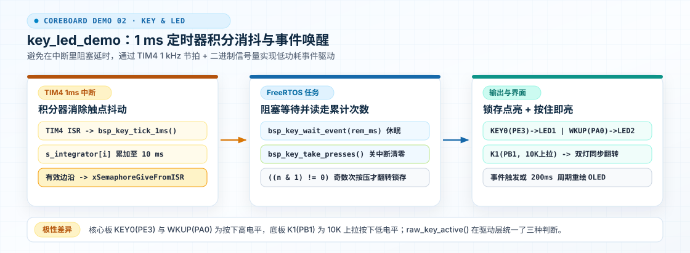

# 按键与 LED（key_led_demo）

新手刚写单片机按键程序时，最容易采用“死循环扫描 + `HAL_Delay(15)` 消抖”的做法——这在多任务系统里既浪费 CPU，又容易漏掉快速短按。`key_led_demo` 展示了工程中极受推崇的**定时中断积分消抖 + FreeRTOS 二进制信号量事件唤醒**框架，同时统一接入核心板与底板两类不同电平极性的按键。

通过本篇源码解析，你将掌握：
- **中断到任务的协作链**：理解 `TIM4` 1 ms 节拍如何经过 HAL 回调、积分器状态机与 `xSemaphoreGiveFromISR()` 唤醒阻塞中的任务。
- **FreeRTOS 中断优先级铁律**：看懂 `configASSERT(NVIC_GetPriority(TIM4_IRQn) >= 5)` 为何是防止系统偶发崩坏的保命红线。
- **多时间基准融合**：学会在一个任务循环里用剩余超时推算 `next_tick - now`，同时做到“按键零延迟响应”和“OLED 每 200 ms 稳定动画”。

## 工程与烧录

```powershell
.\.venv\Scripts\f407.exe flash key_led_demo
```

| 项目 | 说明 |
| --- | --- |
| 应用入口 | `applications/key_led_demo/src/main.c`（131 行） |
| 构建脚本 | `applications/key_led_demo/CMakeLists.txt`、`cmake/f407_app.cmake` |
| 核心驱动 | `platform/bsp/bsp_key.c`、`platform/bsp/bsp_hal_timebase_tim4.c`、`platform/bsp/bsp_led.c`、`platform/bsp/oled_ui.c` |
| 硬件引脚与外设 | `KEY0 (PE3)`、`WKUP (PA0)`、底板 `K1 (PB1)`、`LED1/2 (PF9/10)`、`TIM4` |
| FreeRTOS 机制 | 二进制信号量 `s_key_sem` + `xSemaphoreGiveFromISR()` + 临界区关中断清零按压计数 |

## 运行流程



从按下任意按键到 LED 点亮、OLED 卡片反白，整个数据流如下：

1. **硬件时基驱动（1000 Hz）**：`TIM4` 每 `1 ms` 溢出触发 `TIM4_IRQHandler` → `HAL_TIM_PeriodElapsedCallback()`，在执行 `HAL_IncTick()` 之后紧接着调用 `bsp_key_tick_1ms()`。
2. **积分器消除触点抖动**：`bsp_key_tick_1ms()` 逐个读取 3 颗按键当前电平，把各自的计数器 `s_integrator[i]` 在 `0~10` 之间加 1 或减 1；只有连续稳定维持 10 ms 才确认 `s_debounced[i]` 状态翻转，并累加 `s_press_counts[i]`。
3. **中断发信号量立即切换**：一旦确认有效按下或松开边沿，且调度器处于运行态，中断立刻调用 `xSemaphoreGiveFromISR(s_key_sem, &woken)` 并视情况触发 `portYIELD_FROM_ISR(woken)`。
4. **任务立即取数与更新**：原本挂在 `bsp_key_wait_event(wait_ms)` 上的 `key_led_task` 立刻苏醒，关中断取出并清零累计次数；按下奇数次才翻转锁存灯态，确保快速连按两次不会算丢。
5. **合并状态与界面**：把锁存状态与当前按住状态做逻辑或（`led1_latched || k0`）直接输出到 `LED1/2`，并在按键变化或 200 ms 定时到期时重绘 OLED 三个按键小徽章。

## 主程序解析

### 事件与周期等待

```c
static void key_led_task(void *arg)
{
    (void)arg;
    bool led1_latched = false;
    bool led2_latched = false;
    uint32_t hits = 0U;
    uint32_t tick = 0U;
    const TickType_t period = pdMS_TO_TICKS(200);
    TickType_t next_tick = xTaskGetTickCount() + period;

    (void)oled_ui_init();
    printf("\r\nkey_led_demo: Press KEY0(PE3), WKUP(PA0), or K1(PB1)\r\n");
    render_key_oled(bsp_key_is_pressed(BSP_KEY0),
                    bsp_key_is_pressed(BSP_WKUP),
                    bsp_key_is_pressed(BSP_KEY_K1),
                    hits, tick);

    for (;;) {
        TickType_t now = xTaskGetTickCount();
        int32_t rem = (int32_t)(next_tick - now);
        uint32_t wait_ms = (rem > 0) ? (uint32_t)rem : 0U;
        bool evt = bsp_key_wait_event(wait_ms);
```

- **为什么不直接 `bsp_key_wait_event(200)` 写死**：如果用户在距离下次 200 ms 刷新还有 `30 ms` 时按下按键，任务醒来打完日志，下一个周期如果重新傻等满 `200 ms`，标题栏右上角旋转指示器就会越走越慢甚至抽动。通过算差值 `rem = (int32_t)(next_tick - now)` 动态传入信号量超时时间，无论中间因为按键醒来多少次，200 ms 动画节拍始终对齐整拍。
- **首帧先绘制再入循环**：注意进 `for (;;)` 前先渲染了一次 `render_key_oled(...)`，让通电瞬间画面就立即可看，不用白屏干等 200 ms。

### 按键分发与灯效

```c
        uint32_t n0 = bsp_key_take_presses(BSP_KEY0);
        uint32_t nw = bsp_key_take_presses(BSP_WKUP);
        uint32_t n1 = bsp_key_take_presses(BSP_KEY_K1);

        if (n0 > 0U) {
            hits += n0;
            if ((n0 & 1U) != 0U) {
                led1_latched = !led1_latched;
            }
            printf("[KEY] KEY0(PE3) -> LED1=%s (hits=%lu)\r\n",
                   led1_latched ? "ON" : "OFF", (unsigned long)hits);
        }
        ...
        bool k0 = bsp_key_is_pressed(BSP_KEY0);
        bool wk = bsp_key_is_pressed(BSP_WKUP);
        bool k1 = bsp_key_is_pressed(BSP_KEY_K1);
        bsp_led_set(BSP_LED1, led1_latched || k0);
        bsp_led_set(BSP_LED2, led2_latched || wk);
```

- **按奇偶校验防多次累积出错**：假如系统忙时任务晚醒了 20 ms，用户连按两下（`n0 == 2`），`hits` 会老实 `+2`，但 `(n0 & 1U)` 为 `0` 表明翻转了两次等于没变，`led1_latched` 就不会判错态。
- **`led1_latched || k0` 的物理手感**：即使 `led1_latched` 原本是 `false`（灯灭），手指按住 `KEY0` 的过程中 `LED1` 就会先立刻亮起（确认按键被硬件认到），松开后由翻转过的 `led1_latched` 维持最新锁存状态。

| 按键 | 芯片引脚 | 硬件接法（按下电平） | 本例程功能 |
| --- | --- | --- | --- |
| `KEY0` | `PE3` | 核心板 10K 下拉，按下为**高电平** | 独立翻转 `LED1` 锁存状态 |
| `WKUP` | `PA0` | 核心板 10K 下拉，按下为**高电平** | 独立翻转 `LED2` 锁存状态 |
| `K1`（底板） | `PB1` | 底板 10K 上拉 `R3`，按下为**低电平** | 同时把 `LED1/LED2` 步调统一翻转 |

## 驱动解析

深入 `platform/bsp/bsp_key.c`，看消抖逻辑、中断优先级红线与关中断清零机制：

```c
static inline bool raw_key_active(bsp_key_id_t id)
{
    switch (id) {
    case BSP_KEY0:
        return (GPIOE->IDR & GPIO_PIN_3) != 0U;
    case BSP_WKUP:
        return (GPIOA->IDR & GPIO_PIN_0) != 0U;
    case BSP_KEY_K1:
        return (GPIOB->IDR & GPIO_PIN_1) == 0U;
    default:
        return false;
    }
}
```

- **为什么在中断里直接读 `GPIOx->IDR`**：每 1 ms 进中断扫描 3 颗按键，直接读端口输入数据寄存器只需几个时钟周期，既干净又比反复进 HAL 函数节省中断执行时间。
- **初始化中的防毛刺设计**：`bsp_key_init()` 配完上下拉电阻后专门等待 `bsp_delay_us(10U)` 让硬件电平先充放电稳定，再读取当前初始状态赋值给 `s_debounced[i]` 与 `s_integrator[i]`——这样假如上电时用户恰好一直按着 `KEY0`，开机瞬间也不会误记为一次新按压事件！

再看两条非常关键的 FreeRTOS 底层保护机制：

```c
    configASSERT(NVIC_GetPriority(TIM4_IRQn) >= (uint32_t)configLIBRARY_MAX_SYSCALL_INTERRUPT_PRIORITY);
    ...
    if (any_edge && sched_running && s_key_sem != NULL) {
        BaseType_t woken = pdFALSE;
        (void)xSemaphoreGiveFromISR(s_key_sem, &woken);
        portYIELD_FROM_ISR(woken);
    }
```

```c
uint32_t bsp_key_take_presses(bsp_key_id_t id)
{
    ...
    uint32_t primask = __get_PRIMASK();
    __disable_irq();
    uint32_t count = s_press_counts[id];
    s_press_counts[id] = 0U;
    __set_PRIMASK(primask);
    return count;
}
```

:::caution[为什么 `TIM4` 优先级数值必须 `>= 5`？]
在 Cortex-M4 上，**中断优先级数字越小、紧急度越高**。`FreeRTOSConfig.h` 规定 `configLIBRARY_MAX_SYSCALL_INTERRUPT_PRIORITY = 5`，意思是所有调用 `...FromISR()` API 的中断，其抢占优先级数值**绝对不能小于 5（0~4 号中断不受临界区关中断屏蔽）**。如果错把 `TIM4` 配成高抢占级 `0~4`，调 `xSemaphoreGiveFromISR()` 就可能踩碎内核链表！`bsp_key_init()` 用一句断言直接帮你在开机阶段把这类隐患堵死。
:::

- **如何读懂积分器算法（`BSP_KEY_DEBOUNCE_MS = 10U`）**：每次 1 ms 回调，按着键就把积分器 `+1`（上限 10）、松开就 `-1`（下限 0）。当积分器从下面一路攒满 `10` 且上次稳态还是松开时，确认为一次按下（`s_press_counts[i]++`）；一旦发生触点机械弹跳（比如按了 3 ms 弹开 1 ms 又按住），积分器只是略微减到 2 再重新爬坡，既不提前误触发，也能稳稳扛过弹跳。
- **`primask` 保护读取清零原语**：如果直接写 `count = s_press_counts[id]; s_press_counts[id] = 0;`，两句之间恰好 `TIM4` 中断打进来把次数加 1，下一句清零就把那 1 次吞掉了。先保存状态字关闭中断再取出并清零，只需 4~5 条指令，完全零竞态且不影响后续恢复原有开关中断状态。

### 驱动接口速查

头文件：`bsp_key.h`

| 函数原型 | 参数说明 | 作用与返回值 |
| --- | --- | --- |
| `void bsp_key_init(void)` | 无参数 | 配好 3 颗按键上下拉、信号量与 NVIC 断言检查 |
| `void bsp_key_tick_1ms(void)` | 无参数 | 由 `TIM4` 1 ms 回调调用，执行消抖与信号量释放 |
| `bool bsp_key_is_pressed(id)` | `id`: `BSP_KEY0`/`WKUP`/`K1` | 查询当前消抖后的实时按压状态（按下返回 `true`） |
| `uint32_t bsp_key_take_presses(id)` | `id`: 按键枚举 | 原子读取并清零累计的稳定按下次数 |
| `bool bsp_key_wait_event(ms)` | `ms`: 超时（`UINT32_MAX` 死等） | 阻塞挂起等待任意按键边沿，等到返回 `true` |

## 现象与排查

依次按下 `KEY0`、`WKUP` 与 `K1`，串口（`115200 8-N-1`）即时输出触发对象与累计总次数；核心板对应 LED 状态随之翻转，OLED 的 `KEY0` / `WKUP` / `K1` 小方框会在按住时反白显示：

```text
key_led_demo: Press KEY0(PE3), WKUP(PA0), or K1(PB1)
[KEY] KEY0(PE3) -> LED1=ON (hits=1)
[KEY] WKUP(PA0) -> LED2=ON (hits=2)
[KEY] K1(PB1)   -> BOTH=OFF (hits=3)
```

| 现象 | 可能原因 | 排查方法 |
| --- | --- | --- |
| 刚开机按下 `K1` 没有任何反应 | 用错插座或底板接触不良 | 确认测试的是底板上的 **K1 独立按键**，且核心板已完全插到底板排母内 |
| `KEY0` 标着 `BOOT0`，怎么不会进下载模式？ | 正常设计，只需注意上电瞬间 | `BOOT0/PE3` 只在芯片上电/复位采样瞬间决定启动区；启动进系统后即作为普通 `PE3` 按键使用，开机不要按住它即可 |
| 不按键的时候串口安静，灯也没闪？ | 预期事件驱动表现 | 若接了 OLED，左上角旋转器会每 200 ms 转一帧表示系统活着，只有真正按键变化才打印串口日志 |

## 扩展练习

### 添加长按清零功能

利用现成的 `bsp_key_is_pressed(BSP_KEY0)` 状态与 200 ms 定时刷新，只需在 `key_led_task` 的 `for (;;)` 循环内加一个累计按住计数变量，就能免改底层驱动实现**长按复原**：

```c
        static uint32_t key0_hold_start = 0U;
        static bool long_handled = false;

        if (bsp_key_is_pressed(BSP_KEY0)) {
            if (key0_hold_start == 0U) {
                key0_hold_start = xTaskGetTickCount();
                long_handled = false;
            } else if (!long_handled && (xTaskGetTickCount() - key0_hold_start) >= pdMS_TO_TICKS(1000)) {
                long_handled = true;
                hits = 0U;
                led1_latched = false;
                led2_latched = false;
                bsp_led_set(BSP_LED1, false);
                bsp_led_set(BSP_LED2, false);
                printf("[KEY] KEY0 long-press -> reset hits & LEDs OFF\r\n");
                render_key_oled(true, wk, k1, hits, tick);
            }
        } else {
            key0_hold_start = 0U;
            long_handled = false;
        }
```

### 连按响应测试

对比试验把 `bsp_key_wait_event(wait_ms)` 的 `wait_ms` 临时改成只用 `vTaskDelay(pdMS_TO_TICKS(200))` 轮询，再用连击快速按两次 `K1`，亲身对比事件信号量响应的跟手度差异。

---

[上一篇：双灯闪烁（blinky）](../d01-blinky/README.md) · [下一篇：外部 SRAM 校验（sram_test）](../d03-sram-test/README.md) · [内置示例汇总](../../c09-apps-index-and-pitfalls/README.md)
