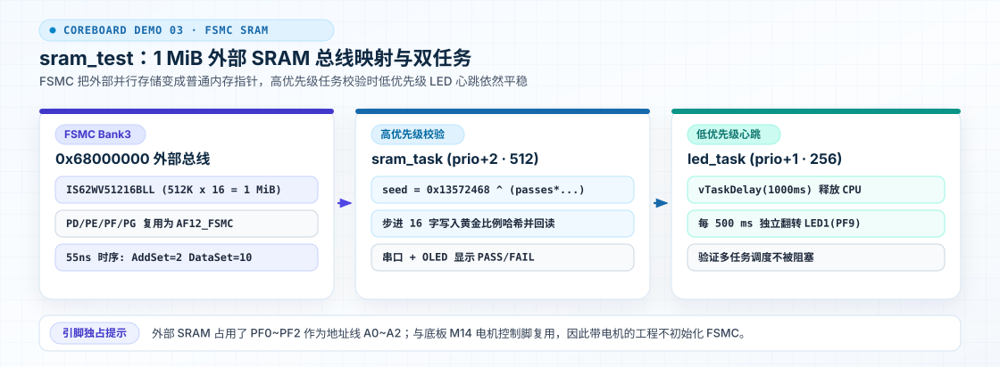

# 外部 SRAM 校验（sram_test）

STM32F407ZGT6 自带片内 SRAM 为 `192 KB`，面对大图缓存或大型状态表常常捉襟见肘。为此 DshanMCU-F407 核心板背面额外焊有一颗 **1 MiB（`512K × 16 bit`）并行静态存储器 `IS62WV51216BLL-55TLI`**。`sram_test` 演示如何通过 FSMC 控制器将其直接映射到内存地址 `0x68000000`，同时用“高优先级校验 + 低优先级闪烁”验证并发调度行为。

通过本篇源码解析，你将掌握：
- **FSMC 存储总线映射**：搞懂 44 根并行控制/地址/数据引脚如何复用为 `GPIO_AF12_FSMC`，并学会按芯片手册 55 ns 规格推算 `AddressSetupTime` 和 `DataSetupTime`。
- **多任务抢占调度直观体验**：观察高优先级 `sram` 任务进入阻塞期后，低优先级 `led` 任务如何无缝切入工作。
- **为什么一定要避让 M14 电机**：从硬件引脚层面理清 FSMC 地址线与底板电机的物理复用关系。

## 工程与烧录

```powershell
.\.venv\Scripts\f407.exe flash sram_test
```

| 项目 | 说明 |
| --- | --- |
| 应用入口 | `applications/sram_test/src/main.c`（73 行） |
| 构建脚本 | `applications/sram_test/CMakeLists.txt`、`cmake/f407_app.cmake` |
| 核心驱动 | `platform/bsp/bsp_sram.c`、`platform/bsp/bsp_led.c`、`platform/bsp/oled_ui.c` |
| 硬件引脚与外设 | `FSMC Bank3`（`NE3 -> PG10`、`19 根地址线 + 16 根数据线 + NOE/NWE/NBL`），映射区 `0x68000000` |
| FreeRTOS 机制 | 双任务优先抢占（`sram` 优先级 `+2` 栈 `512` 字 vs `led` 优先级 `+1` 栈 `256` 字） |
| 硬件互斥提醒 | 外部 SRAM 占用 `PF0~PF2 (A0~A2)`，与底板 **`M14` 直流电机冲突**，切勿在电机工程中启用 SRAM |

## 运行流程



1. **创建高低双任务**：`main()` 按基础顺序调 `board_init()`，然后分别创建栈空间极省（`256` 字）的低优先级心跳任务 `led_task`（优先级 `+1`），和负责大量字符串拼接及总线测试的 `sram_test_task`（优先级 `+2`）。
2. **映射外部芯片到 CPU 地址空间**：`sram_test_task` 先启动运行，调用 `bsp_sram_init()` 启用 PD/PE/PF/PG 端口与 FSMC 时钟，把 `FSMC Bank3` 配置为 16 位宽标准异步 SRAM（模式 A）。完成后，向指针 `0x68000000` 读写就等于直接读写外置芯片。
3. **动态变更种子防误判**：每跑一轮先用异或公式算出一个新的 `seed`，再呼叫 `bsp_sram_march_test(16U, seed, &err_addr)` 按步长 `16` 个字写满伪随机哈希值并逐点回读校验。
4. **主动让出 CPU 触发任务切换**：每测完一轮并更新串口/OLED 后，`sram_test_task` 调用 `vTaskDelay(pdMS_TO_TICKS(1000))` 休眠 1 秒——此时调度器立刻把 CPU 交还给优先级更低的 `led_task`，实现每隔 500 ms 稳定翻转核心板 `LED1`。

## 主程序解析

### 双任务抢占协作

```c
static void led_task(void *arg)
{
    (void)arg;
    for (;;) {
        bsp_led_toggle(BSP_LED1);
        vTaskDelay(pdMS_TO_TICKS(500));
    }
}
...
int main(void)
{
    board_init();
    configASSERT(xTaskCreate(led_task, "led", 256U, NULL, tskIDLE_PRIORITY + 1U, NULL) == pdPASS);
    configASSERT(xTaskCreate(sram_test_task, "sram", 512U, NULL, tskIDLE_PRIORITY + 2U, NULL) == pdPASS);
    vTaskStartScheduler();
    for (;;) {
    }
}
```

- **高优先级为何必须学会“休息”**：`sram_test_task` 的优先级是 `+2`，高于 `led_task` 的 `+1`。只要 `sram_test_task` 还想继续执行且不调任何阻塞 API（如 `vTaskDelay` 或等待信号量），`led_task` 永远抢不到半点时间片。一旦 `sram` 进入 1 秒延时，内核就立刻把就绪态的 `led_task` 切上来翻转灯脚。
- **为什么 `led` 任务只配 `256U` 栈**：它既没调 `printf` 也没声明大局部数组，仅靠寄存器调用翻转 GPIO 和 `vTaskDelay`，`256 × 4 = 1024 B` 的栈完全充裕；而 `sram` 任务开了 `line1[36]`、`line2[28]` 两个字符缓冲且调 `snprintf` / `printf` / OLED，所以配 `512U` 更稳妥。

### 步进采样与校验

```c
    for (;;) {
        uint32_t err_addr = 0U;
        uint32_t seed = 0x13572468UL ^ (passes * 0x01010101UL);
        bool ok = init_ok && bsp_sram_march_test(16U, seed, &err_addr);
        if (ok) {
            ++passes;
        } else {
            ++fails;
        }

        printf("[SRAM] pass=%lu fail=%lu last=%s err=0x%08lX\r\n",
               (unsigned long)passes, (unsigned long)fails,
               ok ? "PASS" : "FAIL", (unsigned long)err_addr);
        ...
        vTaskDelay(pdMS_TO_TICKS(1000));
    }
```

- **为什么步进取 `16U` 而不是每次全片扫描**：`1 MiB` 共有 `1048576 / 4 = 262144` 个 32 位字。步长 `16` 会抽查分散在全芯片上的 `16384` 个地址单元（写一遍再读一遍），耗时仅十几毫秒，兼顾快速刷新屏幕又能揪出虚焊或总线粘连问题。
- **每次换新 `seed` 的意义**：通过 `0x13572468UL ^ (passes * 0x01010101UL)` 让相邻两轮写入每个字节的内容全都不一样（`0x01010101UL` 保证 4 个字节位都跟着递增变化），防止“芯片写操作压根没生效、只是读回上次留在电容里的旧数值”造成假阳性通过。

## 驱动解析

深入 `platform/bsp/bsp_sram.c`，看 44 根外部总线如何配置，以及 `55 ns` 存储芯片时序是如何算出来的：

```c
    /* PD: D2(0), D3(1), NOE(4), NWE(5), D13..D15(8..10), A16..A18(11..13), D0..D1(14..15) */
    ...
    /* PE: NBL0(0), NBL1(1), D4..D12(7..15) */
    ...
    /* PF: A0..A5(0..5), A6..A9(12..15) */
    ...
    /* PG: A10..A15(0..5), NE3(10) */
```

- **为什么芯片是 Bank3、首地址固定在 `0x68000000`**：STM32F407 把 FSMC 的 NOR/PSRAM 存储区 `1 GB`（`0x60000000 ~ 0x9FFFFFFF`）均分成了 4 个子块（NE1~NE4），每个子块占 `64 MB`：
  - `Bank1 (NE1)`: `0x60000000`
  - `Bank2 (NE2)`: `0x64000000`
  - **`Bank3 (NE3, PG10)`: `0x68000000`**
  - `Bank4 (NE4)`: `0x6C000000`
  核心板将外部 SRAM 的片选线接入了 `PG10 (FSMC_NE3)`，并接满 `A0~A18` 共 19 根地址线（`2^19 = 524288` 个 16 位半字 = `1 MiB`）。

再看 `55 ns` 读写时序参数计算（第 50~57 行）：

```c
    /* IS62WV51216BLL-55TLI (55ns access @ 168MHz HCLK: 1 HCLK = 5.95ns) */
    timing.AddressSetupTime = 2U;
    timing.AddressHoldTime = 15U;
    timing.DataSetupTime = 10U;
    timing.BusTurnAroundDuration = 1U;
    timing.CLKDivision = 16U;
    timing.DataLatency = 17U;
    timing.AccessMode = FSMC_ACCESS_MODE_A;
```

- **时序公式验算**：主频 `HCLK = 168 MHz` 时，1 个时钟周期约 `5.95 ns`。设置 `AddressSetupTime = 2`（约 `11.9 ns`）留足地址建立时间；`DataSetupTime = 10`（约 `59.5 ns`），二者总和约 `71.4 ns`，留足超过芯片手册 `55 ns` 极限访问时间的余量，即使温度变化也能 100% 稳定读写；同时配置 `MemoryDataWidth = FSMC_NORSRAM_MEM_BUS_WIDTH_16`，软件访问 32 位 `*mem` 时 FSMC 硬件会自动利用 `NBL0 (PE0)` 与 `NBL1 (PE1)` 字节掩码拼成两次无缝 16 位总线访问。

再看 `bsp_sram_march_test()` 校验算法核心细节：

```c
    volatile uint32_t *mem = (volatile uint32_t *)BSP_SRAM_BASE_ADDR;
    uint32_t total_words = BSP_SRAM_SIZE_BYTES / 4U;
    ...
    for (uint32_t idx = 0; idx < total_words; idx += step_words) {
        mem[idx] = (uint32_t)(seed ^ (idx * 0x9E3779B9UL));
    }
    for (uint32_t idx = 0; idx < total_words; idx += step_words) {
        uint32_t expected = (uint32_t)(seed ^ (idx * 0x9E3779B9UL));
        if (mem[idx] != expected) {
            if (out_err_addr != NULL) {
                *out_err_addr = (uint32_t)(BSP_SRAM_BASE_ADDR + idx * 4U);
            }
            return false;
        }
    }
```

- **必须加上 `volatile` 修饰指针**：否则 Release 版打开 `-O2` 优化后，编译器认为“同一片内存刚写完的值不可能平白无故改变”，会把整个回读循环全部优化删掉！
- **黄金比例常数 `0x9E3779B9UL`**：乘上这串无理数哈希系数能让相邻下标写入完全不同的 32 位数，只要任意一根地址线短路（造成两块地址映射到同一个单元）或者数据线互相短接，就会在回读阶段立刻原形毕露，并把报错的精确 32 位物理地址填进 `*out_err_addr`。

### 驱动接口速查

头文件：`bsp_sram.h`

| 函数原型 | 参数说明 | 作用与返回值 |
| --- | --- | --- |
| `bool bsp_sram_init(void)` | 无参数 | 初始化 44 根总线脚与 `FSMC Bank3`（`0x68000000`），重入自动跳过 |
| `bool bsp_sram_quick_check(void)` | 无参数 | 开机快速抽检首/中/尾 3 个典型地址（`< 10 us`） |
| `bool bsp_sram_march_test(step, seed, &err)` | `step`: 步进字长；`seed`: 随机种子；`&err`: 出错物理地址输出指针 | 全范围写读哈希校验外部 1 MiB SRAM，全部一致返回 `true` |

## 现象与排查

烧录后核心板 `LED1` 每 `500 ms` 稳健闪烁，串口（`115200 8-N-1`）每秒新增一轮全部通过结果（M1 OLED 屏幕大字居中展示 **`SRAM OK`** 并实时累计 `PASS` 次数）：

```text
sram_test: 1 MiB FSMC SRAM @ 0x68000000 (init=OK)
[SRAM] pass=1 fail=0 last=PASS err=0x00000000
[SRAM] pass=2 fail=0 last=PASS err=0x00000000
[SRAM] pass=3 fail=0 last=PASS err=0x00000000
```

| 现象 | 可能原因 | 排查方法 |
| --- | --- | --- |
| `init=OK` 但所有轮次都报 `FAIL`，错误地址是 `0x68000000` | 与底板或其他外设复用引脚打架 | 重点检查是否同时插了 **M14 直流电机驱动板**或手动往 `PF0~PF2` 输出了电平；FSMC 占用 `PF0~PF2` 作 `A0~A2` |
| `err=0x68080000` 固定卡在某高位地址出错 | 核心板未插紧到底板电源/检查焊盘，或用户改小了 `DataSetupTime` | 尝试适当调大 `DataSetupTime` 到 `12U`，若仅用核心板测试也可对比排除底板干扰 |
| 怎样验证程序里不只能检验、还能当普通内存用？ | 还不会从 `0x68000000` 取指针 | 参考下方扩展练习，直接强转指针即可当成超大全局数组自由读写 |

## 扩展练习

### 开辟外部大数组

把外部芯片真当大内存来用非常简单。试着在 `sram_test_task` 校验通过后，直接在外部 `0x68000000 + 512 KB` 偏移位置映射一个 64 KB 的大结构体或缓冲区：

```c
typedef struct {
    uint32_t magic;
    uint16_t samples[32768]; /* 64 KB 缓冲区，普通任务栈根本装不下！ */
} ext_frame_buf_t;

/* 直接指向外部 SRAM 0x68080000 地址处 */
volatile ext_frame_buf_t *ext_buf = (volatile ext_frame_buf_t *)(BSP_SRAM_BASE_ADDR + 0x80000UL);
ext_buf->magic = 0xAA551234UL;
for (uint32_t i = 0; i < 32768U; ++i) {
    ext_buf->samples[i] = (uint16_t)(i & 0xFFFFU);
}
printf("[EXTBUF] magic=0x%08lX last=%u\r\n",
       (unsigned long)ext_buf->magic, (unsigned)ext_buf->samples[32767]);
```

### 全片校验与耗时统计

在 `applications/sram_test/src/main.c` 中调用 `xTaskGetTickCount()` 记录前后差值，再把第 33 行的 `16U` 改成 `1U`（遍历全部 26 万多个字），实测 FSMC 在 168 MHz 主频下写读完整 1 MiB 芯片共需多少毫秒，直观感受硬件总线的吞吐速度。

---

[上一篇：按键与 LED（key_led_demo）](../d02-key-led/README.md) · [下一篇：核心板综合自检（f407_demo）](../d04-f407-demo/README.md) · [内置示例汇总](../../c09-apps-index-and-pitfalls/README.md)
