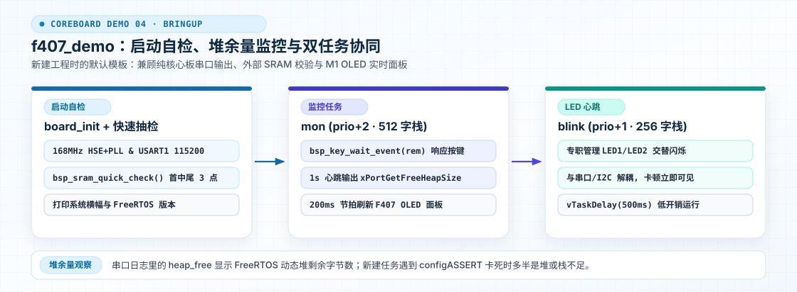

# 核心板综合自检（f407_demo）

`f407_demo` 是整套工程库的默认脚手架模板（新建自有工程时就以它的模式起头）：只需要一块单独的 STM32F407 核心板，就能一次验明 **24 MHz 晶振倍频、1 MiB 外部 SRAM、双路 LED 心跳、三按键输入、USART1 串口重映射、FreeRTOS V11.3.3 堆余量** 等核心基础功能，并在插上底板 M1 OLED 时自动升级为实时仪表盘。

通过本篇源码解析，你将掌握：
- **时钟与启动校验链**：搞懂 24 MHz 外部晶振 `HSE` 如何倍频至 `168 MHz`，以及只耗时数微秒的开机 `3 点 SRAM 抽检` 为何足以发现高位地址线异常。
- **FreeRTOS 内存与防崩溃体系**：理清 `heap_4`（`48 KB`）分配原理、如何读懂 `xPortGetFreeHeapSize()`，以及栈溢出/内存分配失败两个保命钩子函数如何工作。
- **32 位时间计数器防回绕技巧**：掌握标准嵌入式工程必学的 `(int32_t)(now - next_tick) >= 0` 无死角推算写法。

## 工程与烧录

```powershell
.\.venv\Scripts\f407.exe flash f407_demo
```

| 项目 | 说明 |
| --- | --- |
| 应用入口 | `applications/f407_demo/src/main.c`（138 行） |
| 构建脚本 | `applications/f407_demo/CMakeLists.txt`、`cmake/f407_app.cmake` |
| 核心驱动 | `bsp_clock.c`、`bsp_sram.c`、`bsp_key.c`、`bsp_led.c`、`oled_ui.c` |
| 硬件引脚与外设 | `LED1/2 (PF9/10)`、`KEY0/WKUP/K1`、`FSMC SRAM (0x68000000)`、`USART1`、`M1 OLED` |
| FreeRTOS 机制 | 双任务（`blink` + `mon`）+ `xPortGetFreeHeapSize()` + `configCHECK_FOR_STACK_OVERFLOW = 2` |

## 运行流程



1. **硬件起振与外设就绪**：`main()` 首先调用 `board_init()` 把 24 MHz 外部晶振 `HSE` 倍频至 `168 MHz` 并开启 `TIM4` 1 ms 节拍与 `USART1` 日志串口。
2. **微秒级开机内存体检**：紧接着调用 `bsp_sram_quick_check()`，仅读写 3 个特征偏移地址，立即验证外部 1 MiB SRAM 是否连线完好。
3. **打印自检横幅并创建双任务**：把芯片真实工作主频、`SRAM` 状态及 `tskKERNEL_VERSION_NUMBER`（`V11.3.3`）打印出来后，创建专门闪灯的 `blink`（优先级 `+1`）和专责监控与按键交互的 `mon`（优先级 `+2`）。
4. **事件响应 + 整秒心跳**：`mon` 通过 `bsp_key_wait_event(wait_ms)` 随时响应按键按下事件；无论有没有按键，都会按严谨的 `200 ms` 节拍推进计数，每满 5 拍（`1 s`）上报一次实时剩余堆大小，并顺带更新 M1 OLED 仪表盘。

## 主程序解析

### 开机自检与双任务

```c
int main(void)
{
    board_init();
    s_sram_ok = bsp_sram_quick_check();

    printf("\r\n==============================================\r\n");
    printf(" DshanMCU-F407 Native FreeRTOS Bringup\r\n");
    printf(" SYSCLK=%lu MHz | SRAM=%s | FreeRTOS=%s\r\n",
           (unsigned long)(bsp_get_sysclk_hz() / 1000000U),
           s_sram_ok ? "1MiB OK" : "FAILED",
           tskKERNEL_VERSION_NUMBER);
    printf("==============================================\r\n");

    configASSERT(xTaskCreate(blink_task, "blink", 256U, NULL, tskIDLE_PRIORITY + 1U, NULL) == pdPASS);
    configASSERT(xTaskCreate(monitor_task, "mon", 512U, NULL, tskIDLE_PRIORITY + 2U, NULL) == pdPASS);

    vTaskStartScheduler();
    for (;;) {
    }
}
```

- **横幅打印的数字全是现场“实测”出来的**：`bsp_get_sysclk_hz()` 调用 `HAL_RCC_GetHCLKFreq()` 实时读取锁相环寄存器推算主频。如果外置 `24 MHz` 晶振没焊好或起振失败，程序早就停在 `bsp_clock_init()` 内部；能打印出 `168 MHz | SRAM=1MiB OK`，说明时钟树和 FSMC 外设一次过关。
- **为什么要把闪烁灯拆给独立低优先级任务**：在实际开发中，`monitor_task` 以后可能要接入 I2C 传感器或液晶绘制。如果把点灯和业务写死在一个循环里，一旦某个外部模块卡死，核心板灯就不闪了。拆出独立的低优先级 `blink_task`，既能让低优先级心跳灯充当“系统调度健康指示灯”，又不会抢占监控业务的实时响应。

### 防溢出计时与心跳

```c
        now = xTaskGetTickCount();
        bool periodic_due = ((int32_t)(now - next_tick) >= 0);
        if (periodic_due) {
            do {
                next_tick += period;
                ++tick;
            } while ((int32_t)(now - next_tick) >= 0);

            if ((tick % 5U) == 0U) {
                printf("[HEARTBEAT] up=%lus sysclk=%luMHz sram=%s heap_free=%uB\r\n",
                       (unsigned long)(tick / 5U),
                       (unsigned long)(bsp_get_sysclk_hz() / 1000000U),
                       s_sram_ok ? "OK" : "FAIL",
                       (unsigned)xPortGetFreeHeapSize());
            }
        }

        if (key_evt || periodic_due) {
            render_f407_oled(tick, key_hits);
        }
```

- **`(int32_t)(now - next_tick) >= 0` 的防溢出奥秘**：`TickType_t` 在 `FreeRTOSConfig.h` 中配为 32 位无符号数，在 `1000 Hz` 下连续跑 `49.7 天` 会从 `0xFFFFFFFF` 溢出回 `0`。如果傻写 `if (now >= next_tick)`，在第 49.7 天跨越零点时 `next_tick` 已先一步溢出变成小数 `100`，条件会连着误判无数次；而无符号减法在二补码强转为有符号 `int32_t` 后，只要两次检查差距小于 `24.8 天`，正负关系始终百分百准确。
- **`while` 追赶对齐**：哪怕某个时刻因为调试断点暂停了 1 秒，`do { next_tick += period; ++tick; } while (...)` 也会自动跨过已经过期的节拍把目标对齐未来，保证秒表走字准确不卡滞。
- **读懂 `heap_free` 剩余动态堆**：`FreeRTOSConfig.h` 配了 `configTOTAL_HEAP_SIZE = 48 * 1024`（即 `49152` 字节，由 `heap_4.c` 管理）。`blink` 用了 `256` 字（`1024 B` + TCB），`mon` 用了 `512` 字（`2048 B` + TCB），加上内核自建的空闲任务、定时器服务任务（`256` 字）、按键与 I2C 信号量，因此开机后会看到 `heap_free` 大约还剩 `43 KB` 左右。

## 驱动解析

### 时钟树与快速自检

看 `platform/bsp/bsp_clock.c` 如何从板上晶振一路倍频到全系统各总线：

```c
    /* DshanMCU-F407 has 24 MHz HSE (X1): 24 MHz / 24 * 336 / 2 = 168 MHz SYSCLK, /7 = 48 MHz USB */
    rcc_osc.PLL.PLLM = (uint32_t)BOARD_HSE_MHZ; /* 24 */
    rcc_osc.PLL.PLLN = 336U;
    rcc_osc.PLL.PLLP = RCC_PLLP_DIV2;
    rcc_osc.PLL.PLLQ = 7U;
```

- **整条时钟公式一目了然**：核心板晶振 `X1` 为 **`24 MHz`**（而非早期评估板常用的 `8 MHz`，在 `f407_app.cmake` 中也明确定义了 `BOARD_HSE_MHZ=24`）。经过 `/24 × 336` 先得 VCO `336 MHz`，`/2` 输出系统满血主频 `168 MHz`，`/7` 供 USB 外设得 `48 MHz`；再配合 `APB1 / 4 = 42 MHz`（挂载 `TIM2/3/4` 等时钟自动 ×2 得 `84 MHz`）和 `APB2 / 2 = 84 MHz`（`TIM1/8/9/10/11` 时钟 ×2 得 `168 MHz`），配以 Flash `5` 等待周期保证稳定不超频。

再对比 `bsp_sram_quick_check()`（`platform/bsp/bsp_sram.c`）只抽检 3 个点的设计巧思：

```c
bool bsp_sram_quick_check(void)
{
    static const uint32_t offsets[] = {0x00000U, 0x20000U, 0x3FFFCU};
    static const uint32_t patterns[] = {0xA55A5AA5UL, 0x5AA5A55AUL, 0x12345678UL};
    volatile uint32_t *mem = (volatile uint32_t *)BSP_SRAM_BASE_ADDR;
    ...
```

- **三个下标正好顶在芯片关键地址边界**：`1 MiB` 总共 `262144`（`0x40000`）个 32 位字。`0x00000` 查首址、`0x20000` 正好把最高有效地址位切半、`0x3FFFC` 靠近末端地址线全亮，同时交替使用 `0xA5` / `0x5A` 位反转图案把 16 根数据线的高低翻能力查一遍，开机延时不到 10 微秒，完全零感知。

### 异常与溢出钩子

```c
__attribute__((weak)) void vApplicationMallocFailedHook(void)
{
    taskDISABLE_INTERRUPTS();
    printf("[FreeRTOS] FATAL: pvPortMalloc failed!\r\n");
    while (1) {
    }
}

__attribute__((weak)) void vApplicationStackOverflowHook(TaskHandle_t xTask, char *pcTaskName)
{
    (void)xTask;
    taskDISABLE_INTERRUPTS();
    printf("[FreeRTOS] FATAL: stack overflow in task '%s'!\r\n", pcTaskName ? pcTaskName : "unknown");
    while (1) {
    }
}
```

因为 `FreeRTOSConfig.h` 里开启了最严格的第 `2` 级栈溢出金丝雀标记检测（`configCHECK_FOR_STACK_OVERFLOW = 2`）与内存耗尽钩子（`configUSE_MALLOC_FAILED_HOOK = 1`），一旦哪个自己新写的任务数组开太大把栈踩穿，串口会直接喊出那个任务的准确名字，不用盲猜“硬件错误（HardFault）”出在哪儿。

### 驱动接口速查

头文件：`board.h`、`bsp_clock.h`

| 函数原型 | 参数说明 | 作用与返回值 |
| --- | --- | --- |
| `void board_init(void)` | 无参数 | 串联 HAL、168 MHz 时钟、LED、按键与 115200 串口初始化 |
| `void bsp_dwt_init(void)` | 无参数 | 解锁并启动 `DWT->CYCCNT` 168 MHz 周期计数器 |
| `void bsp_delay_us(us)` | `us`: 延时微秒数 | 纯硬件周期计数精准阻塞延时，不依赖 `SysTick` |
| `uint32_t bsp_get_sysclk_hz(void)` | 无参数 | 返回当前 `HCLK` 实际运行频率（正常为 `168000000`） |

## 现象与排查

上电后在串口工具（`115200 8-N-1`）能看到清晰的开机横幅与每秒一次的自检心跳；按下三颗任意按键都会即时弹出计次日志：

```text
==============================================
 DshanMCU-F407 Native FreeRTOS Bringup
 SYSCLK=168 MHz | SRAM=1MiB OK | FreeRTOS=V11.3.3
==============================================
[HEARTBEAT] up=0s sysclk=168MHz sram=OK heap_free=43528B
[HEARTBEAT] up=1s sysclk=168MHz sram=OK heap_free=43528B
[KEY] KEY0 (PE3) pressed x1 (total=1)
[HEARTBEAT] up=2s sysclk=168MHz sram=OK heap_free=43528B
```

| 现象 | 可能原因 | 排查方法 |
| --- | --- | --- |
| 串口打印 `SRAM=FAILED`，其余全正常 | 引脚复用冲突或焊接/接触虚连 | 如果当时底板上接了 **M14 电机模块**，请拔下（两者共用 `PF0~PF2`）后再按复位键 |
| 自建项目忘记在 `board_init()` 前或后调用 `xTaskCreate` | 刚修改工程后堆报错或打印出栈溢出任务名 | 查看串口是否触发 `[FreeRTOS] FATAL`，或调大出错任务的栈字数（如 `256` 改 `512`） |
| 为何 `heap_free` 一直是固定值不减少？ | 所有资源只在启动阶段一次性申请，运行时只用栈内局部变量 | 这正是工业级稳定固件的特征：**杜绝周期性动态 `malloc/free` 碎片** |

## 扩展练习

### 心跳日志输出栈余量

新手最常把握不准 `xTaskCreate` 该填 `256` 还是 `512` 字栈。利用 `FreeRTOSConfig.h` 已打开的 `uxTaskGetStackHighWaterMark(NULL)`，直接在 `monitor_task` 的心跳打印里实时监测最低栈水位线：

```c
            if ((tick % 5U) == 0U) {
                UBaseType_t hwm_words = uxTaskGetStackHighWaterMark(NULL);
                printf("[HEARTBEAT] up=%lus sysclk=%luMHz sram=%s heap=%uB mon_stack_min=%uW\r\n",
                       (unsigned long)(tick / 5U),
                       (unsigned long)(bsp_get_sysclk_hz() / 1000000U),
                       s_sram_ok ? "OK" : "FAIL",
                       (unsigned)xPortGetFreeHeapSize(),
                       (unsigned)hwm_words);
            }
```

烧录后观察 `mon_stack_min` 还剩几百字（Word）——只要历史最小剩余值远大于 `30` 字，你的任务栈就高枕无忧。

### 统计堆空间占用

把 `f407_demo` 复制改造成新应用模板时，试着增加一个软件定时器或信号量，对比前后 `heap_free` 数值变化，切身掌握 `heap_4` 的真实内存开销。

---

[上一篇：外部 SRAM 校验（sram_test）](../d03-sram-test/README.md) · [下一篇：OLED 双色屏（oled_demo）](../d05-oled-demo/README.md) · [内置示例汇总](../../c09-apps-index-and-pitfalls/README.md)
