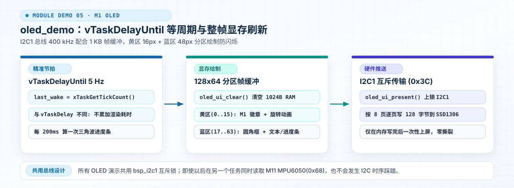

# OLED 双色屏（oled_demo）

`oled_demo` 不仅在 M1 0.96 寸黄蓝双色屏（SSD1306，地址 `0x3C`）上渲染流畅的仪表盘界面，更重要的是揭开了全套工程**多模块同屏实时显示**的底层架构秘密：包括如何在内存里绘制出零撕裂的画面、为什么 5 Hz 动画要用 `vTaskDelayUntil` 而不直接用 `vTaskDelay`，以及底层的 I2C1 总线是如何防止多任务打架和热复位卡死的。

通过本篇源码解析，你将掌握：
- **绝对周期延时 `vTaskDelayUntil`**：用真实波形耗时差算清楚，为什么它能让计时秒表绝不慢拍漂移。
- **SSD1306 显存分页与坐标体系**：看懂 `128×64` 像素如何压成 `1024 B` 数组按 8 个 Page 通过 I2C 送出。
- **嵌入式工程防锁死机制**：学习 `bsp_i2c1_bus_recover()` 发 16 个时钟救回被从机拽死的总线，以及针对 STM32F4 芯片勘误（Errata ES0182）的软件复位。

## 工程与烧录

```powershell
.\.venv\Scripts\f407.exe flash oled_demo
```

| 项目 | 说明 |
| --- | --- |
| 应用入口 | `applications/oled_demo/src/main.c`（78 行） |
| 构建脚本 | `applications/oled_demo/CMakeLists.txt`、`cmake/f407_app.cmake` |
| 核心驱动 | `platform/bsp/oled_ui.c`、`platform/bsp/bsp_i2c.c`、`platform/bsp/bsp_sram.c` |
| 硬件引脚与外设 | 底板 `M1` 插座：`I2C1`（`PB8 = SCL`、`PB9 = SDA`，`400 kHz`，7 位地址 `0x3C`） |
| FreeRTOS 机制 | `vTaskDelayUntil(&last_wake, 200ms)` 等周期节拍 + 两级互斥锁（`s_oled_lock` / `i2c1_mutex`） |

## 运行流程



1. **开机快速确认 SRAM 与探测屏幕**：`oled_demo_task` 先通过 `bsp_sram_quick_check()` 取得板载内存自检状态，接着由 `oled_ui_init()` 初始化 `400 kHz` 快速 I2C1 并试探 `0x3C`（左移 1 位 `0x78`）设备是否应答。
2. **锁定首个唤醒时间点**：记录 `TickType_t last_wake = xTaskGetTickCount()`，接着先绘制第 `0` 帧仪表盘让屏幕瞬间点亮。
3. **本地 1 KB 帧缓冲绘制**：每帧循环调用 `oled_ui_clear()` 清空片内静态显存 `s_fb[1024]`，依次叠加顶部反白徽章、黄区旋转标、蓝区圆角卡片与根据 `tick` 算出的三角波进度条。
4. **上锁分 8 页整帧提交**：图形都在内存里画完毕，最后只调一次 `oled_ui_present()`，连续将 8 页（每页 1 字节 `0x40` 数据标志 + 128 字节像素）安全推向屏幕。
5. **扣除传输耗时实现严格 5 Hz**：最后调用 `vTaskDelayUntil(&last_wake, pdMS_TO_TICKS(200))`，把“绘制 + I2C 发送”花掉的二十多毫秒自动扣掉，精准在每 200 ms 刻度线醒来。

## 主程序解析

### 仪表盘与进度条绘制

```c
static void render_oled_frame(uint32_t tick, bool sram_ok)
{
    uint32_t sec = tick / 5U;
    uint32_t phase = (tick * 40U) % 2000U;
    int permille = (int)((phase <= 1000U) ? phase : (2000U - phase));
    char up_buf[24];

    snprintf(up_buf, sizeof(up_buf), "%02lu:%02lu",
             (unsigned long)(sec / 60U), (unsigned long)(sec % 60U));

    oled_ui_clear();
    oled_ui_header("M1", "F407 OLED", tick);

    oled_ui_card(0, 17, 128, 47);
    oled_ui_big_text_center(20, "100ASK.NET");
    oled_ui_text(6, 39, "CM4F 168MHz", false);
    oled_ui_text_right(122, 39, sram_ok ? "SRAM:1M" : "SRAM:ERR", false);

    oled_ui_bar(6, 50, 80, 9, permille);
    oled_ui_text_right(122, 51, up_buf, false);

    (void)oled_ui_present();
}
```

- **如何用 2 行整数代码造出平滑往复条**：`tick` 每 200 ms 增 `1`，`(tick * 40U) % 2000U` 会按 `0, 40, 80, ..., 1000, 1040, ..., 1960` 循环变化；配合三目运算符 `phase <= 1000U ? phase : 2000U - phase`，值先从 `0 → 1000`（满格）再优雅降回 `0`，传给 `oled_ui_bar()` 正好每 `10 秒` 完成一次流畅来回扫描。
- **双色屏视觉分界线技巧**：0.96 寸 SSD1306 上端第 `0~15` 行物理发光是黄色、`16~63` 行是蓝色。`oled_ui_header` 在 `y=14` 画了一条点状分隔虚线，主体圆角卡片故意从 `y=17` 起画，完美契合两种荧光粉交界，不出现文字被硬生生劈成上黄下蓝两截的尴尬。

### 等周期与相对延时

```c
    TickType_t last_wake = xTaskGetTickCount();
    ...
    for (;;) {
        if ((tick % 5U) == 0U) {
            led_state = !led_state;
            bsp_led_set(BSP_LED1, led_state);
            bsp_led_set(BSP_LED2, !led_state);
        }

        if (oled_ui_is_ready()) {
            render_oled_frame(tick, sram_ok);
        }

        if ((tick % 25U) == 0U) {
            printf("[OLED] up=%lus tick=%lu\r\n", (unsigned long)(tick / 5U), (unsigned long)tick);
        }

        ++tick;
        vTaskDelayUntil(&last_wake, pdMS_TO_TICKS(200));
    }
```

假设屏幕画图 + 传输 1024 B 数据耗时 **23 ms**，两种延时方式带来的节拍天差地别：

| 延时函数 | 真实唤醒时间轴（设定周期 200 ms） | 对 `sec = tick / 5U` 秒表的影响 |
| --- | --- | --- |
| `vTaskDelay(200)` | 每次耗时 23 ms 再等 200 ms → 实际周期 **223 ms** | 跑 1 分钟现实时间，屏幕才走了约 53 秒（越来越慢） |
| `vTaskDelayUntil(&last_wake, 200)` | 耗时 23 ms 后只补等 **177 ms** → 始终落在 `200, 400, 600... ms` | 长期运行严格对齐晶振节拍，每 5 帧精确等于 1 秒 |

## 驱动解析

### 分页刷新与互斥加锁

看 `platform/bsp/oled_ui.c` 最核心的显存上传流程：

```c
    int rc = 0;
    packet[0] = 0x40U;
    for (uint8_t page = 0; page < 8U; ++page) {
        if (!ssd1306_write_cmd((uint8_t)(0xB0U + page)) ||
            !ssd1306_write_cmd(0x00U) ||
            !ssd1306_write_cmd(0x10U)) {
            rc = -1;
            break;
        }
        memcpy(&packet[1], &s_fb[(size_t)page * OLED_UI_WIDTH], OLED_UI_WIDTH);
        if (!bsp_i2c1_transmit(SSD1306_I2C_ADDR, packet, sizeof(packet), 50U)) {
            rc = -1;
            break;
        }
    }
```

- **什么是“页（Page）”结构**：SSD1306 把垂直 `64` 行切成了 8 个水平条带（Page 0 ~ Page 7），每个条带高 8 像素、宽 128 列，1 字节垂直竖着代表 8 个像素的亮灭。因此每发完设置页地址命令（`0xB0 + page`）与起始列命令（`0x00` / `0x10`）后，在数组开头塞一个控制字节 **`0x40`（代表后面全是显存点阵数据）**，一口气发送 `129` 字节就能铺满一整条横带，8 次发完即整屏刷新完成。
- **双锁协同互不打架**：外层 `s_oled_lock` 确保即使将来多任务调用 `oled_ui_*` 也不会发生半幅画面互相覆盖；底层 `bsp_i2c1_transmit` 又会拿下 `i2c1_mutex`，让共线挂载的 `M1 OLED (0x3C)` 与 `M11 MPU6050 (0x68)` 有条不紊轮流占有 PB8/PB9。

### I2C1 总线恢复机制

初学者最常遇到“STM32 调了一半按复位键重启后，I2C 永远返回 `HAL_BUSY` 卡死”。查看 `platform/bsp/bsp_i2c.c` 看驱动是怎么根治这个顽疾的：

```c
    /* Clock SCL only while SDA remains held LOW (sampled with SCL LOW), max 16 pulses */
    for (int i = 0; i < 16 && HAL_GPIO_ReadPin(GPIOB, GPIO_PIN_9) == GPIO_PIN_RESET; ++i) {
        HAL_GPIO_WritePin(GPIOB, GPIO_PIN_8, GPIO_PIN_SET);
        bsp_delay_us(10U);
        HAL_GPIO_WritePin(GPIOB, GPIO_PIN_8, GPIO_PIN_RESET);
        bsp_delay_us(10U);
    }
    ...
    /* Clear potential analog-filter BUSY glitch (STM32F407 Errata ES0182 §2.14.7) */
    I2C1->CR1 |= I2C_CR1_SWRST;
    bsp_delay_us(5U);
    I2C1->CR1 &= ~I2C_CR1_SWRST;
```

- **第一步 `bsp_i2c1_bus_recover()`**：如果从机刚送到某字节的第 3 位正在拉低 `SDA` 恰好单片机复位了，从机不知道主机已重启会死死拽着 `SDA` 不松。驱动上电前先把 `PB8/PB9` 当成普通开漏 IO，在检测到 `SDA == 0` 时连续给 `SCL` 最多打 `16` 个人工时钟脉冲逼从机吐完剩下那几位并主动放手，最后再人工模拟一次 `STOP` 信号彻底清空总线。
- **第二步软件复位 `I2C_CR1_SWRST`**：ST 官方勘误表 `ES0182` 指出 STM32F4 系列在配置复用模式瞬间由于模拟滤波器毛刺可能误置 `BUSY` 标志，开启外设后立刻置位再清零 `SWRST` 可百分百消除这一硬件盲区。

### 驱动接口速查

头文件：`oled_ui.h`、`bsp_i2c.h`

| 函数原型 | 参数说明 | 作用与返回值 |
| --- | --- | --- |
| `bool oled_ui_init(void)` | 无参数 | 初始化 400 kHz I2C1 并点亮 SSD1306，失败返回 `false` |
| `void oled_ui_clear(void)` | 无参数 | 将本地 `128×64` 显存清空为全黑 |
| `void oled_ui_header(tag, title, tick)` | `tag`: 徽章名；`title`: 标题；`tick`: 动画帧号 | 绘制顶部黄区徽章、标题与 4 帧右上角动画标 |
| `void oled_ui_card(x, y, w, h)` | 左上角坐标 `(x, y)` 与宽高 | 绘制带圆角切角的方框卡片边框 |
| `void oled_ui_bar(x, y, w, h, pm)` | `pm`: `0~1000` 千分比填充量 | 绘制单向水平进度条 |
| `int oled_ui_present(void)` | 无参数 | 加锁并将整帧 8 页推送到屏幕（`0` 成功，`-1` 出错） |
| `bool bsp_i2c1_mem_read(...)` | 设备地址、寄存器地址、缓冲、长度、超时 | 互斥加锁读取 I2C 从机寄存器 |

## 现象与排查

烧录后 M1 0.96 寸 OLED 每秒平滑刷新 5 次，`MM:SS` 计时器严丝合缝走字，底部进度条匀速左右往返；coreboard LED1/LED2 每秒切换一次状态，串口每 5 秒（`25` 拍）打印一条运行计时：

```text
oled_demo: SRAM=OK, probing M1 OLED (PB8/PB9 @ 0x3C)
display: ssd1306@3c 128x64 dashboard active (5 Hz)
[OLED] up=0s tick=0
[OLED] up=5s tick=25
[OLED] up=10s tick=50
```

| 现象 | 可能原因 | 排查方法 |
| --- | --- | --- |
| 串口打印 `ERROR: M1 OLED display not ready` | 未插在 M1，或市面部分屏默认焊在 `0x3D` 电阻 | 检查引脚丝印 `GND VCC SCL SDA` 是否对准底板 `M1` 插座；确认屏幕背面地址焊盘短接在 `0x3C`（0x78）侧 |
| 最左侧或最右侧出现 2 列随机雪花竖线 | 误买了 1.3 寸 `SH1106` 控制器模块 | `SH1106` 内置显存宽 132 列（有效区从第 2 列起偏移），与 0.96 寸 `SSD1306` 不同 |
| 屏幕亮了但动画卡顿发闪烁 | 在绘制过程中多次调用了 `oled_ui_present()` | 应养成好习惯：**一帧只清一次、画完所有控件、最后调一次 `present()`** |

## 扩展练习

### 双栏系统状态仪表盘

修改 `render_oled_frame()`，利用 `oled_ui_card()` 与 `oled_ui_center_bar()` 左右分屏，同时在屏幕显示 `xTaskGetTickCount()` 和剩余动态内存：

```c
static void render_custom_dashboard(uint32_t tick, bool sram_ok)
{
    char heap_buf[20];
    char tick_buf[20];
    int wave = (int)(((tick % 40U) <= 20U) ? ((int)(tick % 20U) * 50) : ((20 - (int)(tick % 20U)) * 50));

    snprintf(heap_buf, sizeof(heap_buf), "%uB", (unsigned)xPortGetFreeHeapSize());
    snprintf(tick_buf, sizeof(tick_buf), "T:%lu", (unsigned long)xTaskGetTickCount());

    oled_ui_clear();
    oled_ui_header("SYS", "RTOS MONITOR", tick);

    oled_ui_card(0, 17, 62, 47);
    oled_ui_text(4, 21, "HEAP", false);
    oled_ui_text(4, 34, heap_buf, false);
    oled_ui_text(4, 49, sram_ok ? "SRAM:OK" : "SRAM:--", false);

    oled_ui_card(66, 17, 62, 47);
    oled_ui_text(70, 21, "KERNEL", false);
    oled_ui_text(70, 34, tick_buf, false);
    oled_ui_bar(70, 49, 54, 8, wave);

    (void)oled_ui_present();
}
```

### 屏幕热插拔测试

在运行过程中暂时把 M1 OLED 拔下来，观察串口打印和板载 LED1/2 是否依然按 1 秒周期安稳运行——借此亲手验证 `oled_ui_is_ready()` 的热容错降级设计。

---

[上一篇：核心板综合自检（f407_demo）](../d04-f407-demo/README.md) · [下一篇：RGB 全彩 LED（rgb_led_demo）](../d06-rgb-led/README.md) · [硬件接线与现象（第 1 课）](../../../quickstart/p1-01-OLED双色屏显示/README.md) · [内置示例汇总](../../c09-apps-index-and-pitfalls/README.md)
