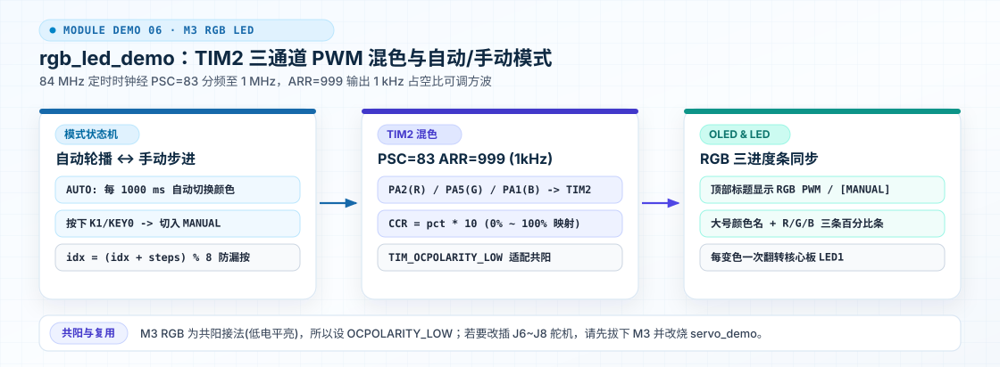

# RGB 全彩 LED（rgb_led_demo）

要让同一颗 RGB 全彩灯珠混合出纯红、黄、青、品红、白乃至柔和呼吸渐变色，靠单纯高低电平开关（只能出 7 种开关色）是远远不够的——必须利用微控制器的 **多通道脉冲宽度调制（PWM）** 分别控制三基色亮度比例。`rgb_led_demo` 用一颗通用定时器 `TIM2` 同时驱动 `R / G / B` 三个通道，并支持自动轮播与按键逐色步进。

通过本篇源码解析，你将掌握：
- **APB1 定时器倍频与分频公式**：弄清为何 `PCLK1 = 42 MHz` 时 `TIM2` 时钟反而跑在 `84 MHz`，并手算出 `1 kHz` PWM 参数。
- **共阳极 LED 与输出极性反转**：理解为何设置 `TIM_OCPOLARITY_LOW` 后，`CCR` 写越大灯光就越亮。
- **单循环多时间标尺模式**：学会不用多建任务也能在同一 `for (;;)` 循环内融合即时按键、1000 ms 自动切色和 200 ms OLED 动画三套节拍。

## 工程与烧录

```powershell
.\.venv\Scripts\f407.exe flash rgb_led_demo
```

| 项目 | 说明 |
| --- | --- |
| 应用入口 | `applications/rgb_led_demo/src/main.c`（112 行） |
| 构建脚本 | `applications/rgb_led_demo/CMakeLists.txt`、`cmake/f407_app.cmake` |
| 核心驱动 | `platform/modules/mod_rgb_led.c`、`platform/bsp/bsp_key.c`、`platform/bsp/oled_ui.c` |
| 硬件引脚与外设 | 底板 `M3`：`PA5 (G, TIM2_CH1)`、`PA1 (B, TIM2_CH2)`、`PA2 (R, TIM2_CH3)` |
| FreeRTOS 机制 | `bsp_key_wait_event(100U)` 事件唤醒 + `last_auto` / `last_ui` 多时间尺度状态判断 |
| 硬件互斥提醒 | `PA5/PA1/PA2` 与舵机插座 `J6~J8` 共用引脚与 `TIM2`，运行本例程前请先拔除舵机 |

## 运行流程



1. **三路 PWM 硬件就绪**：`rgb_task` 初始化屏幕与 `mod_rgb_led_init()`，配好 `GPIO_AF1_TIM2` 复用，设定 1 kHz 周期并点亮调色板首色（纯红 `R=100%`）。
2. **等待按键中断唤醒或 100 ms 超时**：调用 `bsp_key_wait_event(100U)` 阻塞挂起。未按键时最多每 100 ms 醒来查看一下时间标尺；一旦按下 `K1` 或 `KEY0` 立即毫秒级醒来。
3. **自动 ↔ 手动模式状态机**：若 `steps > 0U`，将 `manual = true` 并用 `(idx + steps) % 8` 推进调色板索引（哪怕卡顿连按也不丢步）；若仍处于 `AUTO` 模式且距上次换色已满 `1000 ms`，自动递增一步索引。
4. **仅在变色或 200 ms 到期时输出**：索引发生变化时调用 `mod_rgb_led_set()` 更新占空比、翻转 `LED1` 并打印色值日志；OLED 按照每 `200 ms` 刷一帧的稳态刷新顶部动画与三色百分比横条。

## 主程序解析

### 调色板与按键切换

```c
typedef struct {
    uint8_t r;
    uint8_t g;
    uint8_t b;
    const char *name;
} rgb_color_t;

static const rgb_color_t k_palette[] = {
    {100,   0,   0, "RED"},
    {  0, 100,   0, "GREEN"},
    {  0,   0, 100, "BLUE"},
    {100, 100,   0, "YELLOW"},
    {  0, 100, 100, "CYAN"},
    {100,   0, 100, "MAGENTA"},
    {100, 100, 100, "WHITE"},
    {  0,   0,   0, "OFF"},
};
```

- **用结构体表驱动代替一堆 `if/else`**：把颜色的百分比和显示标签打包成 `const` 只读数组（编进 Flash 不占宝贵片内 RAM），主逻辑只需移动数组下标 `idx` 并用 `sizeof(k_palette) / sizeof(k_palette[0])` 自动计算条目数，增删颜色无需改一行业务分支。

再看主循环内的双标尺调度：

```c
        if (steps > 0U) {
            manual = true;
            idx = (idx + steps) % (sizeof(k_palette) / sizeof(k_palette[0]));
            changed = true;
        } else if (!manual && (now - last_auto) >= pdMS_TO_TICKS(1000)) {
            last_auto = now;
            idx = (idx + 1U) % (sizeof(k_palette) / sizeof(k_palette[0]));
            changed = true;
        }

        if (changed) {
            const rgb_color_t *c = &k_palette[idx];
            mod_rgb_led_set(c->r, c->g, c->b);
            bsp_led_toggle(BSP_LED1);
            printf("[RGB] color=%-7s (R=%u%% G=%u%% B=%u%%) mode=%s\r\n",
                   c->name, c->r, c->g, c->b, manual ? "MANUAL" : "AUTO");
        }

        bool ui_due = (now - last_ui) >= pdMS_TO_TICKS(200);
```

- **`ui_due` 与 `changed` 解耦**：只有在真的换色时（`changed`）才改寄存器和打串口；如果按得飞快，每次按键都能瞬间在 OLED 反映最新颜色；如果停留在手动某色不动，`last_ui` 每 200 ms 只顺便转一格标题栏动画标，绝不会反复打印无意义串口废话。

### 三通道界面绘制

```c
    oled_ui_text(6, 37, "R", false);
    oled_ui_bar(16, 37, 104, 7, (int)c->r * 10);

    oled_ui_text(6, 46, "G", false);
    oled_ui_bar(16, 46, 104, 7, (int)c->g * 10);

    oled_ui_text(6, 55, "B", false);
    oled_ui_bar(16, 55, 104, 7, (int)c->b * 10);
```

注意到第 2 个形参起在蓝区分别占用了 `y = 37, 46, 55` 三行，每条高 `7 px`、间距 `2 px`，最底端 `55 + 7 = 62` 刚好严丝合缝卡在圆角框内部底边（`y = 17 + 47 = 64`）之上。把百分比（`0~100`）乘 `10` 正好变成进度条 API 期望的千分比（`0~1000`）。

## 驱动解析

读透 `platform/modules/mod_rgb_led.c`，以后不管你用哪个 STM32 通用定时器输出 PWM 都会了然于胸：

```c
    /* TIM2 clock = 84 MHz (2 * PCLK1): PSC=83 -> 1 MHz, ARR=999 -> 1 kHz PWM */
    s_htim2_rgb.Instance = TIM2;
    s_htim2_rgb.Init.Prescaler = 83U;
    s_htim2_rgb.Init.CounterMode = TIM_COUNTERMODE_UP;
    s_htim2_rgb.Init.Period = 999U;
    s_htim2_rgb.Init.ClockDivision = TIM_CLOCKDIVISION_DIV1;
    s_htim2_rgb.Init.AutoReloadPreload = TIM_AUTORELOAD_PRELOAD_ENABLE;
    (void)HAL_TIM_PWM_Init(&s_htim2_rgb);

    oc.OCMode = TIM_OCMODE_PWM1;
    oc.Pulse = 0U;
    oc.OCPolarity = TIM_OCPOLARITY_LOW; /* Common anode: active-low lights LED */
```

- **为什么时钟算出来是 `84 MHz`**：虽然 `APB1` 总线跑在 `42 MHz`，但 STM32F407 时钟树硬件规定——只要 `APB1` 预分频系数不是 1（这里是 `DIV4`），挂在 `APB1` 上的定时器输入时钟**自动倍频 ×2**，即 `TIM2 = 42 × 2 = 84 MHz`。
- **`1 kHz` 与百分比整除参数推导**：
  - 预分频写 `83` → 计数器输入频率 = `84,000,000 / (83 + 1) = 1,000,000 Hz`（`1 MHz`，每步正好 `1 us`）。
  - 自动重装载 `ARR` 写 `999` → 每数 `999 + 1 = 1000` 步溢出一个周期，周期 = `1000 us = 1 ms` → **输出频率稳稳等于 `1 kHz`**（远超人眼视觉暂留闪烁阈值，相机拍照也不会有明显频闪横纹）。
  - 设定占空比只需把 `0~100%` 简单乘 `10` 得到 `0~1000` 写入捕获/比较寄存器 `CCR`。
- **共阳极接法与 `TIM_OCPOLARITY_LOW`**：底板 M3 模块三色灯珠共用阳极接入 `VCC_3V3`，需要单片机拉低阴极引脚才亮。在 `PWM1` 向上计数模式下，“计数器 `< CCR` 时输出有效电平”。把有效电平设为 **`LOW`（低电平）** 后：写 `CCR = 0`（从头到尾都没低于 0）代表全周期高电平（全灭）；写 `CCR = 250` 代表前 `25%` 时间输出低电平点亮、`75%` 高电平熄灭；写 `CCR = 1000`（`> 999`）全亮——应用层完全不用在乎共阳还是共阴反转！

| 颜色通道 | 物理引脚 | TIM2 通道 | `mod_rgb_led_set()` 写入宏 |
| --- | --- | --- | --- |
| 红色 `R` | `PA2` | `TIM_CHANNEL_3` | `__HAL_TIM_SET_COMPARE(..., TIM_CHANNEL_3, r)` |
| 绿色 `G` | `PA5` | `TIM_CHANNEL_1` | `__HAL_TIM_SET_COMPARE(..., TIM_CHANNEL_1, g)` |
| 蓝色 `B` | `PA1` | `TIM_CHANNEL_2` | `__HAL_TIM_SET_COMPARE(..., TIM_CHANNEL_2, b)` |

### 驱动接口速查

头文件：`mod_rgb_led.h`

| 函数原型 | 参数说明 | 作用与返回值 |
| --- | --- | --- |
| `void mod_rgb_led_init(void)` | 无参数 | 配置 `PA1/PA2/PA5` 为 `AF1_TIM2`、启动 3 路 1 kHz PWM 并默认熄灭 |
| `void mod_rgb_led_set(r, g, b)` | `r/g/b`: 各自百分比 `0~100`（超过 100 自动限幅为全亮） | 实时改写三通道 `CCR`，无需重配定时器即时无毛刺混色 |

## 现象与排查

刚上电时 M3 全彩灯珠以 1 秒节拍依次循环切换红、绿、蓝、黄、青、品红、白、熄灭；随时按下底板 `K1` 或核心板 `KEY0` 切为 `[MANUAL]` 手动模式，每按一次步进下一个色调：

```text
rgb_led_demo: M3 TIM2 PWM (PA2=R, PA5=G, PA1=B), press K1/KEY0 to step
[RGB] color=RED     (R=100% G=0% B=0%) mode=AUTO
[RGB] color=GREEN   (R=0% G=100% B=0%) mode=AUTO
[RGB] color=BLUE    (R=0% G=0% B=100%) mode=MANUAL
```

| 现象 | 可能原因 | 排查方法 |
| --- | --- | --- |
| 三原色错位或白光偏粉偏绿 | 正常现象，或三色模块排针不同批次顺脚差异 | 本底板标准接法为 `PA2=R, PA5=G, PA1=B`；白光发粉是因为人眼及蓝色/红色 LED 发光效率本身存在物理差异（可适当压低红色比例调正白） |
| 一按按键跳了好几格、甚至颜色不亮 | 请检查底板 `J6~J8` 舵机排针是否还插着舵机 | `PA5/PA1/PA2` 与舵机完全复用，共插会导致信号拉垮电源甚至互相干扰 |
| 单独亮 100% 时依然刺眼怎么办 | 限幅百分比设为最高 `100` | 可参考下方案例把最高占比控制在 `30%~50%`，光线立刻变得温润柔和 |

## 扩展练习

### 彩虹平滑渐变

与其每秒咔哒切换 8 种硬色，试着把 `rgb_task` 里的 `for (;;)` 循环改为每 `20 ms` 推进一小步（50 FPS），做一套流畅流光溢彩小夜灯：

```c
static void rainbow_step(uint16_t step_0_to_299, uint8_t *r, uint8_t *g, uint8_t *b)
{
    uint16_t phase = step_0_to_299 % 300U;
    if (phase < 100U) {
        *r = (uint8_t)(100U - phase);
        *g = (uint8_t)phase;
        *b = 0U;
    } else if (phase < 200U) {
        uint16_t t = phase - 100U;
        *r = 0U;
        *g = (uint8_t)(100U - t);
        *b = (uint8_t)t;
    } else {
        uint16_t t = phase - 200U;
        *r = (uint8_t)t;
        *g = 0U;
        *b = (uint8_t)(100U - t);
    }
}
```

在任务循环里每隔 `20 ms` 让 `hue = (hue + 2) % 300` 调用 `rainbow_step(hue, &r, &g, &b); mod_rgb_led_set(r, g, b);`，就能看到丝般顺滑的彩虹流光。

### 手动与自动模式切换

在 `rgb_task` 里增加一个 `WKUP` 键监听：按 `K1/KEY0` 进入手动单步，按核心板 `WKUP` 键恢复 `manual = false` 重新启动自动轮播。

---

[上一篇：OLED 双色屏（oled_demo）](../d05-oled-demo/README.md) · [下一篇：有源/无源蜂鸣器（buzzer_demo）](../d07-buzzer/README.md) · [硬件接线与现象（第 2 课）](../../../quickstart/p1-02-RGB全彩LED调色/README.md) · [内置示例汇总](../../c09-apps-index-and-pitfalls/README.md)
