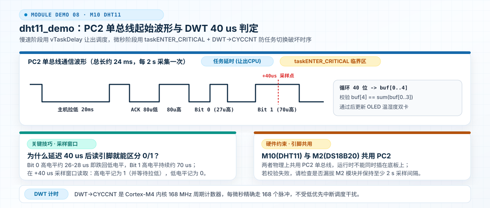

# DHT11 温湿度（dht11_demo）

新手学 RTOS 后常困惑一个实际工程难题：“单总线传感器协议全靠微秒精准计时，如果我在采集 40 位数据读到第 17 位时，FreeRTOS 突然调度切换去跑别的任务怎么办？如果全程关中断几百毫秒又把整个系统卡死怎么办？”`dht11_demo` 给出教科书级的**慢快拆段配合方案**：长达 20 ms 的主机拉低起始阶段放心让给操作系统调度，仅在最后不足 5 ms 的比特读取阶段锁进临界区并用 `DWT->CYCCNT` 硬件计数器精准卡点采样。

通过本篇源码解析，你将掌握：
- **慢快分段临界区技巧**：看懂如何既保住 OS 多任务丝滑切换，又确保微秒协议一比特都不丢。
- **为什么只用 `+40 us` 一个延时就能读懂 0 和 1**：彻底搞懂 DHT11 低/高电平时长差异，避免写一堆算脉冲宽度容易跑偏的代码。
- **定点小数格式与硬件防碰撞**：学会纯整数拆分小数和符号位，并避开 `M10` 与 `M2` 共用 `PC2` 的物理陷阱。

## 工程结构与烧录

```powershell
.\.venv\Scripts\f407.exe flash dht11_demo
```

| 项目 | 说明 |
| --- | --- |
| 应用入口 | `applications/dht11_demo/src/main.c`（120 行） |
| 构建脚本 | `applications/dht11_demo/CMakeLists.txt`、`cmake/f407_app.cmake` |
| 核心驱动 | `platform/modules/mod_dht11.c`、`platform/bsp/bsp_clock.c`、`platform/bsp/oled_ui.c` |
| 硬件引脚与外设 | 底板 `M10` 插座：`PC2`（单线半双工通信）+ 核心内核 `DWT->CYCCNT` |
| FreeRTOS 机制 | `vTaskDelay(20ms)` 出让起振 + `taskENTER_CRITICAL` 保护 4 ms 采样 + 2 s 周期采集 |
| 硬件互斥提醒 | `M10 (DHT11)` 与 `M2 (DS18B20)` 共用 **`PC2`**，插其中一个时必须拔下另一个 |

## 运行原理与流程



1. **开机友好提示界面**：由于 DHT11 内部上电需要稳定约 1 秒以上，任务一启动先在 M1 OLED 绘制 `"Sampling DHT11..."` 提示框，接着开启 `PC2` 与 `DWT` 硬件周期计数器。
2. **第一段（20 ms 慢速出让）**：把 `PC2` 切为推挽输出拉低后，直接调 `vTaskDelay(pdMS_TO_TICKS(20))` 让 CPU 空出来给其他任务使用满 20 ms。
3. **第二段（进入临界区抓应答与 40 位数据）**：调度回来的瞬间调用 `taskENTER_CRITICAL()` 屏住一切任务切换和系统心跳中断——拉高 30 us 切输入，检查传感器返回的 `80 us 低 + 80 us 高` 应答脉冲，再依靠 `DWT` 在每一位高电平上升沿后 **`+40 us`** 窗口处读一次电平决定 `0` 或 `1`，全部读完立刻退出临界区并拉高释放总线。
4. **累加和验证与界面绘制**：核对第 5 个字节是否精确等于前 4 个字节相加；通过后算出毫摄氏度 `temp_mc` 与千分比 `humi_pm`，拆成左右分栏进度卡片刷到 OLED，然后严守传感器最短间隔休眠 `2000 ms`。

## 源码逐段精讲（main.c）

### 1. 定点小数拆解与容错刷新逻辑

```c
        if (mod_dht11_read(&r)) {
            int32_t t_abs = (r.temp_mc < 0) ? -r.temp_mc : r.temp_mc;
            printf("[DHT11] temp=%s%d.%d C, RH=%d.%d %%\r\n",
                   (r.temp_mc < 0) ? "-" : "",
                   (int)(t_abs / 1000), (int)((t_abs % 1000) / 100),
                   (int)(r.humi_pm / 10), (int)(r.humi_pm % 10));
            render_dht11_oled(true, &r, tick);
        } else {
            printf("[DHT11] read failed (check M10 socket & unplug M2)\r\n");
            render_dht11_oled(false, NULL, tick);
        }

        ++tick;
        vTaskDelay(pdMS_TO_TICKS(2000));
```

- **为什么用 `temp_mc`（毫摄氏度）和 `humi_pm`（千分比）**：驱动结构体 `mod_dht11_reading_t` 故意避免引入 `float` 浮点数：比如 `26.3 ℃` 存为 `26300`，`-4.2 ℃` 存为 `-4200`，`58.4 %RH` 存为 `584`。打印或画屏时先用 `t_abs` 取绝对值算整数与小数位，前面单独补 `"-"`, 既绝不会像普通 `%f` 那样因为链接了轻量化 `--specs=nano.specs` 导致打印出空白，又让左右进度条 `temp_mc / 50` 算千分比一步到位。
- **为什么固定休眠 `2000 ms` 不可太短**：DHT11 器件物理特性要求两次采样的最小间隔不低于 1~2 秒。如果手痒改成 100 ms 连读，传感器内部电容还没充好电就直接丢弃主机请求，串口会一直报错 `read failed`。

### 2. 左右分栏卡片自适应居中公式

```c
    int tw = (int)strlen(tbuf) * 12 - 2;
    int hw = (int)strlen(hbuf) * 12 - 2;
    int tx = (62 > tw) ? (62 - tw) / 2 : 2;
    int hx = 66 + ((62 > hw) ? (62 - hw) / 2 : 2);

    /* Left card: Temperature (0..50 C) */
    oled_ui_card(0, 17, 62, 47);
    ...
    oled_ui_bar(4, 52, 54, 7, clamp_int((int)(r->temp_mc / 50), 0, 1000));

    /* Right card: Humidity (0..100 %RH) */
    oled_ui_card(66, 17, 62, 47);
    ...
    oled_ui_bar(70, 52, 54, 7, clamp_int((int)r->humi_pm, 0, 1000));
```

左侧卡占用 `x = 0..61`（宽 62），右侧卡占用 `x = 66..127`（宽 62），中间恰留 4 px 黑边缝隙；大字号字体每字符宽 12 px（减 2 px 末尾间距），从而不管温度是两位数 `"25.0"` 还是带负号 `"-10.5"` 都能左右对称贴合卡片中心；最后用 `clamp_int` 确保温度万一低于 0 ℃ 或超过 50 ℃ 时进度条也不会画到框外去。

## 底层驱动与硬件解析

来看 `platform/modules/mod_dht11.c` 里最精彩的微秒级超时等待与 `+40 us` 窗口判定代码：

```c
static bool dht11_wait_level(GPIO_PinState level, uint32_t timeout_us)
{
    uint32_t ticks = timeout_us * (SystemCoreClock / 1000000U);
    uint32_t start = DWT->CYCCNT;
    while (HAL_GPIO_ReadPin(DHT11_PORT, DHT11_PIN) != level) {
        if ((uint32_t)(DWT->CYCCNT - start) >= ticks) {
            return false;
        }
    }
    return true;
}
```

```c
    for (int byte_idx = 0; ok && byte_idx < 5; ++byte_idx) {
        uint8_t byte_val = 0U;
        for (int bit = 7; bit >= 0; --bit) {
            if (!dht11_wait_level(GPIO_PIN_SET, 90U)) {
                ok = false;
                break;
            }
            bsp_delay_us(40U);
            if (HAL_GPIO_ReadPin(DHT11_PORT, DHT11_PIN) == GPIO_PIN_SET) {
                byte_val |= (uint8_t)(1U << bit);
                if (!dht11_wait_level(GPIO_PIN_RESET, 90U)) {
                    ok = false;
                    break;
                }
            }
        }
        buf[byte_idx] = byte_val;
    }
```

- **单总线时序精准卡点**：每个比特前导都是一段 `50 us` 低电平（被上面 `dht11_wait_level(GPIO_PIN_SET, 90U)` 等过去），一旦总线跳高，立刻计时 `40 us` 后采样：
  - 若对方发 **`0`**：高电平只有 `26~28 us`，走到 `+40 us` 时引脚早已经掉回低电平进入下一位的前导了！判断为低即什么都不用置位，下一轮继续等高即可。
  - 若对方发 **`1`**：高电平足足有 `70 us`，因此在 `+40 us` 读到的依然稳稳是高电平 `GPIO_PIN_SET`！于是把当前字节对应最高位 `(1U << bit)` 置 1，然后再调一次 `dht11_wait_level(GPIO_PIN_RESET, 90U)` 等完剩下的 `~30 us` 高电平结尾。
- **为什么一定要用 DWT 超时而不是固定死循环 `while(read == 0);`**：万一实验室有人热拔下了 M10 模块，每一步最多等待 `90~120 us` 就会判 `ok = false` 跳出临界区恢复调度，绝不可能把整块板子死锁在临界区里。

| 字节索引 | 数据名称 | 数据解读公式与细节 |
| --- | --- | --- |
| `buf[0]` | 湿度整数位 | 直接 `buf[0] * 10` 累加为千分比基数 |
| `buf[1]` | 湿度小数位 | 经典 DHT11 此字节恒 0，扩展型号加 `buf[1] % 10` |
| `buf[2]` | 温度整数位 | `buf[2] * 1000` 毫摄氏度基数 |
| `buf[3]` | 温度小数与负号位 | 低 4 位 `(buf[3] & 0x0F) * 100` 为小数，Bit 7（`0x80`）为 1 则取负号 |
| `buf[4]` | 校验和 | 必须满足 `(uint8_t)(buf[0] + buf[1] + buf[2] + buf[3]) == buf[4]`，否则整帧丢弃 |

### 公开驱动 API 速查（`mod_dht11.h`）

| 函数原型 | 参数说明 | 作用与返回值 |
| --- | --- | --- |
| `void mod_dht11_init(void)` | 无参数 | 开启 `GPIOC` 时钟与 DWT 计数，拉高释放 `PC2` 总线 |
| `bool mod_dht11_read(out)` | `out`: 指向 `mod_dht11_reading_t` 的结果指针 | 发起单次温湿度采集并核对校验和，成功返回 `true`（耗时约 24 ms，含 20 ms 调度让出） |

## 运行现象与常见问题

上电等待约 2 秒第一帧结果出现后，核心板 `LED1` 每 2 秒闪烁一次代表完成一次采集，M1 OLED 左右双卡片直观呈现实测温度（如 `24.3 ℃`）与相对湿度（如 `56.0 %RH`），串口每 2 秒打出一行可读日志：

```text
dht11_demo: M10 on PC2 (keep M2 DS18B20 unplugged)
[DHT11] temp=24.3 C, RH=56.0 %
[DHT11] temp=24.4 C, RH=57.0 %
```

| 现象 | 可能原因 | 排查方法 |
| --- | --- | --- |
| 始终打印 `[DHT11] read failed` | **未拔掉 M2 插座的 DS18B20**，或模块正反插错/上电刚满 1 秒内不稳定 | 检查并清空 `M2` 插座，确认 3 针 DHT11 模块方向未反插，等待下一个 2 秒周期看是否自动恢复 |
| 湿度永远显示 0% 导致报错 | 驱动专门判了 `if (buf[0] == 0 && buf[2] == 0) return false;` 防止全零干扰假通过 | 核实模块供电 `VCC` 有正常 3.3 V 且信号上拉正常 |
| 我自己工程里加高频率串口打印会影响 DHT11 吗？ | 因为读 40 位在 `taskENTER_CRITICAL` 内，不会被其他任务打断 | 仅要注意在临界区的那 4 ms 期间不会产生 `SysTick` 中断，如果其他高优先级任务要求极其严苛，应错开采集 |

## 进阶改造练习

### 练习 1：加上“高温/高湿蜂鸣器与 LED2 声光联动超限报警”

直接把 `dht11_demo` 升级为小型机房监测器：设定温度阈值超过 `30.0 ℃`（即 `r.temp_mc >= 30000`）或湿度超过 `75.0%` 时，亮起核心板 `LED2` 并在 OLED 头部改用 `"ALARM!"` 警告徽章：

```c
        if (mod_dht11_read(&r)) {
            bool over_limit = (r.temp_mc >= 30000) || (r.humi_pm >= 750);
            bsp_led_set(BSP_LED2, over_limit);
            if (over_limit) {
                printf("[ALARM] ENV OVER LIMIT! T=%ld mC RH=%ld pm\r\n",
                       (long)r.temp_mc, (long)r.humi_pm);
            }
            render_dht11_oled(true, &r, tick);
        }
```

### 练习 2：对比拆开看原始校验字节

试着暂时在 `mod_dht11.c` 返回之前加一行打印输出 `buf[0]..buf[4]` 五个十六进制字节，对着手指捏暖传感器前后变化观察究竟哪个字节发生了进制跳变。

---

[上一篇：有源/无源蜂鸣器（buzzer_demo）](../d07-buzzer/README.md) · [下一篇：DS18B20 测温（ds18b20_demo）](../d09-ds18b20/README.md) · [硬件接线与现象（第 4 课）](../../../quickstart/p1-04-DHT11温湿度采集/README.md) · [内置示例汇总](../../c09-apps-index-and-pitfalls/README.md)
