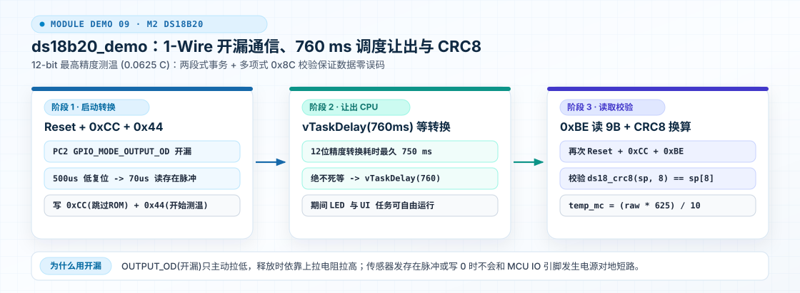

# DS18B20 测温（ds18b20_demo）

与每次只给出 1 ℃ / 0.1 ℃ 大步粗略读数的 DHT11 不同，插入底板 M2 插座的 DS18B20 是标准的 **Dallas/Maxim 1-Wire（单总线）12 位数字温度传感器**，分辨率高达 **`0.0625 ℃`**。本示例用工程级写法打通整套规范：用 **开漏输出（Open-Drain）省去频繁重配 GPIO 方向**、在芯片内部耗时 750 ms 测温时调用 **`vTaskDelay(760)` 礼让系统调度**、再用 **逐比特临界区 + CRC-8 校验** 确保零误码。

通过本篇源码解析，你将掌握：
- **开漏输出（`OUTPUT_OD`）为什么是单总线灵魂**：理清为什么推挽输出可能烧毁或拉打架，而开漏配高上拉既能发数据又能直接读回从机拉低信号。
- **把 `750 ms` 漫长等待变成多任务黄金窗口**：学会两段式总线事务架构（发命令 → 睡 `760 ms` → 读结果），绝不在驱动里空耗 CPU。
- **12 位有符号补码与硬件 CRC-8 多项式（`0x8C`）**：读懂 `raw * 625 / 10` 的由来和零表查验字节的逐位运算过程。

## 工程与烧录

```powershell
.\.venv\Scripts\f407.exe flash ds18b20_demo
```

| 项目 | 说明 |
| --- | --- |
| 应用入口 | `applications/ds18b20_demo/src/main.c`（91 行） |
| 构建脚本 | `applications/ds18b20_demo/CMakeLists.txt`、`cmake/f407_app.cmake` |
| 核心驱动 | `platform/modules/mod_ds18b20.c`、`platform/bsp/bsp_clock.c`、`platform/bsp/oled_ui.c` |
| 硬件引脚与外设 | 底板 `M2` 插座：`PC2`（`GPIO_MODE_OUTPUT_OD` + `GPIO_PULLUP`）+ `DWT->CYCCNT` |
| FreeRTOS 机制 | `vTaskDelay(760ms)` 转换期调度让出 + 逐位 `taskENTER_CRITICAL()` 微秒级保护 |
| 硬件互斥提醒 | `M2 (DS18B20)` 与 `M10 (DHT11)` 共用 **`PC2`**，插其中一个时请务必拔下另一个 |

## 运行流程



1. **配置开漏并初始化 DWT**：`mod_ds18b20_init()` 将 `PC2` 先写输出高电平再设成高速开漏上拉模式（线平时靠电阻保持高电平空闲状态）。
2. **第一阶段（唤醒并下发转换指令）**：发一次 500 us 低复位并在 70 us 确认传感器拉低应答（Presence Pulse）后，依次逐比特发送 `0xCC`（Skip ROM，跳过 64 位寻址直接对唯一从机发话）与 `0x44`（Convert T，启动内部 12 位测温转换）。
3. **礼貌让出 CPU 满 760 ms**：根据芯片手册，12 位高精度温度转换最久消耗 `750 ms`。驱动立刻执行 `vTaskDelay(pdMS_TO_TICKS(760))` 进入阻塞等待，期间所有同级或低级任务正常运行。
4. **第二阶段（唤醒并读 9 字节暂存器 + CRC-8）**：醒来后再次复位并发送 `0xCC` + `0xBE`（Read Scratchpad），连读 9 字节 `sp[0..8]`；如果前 8 字节算出的 CRC-8 等于第 9 字节 `sp[8]`，就把补码原值折算为毫摄氏度返回给任务绘制大号数值和 `0°C ~ 50°C` 比例条。

## 主程序解析

### 温度数值居中排版

```c
    char val_buf[16];
    char fine_buf[24];
    int32_t mag = (milli_c < 0) ? -milli_c : milli_c;

    snprintf(val_buf, sizeof(val_buf), "%s%d.%02d",
             (milli_c < 0) ? "-" : "", (int)(mag / 1000), (int)((mag % 1000) / 10));
    snprintf(fine_buf, sizeof(fine_buf), "12-bit: %s%d.%03d C",
             (milli_c < 0) ? "-" : "", (int)(mag / 1000), (int)(mag % 1000));

    int len = (int)strlen(val_buf);
    int total_w = len * 12 + 17;
    int sx = (OLED_UI_WIDTH > total_w) ? (OLED_UI_WIDTH - total_w) / 2 : 2;

    oled_ui_big_text(sx, 20, val_buf);
    oled_ui_degree(sx + len * 12 + 1, 20);
    oled_ui_big_text(sx + len * 12 + 7, 20, "C");
    oled_ui_text_center(39, fine_buf, false);

    int permille = (milli_c <= 0) ? 0 : ((milli_c >= 50000) ? 1000 : (int)(milli_c / 50));
    oled_ui_bar(8, 51, 112, 8, permille);
```

- **逐像素排版细节**：大号字母宽 12 px，`oled_ui_degree`（小圆圈度符号）占约 6 px 宽，最后加 1 个大字 `'C'`（12 px）——整行加起来正好 `len * 12 + 17` 像素！用 `(128 - total_w) / 2` 动态算出左起横坐标 `sx`，哪怕从 `9.87°C` 升到 `25.62°C` 或掉到 `-12.34°C`，画面永远居中不偏一边；下方还额外加了一行 `12-bit: 25.625 C` 展示完整的三位小数实测精度。

### 主任务采样节奏

`ds18b20_task` 每轮循环调用 `mod_ds18b20_read_milli_c(&mc)`（内耗约 `760 ms`）后再追加 `vTaskDelay(pdMS_TO_TICKS(1200))`，整体节奏大约每 `~2 秒` 刷新一帧，串口打印精度精确到千分之一度（`25.625 C`）。

## 驱动解析

读懂 `platform/modules/mod_ds18b20.c`，就能彻底征服单总线：

### 开漏输出配置

```c
    HAL_GPIO_WritePin(DS18_PORT, DS18_PIN, GPIO_PIN_SET);
    gpio.Pin = DS18_PIN;
    gpio.Mode = GPIO_MODE_OUTPUT_OD;
    gpio.Pull = GPIO_PULLUP;
    gpio.Speed = GPIO_SPEED_FREQ_VERY_HIGH;
    HAL_GPIO_Init(DS18_PORT, &gpio);
```

- **什么是“线与”逻辑不短路原理**：如果引脚配成普通推挽输出高，恰逢 DS18B20 想拉低总线发应答脉冲，MCU 的 PMOS 强推 `3.3 V`、传感器内部管脚强拽 `0 V`——当场形成电源到地的低阻短路大电流！而配置成 `GPIO_MODE_OUTPUT_OD`（开漏）并预先写 `GPIO_PIN_SET` 后，MCU **写 1 仅仅等价于断开内部下拉 MOS 管**，全靠上拉电阻拉高总线；既不怕任何碰撞冲突，想读传感器状态时连 `GPIO_MODE_INPUT` 都不用重配，直接读 `HAL_GPIO_ReadPin` 就是真实总线电平！

### 1-Wire 微秒时序

```c
static void ow_write_byte(uint8_t byte_val)
{
    for (int i = 0; i < 8; ++i) {
        bool bit = ((byte_val >> i) & 0x01U) != 0U;
        taskENTER_CRITICAL();
        ds18_drive_low();
        if (bit) {
            bsp_delay_us(6U);
            ds18_release();
            bsp_delay_us(64U);
        } else {
            bsp_delay_us(60U);
            ds18_release();
            bsp_delay_us(10U);
        }
        taskEXIT_CRITICAL();
    }
}
```

| 时隙动作 | 主机操作时长明细（低位优先 LSB-first） | 临界区最大连续关中断时长 |
| --- | --- | --- |
| 复位与存在检测 | 拉低 `500 us` → 释放等 `70 us` 读存在 → 等完后段 `430 us` | 约 `570 us`（`taskEXIT_CRITICAL` 后再等 `430 us`） |
| 写逻辑 `1` | 拉低 `6 us` → 释放高电平保持 `64 us` | 单比特仅约 **`70 us`** |
| 写逻辑 `0` | 拉低 `60 us` → 释放高电平恢复 `10 us` | 单比特仅约 **`70 us`** |
| 读 1 比特 | 拉低 `3 us` → 释放等 `10 us` 采样 → 等收尾 `53 us` | 单比特仅约 **`66 us`** |

:::tip[为什么把 `taskENTER_CRITICAL()` 放在 `for` 循环里面（每比特开关一次）？]
写一个字节共需 `8 × 70 = 560 us`，读 9 字节更是接近 `5 ms`。把临界区锁缩到单个比特内部，意味着任意两位传输的间隙哪怕有高优先级中断（如 `TIM4` 或网络包）也能顺畅穿插响应，因为 1-Wire 协议允许任意两个相邻比特间隔被拉长！这正是老手与新手写单总线驱的区别所在。
:::

### CRC-8 校验与换算

```c
static uint8_t ds18_crc8(const uint8_t *data, size_t len)
{
    uint8_t crc = 0U;
    for (size_t i = 0; i < len; ++i) {
        uint8_t inbyte = data[i];
        for (int b = 0; b < 8; ++b) {
            uint8_t mix = (uint8_t)((crc ^ inbyte) & 0x01U);
            crc >>= 1U;
            if (mix != 0U) {
                crc ^= 0x8CU;
            }
            inbyte >>= 1U;
        }
    }
    return crc;
}
```

```c
    int16_t raw = (int16_t)(((uint16_t)sp[1] << 8) | sp[0]);
    *out_mc = ((int32_t)raw * 625) / 10;
```

- **多项式 `0x8C` 校验**：Maxim 1-Wire 采用 `X^8 + X^5 + X^4 + 1`（按低位优先反序写成掩码 **`0x8C`**）。对读回的前 8 字节算一遍，结果必须一分不差等于第 9 字节 `sp[8]` 才放行，否则哪怕受干扰错了一位也立刻报错重读，绝不会突然在屏幕闪出一个 `85.000°C` 或 `-127.000°C` 飞点。
- **有符号补码与分辨率公式**：`sp[1]` 为高字节（高 5 位全为符号扩展位）、`sp[0]` 为低字节。合并成 **`int16_t raw`** 后即自带标准补码负温符号；因为默认 12 位精度下每步进 `1 LSB = 0.0625 ℃ = 62.5 m℃`，于是 `* 625 / 10` 直接免除浮点运算完美输出精准的毫摄氏度！

### 驱动接口速查

头文件：`mod_ds18b20.h`

| 函数原型 | 参数说明 | 作用与返回值 |
| --- | --- | --- |
| `void mod_ds18b20_init(void)` | 无参数 | 使能 `GPIOC`、启动 DWT 并配置 `PC2` 为高速开漏上拉模式 |
| `bool mod_ds18b20_read_milli_c(out)` | `out`: 指向 `int32_t` 的结果指针（单位 0.001 ℃） | 执行完整触发+`760 ms`休眠等待+CRC 校验读数，成功返回 `true` |

## 现象与排查

将 DS18B20 温度模块插入底板 **M2** 插座并确保 `M10` 为空，烧录运行后 OLED 大字实时显示两位小数温度、下方标出精细 12-bit 三位小数，串口日志约每 2 秒打印一条记录：

```text
ds18b20_demo: M2 on PC2 (keep M10 DHT11 unplugged)
[DS18B20] temp=25.437 C
[DS18B20] temp=25.500 C
[DS18B20] temp=26.187 C
```

| 现象 | 可能原因 | 排查方法 |
| --- | --- | --- |
| 报错 `read failed (check M2 socket & unplug M10)` | **`M10` DHT11 还插在上面没拔**，或者探头模块三根脚方向插反（烧热请立即断电！） | 立刻核查 `M10` 为空；对照底板丝印核对 DS18B20 的 `GND/DQ/VCC` 顺序正确无误，切忌反插短路 |
| 一直显示固定不变的 `85.000 C` | 发送 `0x44` 转换命令前供电不稳复位，芯片仍停在上电默认初值 `0x0550`（对应 `85.0℃`） | 核实供电良好、`vTaskDelay(760)` 完整跑完未缩短 |
| 温度变化阶梯为 `0.5°C` 而非 `0.0625°C` | 买到个别预配为低 9-bit 精度或国产替代兼容片 | 可按协议发写暂存器指令 `0x4E` 强写配置寄存器第 4 字节为 `0x7F`（12-bit） |

## 扩展练习

### 记录历史温度极值

在温度监控仪表盘中非常实用：在 `ds18b20_task` 里加一对静态极值追踪变量，并在每次读数后更新：

```c
    static int32_t t_min_mc = INT32_MAX;
    static int32_t t_max_mc = INT32_MIN;

    if (mod_ds18b20_read_milli_c(&mc)) {
        if (mc < t_min_mc) t_min_mc = mc;
        if (mc > t_max_mc) t_max_mc = mc;
        printf("[DS18B20] cur=%ld mC | min=%ld | max=%ld\r\n",
               (long)mc, (long)t_min_mc, (long)t_max_mc);
    }
```

再用小号字 `oled_ui_text()` 把 `Min / Max` 展示在 OLED 蓝区下方，即可做成一个简易环境温差记录仪。

### 转换期多任务并发

试着在 `main()` 里参照 `sram_test` 再加一个每 `250 ms` 快速闪烁 `LED2` 的任务。由于 `mod_ds18b20_read_milli_c` 在等待转换时调用了 `vTaskDelay(760)`，你会清楚观察到 **760 ms 等待测温期间 `LED2` 依然照闪不误**。

---

[上一篇：DHT11 温湿度（dht11_demo）](../d08-dht11/README.md) · [下一篇：HC-SR04 超声波（hc_sr04_demo）](../d10-hc-sr04/README.md) · [硬件接线与现象（第 5 课）](../../../quickstart/p1-05-DS18B20单总线测温/README.md) · [内置示例汇总](../../c09-apps-index-and-pitfalls/README.md)
