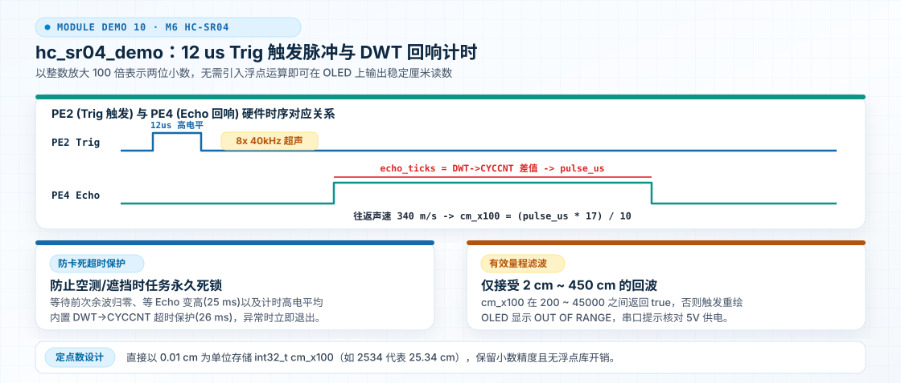

# HC-SR04 超声波（hc_sr04_demo）

新手写超声波模块时最容易踩两个坑：第一，用 `while (Echo == 0)` 死等回波，模块松了一下整颗芯片就死机再也不跑其他任务；第二，直接调 `float` 算距离导致轻量版 C 库格式化输出异常或占用额外 Flash。`hc_sr04_demo` 展示了如何用 **Cortex-M4 内核 `DWT->CYCCNT` 硬件计数器实现三段硬超时防护**，再用简洁的定点数乘除算出精度达 `0.01 cm` 的稳定距离。

通过本篇源码解析，你将掌握：
- **三段超时守护状态机**：在不用占用珍贵定时器输入捕获（IC）通道的前提下，安全捕捉 `Echo` 高电平脉宽，彻底杜绝模块掉线拖死系统。
- **往返声速定点数换算推导**：看懂 `pulse_us * 17 / 10` 如何直接把微秒数变成分辨率 `0.01 cm` 的整型数 `cm_x100`。
- **下拉输入（`GPIO_PULLDOWN`）防干扰妙用**：明白为什么 `PE4` 配成内部下拉就能防止模块拔掉后的误读乱跳。

## 工程与烧录

```powershell
.\.venv\Scripts\f407.exe flash hc_sr04_demo
```

| 项目 | 说明 |
| --- | --- |
| 应用入口 | `applications/hc_sr04_demo/src/main.c`（84 行） |
| 构建脚本 | `applications/hc_sr04_demo/CMakeLists.txt`、`cmake/f407_app.cmake` |
| 核心驱动 | `platform/modules/mod_hcsr04.c`、`platform/bsp/bsp_clock.c`、`platform/bsp/oled_ui.c` |
| 硬件引脚与外设 | 底板 `M6` 插座：`PE2 (Trig 推挽输出)`、`PE4 (Echo 下拉输入)`（模块由底板 `5V` 供电） |
| FreeRTOS 机制 | 单任务 `hcsr04_task`（优先级 `+2`，栈 `512` 字）500 ms 周期测距 + 硬超时退出 |

## 运行流程



1. **余波清零守卫（阶段 1）**：发新脉冲前，先检查 `PE4 (Echo)` 是否仍被前次测量余振抬高；如过 25 ms 仍未归零直接放弃本次并返回失败。
2. **发 `12 us` 触发脉冲与 40 kHz 发射**：给 `PE2 (Trig)` 送出一个不少于 10 us（这里取 `12 us` 留出余量）的高电平脉冲，模块芯片随即自动向外发射 8 组 40 kHz 超声脉冲并将 `PE4` 抬高计时。
3. **等上升与测高宽（阶段 2、3）**：用 `DWT->CYCCNT` 等待 `PE4` 变高（超时 25 ms），一旦跳高立刻打上时间戳 `echo_start`，再等待 `PE4` 跌回低电平（最多等 26 ms 对应约 `4.5 米` 物理极限），做减法得精确时钟周期差。
4. **有效量程滤波与刷屏**：把微秒脉宽通过 `(pulse_us * 17U) / 10U` 转为 `cm_x100`，仅接受有效区间 `2 cm ~ 450 cm`；越界时在 OLED 反白提示 `OUT OF RANGE`，然后休眠 500 ms 让出调度权。

## 主程序解析

### 采样周期与定点拆分

```c
    for (;;) {
        int32_t cm_x100 = 0;
        led_state = !led_state;
        bsp_led_set(BSP_LED1, led_state);

        if (mod_hcsr04_measure_cm_x100(&cm_x100)) {
            printf("[HC-SR04] distance=%d.%02d cm\r\n", (int)(cm_x100 / 100), (int)(cm_x100 % 100));
            render_hcsr04_oled(true, cm_x100, tick);
        } else {
            printf("[HC-SR04] no echo (check M6 & 5V USB power)\r\n");
            render_hcsr04_oled(false, 0, tick);
        }

        ++tick;
        vTaskDelay(pdMS_TO_TICKS(500));
    }
```

- **定点数零精度损失打印**：`cm_x100` 以 `0.01 cm` 为最小单位。`cm_x100 / 100` 取出整数厘米，`cm_x100 % 100` 取出两位小数，用 `%02d` 补齐前导零——例如 `1205` 打印成 `12.05 cm`，比盲目 `%f` 更安全省资源。
- **为什么提示 `5V USB power`**：HC-SR04 发射探头内含升压驱动电路，标准工作电压是 **`5 V`**。底板 `M6` 插座正好引了 `5V` 电源；如果只通过 ST-Link 的 3.3V SWD 三线单独供电而没插底板 Type-C 供电线，探头无法起振或只输出超短误回波。

### 进度条限幅绘制

```c
    char dist_buf[20];
    int permille = (int)(cm_x100 / 10);
    if (permille < 0) {
        permille = 0;
    }
    if (permille > 1000) {
        permille = 1000;
    }
```

传感器最大可测到 `450 cm`（`45000`），但桌面实验通常在 `0 ~ 100 cm` 内滑动手掌测试。因此进度条特地按照 `0~100 cm` 满格做线性映射（`cm_x100 / 10`：例如 `50.00 cm` → `5000 / 10 = 500‰` 正好半满），超过 `100 cm` 时强行封顶为 `1000‰`，文字继续准确显示实际远距离。

## 驱动解析

深入 `platform/modules/mod_hcsr04.c`，完整看清内部防悬空设计与 3 步硬超时计算：

```c
void mod_hcsr04_init(void)
{
    ...
    gpio.Pin = GPIO_PIN_2;
    gpio.Mode = GPIO_MODE_OUTPUT_PP;
    ...
    gpio.Pin = GPIO_PIN_4;
    gpio.Mode = GPIO_MODE_INPUT;
    gpio.Pull = GPIO_PULLDOWN;
    HAL_GPIO_Init(GPIOE, &gpio);
}
```

```c
    uint32_t echo_ticks = DWT->CYCCNT - echo_start;
    uint32_t pulse_us = echo_ticks / ticks_per_us;

    /* Sound 340 m/s -> distance (cm) = pulse_us * 0.017 => in 0.01cm units: pulse_us * 17 / 10 */
    int32_t cm_x100 = (int32_t)((pulse_us * 17U) / 10U);
    if (cm_x100 < 200 || cm_x100 > 45000) {
        return false;
    }
```

### 轮询超时保护

| 等待阶段 | 超时时间计算（`ticks_per_us = 168`） | 保护场景 |
| --- | --- | --- |
| 1. 等 `PE4 == RESET` | `25000 us`（25 ms） | 若硬件损坏或接反导致 `PE4` 被永远拉死在 `5 V/3.3 V`，25 ms 立刻放弃不阻塞 |
| 2. 等 `PE4 == SET` | `25000 us`（25 ms） | 未插模块或仅 3.3V 供电无发射信号时（靠 `GPIO_PULLDOWN` 稳拉低）安全返回 `false` |
| 3. 等 `PE4` 回落测脉宽 | `26000 us`（26 ms） | 对着空旷天花板或吸音布无有效回波时，`26 ms`（对应约 `4.42 m`）直接截断退出 |

### 声速与距离换算

常温干燥空气中声速约 `340 m/s = 0.034 cm/us`。由于超声波走的是“传感器 → 障碍物 → 传感器”**往返两倍路径**：

- `distance (cm) = (pulse_us × 0.034) / 2 = pulse_us × 0.017`

把结果放大 100 倍写成 `0.01 cm` 定点单位 `cm_x100`：

- `cm_x100 = pulse_us × 1.7 = (pulse_us * 17U) / 10U`

最后用 `if (cm_x100 < 200 || cm_x100 > 45000)` 过滤掉低于 `2.00 cm` 的探头近场盲区和高于 `450.00 cm` 的无效超距杂波。*(由于测量仅耗时数毫秒且对普通测距允许少量其它任务微秒级干扰，本驱动未封锁全程中断，保证了 FreeRTOS 实时调度流畅度。)*

### 驱动接口速查

头文件：`mod_hcsr04.h`

| 函数原型 | 参数说明 | 作用与返回值 |
| --- | --- | --- |
| `void mod_hcsr04_init(void)` | 无参数 | 配好 `PE2` 推挽输出低、`PE4` 内部下拉输入，并确保启用 DWT |
| `bool mod_hcsr04_measure_cm_x100(out)` | `out`: 指向 `int32_t` 的距离输出指针（单位 `0.01 cm`） | 发射 12 us 触发脉冲并测算回响距离；在 `2~450 cm` 内有效返回 `true` |

## 现象与排查

对准正前方平坦桌面或硬纸板（`2 cm ~ 100 cm` 效果最佳），OLED 大字居中实时刷新精准小数距离并推拉横条，串口每 `500 ms` 打出一行测距值：

```text
hc_sr04_demo: M6 Ultrasonic Trig=PE2 Echo=PE4
[HC-SR04] distance=18.36 cm
[HC-SR04] distance=24.14 cm
[HC-SR04] no echo (check M6 & 5V USB power)
```

| 现象 | 可能原因 | 排查方法 |
| --- | --- | --- |
| 始终打印 `no echo (check M6 & 5V USB power)` | 最常见原因：**底板没有通过 Type-C/DC 供上 `5 V` 电源**，只靠 3.3 V 烧录器供电 | 给核心板/底板插上 USB Type-C 供电线，量测 M6 插座 `VCC` 针确有 `5 V` 电压 |
| 测量距离在偶尔几帧突然跳到 `300+ cm` 或无回波 | 目标面倾斜角度过大或面前是蓬松毛衣/窗帘吸收声波 | 用面积较大的硬平面（书本、墙面）垂直对准双圆筒探头，参考下方练习加入中值滤波 |
| 测量极近物体（`< 2 cm`）显示 `OUT OF RANGE` | 收发分体式超声波固有的发射余震与三角形声场盲区 | 这属于物理特性，被测物距离探头保持 ≥ 3 cm 以上即恢复精确读数 |

## 扩展练习

### 添加中值滤波

当手移动或碰到斜墙面时偶尔会冒出单次异常远/近跳变。我们在应用层连测 5 次（每次间隔 `25 ms` 避开余震），排序后取正中间值即可过滤绝大多数环境毛刺：

```c
static bool measure_median_cm_x100(int32_t *out_cm)
{
    int32_t buf[5];
    int n = 0;

    for (int i = 0; i < 5; ++i) {
        int32_t v = 0;
        if (mod_hcsr04_measure_cm_x100(&v)) {
            buf[n++] = v;
        }
        vTaskDelay(pdMS_TO_TICKS(25));
    }
    if (n == 0) {
        return false;
    }
    for (int i = 0; i < n - 1; ++i) {
        for (int j = i + 1; j < n; ++j) {
            if (buf[j] < buf[i]) {
                int32_t t = buf[i];
                buf[i] = buf[j];
                buf[j] = t;
            }
        }
    }
    *out_cm = buf[n / 2];
    return true;
}
```

### 倒车雷达阈值报警

试试把 `hc_sr04_task` 的判断条件按 `< 1500`（15 cm 内）亮核心板 `LED2`、`< 800`（8 cm 内）双灯急闪修改一下，体验实时物理告警反馈。

---

[上一篇：DS18B20 测温（ds18b20_demo）](../d09-ds18b20/README.md) · [下一篇：MPU6050 六轴姿态（mpu6050_demo）](../d11-mpu6050/README.md) · [硬件接线与现象（第 6 课）](../../../quickstart/p1-06-HC-SR04超声波测距/README.md) · [内置示例汇总](../../c09-apps-index-and-pitfalls/README.md)
