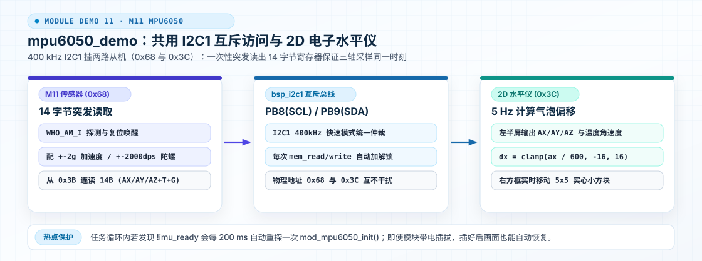

# MPU6050 六轴姿态（mpu6050_demo）

在实际项目中，一片传感器和一块屏幕挂在同一条 `I2C` 总线上是极普遍的硬件拓扑。`mpu6050_demo` 正好演绎了底板 `M11 (MPU6050, 7 位地址 0x68)` 与 `M1 (SSD1306 OLED, 7 位地址 0x3C)` 共插同一条 **`I2C1 (PB8/PB9)` 总线高速共存**的完整工程写法：以 5 Hz 采样六轴姿态与片内温度，并在右侧盒子里实时移动 2D 水平仪气泡。

通过本篇源码解析，你将掌握：
- **共用 `I2C1` 互斥总线的软件仲裁**：看懂两颗外设芯片在地址各自独立的前提下，驱动是如何依靠 `i2c1_mutex` 实现并发安全互不打架的。
- **为什么要一次性突发连读 14 字节（`0x3B ~ 0x48`）**：明白拆成单个寄存器去读会导致三轴数据不在同一时间快照上，且效率低下。
- **传感器原始大端数据 → 国际单位换算**：推导加速度 `mm/s²` 与角速度 `mrad/s` 整数缩放系数，以及水平仪坐标如何精准映射进方框。

## 工程结构与烧录

```powershell
.\.venv\Scripts\f407.exe flash mpu6050_demo
```

| 项目 | 说明 |
| --- | --- |
| 应用入口 | `applications/mpu6050_demo/src/main.c`（126 行） |
| 构建脚本 | `applications/mpu6050_demo/CMakeLists.txt`、`cmake/f407_app.cmake` |
| 核心驱动 | `platform/modules/mod_mpu6050.c`、`platform/bsp/bsp_i2c.c`、`platform/bsp/oled_ui.c` |
| 硬件引脚与外设 | `M11` 与 `M1` 共用 `PB8 (I2C1_SCL)`、`PB9 (I2C1_SDA)` (`400 kHz`)；`M11` 7 位地址 `0x68`、`M1` `0x3C` |
| FreeRTOS 机制 | `i2c1_mutex` + `s_oled_lock` 互斥访问 + 任务栈 `640` 字 + 失败自动重探自愈 |

## 运行原理与流程



1. **同一条 I2C1 初始化两次依然幂等**：任务启动先调 `oled_ui_init()` 内部把 `I2C1` 初始化并拉高唤醒 OLED，再调 `mod_mpu6050_init(&who)` 复用已经 ready 的 `bsp_i2c1` 去探测 `0x68`（`8-bit 0xD0`）芯片、读 `WHO_AM_I`、复位并配好滤波及量程。
2. **故障掉线自愈机制**：每次进入 `for (;;)` 循环先检查 `if (!imu_ready)`——假如带电插上模块或开始没插紧，每 200 ms 会自动重试重连，一旦插好不需重启板子立即恢复画面。
3. **一次突发连读 14 字节快照**：通过 `bsp_i2c1_mem_read` 从 `0x3B` 起始寄存器连读 14 字节，内部通过 `be16()` 将高前低后大端数据还原为 7 个有符号 `int16_t` 原码并折算为毫单位整数。
4. **左数右图同步排版与 1 秒串口汇报**：每 200 ms 重绘左半屏 4 行文字 + 右侧 `44×44` 2D 水平仪气泡方框，并每满 5 拍（`1 s`）输出一行完整 7 路原始数据到串口。

## 源码逐段精讲（main.c）

### 1. 热插拔自愈循环与大栈配置考量

```c
        if (!imu_ready) {
            imu_ready = mod_mpu6050_init(&who);
        }

        bool ok = imu_ready && mod_mpu6050_read(&data);
        render_mpu6050_oled(ok, ok ? &data : NULL, tick);
```

- **为什么本例程把任务栈配到了 `640U`（`2560 B`）**：看看 `render_mpu6050_oled` 内一次开出 `l1[32], l2[32], l3[32], l4[40]` 四个字符串数组，再加四次 `snprintf` 调用，加上 `mpu6050_task` 本身又开了 `mod_mpu6050_data_t data`（28 B）和带 7 个参数的长 `printf` 调用，栈峰值显著高于简单开关示例；因此工程刻意上调 `640U`（比常见的 `512U` 多留 512 字节保护区），防止触及 `configCHECK_FOR_STACK_OVERFLOW`。

### 2. 右侧 2D 电子水平仪坐标映射解析

```c
    /* Right 2D spirit-level box (82, 18, 44, 44), center (104, 40) */
    oled_ui_card(82, 18, 44, 44);
    oled_ui_hline(85, 40, 4, true);
    oled_ui_hline(119, 40, 4, true);
    oled_ui_vline(104, 21, 4, true);
    oled_ui_vline(104, 55, 4, true);
    oled_ui_rect(98, 34, 13, 13, true);

    int dx = clamp_int((int)(d->ax_mms2 / 600), -16, 16);
    int dy = clamp_int((int)(d->ay_mms2 / 600), -16, 16);
    oled_ui_fill_rect(104 + dx - 2, 40 + dy - 2, 5, 5, true);
```

算一笔清晰的像素几何账：
- 外框左上角 `(82, 18)`、宽 44、高 44，因此几何正中心恰好在 `(82 + 22, 18 + 22) = (104, 40)`。
- 中心环 `oled_ui_rect(98, 34, 13, 13)` 正好在 `(104, 40)` 四周向外各扩 `6 px` 画一个小靶圈；外框边缘又分别留出了上下左右四个短十字准星刻度。
- 重力加速度 `1 g = 9807 mm/s²`。当板子倾斜到接近竖直（`90°`）时，`ax_mms2` 达到约 `9807`，`9807 / 600 = 16.3`，被 `clamp_int(..., -16, 16)` 牢牢限制在 `±16` 像素内。再画 `5×5` 实心点（左上角减 2：`104 + 16 - 2 = 118`，宽 `5` 到 `123`），正好紧挨外框内壁 `(82 + 44 - 2 = 124)` 而绝不压破边框！

### 3. 左半屏三轴格式化与 `main()` 创建规范

```c
static void fmt_axis_milli(char *buf, size_t sz, const char *name, int32_t milli)
{
    char sign = (milli < 0) ? '-' : '+';
    int32_t mag = (milli < 0) ? -milli : milli;
    snprintf(buf, sz, "%s:%c%d.%02dm/s",
             name, sign, (int)(mag / 1000), (int)((mag % 1000) / 10));
}
```

- **留足左半屏 80 px 安全区**：右侧水平仪卡片占用 `x = 82..126`，左侧从 `x = 0` 开始用固定格式 `AX:+0.14m/s`（共 12 个小号字符 × 6 px = 72 px）逐行写在 `y = 19, 29, 39, 51`，左右井水不犯河水。
- **第 4 行紧凑拼合温度与偏航角速度**：例如 `28.9C Z:-0.1`，既能看到片内温漂参考值，又能在水平旋转板子时看到 Z 轴陀螺瞬间跳动。

## 底层驱动与硬件解析

深入 `platform/modules/mod_mpu6050.c`，理清唤醒寄存器配置和物理换算系数：

### 1. 初始化寄存器配置清单（`mod_mpu6050_init`）

```c
    bsp_i2c1_init(400000U);
    if (!bsp_i2c1_probe(MPU6050_I2C_ADDR)) { return false; }
    if (!bsp_i2c1_mem_read(MPU6050_I2C_ADDR, MPU_REG_WHO_AM_I, &who, 1U, 30U)) { return false; }
```

*(注意 `MPU6050_I2C_ADDR = (0x68U << 1) = 0xD0`，因为 STM32 HAL 库传入的是已左移 1 位的 8 位地址格式。)* 紧接着对 6 个关键配置寄存器依次写入（每次配置都会自动进出 `bsp_i2c1_lock()/unlock()`）：

| 寄存器地址 | 宏定义名 | 写入值 | 作用与意义 |
| --- | --- | --- | --- |
| `0x6B` | `PWR_MGMT_1` | `0x80` → 等 50 ms → `0x01` | 先软件彻底复位清空旧状态，随后退出睡眠并选 X 轴陀螺 PLL 作稳频时钟 |
| `0x19` | `SMPLRT_DIV` | `0x07` | 采样率分频（开启 DLPF 后内部 `1 kHz / (1 + 7) = 125 Hz` 刷新） |
| `0x1A` | `CONFIG` | `0x06` | 配 **`5 Hz` 数字低通滤波器（DLPF）**，强力滤除手抖与桌面高频震动噪点 |
| `0x1B` | `GYRO_CFG` | `0x18` | 陀螺仪设最宽量程 **`±2000 °/s`**（灵敏度 `16.4 LSB/(°/s)`） |
| `0x1C` | `ACCEL_CFG` | `0x00` | 加速度计设高灵敏量程 **`±2 g`**（灵敏度 `16384 LSB/g`） |

:::tip[为什么把 `CONFIG` 配成最重的 `5 Hz` 低通滤波？]
如果不加低通滤波（`DLPF` 关闭或设为 260 Hz），桌面哪怕微小的电脑风扇共震就会让加速度值跳得像噪声。电子水平仪人眼观赏只需 5 Hz 刷新响应，`0x06` 这颗芯片内置硬件滤波器能让你在不用写卡尔曼滤波代码的情况下直接收获稳如磐石的顺滑气泡！
:::

### 2. 大端拼接 `be16()` 与全整数物理换算

```c
static int16_t be16(const uint8_t *p)
{
    return (int16_t)(((uint16_t)p[0] << 8) | p[1]);
}
...
    /* 1 g = 9807 mm/s^2, scale +-2g -> 16384 LSB/g */
    out->ax_mms2 = ((int32_t)ax * 9807) / 16384;
    ...
    /* +-2000 dps -> 16.4 LSB/(deg/s), 1 deg/s = 17.453 mrad/s */
    out->gx_mrads = ((int32_t)gx * 17453) / 16400;
    ...
    out->temp_mc = 36530 + (((int32_t)tr * 1000) / 340);
```

- **高字节在前的大端序（Big-Endian）**：Cortex-M4 是小端架构，而 MPU6050 内部寄存器是高字节在前（如 `0x3B` 是 `AX_H`，`0x3C` 是 `AX_L`）。用 `be16` 把高字节左移 8 位与低字节相或，再强转回有符号 `int16_t` 还原正负方向。
- **整数缩放系数的精确含义**：
  - 加速度：`(raw * 9807) / 16384`（单位 `mm/s²`，平放桌面时 `Z` 轴稳稳读在 `+9800 mm/s²` 附近）。
  - 角速度：由于 `1 °/s ≈ 0.017453 rad/s = 17.453 mrad/s`，故原码乘 `17453` 再除以 `16.4 × 1000 = 16400`，直接输出国际单位制 `mrad/s`。
  - 芯片温度：官方手册公式为 `T = 36.53 + TEMP_OUT / 340`，全乘 1000 转为毫摄氏度（`36530 + (tr * 1000) / 340`）。

### 公开驱动 API 速查（`mod_mpu6050.h`）

| 函数原型 | 参数说明 | 作用与返回值 |
| --- | --- | --- |
| `bool mod_mpu6050_init(who)` | `who`: 可传 `uint8_t*` 回传芯片 ID（通常为 `0x68`，可传 `NULL`） | 探测并唤醒配置 MPU6050，找到且写入成功返回 `true` |
| `bool mod_mpu6050_read(out)` | `out`: 指向 `mod_mpu6050_data_t`（7 路整数物理值） | 通过互斥 `I2C1` 突发读 14 字节并换算为国际单位 |

## 运行现象与常见问题

将 M1 OLED 与 M11 MPU6050 同时插上底板运行后，平放开发板气泡停在正中心方框内，`AZ` 接近 `+9.80 m/s`；向任意方向倾斜板子，气泡立刻像水珠一样朝低处顺滑滚过去，串口每秒打印一条 7 轴原始测量值：

```text
mpu6050_demo: M11 on I2C1 (0x68) ready=1 WHO_AM_I=0x68
[MPU6050] accel[mm/s^2]: 142 -215 9784 | gyro[mrad/s]: -12 8 3 | temp[mC]: 28940
[MPU6050] accel[mm/s^2]: 3840 -120 8992 | gyro[mrad/s]: 45 -310 12 | temp[mC]: 28970
```

| 现象 | 可能原因 | 排查方法 |
| --- | --- | --- |
| OLED 一半提示 `READ FAILED`，另一半正常显示标题 | M11 模块虚接，或买了 `AD0` 被焊成高电平（地址变 `0x69`）的第三方模块 | 确认核心板和 M11 插牢固；注意套件原装模块 `AD0` 接地（`0x68`） |
| 为什么插着两颗 I2C 设备却从不花屏卡顿？ | `bsp_i2c1` 的 `i2c1_mutex` + 硬件 400 kHz 快速模式功劳 | 每读完 MPU6050 14 字节不到 `0.4 ms`，刷 OLED 约 `22 ms`，两者轮流占用 `I2C1` 毫无冲突 |
| 水平摆放时 `AX` 或 `AY` 依然有 `+0.2 m/s` 小零偏 | MEMS 硅微机械陀螺加速度计正常的出厂零点误差（Zero-g Offset） | 工程上可通过开机静止采样前 20 帧求平均作为零点校准偏差扣减 |

## 进阶改造练习

### 练习 1：增加“大角度倾倒自动亮红警灯”功能

用上现成的 `d->ax_mms2` 与 `d->ay_mms2`，当板子倾角超过约 24°（对应横向重力分量大于 `4000 mm/s²`）时点亮核心板 `LED2` 充当倾倒防呆开关：

```c
        if (ok) {
            bool tilted = (data.ax_mms2 > 4000 || data.ax_mms2 < -4000 ||
                           data.ay_mms2 > 4000 || data.ay_mms2 < -4000);
            bsp_led_set(BSP_LED2, tilted);
        } else {
            bsp_led_set(BSP_LED2, false);
        }
```

### 练习 2：利用 Z 轴角速度积分估测“板子旋转了多少度”

尝试自己开一个 `static int64_t yaw_mdeg = 0;` 变量，把每次隔 `200 ms` 测到的有效 `gz_mrads`（建议扣减静止零偏并加小死区阈值）乘时间增量积分，观察绕桌面转动核心板 90 度时累加出的偏航角变化。

---

[上一篇：HC-SR04 超声波（hc_sr04_demo）](../d10-hc-sr04/README.md) · [下一篇：光敏电阻亮度（light_sensor_demo）](../d12-light-sensor/README.md) · [硬件接线与现象（第 7 课）](../../../quickstart/p1-07-MPU6050六轴姿态采集/README.md) · [内置示例汇总](../../c09-apps-index-and-pitfalls/README.md)
