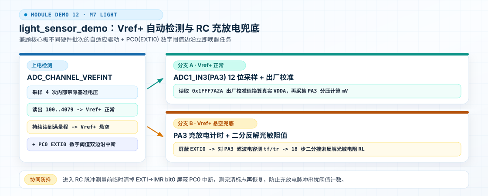

# 光敏电阻亮度（light_sensor_demo）

这是全库**硬件兼容容错设计最具含金量**的一章：在早期小批次的核心板上，STM32F407 封装的模拟参考电压脚 `Vref+` 处于悬空状态——如果写死调普通的 `HAL_ADC_GetValue()`，任何模拟引脚读出来全都死死顶在满量程 `4095`。`mod_light.c` 没有让那批核心板报废，而是在初始化时**自动用内部带隙基准电压 `ADC_CHANNEL_VREFINT` 做一次硬件体检**，正常走硬件 ADC，悬空则无缝切入基于芯片内部 `40 kΩ` 上下拉电阻对模块电容充放电计时的 **`RC` 时间常数反解电路法**，在两种板子上都能测出连续细腻的毫伏级光线亮度！

通过本篇源码解析，你将掌握：
- **利用 `VREFINT` 自检供电与参考源硬件问题**：看懂 ST 出厂校准地址 `0x1FFF7A2A` 怎样算出真实系统参考电压，并识别 `Vref+` 悬空故障。
- **没有 ADC 也能测电压——`RC` 充放电微秒二分求解电路法**：理解硬件 RC 充放电模型如何用纯数字 IO + `DWT->CYCCNT` 精确推算出光敏电阻实时阻值与电压。
- **动态睡眠步长与临界遮蔽防串扰**：学习暗处降频休眠，以及脉冲测量前屏蔽 `EXTI->IMR` 避免产生虚假数字跳变计数。

## 工程结构与烧录

```powershell
.\.venv\Scripts\f407.exe flash light_sensor_demo
```

| 项目 | 说明 |
| --- | --- |
| 应用入口 | `applications/light_sensor_demo/src/main.c`（155 行） |
| 构建脚本 | `applications/light_sensor_demo/CMakeLists.txt`、`cmake/f407_app.cmake` |
| 核心驱动 | `platform/modules/mod_light.c`、`platform/core/stm32f4xx_it.c`、`platform/bsp/oled_ui.c` |
| 硬件引脚与外设 | 底板 `M7`：`PA3`（模拟分压 `AO` / `ADC1_IN3` 或 RC 计时）、`PC0`（阈值比较 `DO` / `EXTI0`） |
| FreeRTOS 机制 | 二进制信号量 `s_light_sem`（`DO` 双边沿触发即时醒来）+ 自适应阻塞超时 `120 ms / 500 ms` |

## 运行原理与流程



1. **开机带隙电压诊断分流**：`mod_light_init()` 打开温度与内部参考使能位 `ADC_CCR_TSVREFE`，采 4 次内部稳定的 `~1.21 V` 带隙参考 `ADC_CHANNEL_VREFINT`。如果读数位于 `100 ~ 4079` 之间，标志 `s_vref_ok = true` 走 **分支 A（硬件 ADC1）**；如果顶满到 `4080~4095`，立即识别为 **`Vref+` 悬空批次** 切入 **分支 B（RC 计时兜底）**。
2. **双路模拟读数与 EMA 平滑**：每次读取先抓一眼 `PC0 (DO)` 数字比较器状态防止干扰，随后分别按对应路径获取分压毫伏值 `mv`（范围 `0 ~ 3300 mV`）。
3. **数字阈值边沿中断唤醒**：当光线强弱跨越 M7 板上蓝色电位器设定的临界线时，`PC0` 触发 `EXTI0` 中断回调（带 20 ms 防抖过滤），释放 `s_light_sem` 立即唤醒任务翻转 `LED1` 并刷新界面。
4. **稳态降噪节流睡眠**：如果环境一直在暗处（`do_high == true`）且亮度波动小于 `40 mV` 连续 3 次以上，自动把信号量等待间隔放宽到 `500 ms`，日常变化期保持敏感的 `120 ms` 响应速度。

## 源码逐段精讲（main.c）

### 1. M7 模块的电压与亮度“反比关系”转换

```c
static int compute_light_pct(int32_t mv)
{
    int pct = 100 - (int)((mv * 100) / 3300);
    if (pct < 0) {
        pct = 0;
    } else if (pct > 100) {
        pct = 100;
    }
    return pct;
}
```

- **为什么光越亮电压反而越低**：光敏电阻的物理特性是**光照越强、自身阻值 `RL` 急剧下降（从几十上百千欧降至数百欧）**。M7 模块内部用一颗固定上拉电阻 `10 kΩ` 接 `3.3 V`，光敏电阻 `RL` 下拉接地，`AO (PA3)` 从中间分压抽头引出。根据分压公式 `V_AO = 3300 * RL / (10000 + RL)`：强光照射时 `mv` 接近 `0 mV`，用手死捂变全黑时逼近 `3300 mV`。为了符合用户直觉，代码用 `100 - (mv * 100) / 3300` 反转为 `0% ~ 100%` 的 `BRI` 亮度百分比与进度条。

### 2. 事件触发 + 自适应休眠与日志诊断

```c
    bool vref_ok = mod_light_has_vref(&vrefint_raw);
    printf("\r\nlight_sensor_demo: M7 AO=PA3(ADC1_IN3) DO=PC0(EXTI0)\r\n");
    printf("[LIGHT-DIAG] VREFINT_RAW=%u (%s)\r\n",
           (unsigned)vrefint_raw,
           vref_ok ? "HW-ADC1" : "RC-TIME continuous mode (Vref+ floating)");
```

```c
        uint32_t wait_ms = (steady_dark_cnt >= 3U) ? 500U : 120U;
        (void)mod_light_wait_event(wait_ms);
        ...
        uint32_t changes = mod_light_get_changes();
        bool changed = (do_high != prev_do) || (changes != prev_changes);
```

- **即使发生两次极快遮光也不会漏觉状态变化**：光看当前布尔值 `do_high != prev_do` 可能会错过两次循环间“亮 → 暗 → 亮”的一闪而过。驱动同时在后台统计有效中断边沿跳变总次数 `changes`，把 `changes != prev_changes` 一并纳入 `changed` 条件，做到无论快慢都能精准捕获。

## 底层驱动与硬件解析

来看 `platform/modules/mod_light.c` 两条亮度计算分支的硬核细节：

### 1. 分支 A：带隙校准真实 `VDDA / VREF`

```c
    if (s_vref_ok && vrefint > 0U) {
        if (!adc1_read_single(ADC_CHANNEL_3, &raw)) {
            return false;
        }
        int32_t vref_mv = 3300;
        uint16_t vref_cal = *(__IO uint16_t *)0x1FFF7A2AU;
        if (vref_cal >= 1200U && vref_cal <= 1800U) {
            vref_mv = (3300 * (int32_t)vref_cal) / (int32_t)vrefint;
        } else {
            vref_mv = (1210 * 4095) / (int32_t)vrefint;
        }
        mv = ((int32_t)raw * vref_mv) / 4095;
    }
```

每片 STM32F407 出厂测试时，ST 官方都会在只读地址 `0x1FFF7A2A` 写入“精确 `3.300 V` 供电下实测到的 `VREFINT` 原码”。用 `3300 * vref_cal / vrefint` 就可以瞬间消除电脑 USB 口实际只有 `3.15 V` 还是 `3.32 V` 造成的 LDO 供电漂移误差，而且 ADC 采样时间特意设为最稳健的 `ADC_SAMPLETIME_480CYCLES` 适应高阻光敏分压源。

### 2. 分支 B：当 `Vref+` 悬空时，如何用 RC 充放电“量出”光敏阻值？

```c
    /* Mask EXTI0 so PA3 pulsing does not inject spurious DO edges on PC0 */
    EXTI->IMR &= ~GPIO_PIN_0;
    GPIOA->OTYPER &= ~GPIO_PIN_3;

    /* 1. Pre-charge C1 to 3.3V, then time discharge with internal pull-down */
    GPIOA->PUPDR &= ~(3UL << 6U);
    GPIOA->BSRR = GPIO_PIN_3;
    GPIOA->MODER = (GPIOA->MODER & ~(3UL << 6U)) | (1UL << 6U);
    bsp_delay_us(20U);

    uint32_t primask = __get_PRIMASK();
    __disable_irq();
    GPIOA->MODER &= ~(3UL << 6U);
    GPIOA->PUPDR = (GPIOA->PUPDR & ~(3UL << 6U)) | (2UL << 6U);
    uint32_t start_cyc = DWT->CYCCNT;
    __set_PRIMASK(primask);

    while ((GPIOA->IDR & GPIO_PIN_3) != 0U) { ... }
    dt_f = DWT->CYCCNT - start_cyc;
```

这个工程兜底算法的物理与电路思路极为巧妙：
1. **屏蔽 `EXTI0` 并采样隔离**：M7 模块上 `PA3`（模拟口）和 `PC0`（LM393 比较器同向端）连在同一个光敏分压节点！如果直接向 `PA3` 脉冲充放电而不掩蔽中断，比较器 `PC0` 会顺便误触发中断使 `s_do_changes` 狂飙。所以先执行 **`EXTI->IMR &= ~GPIO_PIN_0`** 临时闭嘴，测完再恢复。
2. **利用模块滤波电容 + 芯片内部 `40 kΩ` 下拉/上拉**：M7 模块 `AO` 输出对地挂着一颗约 `100 nF` 滤波电容 `C1`。驱动先把 `PA3` 强推拉高 `20 us` 给电容充满电，再瞬间切换回输入模式并挂上片内约 `40 kΩ` 下拉电阻 `Rpd`，用 `DWT->CYCCNT` 记录电容从 `3.3 V` 跌落过 GPIO 施密特翻转阈值（约 `1.38 V`）耗时 `tf_us`（如果在很暗环境光敏电阻大、放电太久，还触发第二段对 `0 V` 放电再开上拉测充电时间 `tr_us`）。
3. **18 步二分法求解未知电阻 `RL` + EMA 滤波**：套用一阶 RC 充放电解析式 `t = tau * ln(...)` 无法直接代数反解分母里的 `RL`，代码只花 **18 次折半搜索循环**就在微秒级时间内把当前真实光敏阻值 `RL` 搜到极高精度，再代回 `3300 * RL / (10000 + RL)` 换算毫无二致的电压值！最后配合平滑指数滤波（突跳 `> 220 mV` 时立刻响应，微小抖动用 `(2*old + new)/3` 平滑），最终做到两条路径呈现高度一致的手感体验。

### 公开驱动 API 速查（`mod_light.h`）

| 函数原型 | 参数说明 | 作用与返回值 |
| --- | --- | --- |
| `void mod_light_init(void)` | 无参数 | 配置 `PA3/PC0`、探测 `VREFINT` 选择测量分支并启动 `EXTI0` |
| `bool mod_light_read(&raw, &mv, &do_h)` | 输出原码(0~4095)、电压(mV)与 DO 状态 | 自动执行对应分支读取并返回实时光强电压与数字高低态 |
| `bool mod_light_has_vref(&raw)` | 回传 `VREFINT` 原码（可 `NULL`） | 返回硬件 `Vref+` 是否供电正常（`true`=HW-ADC1，`false`=RC 兜底） |
| `void mod_light_get_rc_debug(&tf, &tr)` | 单位为 `0.1 us` | 输出最近一次 RC 测得的下降/上升耗时以供诊断 |
| `bool mod_light_wait_event(ms)` | 超时毫秒数 | 阻塞等待 `PC0 (DO)` 跨越电位器阈值产生的边沿中断信号 |
| `uint32_t mod_light_get_changes(void)` | 无参数 | 原子返回累计的防抖数字阈值翻转总次数 |

## 运行现象与常见问题

将 M7 光敏电阻模块插进底板插座，用手掌慢慢盖住探头或拿手机手电筒照向探头，屏幕 `mV` 与 `BRI:%` 连续跟随变化，标题在 `LIGHT [BRIGHT]` 和 `LIGHT [DARK]` 之间跳变；串口首行明确指出当前板子走的路径：

```text
light_sensor_demo: M7 AO=PA3(ADC1_IN3) DO=PC0(EXTI0)
[LIGHT-DIAG] VREFINT_RAW=1503 (HW-ADC1)
[LIGHT] raw= 842 ( 678 mV, BRI=79%) DO=0 (BRIGHT) [rc tf=0.0us tr=0.0us]
[LIGHT] raw=3780 (3045 mV, BRI= 7%) DO=1 (DARK) [rc tf=0.0us tr=0.0us]
```

*(若 `[LIGHT-DIAG]` 打印 `VREFINT_RAW=4095 (RC-TIME continuous mode)`，属于核心板部分批次的硬件差异，驱动已全自动切换完成，尾部 `[rc tf=...]` 会动态展示实测微秒数，完全正常使用！)*

| 现象 | 可能原因 | 排查方法 |
| --- | --- | --- |
| 亮度能变化，但 `DO=0/1` 无论盖多黑或照多亮都不切换 | M7 模块蓝框里的**灵敏度比较器电位器**拧到了极端一侧 | 用小十字螺丝刀微调模块上面那颗蓝色电位器，直至旁边绿色指示 LED 在当前室内亮暗遮挡瞬间亮灭翻转 |
| `HW-ADC1` 与 `RC-TIME` 两块核心板表现对比 | 早期批次 `Pin32 Vref+` 悬空 vs 新版接 `3.3 V` | 驱动层对应用完全透明，不用改写任何上层业务逻辑就能兼容全部批次 |
| 怎么调节黑暗处安静等待的灵敏度？ | 代码设定 `steady_dark_cnt >= 3` 后放宽等待 `500U ms` | 若想强光弱光都极速刷新，可直接把第 100 行等待统一改成固定 `120U` |

## 进阶改造练习

### 练习 1：用“双阈值滞回算法”实现不乱闪烁的智能夜灯开关

单纯以一个值 `BRI < 40%` 就开灯，光线恰好卡在 `39%~41%` 边缘时夜灯就会像抽风一样高频闪烁！加上 **滞回区间（低于 `30%` 开灯，高过 `45%` 才关灯）** 是所有嵌入式控制必学的工程稳定手段：

```c
    static bool night_lamp_on = false;
    int bri = compute_light_pct(mv);

    if (!night_lamp_on && bri < 30) {
        night_lamp_on = true;
        printf("[NIGHT-LAMP] Auto ON (bri=%d%%)\r\n", bri);
    } else if (night_lamp_on && bri > 45) {
        night_lamp_on = false;
        printf("[NIGHT-LAMP] Auto OFF (bri=%d%%)\r\n", bri);
    }
    bsp_led_set(BSP_LED2, night_lamp_on);
```

### 练习 2：对比查看电位器旋钮在串口日志的触发速度

拧调电位器把暗光阈值卡在桌面正常台灯下附近，手快遮一下光敏头看 `s_do_changes` 触发的 `LED1` 和串口消息有没有因为 `120/500 ms` 而变迟钝——你会发现 `mod_light_wait_event()` 靠信号量毫秒级直通唤醒，比固定轮询快得多！

---

[上一篇：MPU6050 六轴姿态（mpu6050_demo）](../d11-mpu6050/README.md) · [下一篇：旋转编码器（rotary_encoder_demo）](../d13-rotary-encoder/README.md) · [硬件接线与现象（第 8 课）](../../../quickstart/p1-08-光敏电阻亮度采集/README.md) · [内置示例汇总](../../c09-apps-index-and-pitfalls/README.md)
