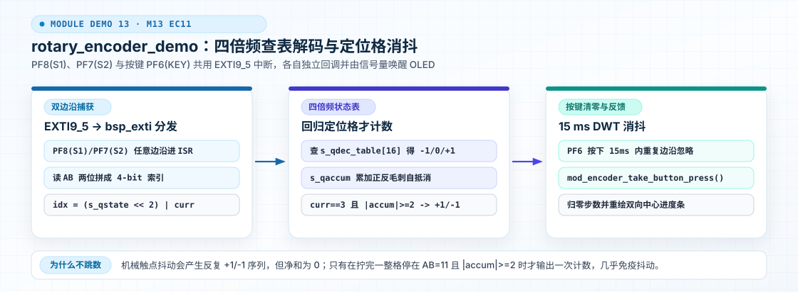

# 旋转编码器（rotary_encoder_demo）

机械旋转编码器（EC11）的成本很低、手感咔哒清脆，却是无数嵌入式开发者最头疼的外设之一：用简单“下降沿判断另一相电平”的老办法，稍微拧快一点或者触点老化抖动，就会频频发生 **向右拧突然减 `1`、拧 1 格却跳了 `3` 下**。`rotary_encoder_demo` 展示了工业界最稳健的解决方案：**16 项四倍频正交状态查表 + 定位格静稳净累加判定**，加上 `EXTI9_5` 统一中断分发框架，让你体会丝毫不动摇的旋钮编码器控制。

通过本篇源码解析，你将掌握：
- **`EXTI9_5` 共用中断线的优雅拆分**：理解 `PF6/PF7/PF8` 为什么只占一个 NVIC 中断入口，以及 `bsp_exti_set_callback()` 是如何像路由器一样把信号各找各家分派出去的。
- **四倍频正交格雷码状态机（`s_qdec_table[16]`）**：彻底弄清机械抖动为什么能被状态表自己正负抵消，以及 `curr == 3 && |accum| >= 2` 这一行代码的神来之笔。
- **中断里的原子快照（`taskENTER_CRITICAL`）**：学会把位置、方向、按压态三个相关变量打包一次锁住安全读出。

## 工程与烧录

```powershell
.\.venv\Scripts\f407.exe flash rotary_encoder_demo
```

| 项目 | 说明 |
| --- | --- |
| 应用入口 | `applications/rotary_encoder_demo/src/main.c`（99 行） |
| 构建脚本 | `applications/rotary_encoder_demo/CMakeLists.txt`、`cmake/f407_app.cmake` |
| 核心驱动 | `platform/modules/mod_encoder.c`、`platform/core/stm32f4xx_it.c`、`platform/bsp/oled_ui.c` |
| 硬件引脚与外设 | 底板 `M13`：`PF8 (S1/A相, EXTI8)`、`PF7 (S2/B相, EXTI7)`、`PF6 (KEY 按压, EXTI6)` |
| FreeRTOS 机制 | 二进制信号量 `s_enc_sem` 唤醒任务 + `taskENTER_CRITICAL` 读状态快照与清零 |

## 运行流程



1. **同一 IRQ 绑定三路独立回调**：`PF6`、`PF7`、`PF8` 全都在 `5~9` 线区间，共用同一个硬件中断向量 `EXTI9_5_IRQHandler`（抢占优先级 `6 ≥ 5`，合法使用 FreeRTOS ISR API）。初始化时通过 `bsp_exti_set_callback()` 给 6 号线绑 `encoder_key_exti_cb`，给 7、8 号线同绑 `encoder_ab_exti_cb`。
2. **双边沿正交查表累加**：只要拧动一格，A/B 两相依次走过 `4` 个格雷码台阶（顺时针 `11 → 01 → 00 → 10 → 11`），每过一个台阶在查表数组里产生 `+1` 或 `-1` 存入 `s_qaccum`；任何局部接触反弹都会立刻抵消归 `0`。
3. **跨格归位才计 `+1 / -1` 并唤醒任务**：只有当两脚同时回到空闲高电平（`curr == 3U`）且净步数到达至少 2 步（`|accum| >= 2`），驱动才让总位置 `s_enc_pos` 增减 1 并通过 `xSemaphoreGiveFromISR(s_enc_sem, &woken)` 瞬间叫醒显示任务。
4. **中心双向条渲染与下压一键清零**：`encoder_task` 计算前后增量 `delta = pos - prev_pos` 更新 `-20 ~ +20` 限幅条 `bar_steps` 并调用 `oled_ui_center_bar()` 从正中间向左右延展；按下旋钮触发 15 ms 消抖后清零复位。

## 主程序解析

### 双向进度条与状态

```c
    for (;;) {
        bool evt = mod_encoder_wait_event(100U);
        int32_t pos = 0;
        int dir = 0;
        bool pressed = false;
        bool refresh = evt;

        mod_encoder_get_state(&pos, &dir, &pressed);

        if (mod_encoder_take_button_press()) {
            mod_encoder_reset_pos();
            pos = 0;
            prev_pos = 0;
            bar_steps = 0;
            dir = 0;
            printf("[EC11] button pressed -> counter reset to 0\r\n");
            refresh = true;
        }

        if (pos != prev_pos) {
            int32_t delta = pos - prev_pos;
            bar_steps = clamp_int(bar_steps + (int)delta, -20, 20);
            prev_pos = pos;
            printf("[EC11] pos=%+ld bar=%+d dir=%s\r\n", (long)pos, bar_steps, (dir > 0) ? "CW" : "CCW");
            refresh = true;
        }
```

- **为什么清零前要等按键边缘提取 `mod_encoder_take_button_press()`**：如果只看“现在按钮按着就一直清零”，按住旋钮的半秒内会疯狂清空无数次。驱动单独锁存了一次点击事件并由 `take` 取出消费，确保“按下咔哒一声清零并只打一行日志”，松手前哪怕微微晃动旋钮也不会莫名连刷。
- **为什么既保留 `pos` 又单独维护 `bar_steps`**：`pos` 是无上限的绝对里程计数（往右拧 50 格就是 `+50`）；而 OLED 屏幕中间那条水平条宽度有限，用 `clamp_int(bar_steps + delta, -20, 20)` 并配合 `* 50` 转千分比（`-1000 ~ +1000`），满格停在边缘后往回拧一格立刻就能直观退格，手感极像数字调音台电平推子。

## 驱动解析

### 外部中断与优先级

看 `platform/core/stm32f4xx_it.c` 如何把共享中断线干净拆分：

```c
static void dispatch_exti_line(uint8_t line)
{
    uint32_t mask = (uint32_t)(1UL << line);
    if (__HAL_GPIO_EXTI_GET_IT(mask) != RESET) {
        __HAL_GPIO_EXTI_CLEAR_IT(mask);
        if (s_exti_cbs[line] != NULL) {
            s_exti_cbs[line]();
        }
    }
}

void EXTI9_5_IRQHandler(void)
{
    for (uint8_t line = 5U; line <= 9U; ++line) {
        dispatch_exti_line(line);
    }
}
```

注意驱动设中断优先级时特意传的是 `HAL_NVIC_SetPriority(EXTI9_5_IRQn, 6U, 0U)`——严格大过或等于 `FreeRTOSConfig.h` 规定的临界区天花板值 `5`，从而合法地在中断结尾处调用 `xSemaphoreGiveFromISR(s_enc_sem, &woken)` 唤醒任务。

### 四倍频正交状态表

```c
static const int8_t s_qdec_table[16] = {
     0, -1, +1,  0,
    +1,  0,  0, -1,
    -1,  0,  0, +1,
     0, +1, -1,  0
};
```

先弄清两位二进制 `(S1 << 1) | S2` 组成的 `0~3` 编码：空闲停在定位格凹槽里时两脚都靠上拉呈高电平，即 **`AB = 11`（十进制 `3`）**。顺时针拧动一咔哒跨过四个边沿时，引脚电平如格雷码般依次每次仅翻转一位：

| 状态步序 | 上次 `AB` → 当前 `AB` | 4-bit 索引 `(old << 2) \| curr` | 查表返回值 | 意义与防抖功效 |
| --- | --- | --- | --- | --- |
| 顺时针第 1 步 | `11 (3)` → `01 (1)` | `0xD`（13） | **`+1`** | `S1` 先下降 |
| 顺时针第 2 步 | `01 (1)` → `00 (0)` | `0x4`（4） | **`+1`** | `S2` 跟随下降 |
| 顺时针第 3 步 | `00 (0)` → `10 (2)` | `0x2`（2） | **`+1`** | `S1` 率先弹回高 |
| 顺时针第 4 步 | `10 (2)` → `11 (3)` | `0xB`（11） | **`+1`** | `S2` 回高回到凹槽，`accum = +4 ≥ 2`，计 `pos + 1` 并归零累加器 |
| 逆时针完整一格 | `11 → 10 → 00 → 01 → 11` | `14, 8, 1, 7` | **4 次 `-1`** | 累加满 `accum = -4 ≤ -2`，计 `pos - 1` |
| 非法双线同时跳变 | `11 → 00` 或 `01 → 10` 等 | `12, 6, 9, 3` | **`0`** | 物理上不可能一步变两位，判为强电磁毛刺直接丢弃 |

- **看看为什么能自动消化弹性抖动**：假设在顺时针刚切过 `11 → 01` 时弹簧片快速弹跳了 5 次（`11 → 01 → 11 → 01`）：正向产生 `+1`，弹回来查 `01 → 11`（索引 7）立刻变成 `-1` 把 `s_qaccum` 抵消回 `0`，而且因为 `|accum| = 0 < 2`，完全不触发记数！只有真实把旋钮扭过了一整格并卡稳在静止定位点，才会干净利落地累加唯一的一步。

### 按键去抖与原子快照

```c
static void encoder_key_exti_cb(void)
{
    uint32_t now = DWT->CYCCNT;
    uint32_t min_gap = 15000U * (SystemCoreClock / 1000000U); /* 15ms push-button debounce */
    bool active = (HAL_GPIO_ReadPin(GPIOF, GPIO_PIN_6) == GPIO_PIN_RESET);

    if ((uint32_t)(now - s_last_key_cyc) >= min_gap) {
        s_last_key_cyc = now;
        if (active && !s_btn_latched) {
            s_btn_latched = true;
            ++s_btn_presses;
        } else if (!active) {
            s_btn_latched = false;
        }
    }
    ...
}
```

按键没借用 `TIM4` 的 1 ms 节拍，而是靠 `DWT->CYCCNT` 无锁死时间戳一招滤掉 15 ms 内所有触点余振；上层读取通过 `mod_encoder_get_state()` 用 `taskENTER_CRITICAL()` 一次性把 `pos`、`dir` 和 `pressed` 打包带走，避免并发读撕裂。

### 驱动接口速查

头文件：`mod_encoder.h`

| 函数原型 | 参数说明 | 作用与返回值 |
| --- | --- | --- |
| `void mod_encoder_init(void)` | 无参数 | 注册 `EXTI6/7/8` 回调并配置上拉双边沿中断与信号量 |
| `bool mod_encoder_wait_event(ms)` | 超时毫秒数 | 挂起等待任意旋转或按下有效事件，收到返回 `true` |
| `void mod_encoder_get_state(&pos, &dir, &btn)` | 位置、最近方向(1/-1/0)、按下态指针 | 在临界区内安全快照获取全部旋钮状态 |
| `bool mod_encoder_take_button_press(void)` | 无参数 | 消费清零最近一次有效按下标记（防止按住期间多次触发） |
| `void mod_encoder_reset_pos(void)` | 无参数 | 将内部累计位置 `s_enc_pos` 与四倍频累加器一同清零 |

## 现象与排查

将 M13 旋钮模块插到底板运行后，左右高速或慢速搓动旋钮，数字平滑加减、双向中心进度条左右伸缩；轻按旋钮轴心即刻清零位置并把标题切为 `EC11 [RESET]`：

```text
rotary_encoder_demo: M13 (PF8=S1 EXTI8, PF7=S2 EXTI7, PF6=KEY EXTI6). Press knob to reset.
[EC11] pos=+1 bar=+1 dir=CW
[EC11] pos=+2 bar=+2 dir=CW
[EC11] pos=+1 bar=+1 dir=CCW
[EC11] button pressed -> counter reset to 0
```

| 现象 | 可能原因 | 排查方法 |
| --- | --- | --- |
| 拧方向恰好和自己习惯反了（顺时针变成 `-1`） | 不同厂家旋转编码器 A/B 相管脚排线镜像定义不同 | 不用拆线，只需在 `mod_encoder.c` 里把 `s_enc_pos + 1` 和 `- 1`（及 `dir` 正负）对调一下立刻修正方向 |
| 高速猛转一大把会偶尔少记 1 格？ | 旋转频率超出物理弹片极限或机械定位与每 2 步变化同步模型 | 普通 EC11 是“每卡一格一周期（4 个边沿）”；也有极少数“每格两步”半周期款型，把 `accum >= 2` 与去掉 `curr == 3` 过滤即可适配 |
| 我能不能直接利用它去给第 2 课 RGB 调亮度？ | 当然可以，正是经典应用 | 用 `pos` 限幅到 `0~100` 直接喂给 `mod_rgb_led_set()` 就是现成的数字无极旋钮调光台 |

## 扩展练习

### 有界参数调节旋钮

实际菜单调节音量或目标温度时，希望数字调到 `0` 再往左拧停在 `0`、拧到 `100` 再往右不再超出。在 `encoder_task` 里加一套有界状态逻辑即可体验：

```c
        static int setting_val = 50;
        if (pos != prev_pos) {
            int32_t delta = pos - prev_pos;
            prev_pos = pos;
            setting_val = clamp_int(setting_val + (int)delta * 5, 0, 100);
            printf("[MENU] Target Value = %d%%\r\n", setting_val);
        }
        if (mod_encoder_take_button_press()) {
            printf("[MENU] CONFIRMED Value = %d%%!\r\n", setting_val);
            bsp_led_set(BSP_LED2, true);
        }
```

### 对比单边沿采样抖动

试着临时注释 `mod_encoder.c` 里的查表逻辑改成简单的“只在 `S1` 下降沿读 `S2`”，然后稍微用力快速揉搓旋钮对比串口数值，你会瞬间切身体会工程状态机的威力。

---

[上一篇：光敏电阻亮度（light_sensor_demo）](../d12-light-sensor/README.md) · [下一篇：红外对管避障（ir_obstacle_demo）](../d14-ir-obstacle/README.md) · [硬件接线与现象（第 9 课）](../../../quickstart/p1-09-旋转编码器与按键/README.md) · [内置示例汇总](../../c09-apps-index-and-pitfalls/README.md)
