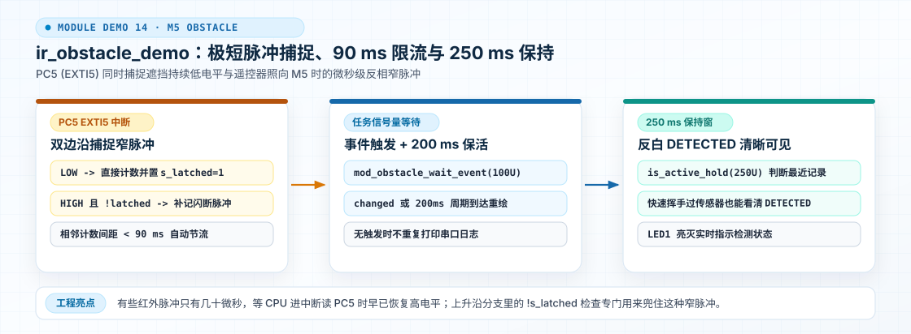

# 红外对管避障（ir_obstacle_demo）

对一个只有一根信号脚 `PC5` 的红外避障开关模块，大家可能会想：“不就是读一下 `HAL_GPIO_ReadPin` 看是不是低电平吗？”真拿工业产线计数器或快速红外脉冲测试就会发现两个痛点：**物体飞快掠过时，电平脉冲可能只有微秒级——CPU 进中断去读引脚时已经跳回高电平导致完全漏记；另外手指放探头前面刚要撤走时界面闪一下就消失，根本看不清触发状态**。`ir_obstacle_demo` 把这两处细节处理得相当到位。

通过本篇源码解析，你将掌握：
- **双边沿中断补记窄脉冲技巧**：理解 `obstacle_exti_cb()` 里的 `else` 分支为何用 `!s_latched` 就能把一闪而过没来得及踩到的低电平补记回来。
- **传感器采样节流 vs 人机界面视觉保持**：学会区分底层防连击节流窗口（`90 ms`）与前端画面视觉防闪烁保持窗（`250 ms`）。
- **变化触发打印（Event-driven Quiet Logging）**：如何在无遮挡时让串口安静，而在定期保持 `LED2` 与 OLED 旋转标照常存活。

## 工程结构与烧录

```powershell
.\.venv\Scripts\f407.exe flash ir_obstacle_demo
```

| 项目 | 说明 |
| --- | --- |
| 应用入口 | `applications/ir_obstacle_demo/src/main.c`（92 行） |
| 构建脚本 | `applications/ir_obstacle_demo/CMakeLists.txt`、`cmake/f407_app.cmake` |
| 核心驱动 | `platform/modules/mod_obstacle.c`、`platform/core/stm32f4xx_it.c`、`platform/bsp/oled_ui.c` |
| 硬件引脚与外设 | 底板 `M5` 插座：`PC5 (LM393 比较器输出, EXTI5 双边沿触发, 上拉输入, 低有效)` |
| FreeRTOS 机制 | 二进制信号量 `s_obs_sem` + Tick 差值限流（`90 ms`）+ `mod_obstacle_is_active_hold(250U)` |

## 运行原理与流程



1. **开启 `EXTI5` 上升与下降双边沿中断**：`mod_obstacle_init()` 通过 `bsp_exti_set_callback(5U, obstacle_exti_cb)` 注册回调函数，并配置 `PC5` 内部上拉（无障碍空闲时稳稳维持高电平）。
2. **中断捕捉持续遮挡与微秒瞬态窄脉冲**：一旦发生遮挡跳变，`PC5` 进入 `EXTI9_5_IRQHandler` 转入回调；无论是持续遮挡（下降沿 `low == true`）还是极其短暂的窄脉冲导致进中断时已跳回高电平（`else` 中 `!s_latched` 命中），只要距上次触发超过 `90 ms` 就计作 1 次有效命中，记录时间并释放 `s_obs_sem`。
3. **主任务低功耗守候并合并视觉保持窗**：任务在 `mod_obstacle_wait_event(100U)` 阻塞挂起；醒来后取出的不是瞬时毛刺电平，而是带有 **`250 ms` 视觉延时保持** 的状态 `mod_obstacle_is_active_hold(250U)`。
4. **静默日志与反白高亮提示**：仅当识别状态切换或命中总计数增长时才向串口打一行日志；同时维持每 `200 ms` 翻转核心板 `LED2` 与刷新右上角小动画图标。

## 源码逐段精讲（main.c）

### 1. 事件触发与 250 ms 视觉保持的合并循环

```c
    for (;;) {
        (void)mod_obstacle_wait_event(100U);

        bool detected = mod_obstacle_is_active_hold(250U);
        uint32_t hits = mod_obstacle_get_hits();
        bool changed = (detected != prev_detected) || (hits != prev_hits);

        if (changed) {
            printf("[OBSTACLE] %s (hits=%lu)\r\n",
                   detected ? "DETECTED" : "CLEAR", (unsigned long)hits);
            prev_detected = detected;
            prev_hits = hits;
            bsp_led_set(BSP_LED1, detected);
        }

        TickType_t now = xTaskGetTickCount();
        bool periodic = (now - last_hb) >= pdMS_TO_TICKS(200);
        if (periodic) {
            last_hb = now;
            bsp_led_toggle(BSP_LED2);
            ++tick;
        }

        if (changed || periodic) {
            render_obstacle_oled(detected, hits, tick);
        }
    }
```

- **看这行精妙的条件 `changed = (detected != prev_detected) || (hits != prev_hits)`**：假如有颗小球速度非常快地掠过探测区——第一拍刚触发保持窗口变为 `DETECTED (hits=1)`；紧接着在 250 ms 保持窗还没消退的 `120 ms` 后又滚过第二颗小球，此时 `detected` 依然是 `true` 没变，但 `hits` 已经变成了 `2`！由于加入了 `|| (hits != prev_hits)`，终端和 OLED 上的总命中计数 `Hits:002` 依然毫秒级不漏记、即时刷出来！

### 2. OLED 黑底白字全框反白高亮设计（`render_obstacle_oled`）

```c
    if (detected) {
        oled_ui_big_text_center(22, "DETECTED");
        oled_ui_invert_rect(8, 20, 112, 18);
    } else {
        oled_ui_rect(8, 20, 112, 18, true);
        oled_ui_big_text_center(22, "CLEAR");
    }
```

`oled_ui_invert_rect` 把指定矩形 `(8, 20, 112, 18)` 内的所有像素按位异或取反：先把大字 `"DETECTED"` 画在黑底上，再整个区域反转变成极度醒目的**亮白背景扣黑字**警报牌，远远扫一眼屏幕立刻能判别是否触发！

## 底层驱动与硬件解析

深入 `platform/modules/mod_obstacle.c`，学习核心的窄脉冲漏捕补偿与视觉保持算法：

```c
static void obstacle_exti_cb(void)
{
    bool low = (HAL_GPIO_ReadPin(GPIOC, GPIO_PIN_5) == GPIO_PIN_RESET);
    TickType_t now = xTaskGetTickCountFromISR();
    bool evt = false;

    if (low) {
        if (!s_has_trig || (uint32_t)(now - s_last_hit_tick) >= 90U) {
            s_hits = s_hits + 1U;
            s_last_hit_tick = now;
            s_has_trig = 1U;
        }
        s_latched = 1U;
        s_last_low_tick = now;
        evt = true;
    } else {
        /* Also catch ultra-short IR bursts whose LOW pulse already ended before ISR read PC5 */
        if (!s_latched && (!s_has_trig || (uint32_t)(now - s_last_hit_tick) >= 90U)) {
            s_hits = s_hits + 1U;
            s_last_hit_tick = now;
            s_last_low_tick = now;
            s_has_trig = 1U;
            evt = true;
        } else if (s_latched) {
            evt = true;
        }
        s_latched = 0U;
    }
```

- **逐分支剖析为什么用 `s_latched` 状态锁住下降沿**：
  1. **常规物体靠近**：`PC5` 从高变低并维持一阵。CPU 跳进中断读到 `low == true`，记录命中、更新 `s_last_low_tick = now`，把 `s_latched` 设为 `1`。等到物体移开上升沿再进中断时，由于之前早已认领过这次下降沿（`s_latched == 1`），`else` 分支只触发一次 UI 恢复通知且把 `s_latched` 复位为 `0`，**不会在离开时二次误加计数**。
  2. **超短红外脉冲闪断**：如果红外脉冲极窄，导致硬件已经抓住下降沿拉响 `EXTI5` 标志、但等 CPU 进入中断函数去执行 `HAL_GPIO_ReadPin(GPIOC, GPIO_PIN_5)` 时电平早已经弹回高电平了！如果代码写死只处理 `if (low)`，这发触发就被无声吞掉了；有了 `else` 里的 **`if (!s_latched && ...)`**——既然没进过下降沿（`s_latched == 0`）却莫名收到了硬件 `EXTI5` 边沿中断，必定是一道快到眨眼没抓到的低脉冲刚划过！于是立刻当场补加 `s_hits` 并刷新 `s_last_low_tick = now`。

再看前端保持函数：

```c
bool mod_obstacle_is_active_hold(uint32_t hold_ms)
{
    if (mod_obstacle_is_detected()) {
        return true;
    }
    ...
    return (uint32_t)(xTaskGetTickCount() - last_tick) < pdMS_TO_TICKS(hold_ms);
}
```

当前正在遮挡直接返回 `true`；即使物体刚撤走导致 `PC5` 回到高电平，只要距离最后一次低电平时间不到 `hold_ms`（`250 ms`），画面和指示灯就继续稳稳保持 `DETECTED` 满四分之一秒再利落回退为 `CLEAR`。

### 公开驱动 API 速查（`mod_obstacle.h`）

| 函数原型 | 参数说明 | 作用与返回值 |
| --- | --- | --- |
| `void mod_obstacle_init(void)` | 无参数 | 注册 `EXTI5 (PC5)` 双边沿回调、初始态采样与二值信号量 |
| `bool mod_obstacle_is_detected(void)` | 无参数 | 瞬时读取 `PC5` 是否正被拉低遮挡（低电平返回 `true`） |
| `bool mod_obstacle_wait_event(ms)` | 超时毫秒数 | 挂起等待任意边沿触发事件，醒来返回 `true` |
| `uint32_t mod_obstacle_get_hits(void)` | 无参数 | 关中断原子返回消抖节流后的累计触发总次数 |
| `bool mod_obstacle_is_active_hold(ms)` | 视觉保持时长（毫秒） | 若当前正被触发，或距离最近触发在 `ms` 内，则返回 `true` |

## 运行现象与常见问题

将 M5 红外对管模块插入底板，手掌、白纸在黑色双发光管前方 `2 ~ 20 cm` 挥过时，模块背后检测绿灯亮起，OLED 大字瞬间反白高亮 **`DETECTED`** 并叠加 `Hits` 计数器，核心板 `LED1` 同步亮起：

```text
ir_obstacle_demo: M5 on PC5 EXTI5 (LOW = obstacle/IR pulse detected)
[OBSTACLE] CLEAR (hits=0)
[OBSTACLE] DETECTED (hits=1)
[OBSTACLE] CLEAR (hits=1)
[OBSTACLE] DETECTED (hits=2)
```

| 现象 | 可能原因 | 排查方法 |
| --- | --- | --- |
| 模块上指示灯一直常亮，屏幕永远卡在 `DETECTED` | M5 灵敏度电位器顺时针拧太高过头，或对着阳光/强台灯干扰 | 用小螺丝刀缓慢逆时针微调模块上的**蓝色电位器**，恰好使对着前方空旷处时绿灯熄灭、手距离约 10 cm 时稳健点亮 |
| 手挥过去模块指示灯闪了一下，但 `Hits` 几乎没加？ | 确认信号脚 `PC5` 连接良好，或是否挥动速度远超出电位器当前低敏窗口 | 适当提高一点电位器探测距离即可让有效脉冲加宽加稳 |
| 为什么手明明放开很久，黑纸几乎不反光难触发？ | 黑色物体吸收绝大部分 940 nm 红外光 | 物理特性，红外反射避障对白纸/手掌极灵敏、对吸光哑光黑物质探测距离极近 |

## 进阶改造练习

### 练习 1：扩展成“流水线计数箱满报警与按键一键清零”系统

产线传感器往往需要配合复位清零以及每满 10 件提醒一下。直接在 `obstacle_task` 中加入 `hits_offset` 清零基准偏移量，按底板 `K1/KEY0` 复位当前批次数：

```c
        static uint32_t batch_offset = 0U;
        if (bsp_key_take_presses(BSP_KEY_K1) + bsp_key_take_presses(BSP_KEY0) > 0U) {
            batch_offset = mod_obstacle_get_hits();
            printf("[COUNTER] Batch counter cleared!\r\n");
        }
        uint32_t cur_batch = hits - batch_offset;
        if (cur_batch > 0U && (cur_batch % 10U) == 0U && changed) {
            printf("[COUNTER] Box Full Milestone: %lu items!\r\n", (unsigned long)cur_batch);
            bsp_led_set(BSP_LED2, true);
        } else if (cur_batch == 0U) {
            bsp_led_set(BSP_LED2, false);
        }
```

### 练习 2：试试用手边的电视/空调遥控器直接照向 M5 接收头

按一下遥控器照向 M5，观察即便 38 kHz 载波脉冲只有几十微秒宽，`Hits` 是否也能稳稳加一（由 `!s_latched` 窄脉冲捕获逻辑兜住）！

---

[上一篇：旋转编码器（rotary_encoder_demo）](../d13-rotary-encoder/README.md) · [下一篇：红外发射与接收（ir_tx_rx_demo）](../d15-ir-tx-rx/README.md) · [硬件接线与现象（第 10 课）](../../../quickstart/p1-10-红外对管避障检测/README.md) · [内置示例汇总](../../c09-apps-index-and-pitfalls/README.md)
