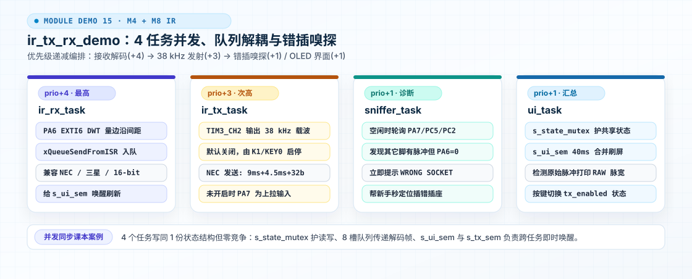

# 红外发射与接收（ir_tx_rx_demo）

`ir_tx_rx_demo` 是整套工程中**并发架构最完整、RTOS 同步原语运用最丰富**的压轴级示例：只靠一块主板，不仅能接收识别市面上绝大部分通用红外遥控器（NEC / 扩展 NEC / 三星引导 / 百问网 16-bit），还自带 **M4 38 kHz 红外发射自发自收验证**、**原始 40 对脉宽抓包分析**，甚至在后端运行着专门帮你查“是不是把模块插错插座”的 **物理引脚错插嗅探器**。代码用上了 4 个任务与消息队列、互斥锁、双二进制信号量完整并发通信体系！

通过本篇源码解析，你将掌握：
- **四任务并发编排与优先级层次**：理清接收（`+4`）、发射（`+3`）、嗅探诊断（`+1`）与界面融合（`+1`）为什么按这个优先级和栈深度切分。
- **FreeRTOS 三大通信原语的各自精准定位**：看透 **Queue**（ISR 向任务传输结构体帧）、**Mutex**（多任务共享状态结构保护与优先级继承）、**Binary Semaphore**（任务间按需即时秒级唤醒）的经典分工。
- **抗失真硬件解码算法**：推懂为什么测“相邻两次下降沿间隔”比死算单个低电平脉宽对一体化接收头的抗展宽容错率高得多。

## 工程结构与烧录

```powershell
.\.venv\Scripts\f407.exe flash ir_tx_rx_demo
```

| 项目 | 说明 |
| --- | --- |
| 应用入口 | `applications/ir_tx_rx_demo/src/main.c`（396 行） |
| 构建脚本 | `applications/ir_tx_rx_demo/CMakeLists.txt`、`cmake/f407_app.cmake` |
| 核心驱动 | `platform/modules/mod_ir.c`、`platform/core/stm32f4xx_it.c`、`platform/bsp/oled_ui.c` |
| 硬件引脚与外设 | 接收 `M8 -> PA6 (EXTI6, 内部上拉)`；发射 `M4 -> PA7 (TIM3_CH2 38 kHz, 默认休眠)` |
| FreeRTOS 机制 | 4 个并行任务 + `8 槽` 消息队列 `s_ir_rx_queue` + 互斥锁 `s_state_mutex` + 双信号量 |
| 硬件互斥提醒 | `M4 (红外发射)` 与 `M9 (蜂鸣器)` 共用 **`PA7`**，运行前请务必拔下 `M9` 蜂鸣器 |

## 运行原理与流程



先看整张系统四任务的“职责与优先级版图”：

| 任务名 | 优先级 | 栈深（字） | 睡眠唤醒条件 | 核心职责 |
| --- | --- | --- | --- | --- |
| `ir_rx` | **`+4`** | `384` | 死等队列 `s_ir_rx_queue` | 最高优先级：立刻出队 `EXTI6` 解码帧、闪 `LED2`、打日志并踢醒 UI |
| `ir_tx` | **`+3`** | `384` | `s_tx_sem`（开关与 450 ms） | 次高优先级：按需配置 `PA7` 并每 450 ms 发送标准 NEC 38 kHz 编码 |
| `sniff` | **`+1`** | `384` | `vTaskDelay(1)` / `50ms` 轮询 | 发射关闭且尚未收满过 `PA6` 边沿时，高频嗅探 `PA7/PC5/PC2` 告警错插 |
| `ir_ui` | **`+1`** | `640` | 信号量 `s_ui_sem` (40 ms 超时) | 处理按键开关发射、打印未解码的原始脉冲，加锁拷贝完整状态上屏 |

## 源码逐段精讲（main.c）

### 1. 四任务资源申请与共享数据结构防撕裂保护

```c
    s_state_mutex = xSemaphoreCreateMutex();
    s_ui_sem = xSemaphoreCreateBinary();
    s_tx_sem = xSemaphoreCreateBinary();
    configASSERT(s_state_mutex != NULL && s_ui_sem != NULL && s_tx_sem != NULL);

    ir_sniffer_pins_init();
    mod_ir_rx_init();

    configASSERT(xTaskCreate(ir_rx_task,   "ir_rx",   384U, NULL, tskIDLE_PRIORITY + 4U, NULL) == pdPASS);
    configASSERT(xTaskCreate(ir_tx_task,   "ir_tx",   384U, NULL, tskIDLE_PRIORITY + 3U, NULL) == pdPASS);
    configASSERT(xTaskCreate(sniffer_task, "sniff",   384U, NULL, tskIDLE_PRIORITY + 1U, NULL) == pdPASS);
    configASSERT(xTaskCreate(ui_task,      "ir_ui",   640U, NULL, tskIDLE_PRIORITY + 1U, NULL) == pdPASS);
```

- **看懂“状态结构体 + 互斥锁 + 局部变量快照”工业范式**：本工程中 `s_state` 包含了发送计数、接收计数、命令字、原始脉宽诊断及错插插座字符串共十几个字段，同时被 **4 个不同优先级的任务** 读写！查看 `render_ir_oled()` 第 225~228 行的极致优雅写法：

```c
    ir_state_t st;
    (void)xSemaphoreTake(s_state_mutex, portMAX_DELAY);
    st = s_state;
    (void)xSemaphoreGive(s_state_mutex);
```

**绝不拿着互斥锁去慢慢画 OLED 屏幕（刷一次屏要耗时 20 ms！）**——而仅仅拿着锁花微秒级速度把全局 `s_state` 整体浅拷贝给栈上局部变量 `st` 后就立刻放锁！既杜绝了屏上字符刚画到一半被高优先级 `ir_rx` 改一半导致的“半新半旧撕裂态”，又把持锁阻塞高优先级任务的时间压缩到了不足 1 微秒！

### 2. 安全懒初始化 `PA7` 发射引脚与开关瞬醒

看 `ir_tx_task` 如何靠 `s_tx_sem` 与状态位实现“默认绝不干扰空闲状态，一点即射”：

```c
        if (need_init) {
            mod_ir_tx_init();
        } else if (need_deinit) {
            mod_ir_tx_deinit();
        }

        if (enabled) {
            uint8_t cmd = cmds[idx];
            idx = (idx + 1U) % (sizeof(cmds) / sizeof(cmds[0]));

            mod_ir_tx_send_nec(IR_DEMO_ADDR, cmd);
            ...
            (void)xSemaphoreGive(s_ui_sem);
            (void)xSemaphoreTake(s_tx_sem, pdMS_TO_TICKS(450));
        } else {
            (void)xSemaphoreTake(s_tx_sem, portMAX_DELAY);
        }
```

- **为什么开机不直接配好 `TIM3_CH2` 输出，而是按需 `init` / `deinit`**：只要 `tx_enabled == false`，`PA7` 会一直保持上拉普通输入充当 **`sniffer_task` 的错插探针**（万一新手把接收头错插在 `M4` 上，能被立刻嗅探告警）；一旦用户按 `K1/KEY0` 在 `ui_task` 把开关打开并通过 `xSemaphoreGive(s_tx_sem)` 踢醒，任务才切进 `AF2_TIM3` 发射载波；关闭时再顺手还原上拉输入并挂死在 `portMAX_DELAY` 零耗电睡眠！

### 3. 新手诊断利器：插座防错插嗅探器（`sniffer_task`）

```c
        if (hit_pin != NULL && mod_ir_rx_get_edges() == 0U &&
            (uint32_t)(now - last_warn_tick) >= pdMS_TO_TICKS(500)) {
            last_warn_tick = now;
            printf("[IR-WARN] Pulse detected on %s (%s) instead of PA6 (M8)!\r\n",
                   hit_pin, hit_sock);
            (void)xSemaphoreTake(s_state_mutex, portMAX_DELAY);
            snprintf(s_state.wrong_sock, sizeof(s_state.wrong_sock), "%s", hit_sock);
            (void)xSemaphoreGive(s_state_mutex);
            (void)xSemaphoreGive(s_ui_sem);
        }
```

套件里 `M4 (PA7)`、`M5 (PC5)`、`M8 (PA6)` 外观非常像。如果接收头错插到旁边孔位，当你拿着遥控器死命按时，`PA6` 毫无动静但旁边的 `PA7/PC5/PC2` 却发生了跳变——`sniffer_task` 立马抓包并在 OLED 大字弹窗提示 **`CHECK PIN / Pulse on M5(PC5)`**，一秒排除硬件错插！

## 底层驱动与硬件解析

深入 `platform/modules/mod_ir.c`，看透 38 kHz 红外调制与防脉宽失真解码核心：

### 1. 38 kHz 载波生成与标准 NEC 编码调制

```c
    /* TIM3 clock = 84 MHz -> Period=2209 gives 84e6 / 2210 = 38.009 kHz */
    s_htim3_ir.Instance = TIM3;
    s_htim3_ir.Init.Prescaler = 0U;
    s_htim3_ir.Init.Period = 2209U;
    ...
    s_ir_carrier_pulse = 1105U; /* 50% duty at 38.009 kHz */
```

- **载波参数精算**：`TIM3` 输入频率 `84 MHz`，`Prescaler = 0`（不分频），`84,000,000 / 38,000 ≈ 2210.5`，故 `Period = 2209` 实际产生极其精准的 **`38.009 kHz`（占空比 `1105 / 2210 = 50%`）** 高频载波去驱动 M4 红外发光管。
- **为什么发“脉冲包 + 空白间隔”**：看 `mod_ir_tx_send_nec()`，发 `0` 时开启 38 kHz 载波 `560 us`（Mark）+ 关闭静默 `560 us`（Space）；发 `1` 时同样开载波 `560 us` + 静默 `1690 us`。32 位拼装严格遵循 NEC 小端规则：`[8b地址][8b地址反码][8b命令][8b命令反码]`。

### 2. 多协议下降沿周期解码状态机（抗收发失真核心）

```c
    /* Leader & repeat detection using falling-edge periods */
    if (dt_fall_us >= 12000U && dt_fall_us <= 16000U) {
        /* Standard NEC / Extended-NEC 9ms + 4.5ms leader */
        ...
    } else if (dt_fall_us >= 8000U && dt_fall_us <= 10200U &&
               s_last_low_us >= 3500U && s_last_low_us <= 5800U) {
        /* Samsung-style 4.5ms + 4.5ms leader */
        ...
    } else if (dt_fall_us >= 9800U && dt_fall_us < 12000U && s_last_low_us >= 7000U) {
        /* NEC repeat 9ms + 2.25ms */
        ...
    } else if (dt_fall_us >= 3000U && dt_fall_us <= 4300U &&
               s_last_low_us >= 1800U && s_last_low_us <= 3000U) {
        /* 100ask HPM6E70 16-bit protocol: 2.4ms + 1.2ms leader */
        ...
    } else if (s_rx_active) {
        uint32_t bit = 0U;
        if (dt_fall_us >= 700U && dt_fall_us <= 1680U) {
            bit = 0U;
        } else if (dt_fall_us > 1680U && dt_fall_us <= 2950U) {
            bit = 1U;
        }
```

| 识别协议类型 | 引导码整周期判定（`dt_fall_us`） | 位序列特征 | 校验与出队结果 |
| --- | --- | --- | --- |
| **标准 / 扩展 NEC** | `12.0 ~ 16.0 ms`（典型 `9 + 4.5 = 13.5 ms`） | 32 位 LSB 优先 | 提取 `addr`、`cmd` 并校验 `(b2 ^ b3) == 0xFF`（设 `nec_valid`） |
| **NEC 连发重码（Repeat）** | `9.8 ~ 12.0 ms` 且低脉宽 `≥ 7 ms` | 无数据位，距前次 `≤ 250 ms` | 复发上次有效帧并把 `.repeat = true` |
| **三星等同类协议** | `8.0 ~ 10.2 ms` 且低脉宽 `3.5 ~ 5.8 ms` | 32 位 LSB 优先 | 兼容不同前导时间的 32 位遥控器 |
| **百问网 16-bit 编码** | `3.0 ~ 4.3 ms` 且低脉宽 `1.8 ~ 3.0 ms` | 16 位 MSB 优先 | 固定填入地址 `0x100A`，同样验证命令+反码完整性 |

:::tip[为什么测 `dt_fall_us`（连续两次下降沿间隔）远远优于测低电平或高电平时长？]
红外接收头（1838/HS0038 等）内部包含放大、带通和积分鉴频器，输出低电平常有 `±150 us` 脉冲展宽失真——这意味着“低电平拉长了 150 us、随后的高电平就自然缩窄了 150 us”！然而，**一个完整周期从开始（第 1 个下降沿）到结束（第 2 个下降沿）的总耗时相加正好把一长一窄完全互相抵消！** 用一刀切 `1680 us` 界线区分标准 NEC `1125 us (0)` 与 `2250 us (1)`，容差高达 ±500 us，再差的杂牌遥控器也能一击必中！
:::

### 公开驱动 API 速查（`mod_ir.h`）

| 函数原型 | 参数说明 | 作用与返回值 |
| --- | --- | --- |
| `void mod_ir_tx_init(void)` / `deinit` | 无参数 | 动态切换 `PA7` 为 `TIM3` 38 kHz 载波发射态或退回上拉输入嗅探态 |
| `void mod_ir_tx_send_nec(addr, cmd)` | 8 位地址码与 8 位命令码 | 阻塞式利用 `bsp_delay_us` 按标 NEC 时序调制发出 32 位帧 |
| `void mod_ir_rx_init(void)` | 无参数 | 创建 `8 槽` `mod_ir_frame_t` 队列并使能 `PA6 (EXTI6)` 双边沿解码 |
| `bool mod_ir_rx_wait(out, ms)` | 输出解码帧指针、超时毫秒 | 任务挂起等待队列 `s_ir_rx_queue` 出队完整解码帧 |
| `bool mod_ir_rx_pop_raw_burst(out)` | 指向 `mod_ir_raw_burst_t` | 若收到过边沿且已空闲满 30 ms，弹出最多 40 对原始高低脉宽用于抓包分析 |
| `const char* mod_ir_key_name(cmd)` | 命令字字节 | 查表翻译常见百问网/NEC 遥控器按键英文名（未知返回 `NULL`） |

## 运行现象与常见问题

- **拿通用红外遥控器测试**：对准底板 `M8` 接收头按下，屏幕大号字符显示按键名与十六进制码（如 `PLAY 15` / `POWER 45`），串口立即弹出解码帧详情与 32 位原码：
```text
ir_tx_rx_demo: M8(PA6) RX + M4(PA7) TX [DIAGNOSTIC MODE]
[IR-DIAG] Ready! Idle levels: PA6(M8)=1 PA7(M4)=1 PC5(M5)=1 PC2(M2/10)=1
[IR RX #1] addr=0xFF00 cmd=0x45 (POWER) raw=0xBA45FF00
[IR RX #2] addr=0xFF00 cmd=0x45 (POWER REP) raw=0xBA45FF00
```
- **开启自发自收环回测试**：同时插上 `M4`（红外发射）与 `M8`（红外接收），把一张白纸放在两者正前方 `5~8 cm` 处斜反射红外线，按一次 `K1` 开启发送：
```text
[IR TX] M4 auto-TX ENABLED (press K1/KEY0 to toggle)
[IR RX #3] addr=0xDD22 cmd=0x10 (PING) raw=0xEF10DD22
```
*(由于发送 8 位地址 `0x22` 连带反码 `~0x22 = 0xDD` 按小端拼接，`mod_ir_rx` 输出的 16 位扩展地址为 `0xDD22`、`cmd=0x10 (PING)`。)*

| 现象 | 可能原因 | 排查方法 |
| --- | --- | --- |
| OLED 弹窗提示 `ERR WRONG SOCKET: Pulse on M5(PC5)` | 把接收模块错插到了 `M5` 避障口或 `M4` / `M2` 口 | 立刻断电拔下，确认三针红外接收头插在丝印 **`M8`**（`PA6`）插座 |
| 按某些冷门空调遥控器屏幕上显示 `RAW 28EDG` 并未出键名 | 空调红外帧长达数十上百位且编码机制完全不同于电视 NEC | 属于预期诊断设计：观察串口打印的 `[IR-RAW] L0=... H0=...` 真实脉宽即可看清任何冷门遥控器协议规律 |
| 按了 `K1` 后发不出自检信号、也不亮红外（手机摄像头看不到淡紫光） | 检查之前实验是否还忘着拔 `M9` 蜂鸣器，或是否把 M4 方向插反了 | 拔下 `M9`（共用 `PA7`）；可用手机自带相机镜头对准 M4 发射灯头肉眼观测淡紫红外闪烁 |

## 进阶改造练习

### 练习 1：把普通红外遥控器做成“双灯无线开关遥控器”

只需要在 `applications/ir_tx_rx_demo/src/main.c` 的 `ir_rx_task` 中加入按命令字 `frame.cmd` 的分支调度，即可无线遥控核心板硬件外设（注意先用串口看清你手里遥控器按键对应的 `cmd` 十六进制数）：

```c
        if (mod_ir_rx_wait(&frame, UINT32_MAX)) {
            if (!frame.repeat) {
                switch (frame.cmd) {
                case 0x45U: /* POWER: 同步切换两灯全亮或全灭 */
                    bsp_led_toggle(BSP_LED1);
                    bsp_led_toggle(BSP_LED2);
                    break;
                case 0x0CU: /* KEY 1: 翻转 LED1 */
                case IR_CMD_PING:
                    bsp_led_toggle(BSP_LED1);
                    break;
                case 0x18U: /* KEY 2: 翻转 LED2 */
                    bsp_led_toggle(BSP_LED2);
                    break;
                default:
                    break;
                }
            }
            ...
```

### 练习 2：理解为何高优先级的 `ir_rx` 能保住高频连发帧

对照上面 4 个任务优先级表：就算未来你在 `ui_task` 里加入大段计算让绘图耗时上升，也因为 `ir_rx (+4) > ir_ui (+1)` 的关系，每收到一帧红外解码瞬间就能立刻完成出队统计而不撑爆 8 槽队列。

---

[上一篇：红外对管避障（ir_obstacle_demo）](../d14-ir-obstacle/README.md) · [下一篇：W25Q64 Flash（w25q64_demo）](../d16-w25q64/README.md) · [硬件接线与现象（第 11 课）](../../../quickstart/p1-11-红外发射与接收通信/README.md) · [内置示例汇总](../../c09-apps-index-and-pitfalls/README.md)
