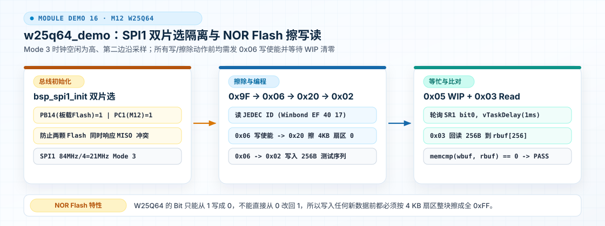

# W25Q64 Flash（w25q64_demo）

与普通掉电即失的 SRAM 不同，NOR Flash（如 M12 上的 `W25Q64JV`，容量 `64 Mbit = 8 MiB`）断电后数据依然完好保存，常用来存放字库、图片、固件升级包及掉电配置参数。更值得一提的是：DshanMCU-F407 **核心板背面焊着一颗板载 `GD25Q256`（片选 `PB14`）**，而底板 **M12 插座上的 `W25Q64`（片选 `PC1`）** 与它共享同一条高速 `SPI1 (PB3/PB4/PB5)` 总线。本示例完美演示了如何正确隔离双片选，并按标准 NOR Flash 状态机安全擦、写、读校验。

通过本篇源码解析，你将掌握：
- **共用 SPI1 总线双片选防碰撞准则**：理解为什么配 `SPI1` 引脚前就必须先把两颗芯片的 `CS` 拉高，否则总线一初始化 MISO 数据线就开始互掐。
- **NOR Flash 物理写特性（只能 `1→0`、必须先擦成 `0xFF`、256B 页边界不跨页）**：彻底明白写 Flash 前为什么不能像写数组那样直接覆盖字节。
- **把长达 50 ms 的扇区擦除等忙变成 OS 友好等待**：看懂 `w25q_wait_ready()` 如何用 `0x05` 读状态寄存器 + `vTaskDelay(1)` 在不阻塞其他任务的前提下精准捕捉写完时刻。

## 工程结构与烧录

```powershell
.\.venv\Scripts\f407.exe flash w25q64_demo
```

| 项目 | 说明 |
| --- | --- |
| 应用入口 | `applications/w25q64_demo/src/main.c`（130 行） |
| 构建脚本 | `applications/w25q64_demo/CMakeLists.txt`、`cmake/f407_app.cmake` |
| 核心驱动 | `platform/modules/mod_w25q64.c`、`platform/bsp/bsp_spi.c`、`platform/bsp/oled_ui.c` |
| 硬件引脚与外设 | `SPI1`: `PB3 (SCK)`、`PB4 (MISO)`、`PB5 (MOSI)`；`M12` 片选 `PC1`；板载 `GD25Q256` 片选 `PB14` |
| FreeRTOS 机制 | 内部擦除/写编程等待芯片忙位（WIP）清零期间调用 `vTaskDelay(1ms)` 让出 CPU |
| 硬件互斥提醒 | `PB3/PB4/PB5` 为高速 SPI 总线且含板载 Flash `PB14`，`bsp_spi1_init()` 会预先拉高两路片选避免冲突 |

## 运行原理与流程



1. **先锁后放，双片选安全就绪**：`mod_w25q64_init()` 内部调用 `bsp_spi1_init()`，在打开 SPI1 控制器前就先把 **`PB14`（板载 GD25Q256）和 `PC1`（底板 M12 W25Q64）同时推挽拉高**，确保同一时刻绝无两颗 Flash 同时开启输出级冲突。
2. **读 `JEDEC ID` 验明正身**：向 `PC1` 发出 `0x9F` 命令并接收 3 字节响应（Winbond W25Q64 标准为厂商 `0xEF`、存储器类型 `0x40`、容量码 `0x17`）。如果发现字节为 `0x00` 或 `0xFF`，说明模块未插稳，直接显示 `NO FLASH CHIP` 并 2 秒重探一次。
3. **写使能 + 4 KB 扇区擦除 + 非阻塞等忙**：每次确认芯片存在后，递增测试序列 `seq`，依次发出 `0x06`（写使能）→ `0x20 + 24 位地址`（擦除第 0 号 4 KB 扇区），然后周期查询 `SR1 bit0 (WIP)` 直到芯片擦成全 `0xFF`。
4. **页编程写入动态序列并读回逐字节比对**：再次发出 `0x06` → `0x02 + 地址 + 256 字节伪随机图案`，等编程完成并用 `0x03` 读回 256 字节到 `rbuf`，用 `memcmp(wbuf, rbuf, 256) == 0` 验证写入 100% 精确无误，每 3 秒执行一轮展示在 OLED 与串口。

## 源码逐段精讲（main.c）

### 1. 随序号变化的写入缓冲校验法

```c
static bool w25q64_verify_once(uint32_t seq)
{
    uint8_t wbuf[256];
    uint8_t rbuf[sizeof(wbuf)];

    wbuf[0] = 'W';
    wbuf[1] = '6';
    wbuf[2] = '4';
    wbuf[3] = (uint8_t)seq;
    for (size_t i = 4U; i < sizeof(wbuf); ++i) {
        wbuf[i] = (uint8_t)(seq * 7U + i);
    }

    if (!mod_w25q64_erase_sector_4k(W25Q_TEST_OFFSET)) { ... }
    if (!mod_w25q64_write_page(W25Q_TEST_OFFSET, wbuf, sizeof(wbuf))) { ... }
    if (!mod_w25q64_read(W25Q_TEST_OFFSET, rbuf, sizeof(rbuf))) { ... }
    if (memcmp(wbuf, rbuf, sizeof(wbuf)) != 0) {
        printf("[W25Q64] ERROR: verify mismatch\r\n");
        return false;
    }
```

- **动态图案破解假阳性隐患**：和 SRAM 校验同理，如果每 3 秒都往地址 `0x000000` 写死同一串 `"Hello"`，万一某天扇区擦除没成功或者写了半截卡死，读出来依然是上一轮残留的那串字，极易误报通过！将第 3 字节与后续全部 252 字节绑上 `seq * 7U + i`，确保每一轮 256 字节都彻底换了新模样，一比即真。
- **为什么任务栈配到了 `640U`**：查看局部变量 `wbuf[256]` + `rbuf[256]` 这一对缓冲区，在调用 `w25q64_verify_once()` 时一次性就要在当前任务栈上压入 **`512 字节`（`128 字`）** 的数组，再加上 OLED 打印缓冲和 HAL SPI 嵌套深度，`512U` 偏紧，而 `640U`（`2560 B`）留出非常安全的栈余量。

## 底层驱动与硬件解析

### 1. 共用 SPI1 双片选隔离与 Mode 3 配置（`bsp_spi.c`）

```c
    /* Chip-select pins idle high to avoid bus contention on shared SPI1 */
    HAL_GPIO_WritePin(GPIOB, GPIO_PIN_14, GPIO_PIN_SET);
    HAL_GPIO_WritePin(GPIOC, GPIO_PIN_1, GPIO_PIN_SET);
    ...
    hspi1.Init.CLKPolarity = SPI_POLARITY_HIGH;
    hspi1.Init.CLKPhase = SPI_PHASE_2EDGE;
    hspi1.Init.NSS = SPI_NSS_SOFT;
    hspi1.Init.BaudRatePrescaler = SPI_BAUDRATEPRESCALER_4;
```

- **时钟速度与工作模式详解**：
  - `SPI1` 挂载在高速 `APB2 (84 MHz)` 总线上，分频系数选 `4`，得出整整 **`21 MHz` 读写时钟**（读写 256 字节一页理论仅需 ~100 微秒！）。
  - 选择 **`SPI Mode 3`**（`CPOL=HIGH`, `CPHA=2EDGE`）：W25Q64 支持 Mode 0 和 Mode 3，而在杜邦线或插座走线较长时，让时钟线空闲维持高电平且在上升沿锁存采样通常具有比 Mode 0 更强的抗地弹噪声能力。
  - **严格保持 `PB14 = HIGH`**：在 `mod_w25q64_init()` 与每次 `read_jedec()` 之前都再确认一次 `bsp_spi_core_flash_cs(false)`，彻底隔绝核心板那颗更大的 `GD25Q256`。*(若日后你想在同一板卡上驱动板载 `GD25Q256`，只需在发命令期间拉高 `PC1`、拉低 `PB14` 即可无缝在同一组 `SPI1` 总线上来回切换！)*

### 2. W25Q64 芯片结构与全命令状态机（`mod_w25q64.c`）

这颗 `8 MiB` Flash 内部严格按四级物理层级切分：`128 块 (Block, 64 KB)` → 每块 `16 扇区 (Sector, 4 KB)` → 每扇区 `16 页 (Page, 256 B)`。因为硬件充电泵原理，Flash 拥有**最小擦除单位是 `4 KB 扇区`、最大一次连写单位是 `256 B 页`** 的物理铁律：

| 指令码 | 指令全称 | 协议帧结构与约束 |
| --- | --- | --- |
| `0x9F` | Read JEDEC ID | 发 1B 命令 → 连续读 3B（Winbond W25Q64 = `EF 40 17`） |
| `0x06` | Write Enable (WREN) | 单字节独立片选传输；**每次擦除或写页之前必须重发一次** |
| `0x20` | Sector Erase (4 KB) | `0x20` + 24 位大端地址；把所属整个 4096 字节全刷成 **`0xFF`** |
| `0x02` | Page Program | `0x02` + 24 位地址 + `1~256` 字节数据（超出当前 256 B 页尾会自动回卷覆盖页首！） |
| `0x03` | Read Data | `0x03` + 24 位地址 + 连续读任意长数据（无跨页限制） |
| `0x05` | Read SR1 | 读 状态寄存器 1，`bit 0 (WIP)` 为 `1` 表示内部正在高压擦写忙，清 `0` 才可接收下步指令 |

看看驱动怎样等 `WIP` 忙位清零而不卡死调度器：

```c
static bool w25q_wait_ready(uint32_t timeout_ms)
{
    uint8_t cmd = W25Q_CMD_READ_SR1;
    uint8_t sr = 0xFFU;
    uint32_t elapsed = 0U;

    while (elapsed < timeout_ms) {
        bsp_spi_ext_flash_cs(true);
        HAL_StatusTypeDef st = HAL_SPI_Transmit(&hspi1, &cmd, 1U, 20U);
        if (st == HAL_OK) {
            st = HAL_SPI_Receive(&hspi1, &sr, 1U, 20U);
        }
        bsp_spi_ext_flash_cs(false);
        if (st == HAL_OK && (sr & 0x01U) == 0U) {
            return true;
        }
        vTaskDelay(pdMS_TO_TICKS(1));
        ++elapsed;
    }
    return false;
}
```

一次 4 KB 扇区擦除物理耗时通常达 `40 ~ 60 ms`。在 `while` 循环末尾挂入 `vTaskDelay(pdMS_TO_TICKS(1))`，既能在 1 ms 颗粒度内迅速把握完结时刻，又把宝贵的 `40 ms` CPU 运行期全部释放给别的低优先级业务或音频刷新任务！

### 公开驱动 API 速查（`mod_w25q64.h` & `bsp_spi.h`）

| 函数原型 | 参数说明 | 作用与返回值 |
| --- | --- | --- |
| `bool mod_w25q64_init(jedec)` | 3 字节厂商/容量 ID 数组输出 | 初始化并隔离双 SPI 片选，探测读取 JEDEC ID 正常返回 `true` |
| `bool mod_w25q64_read_jedec(jedec)` | 3 字节数组输出 | 独立读取当前插上 M12 芯片的三字节身份码 |
| `bool mod_w25q64_erase_sector_4k(addr)` | 4 KB 对齐地址 | 使能写并整块擦除 4 KB 扇区至全 `0xFF`，等待 `WIP` 清零后返回 |
| `bool mod_w25q64_write_page(addr, buf, len)` | 页内偏移、`len <= 256` | 页编程写入一页内最多 256 B 数据并等待 `WIP` 清零 |
| `bool mod_w25q64_read(addr, buf, len)` | 起始地址、接收缓冲、任意长度 | 从任意地址起高速连读出指定字节内容 |
| `void bsp_spi_core_flash_cs(sel)` | `true`=拉低选中，`false`=释放 | 显式片选或隔离核心板背面自带的 `GD25Q256 (PB14)` |

## 运行现象与常见问题

将 W25Q64 SPI Flash 模块插到底板 `M12`，烧录后 OLED 首排展示实测 JEDEC ID `EF4017`（若芯片为兼容替代厂可能显示其他合法厂商码如 `C84017` 等），中间显示 `Erase > Write > Read`，底部徽章亮出 **`PASS`** 并每 3 秒递增序号：

```text
w25q64_demo: M12 SPI1 CS=PC1 JEDEC=EF 40 17 present=1
[W25Q64] PASS seq=1 256B data=57363401...
[W25Q64] PASS seq=2 256B data=57363402...
```

*(十六进制 `57 36 34 01` 正是 ASCII 码 `'W' '6' '4'` 与序列号 `0x01`。)*

| 现象 | 可能原因 | 排查方法 |
| --- | --- | --- |
| 报错 `probe failed (JEDEC=FF FF FF)` 或 `00 00 00` | M12 未插牢、插偏一针，或者误用了软件复位造成片选紊乱 | 检查 M12 8 针双排/单排插槽管脚丝印对位；确保没有拔错位置 |
| 忘记先擦除直接往写过非 `0xFF` 数据的页再写新数据结果出错 | 违反 NOR Flash 只允许 `bit 1 → 0` 不能 `0 → 1` 的物理原则 | 往已写过数据的位置更新任何内容前，**必须先调 `mod_w25q64_erase_sector_4k()` 把所在 4 KB 擦回 `0xFF`** |
| 长期通电不拔电源会不会把测试芯片写坏？ | W25Q64 单扇区擦写寿命典型为 `10 万次` | 本示例间隔 3 秒测试一轮，连续通电 3 天才跑完一次，教学完全放心；做真实配置记忆模块时切记**只在上电或配置真变化时才写入** |

## 进阶改造练习

### 练习 1：打造“断电也不丢失的系统开机次数记录器”

把原本“每 3 秒无脑全擦重写第 0 扇区”改写成真正有用的工程小工具——开机只上电读出存在 `0x000000` 处的结构体，把 `boot_count` 加 `1` 后再擦写保存回去！你拿手指拔掉电源再重新上电，串口打印的 `Boot Count` 会一分不差持续增长：

```c
typedef struct {
    uint32_t magic;      /* 固定魔数 0x5A5AA5A5 判别是不是第一次烧好未写入的新芯片 */
    uint32_t boot_count; /* 累计上电运行次数 */
} boot_cfg_t;

static void update_persistent_boot_counter(void)
{
    boot_cfg_t cfg = {0};
    if (mod_w25q64_read(0x000000UL, (uint8_t *)&cfg, sizeof(cfg))) {
        if (cfg.magic != 0x5A5AA5A5UL) {
            cfg.magic = 0x5A5AA5A5UL;
            cfg.boot_count = 1U;
        } else {
            ++cfg.boot_count;
        }
        (void)mod_w25q64_erase_sector_4k(0x000000UL);
        (void)mod_w25q64_write_page(0x000000UL, (const uint8_t *)&cfg, sizeof(cfg));
        printf("[NV-CFG] Persistent Boot Count = %lu\r\n", (unsigned long)cfg.boot_count);
    }
}
```

### 练习 2：利用同一个总线读一把核心板自带的 `GD25Q256` JEDEC ID

对照 `bsp_spi.c`，你能不能动手在工程里加一个函数：先调 `bsp_spi_ext_flash_cs(false)` 关闭 `PC1`，再调 `bsp_spi_core_flash_cs(true)` 选通 `PB14`，发出 `0x9F` 亲眼看看核心板背后那颗 32 MB 大 Flash 的真实厂商 ID？

---

[上一篇：红外发射与接收（ir_tx_rx_demo）](../d15-ir-tx-rx/README.md) · [下一篇：DRV8833 直流电机（motor_demo）](../d17-motor/README.md) · [硬件接线与现象（第 12 课）](../../../quickstart/p1-12-W25Q64外部Flash读写/README.md) · [内置示例汇总](../../c09-apps-index-and-pitfalls/README.md)
