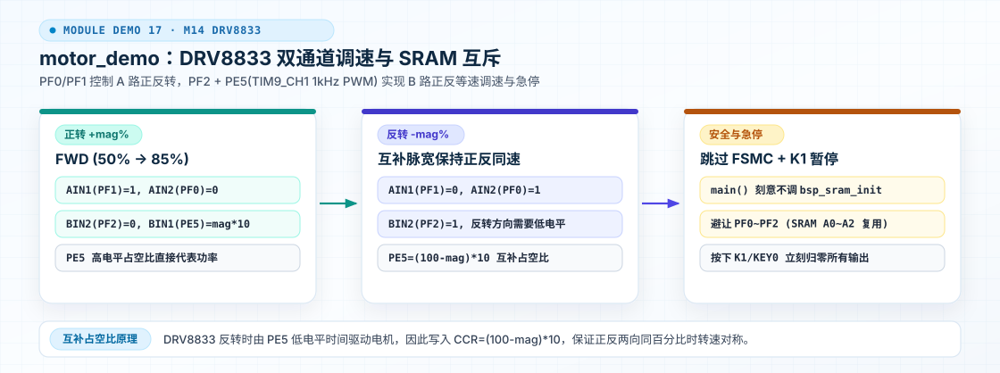

# DRV8833 直流电机（motor_demo）

与控制小灯、读取几毫安的传感器不同，驱动有刷直流电机同时涉及高电流外设、双通道 H 桥逻辑电平组合以及最讲究实战经验的两个工程细节：**当硬件引脚跟外部存储（FSMC SRAM `PF0~PF2`）撞脚时如何在软件侧干净拆解避让**，以及**只有一根引脚带 PWM 时怎样靠互补脉宽魔法保证正转 `50%` 和反转 `-50%` 转速严格一模一样**。

通过本篇源码解析，你将掌握：
- **引脚冲突的主动避让哲学**：看懂为什么 `motor_demo` 在 `main()` 里特意不调用 `bsp_sram_init()`，理解板级资源的按需裁剪原则。
- **`APB2` 168 MHz 定时器与 `APB1` 的区别**：对比前面 `84 MHz` 的 `TIM2/3`，算清楚挂在高速 `APB2` 上的 `TIM9 (PE5)` 为何预分频要写成 `167`（而不是 `83`）。
- **H 桥互补 PWM 反相补偿公式**：推导通道 B 在 `BIN2=1` 反转时的低电平驱动占比 `(100 - mag) * 10`，消除了许多新手电机“正转狂飙、反转无力”的常见通病。

## 工程与烧录

```powershell
.\.venv\Scripts\f407.exe flash motor_demo
```

| 项目 | 说明 |
| --- | --- |
| 应用入口 | `applications/motor_demo/src/main.c`（127 行） |
| 构建脚本 | `applications/motor_demo/CMakeLists.txt`、`cmake/f407_app.cmake` |
| 核心驱动 | `platform/modules/mod_motor.c`、`platform/bsp/bsp_key.c`、`platform/bsp/oled_ui.c` |
| 硬件引脚与外设 | `M14` 芯片连线：`AIN2=PF0`、`AIN1=PF1`、`BIN1=PE5 (TIM9_CH1)`、`BIN2=PF2`；接 `J5` 或直插模块输出端子 |
| FreeRTOS 机制 | `100 ms` 事件等待 + 档位计时状态机 + 急停键 `s_estop` |
| 硬件互斥提醒 | `PF0~PF2` 与核心板外部 SRAM `A0~A2` 地址线完全复用，**绝对不可同时调用 `bsp_sram_init()`** |

## 运行流程



1. **刻意跳过 FSMC，仅初始化必需外设**：`main()` 先只执行 `board_init()`（其内部仅配系统时钟、`LED`、`KEY`、`UART`，**不会**去动 `PF0~PF2` 的 FSMC 复用），紧接着交由 `motor_task` 初始化屏幕与 DRV8833 驱动脚。
2. **表驱动 6 档测试序列**：`k_steps[]` 定义了“滑行停机 → 正转 `+50%` → 正转 `+85%` → 刹车停机 → 反转 `-50%` → 反转 `-85%`”及每档停留时长 `hold_ms`。
3. **随叫随停的一键急停开关**：循环每次都在 `bsp_key_wait_event(100U)` 上等待——未按下按键每 `100 ms` 唤醒推进步序和 `200 ms` 刷屏；一旦按下 `K1` 或 `KEY0`（奇数次有效），瞬间将 `s_estop = true` 并调用 `mod_motor_set_speed(0)` 断电滑停，恢复后将当前步序从头开始计时保证不跃档。
4. **双指示灯反馈方向与中心条**：核心板 `LED1` 指示正转、`LED2` 指示反转，即便暂无电机接入只接核心板+底板也能借助双灯与 OLED 正负速度进度条确认波形时序。

## 主程序解析

### 档位步进与启停控制

```c
typedef struct {
    int speed_pct;
    uint32_t hold_ms;
    const char *label;
} motor_step_t;

static const motor_step_t k_steps[] = {
    {   0, 1200U, "STOP (Coast)"},
    {  50, 2000U, "FWD  +50%"},
    {  85, 2000U, "FWD  +85%"},
    {   0, 1200U, "BRAKE / STOP"},
    { -50, 2000U, "REV  -50%"},
    { -85, 2000U, "REV  -85%"},
};
```

```c
        if ((btn_hits & 1U) != 0U) {
            s_estop = !s_estop;
            if (s_estop) {
                mod_motor_set_speed(0);
            } else {
                step_started = false;
            }
            printf("[MOTOR] pause=%s\r\n", s_estop ? "ON" : "OFF");
            force_ui = true;
        }
```

- **看第 79 行细微又体贴的一句 `step_started = false`**：假设电机正停在 `FWD +85%` 这一步被你按了暂停休息 5 秒，松手解除暂停后如果直接拿当前 `now - step_start` 一算早已大大超过 `2000 ms`，立刻就跳切到了下一个状态！把 `step_started` 复位为 `false` 会强迫状态机重新调用 `mod_motor_set_speed` 起动并从当下刻起走满整整 2 秒。

## 驱动解析

深入 `platform/modules/mod_motor.c`，揭秘 `APB2 TIM9` 分频参数和正反转互补占空比的数学推导：

### TIM9 定时器配置

```c
    /* TIM9 on APB2 (168 MHz timer clock): PSC=167 -> 1 MHz, ARR=999 -> 1 kHz PWM */
    s_htim9_motor.Instance = TIM9;
    s_htim9_motor.Init.Prescaler = 167U;
    s_htim9_motor.Init.CounterMode = TIM_COUNTERMODE_UP;
    s_htim9_motor.Init.Period = 999U;
```

千万要留神**定时器挂载总线的不同基准频率**：前面第 2 课 RGB 和第 3 课蜂鸣器用的 `TIM2`、`TIM3` 挂在较慢的 `APB1 (42 × 2 = 84 MHz)`，预分频只要配 `83` 就得 `1 MHz`；而 `TIM9` 属于高速外设总线 **`APB2 (84 × 2 = 168 MHz)`**！所以想同样分出 `1 MHz` 计数频率再配 `ARR=999` 出 **1 kHz 静音 PWM**，这里的预分频就必须写 **`167U`**（`168,000,000 / 168 = 1,000,000 Hz`）。

### 正反转 PWM 占空比

先读 `mod_motor_set_speed()` 实现：

```c
    if (speed_pct > 0) {
        /* Channel A forward: AIN1=1(PF1), AIN2=0(PF0) */
        HAL_GPIO_WritePin(GPIOF, GPIO_PIN_1, GPIO_PIN_SET);
        HAL_GPIO_WritePin(GPIOF, GPIO_PIN_0, GPIO_PIN_RESET);
        /* Channel B forward: BIN2=0(PF2), BIN1(PE5)=PWM duty */
        HAL_GPIO_WritePin(GPIOF, GPIO_PIN_2, GPIO_PIN_RESET);
        __HAL_TIM_SET_COMPARE(&s_htim9_motor, TIM_CHANNEL_1, (uint32_t)(speed_pct * 10));
    } else if (speed_pct < 0) {
        int mag = -speed_pct;
        /* Channel A reverse: AIN1=0(PF1), AIN2=1(PF0) */
        HAL_GPIO_WritePin(GPIOF, GPIO_PIN_1, GPIO_PIN_RESET);
        HAL_GPIO_WritePin(GPIOF, GPIO_PIN_0, GPIO_PIN_SET);
        /* Channel B reverse: BIN2=1(PF2), BIN1(PE5) active-low fraction = (100 - mag)% HIGH */
        HAL_GPIO_WritePin(GPIOF, GPIO_PIN_2, GPIO_PIN_SET);
        __HAL_TIM_SET_COMPARE(&s_htim9_motor, TIM_CHANNEL_1, (uint32_t)((100 - mag) * 10));
    } else {
        /* Stop / Coast: all IN pins LOW */
        HAL_GPIO_WritePin(GPIOF, GPIO_PIN_0 | GPIO_PIN_1 | GPIO_PIN_2, GPIO_PIN_RESET);
        __HAL_TIM_SET_COMPARE(&s_htim9_motor, TIM_CHANNEL_1, 0U);
    }
```

看看为什么需要做这手反相补偿。根据 DRV8833 芯片真值表（通道 B 输出看 `BIN1 = PE5` 与 `BIN2 = PF2` 两脚关系）：
- **当 `BIN1=1, BIN2=0`**：电机**正转**；
- **当 `BIN1=0, BIN2=1`**：电机**反转**；
- **当 `BIN1=1, BIN2=1`**：两端同时接地或刹车制动（**不供电反扭转**）；
- **当 `BIN1=0, BIN2=0`**：高阻滑行停止。

由于底板上通道 B **只有 `PE5 (BIN1)` 接在硬件定时器 PWM 上**，而 `PF2 (BIN2)` 是普通高低开关 IO：

| 运动方向 | `BIN2 (PF2)` | `BIN1 (PE5)` 占空比 | 有效驱动说明 |
| --- | --- | --- | --- |
| 正转 `+mag%` | `0` (低电平) | `mag * 10` | `PE5` 高电平比例即输出功率 |
| 反转 `-mag%` | `1` (高电平) | `(100 - mag) * 10` | `PE5` 低电平比例即输出功率 |
| 停止 `0` | `0` (低电平) | `0` | `IN1=IN2=0` 滑行停机 |

**一目了然**：反转时固定让 `PF2 = 1`，那么只有当 `PE5` 处于**低电平**的时间段（`BIN1=0, BIN2=1`）电机才真正反向通电加速！假设希望反向功率为 `mag = 20%`（也就是要求 `PE5` 低电平占 `20%`），那么用向上计数默认高极性 PWM 时，高电平时间就正好等于剩下的 `100% - 20% = 80%`，即写 `CCR = (100 - 20) * 10 = 800`！这正是嵌入式控制里最经典的单脚 PWM 反相换算技巧。

*(而通道 A `PF1/PF0` 均不支持硬件 PWM，所以驱动以固定全速高低电平方向配合输出；把普通直流电机接在 `BO1/BO2 (J5 对应通道)` 即可真实感受无级调速与正反对称转速！)*

### 驱动接口速查

头文件：`mod_motor.h`

| 函数原型 | 参数说明 | 作用与返回值 |
| --- | --- | --- |
| `void mod_motor_init(void)` | 无参数 | 初始化 `PF0~2`、`PE5 (AF3_TIM9)` 1 kHz PWM 并安全停机（**禁止配 FSMC SRAM**） |
| `void mod_motor_set_speed(pct)` | `-100 ~ +100` 速度百分比（`0` 为停转） | 自动限幅并切换正反转开关与互补占空比 |

## 现象与排查

将直流电机与 M14 驱动模块正确连接底板后，接上足额供电运行程序，可以看到扇叶正转两档加速、稳步停下刹住、随后同样转速档位流畅反转；按 `K1/KEY0` 电机立刻息止停转并让 OLED 标题显示 `MOTOR [PAUSED]`：

```text
motor_demo: M14 DRV8833 (AO1/AO2 & BO1/BO2), press K1/KEY0 to pause/resume
[MOTOR] STOP (Coast) (duty=+0%)
[MOTOR] FWD  +50% (duty=+50%)
[MOTOR] FWD  +85% (duty=+85%)
[MOTOR] BRAKE / STOP (duty=+0%)
[MOTOR] REV  -50% (duty=-50%)
```

| 现象 | 可能原因 | 排查方法 |
| --- | --- | --- |
| 电机一上电或者转动半截突然核心板串口重启 / 屏灭 | USB 口或计算机主板口电流太弱，电机堵转/瞬态启动电流拽垮了 `5 V` | 请换用供电充足的双口/独立 `5 V / 2 A` 电源或带独立电源的扩展供电口给底板 `5 V` 供电，切莫仅挂着虚弱细 USB 线猛测重负载电机 |
| 接在另一组端子上发现总是直接全速转，不能 `50%/85%` 调速？ | **接在了通道 A（`PF0/PF1` 纯 IO 口）** 上 | 请查看模块与底板对应接入 **通道 B（`PE5 TIM9_CH1` PWM 通道）** 的输出端子或 `J5` 接口实现平滑变速 |
| 在自己项目里合并使用 SRAM 与电机导致两者都不工作？ | 二者物理上硬件引脚共用 `PF0~PF2` | 请遵循同一时间只择其一方案；若确需同时大内存与电机，只能改用软件扩展或把其中一个模块外飞线改脚 |

## 扩展练习

### 软启动斜坡加速

平时从 `0%` 直接跃变 `+85%` 会产生几倍于正常转速的大启动电流（容易引发电源电压瞬间跌落复位板子）。写一个每 `50 ms` 加减 `10%` 慢慢爬坡的小函数平滑过渡目标速度：

```c
static void motor_ramp_to(int target_pct)
{
    static int cur_pct = 0;
    while (cur_pct != target_pct && !s_estop) {
        if (cur_pct < target_pct) {
            cur_pct = (cur_pct + 10 > target_pct) ? target_pct : (cur_pct + 10);
        } else {
            cur_pct = (cur_pct - 10 < target_pct) ? target_pct : (cur_pct - 10);
        }
        mod_motor_set_speed(cur_pct);
        vTaskDelay(pdMS_TO_TICKS(50));
    }
    if (s_estop) {
        cur_pct = 0;
        mod_motor_set_speed(0);
    }
}
```

### 指示灯状态联动

即便把电机马达先拆开不接大负载，光靠观察 `LED1`（正转亮）和 `LED2`（反转亮）以及 OLED 双向进度条，也可以先在桌面放心调通全套 FreeRTOS 控制逻辑和键盘急停状态机再挂物理机械结构！

---

[上一篇：W25Q64 Flash（w25q64_demo）](../d16-w25q64/README.md) · [下一篇：SG90 舵机控制（servo_demo）](../d18-servo/README.md) · [硬件接线与现象（第 13 课）](../../../quickstart/p1-13-DRV8833直流电机驱动/README.md) · [内置示例汇总](../../c09-apps-index-and-pitfalls/README.md)
