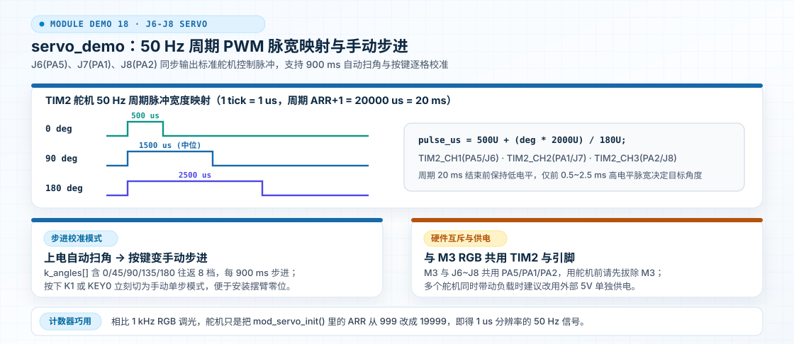

# SG90 舵机控制（servo_demo）

对有刷直流电机，我们用高速 PWM 的百分比平均电压调节转多快；而面对 **SG90 180° 位置舵机** 时，决定摆臂指向哪一个精确角度的，却既不是频率高低，也不是供电电压大小，而是一个全世界航模界通用的脉宽协议：**把周期严格固定为 `20 ms (50 Hz)`，只看周期开头那一截高电平持续多少微秒（`500 us` 对应 `0°`、`1500 us` 对应 `90°`、`2500 us` 对应 `180°`）**。

通过本篇源码解析，你将掌握：
- **把第 2 课与本课 `TIM2` 初始化代码放一起对比看透定时器本质**：理解只改了 `ARR` 与极性两行参数，同一组芯片引脚怎么从 1 kHz 彩色调光摇身变成 50 Hz 舵机精密控制线。
- **嵌入式整数“先乘后除”精度保卫战**：算清楚为什么写成 `500 + (deg * 2000) / 180` 可以严丝合缝卡进 `2500 us` 端点，而先除 `deg * (2000 / 180)` 会少 20 微秒误差。
- **机械臂装配必备单步手动模式**：掌握如何使用 `Auto ↔ Step` 切换在拧上塑料摇臂螺丝前精准打到 `0°` / `90°` 机械零位。

## 工程与烧录

```powershell
.\.venv\Scripts\f407.exe flash servo_demo
```

| 项目 | 说明 |
| --- | --- |
| 应用入口 | `applications/servo_demo/src/main.c`（94 行） |
| 构建脚本 | `applications/servo_demo/CMakeLists.txt`、`cmake/f407_app.cmake` |
| 核心驱动 | `platform/modules/mod_servo.c`、`platform/bsp/bsp_key.c`、`platform/bsp/oled_ui.c` |
| 硬件引脚与外设 | 底板三路 3 针排针：`J6 (PA5, TIM2_CH1)`、`J7 (PA1, TIM2_CH2)`、`J8 (PA2, TIM2_CH3)` |
| FreeRTOS 机制 | 事件等待合并（900 ms 自动往返扫角 ↔ `K1/KEY0` 单步校准步进） |
| 硬件互斥提醒 | `PA5/PA1/PA2` 与 **`M3` RGB 全彩 LED** 共用引脚与 `TIM2`，用舵机前务必拔除 `M3` |

## 运行流程



1. **配置 1 微秒精准计时尺**：`mod_servo_init()` 开启 `TIM2`（84 MHz / 84 分频 = **每 tick 精确代表 `1 us`**），并设定周期 `ARR = 19999` 凑出严格的 `20000 us = 20 ms`（`50 Hz`），开机先稳妥停在中位 `1500 us`（`90°`）。
2. **往返扫角序列初始化**：紧接着 `servo_task` 指向测试角度表第 `0` 项 `0°`（`500 us`），通过通道 1、2、3 同步输出脉冲，并打印当前角度与真实脉宽微秒数。
3. **自动扫描或手动装机校准**：默认以 `900 ms` 间隔在 `0 → 45 → 90 → 135 → 180 → 135 → 90 → 45` 之间来回摆动（足够给机械齿轮留出到位缓冲时间）；一旦按下 `K1` 或 `KEY0` 立刻锁死在手动模式（`SERVO [STEP]`），按一下只精确步进一档。
4. **OLED 大字显示与角度进度条**：蓝区大字醒目呈现当前角度与精准微秒数（如 `PWM:1500us 50Hz`），下方进度条按 `(deg * 1000) / 180` 精准直观映出摆臂当前位置百分比。

## 主程序解析

### 角度序列与到位延时

```c
static const uint8_t k_angles[] = {0U, 45U, 90U, 135U, 180U, 135U, 90U, 45U};
...
        if (steps > 0U) {
            manual = true;
            idx = (idx + steps) % (sizeof(k_angles) / sizeof(k_angles[0]));
            moved = true;
        } else if (!manual && (now - last_auto) >= pdMS_TO_TICKS(900)) {
            last_auto = now;
            idx = (idx + 1U) % (sizeof(k_angles) / sizeof(k_angles[0]));
            moved = true;
        }
```

- **为什么不每 100 ms 切一次 `0° → 180°`？**：小舵机空载转 `60°` 典型速度也要 `0.12 秒` 左右，带机械负载更慢；每次转 `45°` 故意留足 `900 ms`，既让你看清每一个标准角度刻度停留的位置，又避免了舵机内部直流电机长期堵转过热消耗电流。
- **装配机械臂时的黄金工作流**：通电看着它自动转两圈，趁屏幕上显示 **`90 deg`**（`1500 us` 正中位）或者自己按下 `K1` 切进手动单步停在 `90 deg` 之后，再把白色塑料摆臂拧紧固定到舵机齿轮花键轴上，装出来的机器人/云台两侧行程才能严格左右对称不撞限位。

### 归中初始化与主循环

```c
    (void)oled_ui_init();
    mod_servo_init();
    mod_servo_set_angle(k_angles[0], &pulse_us);
    printf("\r\nservo_demo: J6(PA5)/J7(PA1)/J8(PA2) 50Hz PWM, press K1/KEY0 to step\r\n");
    printf("[SERVO] angle=%3u deg pulse=%lu us (AUTO)\r\n",
           (unsigned)k_angles[0], (unsigned long)pulse_us);
    render_servo_oled(k_angles[0], pulse_us, manual, tick);
```

- **开机即刻写入第 1 档位置并刷新**：在进 `for (;;)` 循环之前立即设角 `0°`、打印并画第 1 帧屏，避免上电先出现 `900 ms` 空白窗口；主循环复用第 2 课 RGB 例程同款的“100 ms 等信号量 + `900 ms` 自动步进 / `200 ms` OLED 标题动画”双时间尺。

## 驱动解析

### TIM2 定时器参数配置

打开 `platform/modules/mod_rgb_led.c` 与 `platform/modules/mod_servo.c` 放到同一屏下看，先读初始化代码，再看参数对照表就能秒懂 STM32 通用定时器的复用本质：

```c
    /* TIM2 clock = 84 MHz: PSC=83 -> 1 MHz (1 us/tick), ARR=19999 -> 20 ms (50 Hz) */
    s_htim2_servo.Instance = TIM2;
    s_htim2_servo.Init.Prescaler = 83U;
    s_htim2_servo.Init.CounterMode = TIM_COUNTERMODE_UP;
    s_htim2_servo.Init.Period = 19999U;
    ...
    oc.OCMode = TIM_OCMODE_PWM1;
    oc.Pulse = 1500U; /* Neutral 90 degrees */
    oc.OCPolarity = TIM_OCPOLARITY_HIGH;
```

| 对比参数 | 第 2 课 `mod_rgb_led.c`（调光灯） | 第 14 课 `mod_servo.c`（标准舵机） | 修改带来的变化含义 |
| --- | --- | --- | --- |
| 定时器与引脚 | `TIM2`（84 MHz）`PA5/PA1/PA2` | **完全同一个 `TIM2` 与三引脚** | 因此与 `M3`、`J6~J8` 物理互斥 |
| `Prescaler (PSC)` | `83U`（计数单位 = `1 us`） | `83U`（计数单位 = `1 us`） | 两者时间刻度基准完全一样 |
| `Period (ARR)` | `999U`（总周期 `1000 us = 1 kHz`） | **`19999U`（总周期 `20000 us = 50 Hz`）** | 把计数器装满上限拉长 20 倍变 20 ms 标准周期 |
| `OCPolarity` | `TIM_OCPOLARITY_LOW`（适配共阳灯低有效） | **`TIM_OCPOLARITY_HIGH`（舵机脉宽高电平有效）** | 舵机协议认周期开头的高电平长度 |
| 写入 `CCR` 数值含义 | 百分比占比（`0 ~ 1000`） | **直接写微秒整数（`500 ~ 2500`）** | 写 `1500` 即精准输出 `1500 us` 高脉冲 |

### 角度与脉宽换算

看 `mod_servo_set_angle()` 中的核心一行换算代码（`platform/modules/mod_servo.c`）：

```c
void mod_servo_set_angle(uint8_t deg_0_to_180, uint32_t *out_pulse_us)
{
    if (deg_0_to_180 > 180U) {
        deg_0_to_180 = 180U;
    }

    uint32_t pulse_us = 500U + (((uint32_t)deg_0_to_180 * 2000U) / 180U);
    __HAL_TIM_SET_COMPARE(&s_htim2_servo, TIM_CHANNEL_1, pulse_us);
    __HAL_TIM_SET_COMPARE(&s_htim2_servo, TIM_CHANNEL_2, pulse_us);
    __HAL_TIM_SET_COMPARE(&s_htim2_servo, TIM_CHANNEL_3, pulse_us);

    if (out_pulse_us != NULL) {
        *out_pulse_us = pulse_us;
    }
}
```

| 目标转角 | 算式实算高电平脉宽 | 占 20 ms 全周期比重 | 对应摆臂物理姿势 |
| --- | --- | --- | --- |
| `0°` | `500 + (0 * 2000) / 180 = 500 us` | `2.5%` | 最左（或最右）机械起点极限位 |
| `45°` | `500 + (45 * 2000) / 180 = 1000 us` | `5.0%` | 偏转四分之一全程 |
| `90°`（初始化默认） | `500 + (90 * 2000) / 180 = 1500 us` | `7.5%` | 严丝合缝居中正中位 |
| `135°` | `500 + (135 * 2000) / 180 = 2000 us` | `10.0%` | 偏转四分之三全程 |
| `180°` | `500 + (180 * 2000) / 180 = 2500 us` | `12.5%` | 对侧机械终点极限位 |

:::tip[为什么强调把 `* 2000U` 写在 `/ 180U` 前面，且先强转 `(uint32_t)`？]
第一，如果粗心写成 `deg * (2000 / 180)`，整数除法截断导致 `2000 / 180 == 11`，打到 `180°` 时脉宽只剩 `500 + 180 × 11 = 2480 us` 缩水 20 微秒；第二，`180 * 2000 = 360000` 远远超过了 `uint16_t`（上限 `65535`），因此必须先强转 32 位无符号整型 **`(uint32_t)`** 再相乘后除，保证五档刻度不差半个微秒。
:::

### 驱动接口速查

头文件：`mod_servo.h`

| 函数原型 | 参数说明 | 作用与返回值 |
| --- | --- | --- |
| `void mod_servo_init(void)` | 无参数 | 配置 `TIM2` 三通道 50 Hz（1 tick = 1 us）PWM 并初始居中定位在 `1500 us (90°)` |
| `void mod_servo_set_angle(deg, out)` | `deg`: `0~180` 度；`out`: 回传实际微秒脉宽指针（可传 `NULL`） | 三路同步更新目标转角与高电平脉宽 |

## 现象与排查

将舵机插头严格按色序插入 `J6` / `J7` / `J8` 之一并确认左方 **M3 全彩灯模块已拔空**，上电后舵机摆臂会每 `900 ms` 干脆利落地一格一格转到指定角度后再折返；按 `K1` 或 `KEY0` 即步进停驻方便校准中点，串口日志如下：

```text
servo_demo: J6(PA5)/J7(PA1)/J8(PA2) 50Hz PWM, press K1/KEY0 to step
[SERVO] angle=  0 deg pulse=500 us (AUTO)
[SERVO] angle= 45 deg pulse=1000 us (AUTO)
[SERVO] angle= 90 deg pulse=1500 us (AUTO)
[SERVO] angle=135 deg pulse=2000 us (MANUAL)
```

| 现象 | 可能原因 | 排查方法 |
| --- | --- | --- |
| 舵机完全不转、插上去就狂烫或者核心板供电闪断 | **三针排线反插**（信号线与 GND 插反），或者忘了拔旁边的 **M3 RGB** 模块 | 立刻断电！对照底板排针文字：**棕/黑负线朝上（靠「舵机」丝印）、红正线居中、橙/黄信号线朝下（靠 `J6~8` 文字）**；同时确认 M3 已拔除 |
| 多只舵机一起扫角、或者用手掰动带负载瞬间开发板反复重启 | 核心板自带 3.3V / USB 供电电流余量有限，无法喂饱多个感性大电流启动马达 | 使用 2 个及以上舵机或带动机械臂重负载时，务必将舵机供电单独接外部稳压 **`5 V`** 电源并与开发板 **共地 (`GND` 互连)** |
| 拧到极限位置时齿轮一直咯咯嗡嗡作响发抖 | 个别廉价 9g 舵机内部物理止挡略窄于 `500~2500 us`（如只支持 `550~2450 us`） | 用机械安全限位：把应用里的有效最小/最大角度缩到 `5° ~ 175°` 即可保护塑料齿轮寿命 |

## 扩展练习

### 三路独立平滑扫描

现在 `mod_servo_set_angle()` 对 `J6/J7/J8` 三通道写同一个脉宽。试着给驱动补充一个指定通道写接口，并在任务里用每隔 `20 ms` 改变 1 度（1 个周期推进 1 步）的写法让摆臂像真机械臂一样优雅平滑划过圆弧：

```c
/* 可加在 mod_servo.c 中实现单独通道控制（ch: 1=J6, 2=J7, 3=J8） */
void mod_servo_set_channel(uint8_t ch_1_to_3, uint8_t deg_0_to_180)
{
    if (deg_0_to_180 > 180U) deg_0_to_180 = 180U;
    uint32_t pulse_us = 500U + (((uint32_t)deg_0_to_180 * 2000U) / 180U);
    uint32_t tim_ch = (ch_1_to_3 == 1U) ? TIM_CHANNEL_1 :
                      (ch_1_to_3 == 2U) ? TIM_CHANNEL_2 : TIM_CHANNEL_3;
    __HAL_TIM_SET_COMPARE(&s_htim2_servo, tim_ch, pulse_us);
}

/* 应用层每 20 ms（正好对齐 50 Hz 周期）慢步平滑扫动示例 */
for (uint8_t angle = 30U; angle <= 150U; ++angle) {
    mod_servo_set_channel(1U, angle);
    mod_servo_set_channel(2U, (uint8_t)(180U - angle)); /* J7 与 J6 反向对称运动 */
    vTaskDelay(pdMS_TO_TICKS(20));
}
```

### 编码器联动调角

理解了上面每 `20 ms` 按需刷新 `CCR` 后，试想怎样把第 9 课的 `mod_encoder` 引进来，用 `90 + pos * 5` 限幅到 `0~180` 实时控制云台指哪打哪！

---

[上一篇：DRV8833 直流电机（motor_demo）](../d17-motor/README.md) · [硬件接线与现象（第 14 课）](../../../quickstart/p1-14-SG90舵机角度控制/README.md) · [内置示例汇总](../../c09-apps-index-and-pitfalls/README.md)
