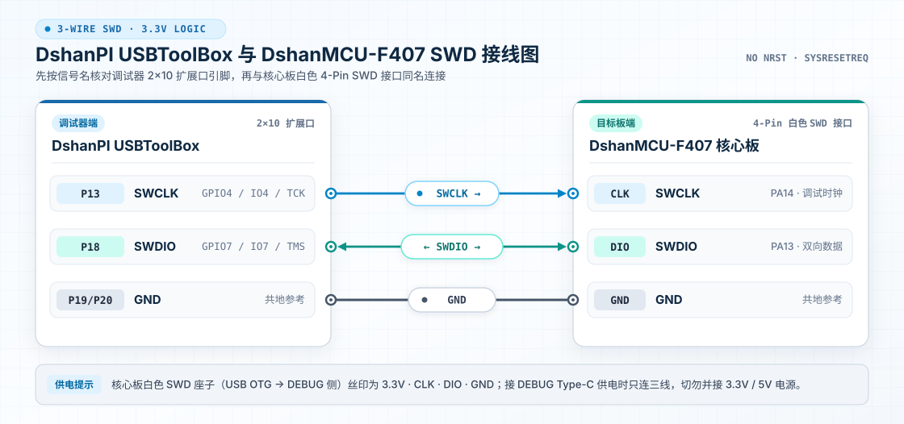
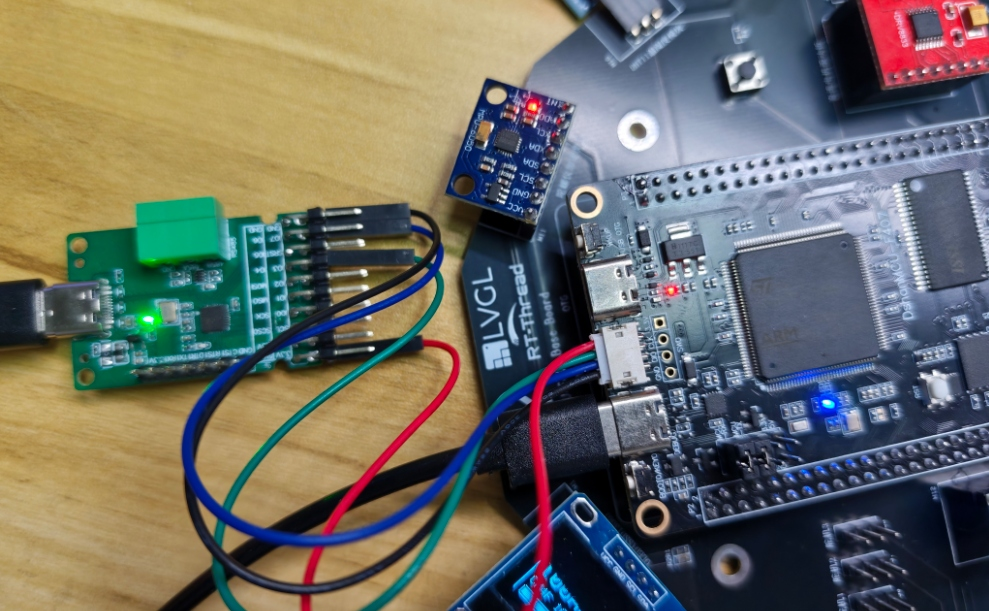
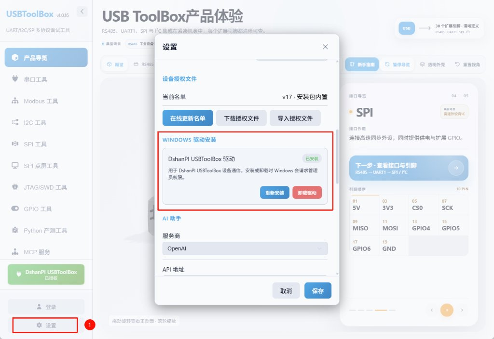
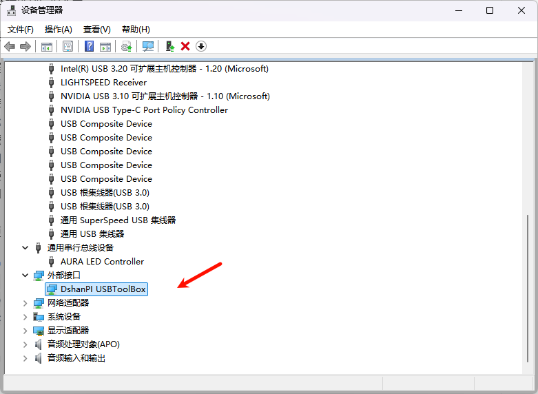

import CoreboardSwdMap from '@site/src/components/KitExplorer/CoreboardSwdMap';

# SWD 调试烧录硬件连接

开始烧录外设体验固件或后续工程调试前，需要按两路连接核心板：白色 SWD 接口连接 [DshanPI USBToolBox](https://dl.100ask.net/Tools/usbtoolsbox/) 用于烧录与调试，DEBUG Type-C 口接入电脑负责供电并引出板载日志串口。

:::info[完成后的可见结果]
1. Windows 设备管理器「外部接口」下出现 DshanPI USBToolBox，图标无感叹号；
2. 「端口（COM 和 LPT）」下能看到核心板 DEBUG Type-C 对应的 USB 串口；
3. 在 DshanPI USBToolBox 点击检测连接后，日志输出 `SWD DPIDR 0x2ba01477` 与 `Examination succeed`。
:::

## 认识核心板 SWD 与串口接口

DshanMCU-F407 核心板左侧的接口分布、串口跳线帽与复位按键如下图所示：

<CoreboardSwdMap />

| 通路 | 连接位置 | 主要作用 |
| --- | --- | --- |
| SWD 调试烧录 | 调试器 ↔ 核心板白色 4-Pin SWD 座子 | 烧录 `.hex` 固件与在线调试，接 CLK、DIO、GND 三线即可 |
| DEBUG Type-C | 电脑 USB ↔ 核心板 DEBUG Type-C 口 | 提供整板 5V 供电（超声波与电机必需）及 115200 8-N-1 日志串口 |

:::caution[接线前先断电，切勿并接两路电源]
先拔掉两头 USB 线再插拔杜邦线。使用 DEBUG Type-C 供电时，SWD 的 3.3V 引脚留空不接，切勿把调试器上的 3.3V 或 5V 并接到核心板供电脚。
:::

## 连接 DshanPI USBToolBox

DshanPI USBToolBox 不同批次的丝印可能标为 GPIO4 / GPIO7、IO4 / IO7 或引脚号 P13 / P18，接线以信号名为准：

| 调试器 2×10 扩展口 | 丝印别名 | 核心板 SWD 座子 | STM32F407 引脚 | 作用 |
| --- | --- | --- | --- | --- |
| P13 | GPIO4 / IO4 / TCK | CLK | PA14 | 调试时钟 |
| P18 | GPIO7 / IO7 / TMS | DIO | PA13 | 双向数据 |
| P19 或 P20 | GND | GND | GND | 共地参考 |

对照下方三线接线图与实物连接图完成接线：





<p className="image-caption">实物连接参考：通过 DEBUG Type-C 供电时，标准三线接法对应为 CLK → P13（GPIO4）、DIO → P18（GPIO7）、GND → P19/P20（线材颜色仅作示意，实际接线请认准信号名称与 PCB 丝印）。</p>

**上电顺序**：

1. 核对核心板 SWD 丝印的 CLK、DIO、GND 已准确连到调试器 P13、P18、P19/P20；
2. 先将 Type-C 数据线插入核心板 DEBUG 接口（确认 MCU-RX / MCU-TX 跳线帽处于短接状态）；
3. 再将 DshanPI USBToolBox 插入电脑 USB 口。

:::tip[使用 ST-Link 进行 CubeMX / Keil 开发？]
如果跟着「FreeRTOS 教程（CubeMX）」章节使用 Keil MDK + ST-Link 学习，可查看 [第 4 章 开发板使用](../../chapter4.md)。
:::

## 安装 Windows 驱动并验证设备

1. 从 [DshanPI USBToolBox 下载目录](https://dl.100ask.net/Tools/usbtoolsbox/) 安装最新上位机；首次启动会自动提示安装驱动，也可在左下角「① 设置 → WINDOWS 驱动安装」点击重新安装：



2. 重新插拔调试器后打开设备管理器：在「外部接口」下可看到 DshanPI USBToolBox（对应 SWD/JTAG 通道），在「端口（COM 和 LPT）」下可见核心板 DEBUG 串口及调试器串口：



也可在 PowerShell 执行以下命令检查调试器通道状态：

```powershell
Get-PnpDevice -PresentOnly |
  Where-Object InstanceId -match 'VID_1A86&PID_55DE' |
  Format-Table Class, FriendlyName, Status, InstanceId -AutoSize
```

| 设备匹配特征 | 功能说明 | 正常状态 |
| --- | --- | --- |
| `Class: WCH` / `MI_04` / `DshanPI USBToolBox` | SWD / JTAG 烧录调试接口 | OK |
| `Class: Ports` / `MI_02` / `DshanPI USBToolBox UART1` | 调试器扩展口串口（本教程日志走核心板 DEBUG 口，不用此口） | OK |
| `Class: Ports` / `MI_00` / `DshanPI USBToolBox RS-485 Port` | 调试器 RS-485 通道 | OK |

## 检测 SWD 连接与查看串口日志

打开 DshanPI USBToolBox，参照下图界面完成参数选择与连通性测试：


1. 确认软件左下角显示绿色「DshanPI USBToolBox 已授权」；
2. 左侧进入「JTAG/SWD 工具」，保持在「固件烧录」页签；
3. 芯片平台选择 ST / STM32，目标配置选择 STM32F4，通信速率保持 1 MHz；
4. 点击检测连接，底部日志出现下面三行即说明 SWD 就绪：

```text
Info : SWD DPIDR 0x2ba01477
Info : [stm32f4x.cpu] Cortex-M4 r0p1 processor detected
Info : [stm32f4x.cpu] Examination succeed
```

**查看核心板串口日志**：打开串口工具（或左侧「串口工具」），选择核心板 DEBUG Type-C 枚举出的 COM 端口，波特率设为 115200（8 数据位、无校验、1 停止位、无流控），按下核心板 RST 按键即可看到开机打印。

## 常见排错与完成检查

| 现象 | 常见原因 | 处理方式 |
| --- | --- | --- |
| 检测连接提示未发现目标 | CLK 与 DIO 接反、GND 漏接、核心板未上电或线材虚接 | 对照核心板丝印（3.3V · CLK · DIO · GND）重插 CLK、DIO、GND 三线，核对 P13/P18 无误 |
| 设备管理器带黄色感叹号 | Windows 驱动未装完或被旧设备缓存 | 在 USBToolBox 设置中点击重新安装驱动，再重插调试器 |
| 串口完全无打印 | 误插到 USB OTG 口、选错调试器串口号或跳线帽脱落 | 改插 DEBUG 口，确认 MCU-RX / TX 跳线帽短接，波特率设为 115200 8-N-1 |
| 曾烧过禁用 SWD 的程序连不上 | 旧程序关闭了 PA13 / PA14 调试引脚或进入低功耗 | 按住核心板 RST 键，在点击检测连接或开始烧录瞬间松开 |
| USB 反复掉线或线缆发烫 | 同时接了 DEBUG Type-C 与调试器电源脚，或电源反接 | 立即断开两头 USB，拆除 3.3V / 5V 电源杜邦线，只留 CLK、DIO、GND |

- [ ] 核心板已插好 DEBUG Type-C，且 MCU-RX / MCU-TX 跳线帽短接；
- [ ] DshanPI USBToolBox 的 P13 (CLK)、P18 (DIO)、P19/P20 (GND) 已正确连到核心板 SWD 座子；
- [ ] 设备管理器「外部接口」可见 DshanPI USBToolBox，且已确认 DEBUG 串口号；
- [ ] DshanPI USBToolBox 点击检测连接输出 `SWD DPIDR 0x2ba01477` 与 `Examination succeed`。

---

[上一篇：认识实验套件与固件汇总](../p1-00-认识实验套件/README.md) · [下一课：OLED 双色屏显示](../p1-01-OLED双色屏显示/README.md) · [DShanMCU-F407 · FreeRTOS](../../README.md)
