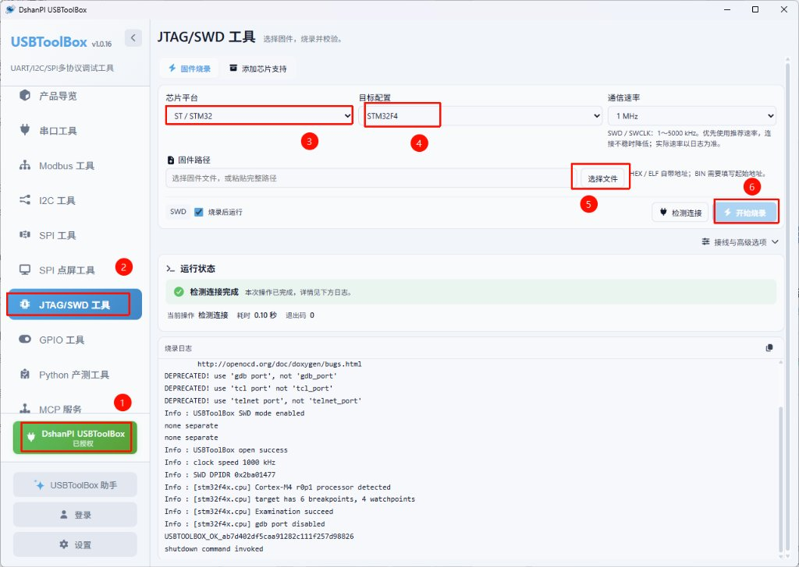

import KitExplorer from '@site/src/components/KitExplorer';

# 第 8 课：光敏电阻亮度采集

本课下载预编译固件 [`08_light_sensor_demo.zip`](https://dl.100ask.net/Hardware/MCU/DShanMCU-F407/firmware/08_light_sensor_demo.zip)（解压得 `08_light_sensor_demo.hex`）并通过 [`DshanPI USBToolBox`](https://dl.100ask.net/Tools/usbtoolsbox/) 烧录，快速体验底板 **M7** 插座上光敏电阻模块的环境亮度模拟量采集（`AO`）与可调电位器阈值中断（`DO`）。

## 硬件准备与接线

<KitExplorer focus="m7" />

将光敏电阻模块插入底板右下方的 **M7** 插座（3.3V）：

| 模块信号 | 底板 M7 插座 | STM32F407 引脚 | 说明 |
| --- | --- | --- | --- |
| `VCC` | `3.3V` | `3.3V` | 模块供电 |
| `GND` | `GND` | `GND` | 公共地 |
| `AO` | `ADC` | **PA3** (`ADC1_IN3`) | 模拟亮度分压输出（越亮电压越低，越暗电压越高） |
| `DO` | `DO / INT` | **PC0** (`EXTI0` 中断) | 模块蓝色电位器比较输出（`0=BRIGHT` 亮，`1=DARK` 暗） |

:::info[体验固件对 F407 核心板 Vref+ 的自动兼容说明]
部分批次 DshanMCU-F407 核心板将 STM32F407 的 `Vref+` 焊盘留空（`R32 = NC`），导致片上 `ADC1` 默认饱和在 `4095`。本体验固件在启动时会自动检测片内 `VREFINT`：若检测到 `Vref+` 正常则走硬件 `ADC1`；若检测到 `Vref+` 悬空，则无缝切换至利用 `M7` 模块自带滤波电容的 **PA3 时间域 RC 连续测光算法**，同样可精准输出 `0～3300 mV` 等效电压与 `BRI:0%～100%` 亮度值！
:::

## 下载并烧录体验固件

1. **下载并解压预编译固件**：点击下载 [`08_light_sensor_demo.zip`](https://dl.100ask.net/Hardware/MCU/DShanMCU-F407/firmware/08_light_sensor_demo.zip)，解压得到 `08_light_sensor_demo.hex`；
2. **使用 [`DshanPI USBToolBox`](https://dl.100ask.net/Tools/usbtoolsbox/) 烧录**：按图选择 **`ST / STM32`** -> **`STM32F4`** -> 加载 `08_light_sensor_demo.hex` -> 点击 **`开始烧录`**：



> 如需查阅 `PA3 (ADC1_IN3)` CubeMX 配置与源码细节，请见 **[5.16 光敏电阻模块驱动使用方法](../../chapter5.md#516-光敏电阻模块驱动使用方法)**。

## 预期现象与串口日志

烧录并运行后，观察 M1 OLED 屏幕、M7 模块指示灯与串口终端（`115200 8-N-1`）：

1. **M1 OLED 亮度仪表盘**：顶部黄区显示 `M7` 徽章与动态阈值状态 `LIGHT [BRIGHT]` 或 `LIGHT [DARK]`；底部蓝区居中大字号显示换算电压（如 `601 mV`），中排显示 `RAW:...` 与相对亮度 `BRI:82%`，底排为亮度进度条；
2. **光照遮挡与电位器测试**：
   - 用手捂住光敏电阻或用手机手电筒照射，观察电压 `mV` 与 `BRI:%` 灵敏跟随变化；
   - 用小十字螺丝刀慢拧 M7 模块上的**蓝色电位器**，可设定明暗分界阈值；当环境光跨越阈值时，核心板 **`LED1`** 点亮/熄灭，且 M1 OLED 顶部 `[BRIGHT]` / `[DARK]` 立即响应翻转；
3. **串口日志示例**：

```text
light_sensor_demo: M7 AO=PA3(ADC1_IN3) DO=PC0(EXTI0)
[LIGHT-DIAG] VREFINT_RAW=4095 (RC-TIME continuous mode (Vref+ floating))
[LIGHT] raw= 745 ( 601 mV, BRI=82%) DO=0 (BRIGHT) [rc tf=213.2us tr=0.0us]
[LIGHT] raw=3780 (3045 mV, BRI= 8%) DO=1 (DARK) [rc tf=1680.5us tr=0.0us]
```

## 常见问题排查

| 现象 | 排查方向 |
| --- | --- |
| 遮挡光敏电阻时亮度百分比变化正常，但 M7 上的指示灯频闪或 `DO` 不翻转 | 用螺丝刀轻微顺时针或逆时针微调 M7 上的蓝色电位器，使比较器门槛脱离临界抖动区 |
| 暗光环境屏幕刷新略变慢 | 属固件防闪烁节能优化：暗光稳态每 `500 ms` 采样一次减少电容充放电对 M7 指示灯造成的微闪，一旦触发 `PC0 (EXTI0)` 或照亮会在 `1 ms` 内立即唤醒 |

---

[上一课：MPU6050 六轴姿态采集](../p1-07-MPU6050六轴姿态采集/README.md) · [下一课：旋转编码器与按键](../p1-09-旋转编码器与按键/README.md) · [课程首页](../../README.md)
