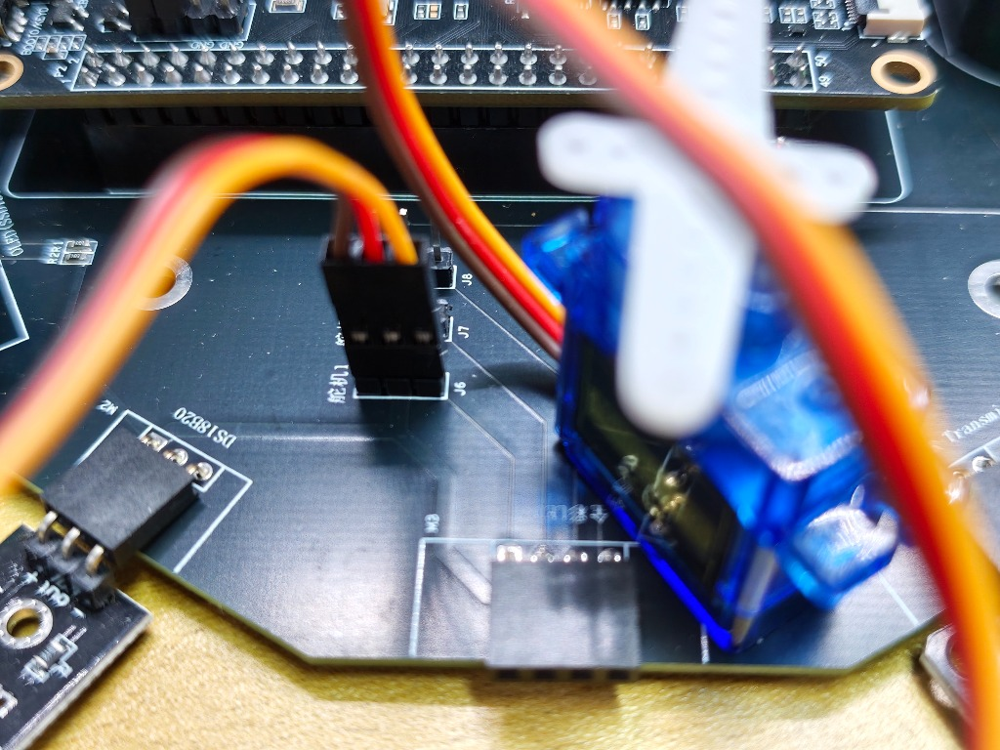

import KitExplorer from '@site/src/components/KitExplorer';

# 第 14 课：SG90 舵机角度控制

本课下载预编译固件 [`14_servo_demo.zip`](https://dl.100ask.net/Hardware/MCU/DShanMCU-F407/firmware/14_servo_demo.zip)（解压得 `14_servo_demo.hex`）并通过 [`DshanPI USBToolBox`](https://dl.100ask.net/Tools/usbtoolsbox/) 烧录，快速体验底板核心板左侧 **J6 / J7 / J8（舵机 1～3）** 三路排针的 `50 Hz PWM（500～2500 us）` `0°～180°` 舵机角度精准控制。

:::warning[实验前建议拔除 M3 全彩 LED 模块]
**J6 / J7 / J8（舵机 1～3）** 与左侧 **M3（RGB 全彩 LED）** 共用 **`PA5 / PA1 / PA2 (TIM2_CH1~3)`**。接舵机前建议先拔除 M3 全彩 LED，避免 LED 分流拉低 PWM 信号电平导致舵机抖动或无响应。
:::

## 硬件准备与接线

<KitExplorer focus="servo" />

将 9g SG90 舵机的 3 针杜邦线接入底板左内侧的 **J6（舵机1）**、**J7（舵机2）** 或 **J8（舵机3）** 排针（三路输出同步扫角）：

| 舵机排针位置（正面看底板从上到下） | 舵机常见线色 | 底板网络 | STM32F407 引脚 | 说明 |
| --- | --- | --- | --- | --- |
| **上针**（靠近「舵机」字样） | **棕色 / 黑色** | `GND` | `GND` | 舵机电源地 |
| **中针** | **红色** | `VCC_3V3` | `3.3V` | 仅限 9g 小舵机空载直接测试 |
| **下针**（靠近 `J6~8` 字样） | **橙色 / 黄色** | `PWM` | `J6=PA5` / `J7=PA1` / `J8=PA2` | `TIM2_CH1~3` 50 Hz（20 ms 周期）控制信号 |

实物接线参考如下（图中将 SG90 舵机接入 `J6 / 舵机1`：靠近「`舵机1`」字样一侧为**棕线 `GND`**，中间为**红线 `VCC`**，靠近「`J6`」字样一侧为**橙/黄线 `PWM`**，同时 `M3` 全彩 LED 插座保持拔除空置）：



> 如需驱动大扭矩金属齿舵机或带载运行，建议由外部 `5V` 电源单独给舵机红黑线供电，并将外接电源负极与底板 `GND`（上针）共地，仅将橙/黄信号线接入底板下针 `PWM`。

## 下载并烧录体验固件

1. **下载并解压预编译固件**：点击下载 [`14_servo_demo.zip`](https://dl.100ask.net/Hardware/MCU/DShanMCU-F407/firmware/14_servo_demo.zip)，解压得到 `14_servo_demo.hex`；
2. **使用 [`DshanPI USBToolBox`](https://dl.100ask.net/Tools/usbtoolsbox/) 烧录**：按图选择 **`ST / STM32`** -> **`STM32F4`** -> 加载 `14_servo_demo.hex` -> 点击 **`开始烧录`**：


> `J6~J8` 与 M3 RGB 共用 `TIM2_CH1~3`，定时器和 PWM 配置思路可参考 **[5.15 RGB 全彩 LED 模块驱动使用方法](../../chapter5.md#515-rgb全彩led模块驱动使用方法)**。
> 若使用 CMake 原生 FreeRTOS 工程编译修改源码，应用入口见 `applications/servo_demo/src/main.c`，驱动代码见 `platform/modules/mod_servo.c`（详见 [servo_demo 源码解析](../../cmake/demos/d18-servo/README.md) 与 [编译、烧录与调试](../../cmake/c02-build-flash-debug/README.md)）。

## 预期现象与串口日志

烧录并运行后，观察舵机摆臂转动、M1 OLED 屏幕与串口终端（`115200 8-N-1`）：

1. **自动循环扫角**：上电后三路接口每 `900 ms` 步进转动一次，序列为 `0° -> 45° -> 90° -> 135° -> 180° -> 135° -> 90° -> 45°`（对应高电平脉宽 `500 us` ～ `2500 us`，每次动作核心板 `LED1` 翻转）；
2. **按键切换手动定位**：按下底板 **`K1 (PB1)`** 或核心板 **`KEY0 (PE3)`**，切为手动模式（OLED 标题变为 `SERVO [STEP]`），每按一次精准步进下一个标准角度，方便测试或安装舵机摆臂零点；
3. **M1 OLED 仪表盘与串口日志**：屏幕大字号居中显示 `90 deg`，下方显示 `PWM:1500us 50Hz` 与 `0°~180°` 进度条：

```text
servo_demo: J6(PA5)/J7(PA1)/J8(PA2) 50Hz PWM, press K1/KEY0 to step
[SERVO] angle=  0 deg pulse=500 us (AUTO)
[SERVO] angle= 45 deg pulse=1000 us (AUTO)
[SERVO] angle= 90 deg pulse=1500 us (AUTO)
[SERVO] angle=135 deg pulse=2000 us (MANUAL)
```

## 常见问题排查

| 现象 | 排查方向 |
| --- | --- |
| 舵机抖动、发热或根本不转 | 1. 核对 3 针插头方向：**棕/黑线必须朝上（靠近「舵机」丝印），橙/黄信号线必须朝下（靠近 `J6~8`）**；<br/>2. 确认左侧 **M3 RGB 全彩 LED** 已拔除 |
| 多路大舵机同时转动时核心板复位 | 3.3V 板载 LDO 电流余量有限，多路或带负载舵机请改用外接 `5V` 电源单独供电并与底板共地 |

---

[上一课：DRV8833 直流电机驱动](../p1-13-DRV8833直流电机驱动/README.md) · [下一步：FreeRTOS 工程开发（CMake）](../../cmake/c01-workspace-setup/README.md) · [课程首页](../../README.md)
